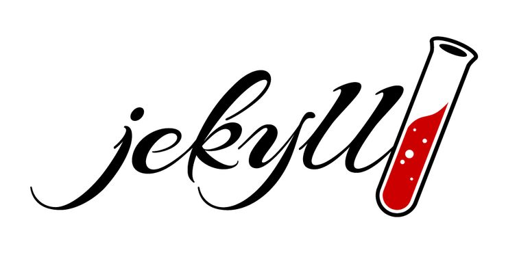
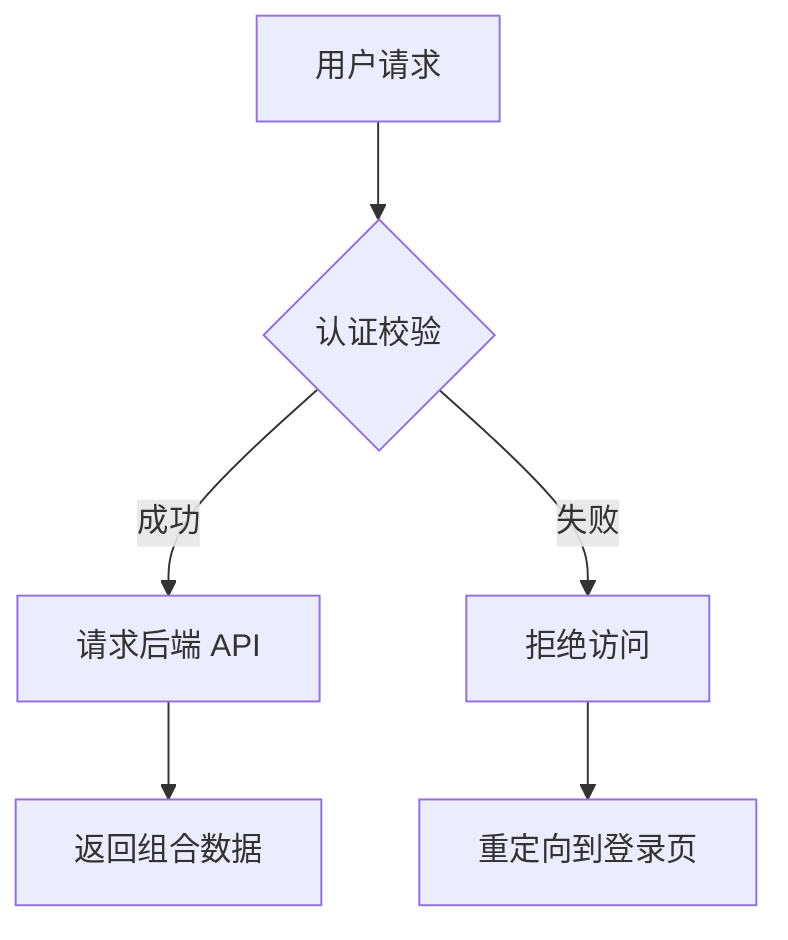

这篇文章展示了 Jekyll（基于 kramdown 解析器）所支持的绝大多数 markup 语法，用于测试主题样式或作为撰写文章的参考规范。

## 1. 基础排版 (Text Formatting)

这是普通的段落文本。你可以在段落中使用 **粗体文本**、*斜体文本*、***粗斜体***，或者删除线~~被划掉的内容~~。
还可以使用 `标记代码` (inline code)，或者添加脚注来补充说明[^1]。

通过 Kramdown 缩写扩展，你可以定义缩写，例如鼠标悬停在 HTML 上会显示全称。

*[HTML]: Hyper Text Markup Language

## 2. 标题层级 (Headings)

### 三级标题 (H3)

#### 四级标题 (H4)

##### 五级标题 (H5)

###### 六级标题 (H6)

> **技巧**：Jekyll 支持通过 `{: #custom-id}` 显式为标题自定义 ID。
{: #custom-heading-section}

## 3. 列表 (Lists)

### 无序列表

 * 顶级列表项 A
   * 二级列表项 A1
   * 二级列表项 A2
 * 顶级列表项 B
 * 顶级列表项 C

### 有序列表

 1. 第一步：准备 Jekyll 环境
 2. 第二步：编写 Markdown 文件
 3. 第三步：运行 `jekyll serve` 构建

### 任务列表 (Task Lists)

 * [x] 完成 Jekyll 配置文件设置
 * [x] 撰写示例 Markdown 文章
 * [ ] 部署到 GitHub Pages

## 4. 引用与块级元素 (Blockquotes)

> 这是一个单行块级引用 (Blockquote)。
> 
> > 这是一个嵌套的引用块。
> > 可以在这里提供出处或引申信息。

## 5. 代码高亮 (Code Blocks)

Jekyll 支持通过标准的 Markdown 语法高亮代码块。并且我们启用了 Rouge 的行号显示：

```javascript
// JavaScript 示例
function greet(name) {
    console.log(`Hello, ${name}! Welcome to Jekyll.`);
}

greet('Developer');
```

同时，Jekyll 原生支持 Liquid 的 `highlight` 标签：


# Python 示例
def calculate_factorial(n):
    if n == 0:
        return 1
    return n * calculate_factorial(n - 1)

print(f"Factorial of 5: {calculate_factorial(5)}")


### Diff 差异对比代码块 (Material Design 3 Diff & Patch)

主题原生支持 **Material Design 3 风格的高性能 Diff 差异高亮与多语言语法高亮共存**。自动统计并展示新增与删除行数徽标，区分注释段落与代码变更，行号与行高 100% 像素级对齐，并支持全宽行级柔和背景过渡：

#### 1. 编程语言语法高亮 + Diff 共存 (`Python[diff]`)

在任意语言标识符后追加 `[diff]`（如 `Python[diff]`、`js[diff]`、`cpp[diff]`、`rust[diff]`），即可在保留完整语言语法高亮（关键字、函数、字符串等着色）的同时，完美应用行级 Diff 增删对比：

```Python[diff]
def calculate_discount(price: float, is_member: bool) -> float:
-   if is_member:
-       # 普通老会员 9 折
-       return price * 0.9
+   if is_member:
+       # VIP 尊享会员全面升级为 8 折
+       return price * 0.8
    return price
```

#### 2. 无语法高亮的纯文本 Diff (`txt[diff]`)

使用 `txt[diff]` 或 `text[diff]`，可以展示干净纯粹的纯文本差异对比，支持 `#` 注释段落识别与行列统计：

```txt[diff]
# 原始字节: 商业售卖模式 (False)
- Offset 0x860cf1c0: 00
- Offset 0x860cf208: 00
- Offset 0x860cf24c: 00

# 补丁字节: 原生测试全免模式 (True)
+ Offset 0x860cf1c0: 01
+ Offset 0x860cf208: 01
+ Offset 0x860cf24c: 01
```

#### 3. 标准 Unified Patch / Diff (`diff`)

```diff
@@ -10,6 +10,7 @@
  import asyncio
  import aiohttp
+ import orjson
 
  async def fetch_user_data(user_id: int):
-     return await legacy_fetch(user_id)
+     return await optimized_fetch(user_id)
```

## 6. 表格 (Tables)

这里展示了一个标准对齐方式的表格。

| 过滤器/属性 | 说明 | 示例输入 | 示例输出 |
|:---|:---|:---:|---:|
| `date_to_string` | 日期转为字符串 | `site.time` | 01 Aug 2026 |
| `upcase` | 字符转大写 | `"hello"` | HELLO |
| `size` | 获取数组或字符串长度 | `page.tags` | 4 |

## 7. 链接与媒体 (Links & Media)

 * [访问 Jekyll 官网](https://jekyllrb.com/){: target="_blank" rel="noopener"} *(含 Kramdown 扩展属性)*
 * [跳转到本文的特殊标题](#custom-heading-section) *(内部锚点)*

### 图片展示


*图：展示支持图片说明文本的效果*

## 8. Jekyll 特有扩展 (kramdown & Liquid)

### 属性列表 (Attribute Lists)

你可以直接给下一个元素添加 CSS 类名或内联样式：

这是一个带有自定义 CSS 类和背景样式的警告段落。
{: style="padding: 16px; border-left: 4px solid #f0ad4e; background: rgba(240, 173, 78, 0.1); border-radius: 4px;"}

### 定义列表 (Definition Lists)

Jekyll / Liquid
: 基于 Ruby 的静态网站生成器。

kramdown
: Jekyll 默认使用的 Markdown 解析引擎，支持丰富的扩展语法。
: 可以有多个解释。

### 数学公式 (LaTeX)

如果你的主题引入了 MathJax/KaTeX，可以渲染数学公式：

$$
E = mc^2
$$

### Liquid 变量调用示例

 * **本篇文章标题**：{{ page.title }}
 * **文章发布时间**：{{ page.date | date: "%Y年%m月%d日" }}
 * **标签数量**：{{ page.tags | size }} 个

## 9. GitHub Alerts (提示框)

我们通过自研的 AST 转换插件，原生支持了 GitHub 风格的 Alerts。在段落前加上 `> [!NOTE]` 等标记即可触发：

> [!NOTE]
> 这是一个 Note 提示框。用于强调一般性的补充信息。

> [!TIP]
> 这是一个 Tip 提示框。用于提供有用的建议或快捷方式。

> [!IMPORTANT]
> 这是一个 Important 提示框。用于向用户传达实现其目标必不可少的关键信息。

> [!WARNING]
> 这是一个 Warning 提示框。用于提醒用户注意潜在的风险。

> [!CAUTION]
> 这是一个 Caution 提示框。用于警告可能导致数据丢失或严重后果的高危操作。

## 10. 可折叠详情区 (Details & Summary)

你可以直接使用原生 HTML 的 `<details>` 和 `<summary>` 标签来包裹长文本或超长代码。我们已经为其适配了 MD3 风格的展开面板样式。

> [!TIP]
> 如果你想在 `<details>` 内部继续使用 Markdown 语法（如代码块、加粗等），必须在 `<details>` 标签上添加 `markdown="1"` 属性，并且在 `<summary>` 和内容之间**留一个空行**。

<details markdown="1">
<summary><b>点击展开查看详细构建日志</b></summary>

```bash
$ bundle exec jekyll build
Configuration file: /workspace/_config.yml
            Source: /workspace
       Destination: /workspace/_site
 Incremental build: disabled. Enable with --incremental
      Generating... 
       Jekyll Feed: Generating feed for posts
                    done in 0.548 seconds.
 Auto-regeneration: disabled. Use --watch to enable.
```

日志显示构建成功。
</details>

## 11. Mermaid 原生图表引擎

本博客内置了高性能、**按需懒加载 (Lazy Load)** 的 Mermaid 渲染支持。你只需要用标准的代码块并指定语言为 `mermaid` 即可绘制流程图、时序图、甘特图等。



## 12. 颜色色块自动预览 (Color Swatches)

在技术博客中，我们经常会讨论到颜色代码。现在，只要你在行内代码中写入规范的颜色值，系统就会自动在旁边生成一个 MD3 风格的圆形色块进行预览。

支持 HEX、RGB(A) 和 HSL(A) 格式：

* 主色调使用 `#FF5733` 或 `#0061A4`
* 也可以带透明度，比如 `#0061A480`
* 或者使用 `rgb(52, 152, 219)` 和 `rgba(52, 152, 219, 0.5)`
* HSL 同样支持：`hsl(120, 100%, 25%)`

## 13. 3D 模型原生渲染 (STL, GLTF & GLB)

现在你可以直接在博客中交互预览多种 3D 模型格式（包括 STL、GLTF 与 GLB）。只需将 3D 数据或模型路径包裹在对应的代码块中，前端的三维引擎会自动将其渲染为可通过鼠标或手势拖拽旋转、支持物理光照材质的三维视口，完美契合 MD3 质感。

### 13.1 STL 基础立方体渲染演示

```stl
solid cube
  facet normal 0 0 -1
    outer loop
      vertex 0 0 0
      vertex 1 1 0
      vertex 1 0 0
    endloop
  endfacet
  facet normal 0 0 -1
    outer loop
      vertex 0 0 0
      vertex 0 1 0
      vertex 1 1 0
    endloop
  endfacet
  facet normal 0 0 1
    outer loop
      vertex 0 0 1
      vertex 1 0 1
      vertex 1 1 1
    endloop
  endfacet
  facet normal 0 0 1
    outer loop
      vertex 0 0 1
      vertex 1 1 1
      vertex 0 1 1
    endloop
  endfacet
  facet normal 0 -1 0
    outer loop
      vertex 0 0 0
      vertex 1 0 0
      vertex 1 0 1
    endloop
  endfacet
  facet normal 0 -1 0
    outer loop
      vertex 0 0 0
      vertex 1 0 1
      vertex 0 0 1
    endloop
  endfacet
  facet normal 0 1 0
    outer loop
      vertex 0 1 0
      vertex 0 1 1
      vertex 1 1 1
    endloop
  endfacet
  facet normal 0 1 0
    outer loop
      vertex 0 1 0
      vertex 1 1 1
      vertex 1 1 0
    endloop
  endfacet
  facet normal -1 0 0
    outer loop
      vertex 0 0 0
      vertex 0 0 1
      vertex 0 1 1
    endloop
  endfacet
  facet normal -1 0 0
    outer loop
      vertex 0 0 0
      vertex 0 1 1
      vertex 0 1 0
    endloop
  endfacet
  facet normal 1 0 0
    outer loop
      vertex 1 0 0
      vertex 1 1 0
      vertex 1 1 1
    endloop
  endfacet
  facet normal 1 0 0
    outer loop
      vertex 1 0 0
      vertex 1 1 1
      vertex 1 0 1
    endloop
  endfacet
endsolid
```

### 13.2 动态 JS 场景构建 (stljs)

> [!TIP]
> **引用外部文件与现场 JS 渲染** 🎨
> 如果模型文件太大，你不需要将冗长的代码直接贴在文章里。你可以在 `stl` 中直接写入本地 STL 文件的路径（如 `/assets/models/example.stl`）或外部 URL，渲染器会自动去下载并解析。
> 
> 此外，我们还支持一种更硬核的极客玩法：使用 `stljs` 代码块。这允许你**直接编写 JavaScript 三维场景构建代码**！在代码内部，你已经拥有了预置好的 `THREE`, `scene`, 和 `material`。例如，下面是一段召唤一组抽象几何体的代码：

```stljs
const mesh = new THREE.Group();

const cylGeo = new THREE.CylinderGeometry(8, 8, 40, 32);
const cyl = new THREE.Mesh(cylGeo, material);
cyl.position.y = 20;
mesh.add(cyl);

const sphGeo = new THREE.SphereGeometry(12, 32, 32);
const sph1 = new THREE.Mesh(sphGeo, material);
sph1.position.set(-10, 0, 0);
mesh.add(sph1);

const sph2 = new THREE.Mesh(sphGeo, material);
sph2.position.set(10, 0, 0);
mesh.add(sph2);

// 为自动缩放镜头设置一个虚拟的包裹盒
mesh.geometry = new THREE.BoxGeometry(40, 60, 24);
mesh.geometry.computeBoundingBox();

scene.add(mesh);
```

### 13.3 进阶 3D 格式：GLTF / GLB 原生渲染与骨骼动画 (GLTF / GLB with PBR & Animations)

除了传统的单一网格 STL 格式外，本主题现已全面升级，支持工业级 **GLTF 2.0 / GLB 3D 模型格式**。

#### 核心渲染特性
* **PBR 真实感物理渲染**：完整支持粗糙度、金属度、法线贴图、环境反射与自发光材质；
* **电影级打光与色调映射**：启用 ACESFilmic 色调映射（Tone Mapping），结合柔和半球环境光与主次平行漫反射光源；
* **骨骼动画 (Skeletal Animation)**：内置 `THREE.AnimationMixer`，自动检测并实时循环播放模型内嵌的骨骼骨骼动画或变形目标（Morph Targets）；
* **视锥自适应与全触控轨道控制**：基于模型的包围盒（Bounding Box）自动计算中心锚点与相机视距，支持 PC 端鼠标拖拽、滚轮缩放与移动端双指手势平移旋转。

#### 语法示例
在 Markdown 中使用 `glb` 或 `gltf` 代码块，内部写入模型绝对路径或外部 URL（也支持内联嵌入标准 GLTF JSON 字符串）：

````markdown
```glb
/assets/models/ori_and_the_blind_forest.glb
```
````

#### 效果展示

```glb
/assets/models/ori_and_the_blind_forest.glb
```

> [!NOTE]
> **模型资产归属与开源许可声明**：
> "Ori and the Blind Forest" (https://skfb.ly/otELU) by Dasha Klyusova is licensed under Creative Commons Attribution (http://creativecommons.org/licenses/by/4.0/).

## 14. GeoJSON 交互式地图

同样地，地图数据也能原生渲染！只需要使用 `geojson` 或 `topojson`。系统会懒加载 Leaflet + MapLibre GL 矢量地图组件，将坐标系精确绘制在全球地图上（使用 OpenFreeMap 极简风格矢量底图），并自动计算最佳缩放视角。

> [!TIP]
> **坐标点 (Point) 和 范围 (Polygon)**
> 只要在 Markdown 里写上 `geojson` 代码块，渲染器会自动分别生成独立的地图，并且自适应缩放到最合适的观看距离。你可以点击图元查看附带的 Properties 属性。

### 示例 1：单点坐标 (Point)

```geojson
{
  "type": "FeatureCollection",
  "features": [
    {
      "type": "Feature",
      "geometry": {
        "type": "Point",
        "coordinates": [121.4442, 31.1895]
      },
      "properties": {
        "name": "宛平南路600号 (Point)",
        "description": "上海市精神卫生中心"
      }
    }
  ]
}
```

### 示例 2：范围多边形 (Polygon)

```geojson
{
  "type": "FeatureCollection",
  "features": [
    {
      "type": "Feature",
      "geometry": {
        "type": "Polygon",
        "coordinates": [
          [
            [116.38, 39.90],
            [116.42, 39.90],
            [116.42, 39.93],
            [116.38, 39.93],
            [116.38, 39.90]
          ]
        ]
      },
      "properties": {
        "name": "故宫范围 (Polygon)",
        "description": "这是一个自定义的多边形"
      }
    }
  ]
}
```

## 15. 键盘按键风格渲染 (Keyboard Input)

在编写技术文档、快捷键说明时，你可以使用原生 `<kbd>` 标签。我们为其量身定制了微立体质感的物理键帽样式，这让快捷键的指引在视觉上更加清晰且极具质感。

* 快速打开命令面板：<kbd>Ctrl</kbd> + <kbd>Shift</kbd> + <kbd>P</kbd>
* 保存文件并退出：<kbd>Win</kbd> + <kbd>S</kbd> 然后按 <kbd>Esc</kbd>
* 在终端中止当前进程：<kbd>Ctrl</kbd> + <kbd>C</kbd>

## 16. 文件下载卡片 (File Download Card)

如果你需要提供 Cloudflare R2 或者其他云存储的外部文件下载链接，不要使用干瘪的普通超链接。Jekyll 原生支持 Liquid `include` 标签，我们为你定制了一个 MD3 风格的下载展示 UI。

你只需要在文章中插入：
```liquid



```

**实际渲染效果：**





## 17. 媒体相册与全屏灯箱 (MD3 Gallery & Lightbox)

在撰写博客时，经常需要展示多张照片、截图或是演示视频。为了提供最优雅的浏览体验，本博客最新引入了 **自动相册 (Smart Gallery)** 与 **全屏悬浮灯箱 (MD3 Lightbox Viewer)** 功能。

### 自动组合的智能相册 (Smart Gallery)

你不需要在 Markdown 中书写任何复杂的 HTML 代码。**只要你将多张图片连续放置（即换行连续写 ``，且中间不穿插其他文本），底层的引擎就会在页面加载时，自动识别并将它们打包成一个高级相册组件。**

生成的相册具有以下特性：
- **上大图、下缩略图**：采用现代化的 `16:9` 黄金比例展示主视图，下方提供可横向滑动的缩略图列表。
- **无缝切换动画**：点击下方缩略图时，主视图会执行流畅的淡入淡出（Crossfade）切换动画，避免生硬的画面闪烁。
- **MD3 设计语言**：选中的缩略图会有一圈柔和的强调色边框（Primary Color），并且带有细微的不透明度渐变反馈。

下面是一个由 5 张图组成的相册示例，你可以点击下方的小图进行切换：


### 全屏沉浸式灯箱查看器 (Lightbox Viewer)

不仅相册里的大图可以点击，即便是文章中单独出现的一张图片，当你点击它时，都会立即唤出一个沉浸式的全屏灯箱。

> [!TIP]
> **操作指南**：
> 1. **缩放**：在全屏状态下，你可以直接使用鼠标滚轮进行无级缩放。或者点击右上角的 🔍 放大/缩小按钮。
> 2. **拖拽平移**：当图片被放大后，你可以按住鼠标左键（或在手机上使用手指）随意拖动图片，查看细节。
> 3. **快捷键切换**：如果你是在相册中打开了灯箱，可以使用键盘上的 <kbd>←</kbd> 左箭头 和 <kbd>→</kbd> 右箭头 快速翻页。
> 4. **退出**：点击右上角的关闭按钮、点击背景黑色模糊区域，或者直接按下键盘上的 <kbd>Esc</kbd> 键即可退出全屏。

为了展示这个效果，这里有一张孤立的宽幅图片，点击它感受一下毛玻璃背景（Backdrop Blur）衬托下的极致阅图体验吧：


---

## 18. Liquid 进阶语法 (Liquid Advanced Syntax)

除了前面展示的基础变量和部分功能外，Liquid 还是一个非常成熟的模板控制引擎。通过以下进阶语法，你可以让你的静态博客拥有极强的动态生成能力。

### 18.1 逻辑控制 (Control Flow)

Liquid 允许你在 Markdown 中进行各种逻辑判断，这在编写复杂的主题模板或根据条件显示特定内容时非常有用。

#### if / elsif / else 与 unless
`unless` 是 `if` 的反面，当条件为假时执行。

```liquid


  <p>评论功能已开启！快来留言吧。</p>

  <p>这是一篇特殊文章。</p>

  <p>默认内容。</p>



  <p>这篇文章不是草稿，已向公众展示。</p>


```

#### case / when
当你需要检查一个变量是否有多个特定值时：

```liquid



  
    <p>汪汪！</p>
  
    <p>喵喵！</p>
  
    <p>未知动物。</p>


```

### 18.2 循环与遍历 (Iteration)

你可以使用 `for` 循环遍历数组，或者直接迭代一定次数。这在生成文章列表、标签页时必不可少。

#### 基础遍历与限制
```liquid

<!-- 遍历标签数组，只输出前两个 -->
<ul>

  <li>标签: {{ tag }}</li>

</ul>

<!-- 循环固定次数，或者反向循环 -->

  <p>倒计时：{{ i }}</p>


```

#### Cycle (轮流输出)
在循环中非常有用的语法，可以在每次迭代时交替输出不同的类名或字符串，通常用于给列表的奇偶行加上不同的颜色：
```liquid


  <div class="">项目 {{ i }}</div>


```

#### Tablerow (自动生成 HTML 表格)
`tablerow` 可以自动帮你把一维数组渲染为 HTML 的 `<table>` 元素。
```liquid

<table>

  {{ tag }}

</table>

```

### 18.3 变量操作与逃逸 (Variables & Raw)

#### assign 与 capture
`assign` 用于单行变量赋值，而 `capture` 可以把一大块包含 Liquid 渲染内容的块级元素打包存进一个变量里。

```liquid




  <div style="color: {{ primary_color }}">
    <h4>注意</h4>
    <p>这是被捕获的一段复杂 HTML 文本。</p>
  </div>


<!-- 在其他地方输出被捕获的内容 -->
{{ alert_html }}

```

#### 原样输出 (Raw) 与 注释 (Comment)
如果你正在写技术博客教别人怎么用 Liquid（就像本文一样），你可以用 `raw` 让 Liquid 停止解析大括号。用 `comment` 则可以写只在源码可见、连编译后的 HTML 里面都不会出现的极密注释。

{% assign open_tag = '
' %}


```liquid
{{ open_tag }} raw {{ close_tag }}
这里面的 {{ open_var }} 不会被解析 {{ close_var }}，{{ open_tag }} include 也会失效 {{ close_tag }}。
{{ open_tag }} endraw {{ close_tag }}

{{ open_tag }} comment {{ close_tag }}
这个注释在 `jekyll build` 的时候会被彻底抹去，用户 F12 绝对看不到。
{{ open_tag }} endcomment {{ close_tag }}
```

### 18.4 丰富的过滤器 (Filters)

过滤器用于修改变量的输出结果，你可以用管道符 `|` 把它们串联起来。

```liquid

* **转为大写**: {{ "hello world" | upcase }} => HELLO WORLD
* **首字母大写**: {{ "hello world" | capitalize }} => Hello world
* **去除 HTML 标签**: {{ "<b>粗体</b>" | strip_html }} => 粗体
* **截断字符**: {{ "这是一段非常长的测试文本，超过长度会被截断。" | truncate: 12, "..." }} => 这是一段非常长...
* **默认值后备**: {{ page.author | default: "佚名" }} => 佚名
* **获取数组首项**: {{ page.tags | first }}

```

### 18.5 Jekyll 专属超级链接 (Post ID & Link)

在文章中插入站内链接时，千万不要把 URL 写死。推荐使用我们扩展的 `post_id` 标签，只需传入文章 Front Matter 中定义的 `id`（例如 `demo`、`a8c9n3`、`v69yxm`），系统会自动解析并生成固定链接路由，哪怕未来你调整了目录结构或日期，站内链接也**永远不会失效/404**：

```liquid

<!-- 极简推荐：直接传入文章的 id，写作体验极其顺畅！ -->
[了解 Jekyll 语法展示]()

<!-- 也支持锚点跳转 -->
[跳转到特定章节]()

<!-- 兼容旧版 post_url 直接传 id 或文件名 -->
[历史语法兼容]()

<!-- 链接到普通页面或静态资源文件 -->
[下载这张图片]()

```

---

## 19. 定制化媒体播放器 (MD3 Player)

Antigravity 主题支持自动拦截浏览器原生的 `<video>` 和 `<audio>` 标签，并将其替换为符合 Material Design 3 (MD3) 设计规范的毛玻璃风格自定义播放器。

只需在插入音视频时带有 `controls` 属性，系统便会自动接管。

### 视频播放器 (Video)
带有全屏支持和底部悬浮控制栏的响应式视频播放器：

<video src="/assets/videos/rickroll.mp4" controls></video>

### 音乐播放器 (Audio)
简洁美观的内嵌式音频播放栏，支持丝滑的进度拖拽：

<audio src="/assets/audios/Record_Makers_Kavinsky_Testarossa_Autodrive_Official_Audio.mp3" controls
       data-title="Testarossa Autodrive"
       data-artist="Kavinsky"
       data-album="Teddy Boy"
       data-cover="https://i.scdn.co/image/ab67616d0000b2732d2f53ca63206d3dd852f250">
</audio>

<audio src="/assets/audios/Record_Makers_Kavinsky_Nightcall_Drive_Original_Movie_Soundtrack.mp3" controls
       data-title="Nightcall"
       data-artist="Kavinsky"
       data-album="Nightcall"
       data-cover="https://i.scdn.co/image/ab67616d0000b273d6d8c2eaa1f9031b62f7a3f7">
</audio>

**RIP Kavinsky**

<audio src="https://zgqinc.gq/music/Running_in_the_Night-FM-84&Ollie_Wride.mp3" controls
       data-title="Running in the Night"
       data-artist="FM-84 & Ollie Wride"
       data-album="Atlas"
       data-cover="https://zgqinc.gq/music/Running_in_the_Night-FM-84&Ollie_Wride.png">
</audio>

<audio src="https://zgqinc.gq/music/The_Midnight&Timecop1983-River_of_Darkness_(feat._Timecop1983).mp3" controls
       data-title="River of Darkness (feat. Timecop1983)"
       data-artist="The Midnight & Timecop1983"
       data-album="Nocturnal">
</audio>

### 自定义大字号文本 (Custom Size Markup)

如果你想在正文中展示一些极具视觉冲击力的超大文本，又不想使用原生的 Markdown 标题标签（比如 `<h1>` 会导致被强制收录到侧边栏目录中），你可以使用我们独创的 `[size:xx]` 语法。

> [!TIP]
> **语法支持**
> 
> `[size:你的大小]大文本内容[/size]`
> 
> 只要标签内部有换行，它就会被渲染成占据全宽的块级大字体段落，否则将作为行内文本。

**示例展示：**

这是一个内联的巨大文本 [size:3rem]HELLO[/size] 测试。

[size:4rem]
这是一个跨行的大字号块级文本！
支持 Markdown 原生语法：**加粗**，*斜体*，[链接](#)
[/size]
[size:80px]
甚至可以使用像素单位 (80px) 来实现更夸张的效果。
[/size]

## 20. 丰富的链接预览卡片 (Rich Link Previews)

无论是指向本站的其他文章，还是指向站外的第三方链接，你都可以通过在 Markdown 链接末尾加上 `{: .preview }` 属性，让编译器自动在构建时抓取目标网站的信息，并生成一个极具质感、符合 MD3 规范的链接预览卡片（类似 Telegram 或 Twitter 的富文本链接）。

### 内链卡片预览
自动读取本站文章的标题、摘要和头图。直接使用 `` 即可，构建速度极快且无需查找冗长的文件路径：
```markdown
[点击查看：MD3 博客主题发布！](){: .preview }

[点击查看：指定的内链文章](){: .preview }
```
**效果：**
[点击查看：MD3 博客主题发布！](){: .preview }

[点击查看：指定的内链文章](){: .preview }

### 外链社交媒体预览 (Open Graph)
对于外链，Jekyll 会在后台智能发起请求，抓取目标网站的 `og:title`, `og:description`, `og:image` 等社交媒体标签，并自动匹配对应域名的 Favicon。
*(第一次编译时需要耗费零点几秒抓取外网数据，之后会写入缓存瞬间完成！)*

```markdown
[GitHub - 全球最大的开源社区](https://github.com/){: .preview }
```
**效果：**
[GitHub - 全球最大的开源社区](https://github.com/){: .preview }

### 艺术与社区深度元数据预览 (Pixiv & e621)
针对 Pixiv 与 e621 平台进行了专门的 Open Graph 与官方元数据 API 增强：
* **无损自适应缩略图**：采用居中自适应容器（`contain`），彻底消除强制剪裁，完整保留立绘/插画纵向构图。
* **卡片宽度升级**：卡片扩展为与流媒体组件一致的大版面（最大宽度 680px），带来更佳的视觉冲击与阅读空间。
* **精准结构化元数据**：自动抓取并按需展示 **原作/版权 (Copyright)**、**角色 (Character)**、**物种 (Species)** 及 **多画师 (Artists)**，去除冗长不完整的 General 标签。
* **R-18 / NSFW 自动遮罩**：自动识别 e621 的 Explicit (`rating: e`) 分级与 Pixiv 的 `xRestrict` / `R-18` 标记，默认施加深度毛玻璃景深高斯模糊与解锁芯片，点击确认即可解锁原图且不触发超链接跳转。

```markdown
<!-- 1. 全年龄普通画作（无裁切自适应立绘） -->
[Pixiv 画作](https://www.pixiv.net/artworks/149691446){: .preview }

<!-- 2. e621 角色/原作/物种结构化元数据与多画师卡片 -->
[e621 插画](https://e621.net/posts/6234366){: .preview }

<!-- 3. Pixiv R-18 敏感内容自动毛玻璃遮罩 -->
[Pixiv R-18 画作](https://www.pixiv.net/artworks/149736454){: .preview }

<!-- 4. e621 Explicit (R-18) 自动毛玻璃遮罩 -->
[e621 R-18](https://e621.net/posts/3605521){: .preview }
```

**效果：**

[Pixiv 画作](https://www.pixiv.net/artworks/149691446){: .preview }

[e621 插画](https://e621.net/posts/6234366){: .preview }

[Pixiv R-18 画作](https://www.pixiv.net/artworks/149736454){: .preview }

[e621 R-18](https://e621.net/posts/3605521){: .preview }

### Telegram 实体资料卡片预览 (Channels, Groups, Users & Bots)
针对 Telegram 公开实体链接（频道、群组、个人用户、机器人），支持直接通过 Markdown 超链接追加 `{: .preview }` 渲染为 MD3 结构化资料卡：
* **头像与类型标签**：圆形头像与语义化类型 Chip（`频道`、`群组`、`用户`、`Bot`）；
* **粉丝与成员计数**：自动解析频道订阅人数或群组在线/总人数；
* **暗色主题兼容**：完美遵循系统明暗主题切换。

```markdown
<!-- 1. Telegram 公开频道 -->
[𝐙𝐆𝐐 ɪɴᴄ.的唠嗑频道](https://t.me/CopyRightZGQInc){: .preview }

<!-- 2. Telegram 讨论群组 -->
[ZGQ Inc. 聊天室](https://t.me/ZGQinc_chat_room){: .preview }

<!-- 3. Telegram 个人用户 -->
[𝐙𝐆𝐐 ɪɴᴄ.](https://t.me/ZGQinc){: .preview }

<!-- 4. Telegram 机器人 -->
[ZGQ Inc.'s Blog 博客助手](https://t.me/zgqinc_blog_bot){: .preview }
```

**效果：**

[𝐙𝐆𝐐 ɪɴᴄ.的唠嗑频道](https://t.me/CopyRightZGQInc){: .preview }

[ZGQ Inc. 聊天室](https://t.me/ZGQinc_chat_room){: .preview }

[𝐙𝐆𝐐 ɪɴᴄ.](https://t.me/ZGQinc){: .preview }

[ZGQ Inc.'s Blog 博客助手](https://t.me/zgqinc_blog_bot){: .preview }

## 21. 多媒体嵌入与 oEmbed 协议 (Media Embeds & oEmbed Protocol)

为了让撰写博文时插入流媒体与第三方社交动态更加轻量优雅，本主题全面支持了 **通用 oEmbed 协议智能调度器**，并针对 6 大主流平台进行了深度样式的 MD3 适配。

### 21.1 通用 oEmbed 智能调度 (`embed.html`)
无需记忆繁琐的各平台专属标签，只需使用通用的 `embed.html` 并传入目标 URL，系统会自动识别平台并调度至最佳嵌入方案：

```markdown

```

### 21.2 六大平台专属嵌入方案

#### 1. YouTube 16:9 响应式播放器
采用标准规范播放域名 `youtube.com`，自适应 16:9 画幅与 MD3 圆角边框，支持 Telegram 即时预览原生播放：
```markdown

```
**效果：**


#### 2. Spotify 音乐播放器
支持单曲 (Track)、专辑 (Album)、歌单 (Playlist) 与播客 (Episode)，支持正常模式与紧凑 (Compact) 模式：
```markdown



```
**效果：**




#### 3. Telegram 消息与动态嵌入
拥有专用 postMessage 动态高度监听机制，**实时同步并撑开容器高度**，彻底消除内嵌滚动条或上下内容被裁切遮挡的痛点，并**深度适配暗色主题**：
```markdown

```
**效果：**


> [!TIP]
> **语法统一与双重支持**：
> - **平台专属组件**：`telegram.html` 组件不仅支持公开频道发言内嵌，如果传入实体主页链接（如 `t.me/CopyRightZGQInc`）也会自动渲染为实体资料卡片；
> - **Markdown 快捷预览**：日常撰写博文时，推荐直接使用第 14 节所示的 `[名称](链接){: .preview }` 语法（无需手写 Liquid 标签），两者享有完全一致的 Material Design 3 资料卡片样式。

#### 4. Twitter / X 动态推文
遵循官方 X Publish 标准，自动适配夜间与浅色模式并融入 MD3 居中边距：
```markdown

```
**效果：**


#### 5. Reddit 社区讨论嵌入
原生支持 Reddit 官方交互组件：
```markdown

```
**效果：**


#### 6. GitHub 仓库卡片与 Gist 代码
支持仓库直观卡片展示以及 Gist 高亮代码嵌入：
```markdown

```
**效果：**


## 22. MD3 毛玻璃遮罩图片保护 (Frosted Glass Media Mask)

在撰写包含剧透、核心剧情画面或敏感内容的文章时，你可以直接在 Markdown 图片语法后添加 `{: .blur }`、`{: .spoiler }` 或 `{: .nsfw }` 属性。

系统会自动为图片赋予 **Material Design 3 风格的深度毛玻璃景深模糊遮罩（Backdrop Blur）**，并浮现安全提示卡片与「点击确认显示」按键。读者点击确认后，遮罩将伴随柔和的材质过渡平滑淡出。

### 语法示例
```markdown
{: .blur data-reason="剧透警告" }
```

### 效果展示
{: .blur data-reason="剧透警告" }

## 23. Telegram 风格文本动态遮罩 (Telegram Spoiler with Cyber Glitch)

主题原生支持与 Telegram 体验一致的行内文本动态遮罩。采用 `||遮罩文本||` 语法，天然支持防剧透、隐藏机密答案或趣味解密交互。

### 特性与黑客动效机制
* **赛博数据损坏遮罩**：未揭示时呈现赛博风格的数据坏块微光噪点与 CRT 扫描线纹理，自适应当前主题色。
* **全乱码等长置换与逐字恢复**：点击遮罩后触发数据恢复动画。初始阶段呈现 100% 纯乱码波动且字符长度严格恒定，随后自左向右高亮逐字解码还原为真实明文。
* **零排版抖动与零行距偏移**：动画播放期间行高、行距和后方文本坐标保持绝对静止，绝无任何跳动或排版位移。
* **双向折叠支持**：点击已解密明文，可再次将其重新折叠隐藏回损坏遮罩状态。
* **富文本嵌套与安全防护**：遮罩内完整支持粗体、链接等富文本；代码块中的逻辑或运算符（如 `||`）严格隔离保护。

### 语法示例
```markdown
* 剧情剧透防护：故事最后的幕后主使其实是 ||侦探自己的双胞胎弟弟||，他在十年前假死脱身。
* 密码密钥展示：服务器初始管理临时密码为 ||sk-proj-antigravity-994827||，请及时修改。
* 行内零位移测试：在段落中隐藏一段 ||高敏感级机密数据情报||，点击解密时后方文本绝对稳定。
* 富文本复合嵌套：支持在遮罩中嵌套 ||包含 **加粗重点** 与 [外部链接](https://telegram.org) 的复合内容||。
```

### 效果展示
* 剧情剧透防护：故事最后的幕后主使其实是 ||侦探自己的双胞胎弟弟||，他在十年前假死脱身。
* 密码密钥展示：服务器初始管理临时密码为 ||sk-proj-antigravity-994827||，请及时修改。
* 行内零位移测试：在段落中隐藏一段 ||高敏感级机密数据情报||，点击解密时后方文本绝对稳定。
* 富文本复合嵌套：支持在遮罩中嵌套 ||包含 **加粗重点** 与 [外部链接](https://telegram.org) 的复合内容||。

## 24. 安全隔离 HTML 运行沙盒 (Isolated HTML Sandbox)

针对文章中需要即时演示 HTML、CSS 样式或 JavaScript 交互组件的场景，本主题原生构建了 **完全独立运行的安全 HTML 运行沙盒 (Sandbox)**。

无需引入外部第三方嵌入平台，直接在 Markdown 中使用 ```` ```[sandbox] ```` 代码块，即可在文章内生成一个功能完备的 Material Design 3 风格运行窗口。

### 安全防护机制 (Zero-Trust Security)
* **严格隔离沙盒环境**：基于 HTML5 标准 `sandbox="allow-scripts"`（**严格禁止 `allow-same-origin`**），沙盒以唯一的 `null` 域独立执行，**彻底免疫 XSS 跨站脚本攻击与注入漏洞**；
* **零宿主 DOM 越权**：沙盒内的 JavaScript 绝无可能读取宿主博客的 DOM、Cookie、LocalStorage 或 Token，也无法劫持浏览器父级路由；
* **CSS 样式强隔离**：沙盒内的 CSS 样式完全封装在独立上下文中，绝不会泄漏或污染文章主体样式；
* **Referrer 泄露拦截**：沙盒请求策略设置为 `no-referrer`，全方位守护隐私安全。

### 配置参数指南

支持在代码块声明行中自由传入窗口尺寸、引用路径与安全策略开关：

| 参数 | 说明 | 示例 | 默认值 |
| :--- | :--- | :--- | :--- |
| `src` / `url` | 引用本地页面或外部网页文件路径 | `src="/playground/demo/index.html"` | `nil` (使用内联代码) |
| `height` / `h` | 自定义视口高度（支持 `px`、`vh`、`%`） | `height="450px"` 或 `height=400` | `380px` |
| `width` / `w` | 自定义视口宽度（自适应移动端弹性收缩） | `width="800px"` 或 `width="90%"` | `100%` |
| `title` | 标题栏自定义文本 | `title="WebGL 粒子动画"` | `HTML 运行沙盒` |
| `jail` | 目录受限隔离：是否仅限在 playground 文件夹内运行 | `jail="true"` / `jail="false"` | `true` (防目录遍历) |
| `cookies` | 同源权限与 Cookie 读写开关 | `cookies="true"` (开启同源存储权限) | `false` (严格阻断) |
| `cross_origin` | 跨域网络请求开关 (CORS / CSP 拦截外部 API) | `cross_origin="false"` (禁用外部请求) | `true` (允许外部调用) |
| `cross_path` | 是否允许跨路径引用非 playground 目录页面 | `cross_path="true"` | `false` |
| `code` / `source` | 是否提供“查看源码”折叠抽屉（对 src 页面自动读取） | `code="false"`（隐藏抽屉） | `true` |
| *纯数字简写* | 仅传入尺寸数字或 px 时，自动映射为高度 | ```` ```[sandbox 450px] ```` | `380px` |

> [!TIP]
> **Liquid 标签支持**：除了 Markdown 代码块外，你还可以直接使用 Liquid 标签嵌入沙盒页面：
> ``

### 交互操作特性
1. 🔄 **实时重置 (Reload / Refresh)**：点击右上角刷新按钮，即刻重新初始化沙盒上下文并重置动画和脚本状态；
2. 📝 **源码抽屉 (View Source)**：内置可折叠的代码面板与一键复制功能，方便读者查看和临摹 HTML 原型；
3. ⛶ **全屏沉浸体验 (Fullscreen)**：点击全屏按钮可进入无干扰的全屏独立视界，按 <kbd>Esc</kbd> 键随时退出；
4. ↕ **实时高度拖拽拉伸 (Drag Resize)**：视口底部配备 MD3 拖动手柄，支持读者按住鼠标上下拖拽自由调节展示高度；
5. 🌓 **明暗主题动态感知**：沙盒会自动监听全站主题切换，并通过安全的 `postMessage` 向沙盒内部发送同步信号。

### 语法示例

````markdown
```[sandbox height="360px" title="交互计数器与动效 (Interactive Counter)"]
<div class="card">
  <h2>MD3 计数器</h2>
  <div id="count">0</div>
  <div class="btn-group">
    <button onclick="change(-1)">-1</button>
    <button onclick="reset()">重置</button>
    <button onclick="change(1)">+1</button>
  </div>
</div>
<style>
  body {
    display: flex;
    align-items: center;
    justify-content: center;
    min-height: 100vh;
    margin: 0;
    font-family: system-ui, -apple-system, sans-serif;
    background: linear-gradient(135deg, #4facfe 0%, #00f2fe 100%);
    color: white;
  }
  .card {
    background: rgba(255, 255, 255, 0.2);
    backdrop-filter: blur(16px);
    -webkit-backdrop-filter: blur(16px);
    border: 1px solid rgba(255, 255, 255, 0.4);
    padding: 2rem 3rem;
    border-radius: 24px;
    text-align: center;
    box-shadow: 0 10px 30px rgba(0, 0, 0, 0.15);
  }
  h2 { margin: 0 0 0.5rem 0; font-size: 1.25rem; font-weight: 600; }
  #count { font-size: 4rem; font-weight: 800; margin: 0.5rem 0 1.25rem 0; }
  .btn-group { display: flex; gap: 0.75rem; justify-content: center; }
  button {
    padding: 0.6rem 1.3rem;
    font-size: 1rem;
    font-weight: 600;
    border-radius: 14px;
    border: none;
    background: white;
    color: #0077b6;
    cursor: pointer;
    box-shadow: 0 4px 12px rgba(0, 0, 0, 0.1);
    transition: transform 0.15s cubic-bezier(0.4, 0, 0.2, 1);
  }
  button:hover { transform: translateY(-2px) scale(1.04); }
  button:active { transform: translateY(0) scale(0.96); }
</style>
<script>
  let n = 0;
  function change(v) { n += v; update(); }
  function reset() { n = 0; update(); }
  function update() { document.getElementById("count").textContent = n; }
</script>
```
````

### 效果展示

#### 1. 动态 JavaScript 交互组件演示

```[sandbox height="360px" title="交互计数器与动效 (Interactive Counter)"]
<div class="card">
  <h2>MD3 计数器</h2>
  <div id="count" class="count-number">0</div>
  <div class="btn-group">
    <button onclick="change(-1)">-1</button>
    <button onclick="reset()">重置</button>
    <button onclick="change(1)">+1</button>
  </div>
</div>
<style>
  body {
    display: flex;
    align-items: center;
    justify-content: center;
    min-height: 100vh;
    margin: 0;
    font-family: system-ui, -apple-system, sans-serif;
    background: linear-gradient(135deg, #4facfe 0%, #00f2fe 100%);
    color: white;
  }
  .card {
    background: rgba(255, 255, 255, 0.2);
    backdrop-filter: blur(16px);
    -webkit-backdrop-filter: blur(16px);
    border: 1px solid rgba(255, 255, 255, 0.4);
    padding: 2rem 3rem;
    border-radius: 24px;
    text-align: center;
    box-shadow: 0 10px 30px rgba(0, 0, 0, 0.15);
  }
  h2 { margin: 0 0 0.5rem 0; font-size: 1.25rem; font-weight: 600; }
  .count-number { font-size: 4rem; font-weight: 800; margin: 0.5rem 0 1.25rem 0; }
  .btn-group { display: flex; gap: 0.75rem; justify-content: center; }
  button {
    padding: 0.6rem 1.3rem;
    font-size: 1rem;
    font-weight: 600;
    border-radius: 14px;
    border: none;
    background: white;
    color: #0077b6;
    cursor: pointer;
    box-shadow: 0 4px 12px rgba(0, 0, 0, 0.1);
    transition: transform 0.15s cubic-bezier(0.4, 0, 0.2, 1);
  }
  button:hover { transform: translateY(-2px) scale(1.04); }
  button:active { transform: translateY(0) scale(0.96); }
</style>
<script>
  let n = 0;
  function change(v) { n += v; update(); }
  function reset() { n = 0; update(); }
  function update() { document.getElementById("count").textContent = n; }
</script>
```

#### 2. 纯 CSS 3D 空间变换效果

```[sandbox height="320px" title="CSS 3D 悬浮卡片 (3D Card Effect)"]
<div class="card-3d">
  <div class="card-content">
    <div class="badge">CSS 3D</div>
    <h3>Antigravity Blog</h3>
    <p>完全独立的沙盒空间，自由探索 CSS 3D 渲染与动效。</p>
  </div>
</div>
<style>
  body {
    display: flex;
    align-items: center;
    justify-content: center;
    min-height: 100vh;
    margin: 0;
    perspective: 1000px;
    background: #0f172a;
    font-family: system-ui, sans-serif;
  }
  .card-3d {
    width: 280px;
    height: 170px;
    border-radius: 20px;
    background: linear-gradient(135deg, #6366f1 0%, #a855f7 100%);
    box-shadow: 0 20px 40px -15px rgba(99, 102, 241, 0.5);
    transition: transform 0.4s cubic-bezier(0.4, 0, 0.2, 1);
    transform-style: preserve-3d;
    cursor: pointer;
    display: flex;
    align-items: center;
    justify-content: center;
    padding: 1.5rem;
    box-sizing: border-box;
    color: white;
  }
  .card-3d:hover {
    transform: rotateX(15deg) rotateY(-18deg) translateZ(20px);
  }
  .card-content {
    transform: translateZ(30px);
    text-align: center;
  }
  .badge {
    display: inline-block;
    padding: 3px 10px;
    background: rgba(255, 255, 255, 0.2);
    border-radius: 12px;
    font-size: 0.75rem;
    font-weight: 700;
    letter-spacing: 0.05em;
    margin-bottom: 0.5rem;
  }
  h3 { margin: 0 0 0.5rem 0; font-size: 1.3rem; }
  p { margin: 0; font-size: 0.85rem; opacity: 0.9; line-height: 1.4; }
</style>
```

#### 3. 引用本地 Playground 独立网页演示 (Local Page Embed)

直接引用博客根目录下的独立网页 `/playground/demo/index.html`。沙盒自动应用目录受限隔离策略，在顶部提供「在新标签页打开」直达按钮，并自动从文件读取源码填充至「查看源码」抽屉：

```[sandbox src="/playground/demo/index.html" height="520px" title="Playground 独立网页沙盒 (Local Page Embed)"]
```

#### 4. 开启同源权限与 Cookie 读写开关演示 (Cookies & Same-Origin Enabled)

当你的组件需要与博客同域 Cookie、登录凭证或 LocalStorage 协同工作时，可显式配置 `cookies="true"`。沙盒将在顶部悬浮警告徽标，并在安全探针中允许读写同源 Cookie 与存储：

```[sandbox src="/playground/demo/index.html" height="420px" title="Playground 演示 (同源 Cookie 已开启)" cookies="true"]
```

#### 5. 跨域网络拦截模式演示 (CSP Cross-Origin Blocked)

当配置 `cross_origin="false"` 时，沙盒将注入严格的内容安全策略（CSP），强制阻断向外部域发起跨域网络请求（可在下方组件中点击「测试调用公共 API」验证策略拦截）：

```[sandbox src="/playground/demo/index.html" height="420px" title="Playground 演示 (跨域拦截已启用)" cross_origin="false"]
```

## 25. WebAssembly 即时算力与运行代码块 (Python & SQLite WASM Runner)

在撰写算法分析、数据处理、机器学习或 SQL 数据库教程时，让读者能够**无需配置本地开发环境、无需安装任何依赖**，在文章中直接点击「运行」并即时看到结果，能够极大地提升技术文章的互动性与阅读体验。

本主题原生构建了基于 WebAssembly 的轻量级客户端即时运行引擎，基于按需懒加载机制（Lazy Loading），零服务器后端成本，完全在读者的浏览器端沙盒中安全执行。

### 核心特性
* **零配置即开即用**：标准 Markdown 代码块声明语言为 `python`、`py`、`sql` 或 `sqlite`，代码块右上角将自动呈现符合 MD3 规范的「<span class="material-symbols-outlined" style="font-size: 16px; vertical-align: middle;">play_arrow</span> 运行」操作按钮；
* **按需懒加载 (On-Demand Lazy Loading)**：初次点击「运行」时才会通过高可用 CDN 异步拉取运行时 WASM 模块，未点击时全站体积与加载速度不受丝毫影响；
* **MD3 质感控制台 (Console Panel)**：
  * 输出面板具备可折叠抽屉交互与清屏按钮；
  * 展示耗时计时器（如 `42ms`）与状态指示徽标（`Running` / `Success` / `Error`）；
  * **Python (Pyodide)**：深度捕获 `sys.stdout`、`sys.stderr` 与表达式返回值（Return Value），支持变量作用域在同一页面内跨代码块持久共享；
  * **SQLite (SQL.js)**：支持标准 ANSI SQL 语句（DDL/DML/DQL），并自动将 `SELECT` 查询结果转换为支持横向弹性滚动的 MD3 响应式结构化数据表格；
* **移动端自适应**：控制台面板与表格在窄屏视口下严格约束宽度，绝无溢出抖动。

### 语法与效果展示

#### 1. Python 算法即时运算 (基于 Pyodide)

点击代码块右上角的「运行」按钮，即可在浏览器端原地编译并执行 Python 代码：

```python
import math

def sieve_of_eratosthenes(limit):
    """埃拉托斯特尼质数筛法"""
    primes = []
    is_prime = [True] * (limit + 1)
    for num in range(2, limit + 1):
        if is_prime[num]:
            primes.append(num)
            for multiple in range(num * num, limit + 1, num):
                is_prime[multiple] = False
    return primes

limit = 50
result = sieve_of_eratosthenes(limit)
print(f"1 到 {limit} 之间的质数列表：")
print(result)
print(f"质数总数：{len(result)}")

# 返回值演示
{"status": "completed", "primes_count": len(result), "max_prime": max(result)}
```

#### 2. SQLite 内存关系型数据库即时查询 (基于 SQL.js)

支持建表、插入测试数据并执行关联查询，查询结果自动转换为结构化数据表格：

```sql
-- 创建部门与员工测试表
CREATE TABLE departments (
    id INTEGER PRIMARY KEY,
    name TEXT NOT NULL,
    budget REAL
);

CREATE TABLE employees (
    id INTEGER PRIMARY KEY,
    name TEXT NOT NULL,
    dept_id INTEGER,
    salary REAL,
    FOREIGN KEY (dept_id) REFERENCES departments(id)
);

-- 插入模拟数据
INSERT INTO departments VALUES (1, '工程研发部', 1500000.0);
INSERT INTO departments VALUES (2, '产品设计部', 800000.0);
INSERT INTO departments VALUES (3, '基础设施部', 1200000.0);

INSERT INTO employees VALUES (101, 'Alice', 1, 95000.0);
INSERT INTO employees VALUES (102, 'Bob', 1, 88000.0);
INSERT INTO employees VALUES (103, 'Charlie', 2, 82000.0);
INSERT INTO employees VALUES (104, 'Diana', 3, 91000.0);
INSERT INTO employees VALUES (105, 'Eve', 1, 105000.0);

-- 聚合查询：各部门人均薪资与员工数量
SELECT 
    d.name AS 部门名称,
    COUNT(e.id) AS 员工人数,
    ROUND(AVG(e.salary), 2) AS 平均年薪,
    ROUND(MAX(e.salary), 2) AS 最高薪资
FROM departments d
LEFT JOIN employees e ON d.id = e.dept_id
GROUP BY d.id
ORDER BY 平均年薪 DESC;
```

## 26. 终端会话录屏回放与交互终端 (Asciinema & Mock Terminal)

在编写 Linux 服务器运维、Git 工作流、编译构建或自动化脚本教程时，录制视频文件往往体积过大且不易暂停复制，而单纯张贴静态命令又缺乏流程步骤的动态直观感。

本主题提供了两套互补的终端展示方案：
1. **交互式模拟终端 (Mock Terminal)**：纯文本定义，带有打字机动画、CRT 扫描线风格及单步交互；
2. **Asciinema 录屏播放器**：支持播放工业标准的 `.cast` 终端会话录制文件，全矢量字符缩放且读者可直接划词复制！

### 方案 A：交互式模拟终端 (`terminal` / `console`)

使用 `terminal` 或 `console` 代码块，行首使用 `$ ` 标记命令输入，其余行作为输出。

#### 核心交互体验
* **拟真打字机动效**：伴随闪烁光标模拟人机交互输入延迟；
* **单步执行与全部展开**：读者可点击「单步」依次推进命令，或点击「全部」一键展开完整日志；
* **CRT 显像管复古特效**：配备 CRT 扫描线微光纹理切换按键，兼顾极客情怀与现代阅读感；
* **一键复制与纯净输出**：智能去除 `$ ` 提示符，让读者复制到剪贴板的内容直接可用于生产环境。

#### 语法示例
````markdown
```terminal
$ sudo apt-get update && sudo apt-get upgrade -y
Hit:1 http://archive.ubuntu.com/ubuntu jammy InRelease
Get:2 http://security.ubuntu.com/ubuntu jammy-security InRelease [110 kB]
Fetched 110 kB in 1s (105 kB/s)
Reading package lists... Done
$ docker compose up -d --build
[+] Building 2.4s (12/12) FINISHED
[+] Running 3/3
 ✔ Network web_net       Created
 ✔ Container blog-redis  Started
 ✔ Container blog-app    Started
$ curl -I http://localhost:8080/health
HTTP/1.1 200 OK
Content-Type: application/json
X-Response-Time: 1.2ms
{"status":"healthy","uptime":"99.98%"}
```
````

#### 效果展示
```terminal
$ sudo apt-get update && sudo apt-get upgrade -y
Hit:1 http://archive.ubuntu.com/ubuntu jammy InRelease
Get:2 http://security.ubuntu.com/ubuntu jammy-security InRelease [110 kB]
Fetched 110 kB in 1s (105 kB/s)
Reading package lists... Done
$ docker compose up -d --build
[+] Building 2.4s (12/12) FINISHED
[+] Running 3/3
 ✔ Network web_net       Created
 ✔ Container blog-redis  Started
 ✔ Container blog-app    Started
$ curl -I http://localhost:8080/health
HTTP/1.1 200 OK
Content-Type: application/json
X-Response-Time: 1.2ms
{"status":"healthy","uptime":"99.98%"}
```

### 方案 B：Asciinema 录屏播放器 (`cast`)

如果你使用 [Asciinema](https://asciinema.org/) 录制了真实终端操作，只需在 `cast` 代码块中写入 `.cast` 文件的网络地址或本地绝对路径：

````markdown
```cast
/assets/casts/install-demo.cast
```
````

渲染器将自动按需加载 `asciinema-player`，渲染高帧率全矢量终端，支持进度条拖拽、倍速播放与字符复制。

## 27. GLSL 片元着色器实时交互画板 (Fragment Shader Canvas)

类似嵌入式的轻量 **Shadertoy**！在文章中编写 GLSL 片元着色器代码，博客引擎自动将其绑定到全功能 WebGL 画布上，读者不仅能看到实时的流体、光效和分形动画，还能直接在页面上修改参数看实时渲染变化。

### 核心特性
* **兼容 Shadertoy 与标准 GLSL 语法**：既支持标准 Shadertoy 的 `void mainImage(out vec4 fragColor, in vec2 fragCoord)`，也支持原生 WebGL 的 `void main()`；
* **自动注入全局着色器变量**：
  * `iResolution` (`vec3`)：画布当前视口像素分辨率；
  * `iTime` (`float`)：从初始化到着色器运行的浮点秒级时间；
  * `iTimeDelta` (`float`)：前后两帧之间的时间间隔；
  * `iFrame` (`int`)：累计渲染帧数；
  * `iMouse` (`vec4`)：鼠标或手指在画布上的实时交互坐标与点击状态；
* **即时代码编辑器抽屉 (Live Code Drawer)**：点击顶部「查看/编辑着色器」展开折叠面板，直接在浏览器中调整颜色、周期、振幅并点击「重新编译」，画面即时更新；
* **节能与视口感知 (Intersection Observer)**：当画布滚动出读者可视区域时，自动暂停 WebGL 渲染管线，避免不必要的 GPU 与电池能耗。

### 语法示例
使用 `shader` 或 `glsl` 代码块：

````markdown
```shader
void mainImage(out vec4 fragColor, in vec2 fragCoord) {
    vec2 uv = (fragCoord - 0.5 * iResolution.xy) / iResolution.y;
    vec2 uv0 = uv;
    vec3 finalColor = vec3(0.0);

    for (float i = 0.0; i < 3.0; i++) {
        uv = fract(uv * 1.5) - 0.5;
        float d = length(uv) * exp(-length(uv0));
        vec3 col = 0.5 + 0.5 * cos(iTime + uv0.xyx + vec3(0.0, 2.0, 4.0) + i);
        d = sin(d * 8.0 + iTime) / 8.0;
        d = abs(d);
        d = pow(0.01 / d, 1.2);
        finalColor += col * d;
    }

    fragColor = vec4(finalColor, 1.0);
}
```
````

### 效果展示
```shader
void mainImage(out vec4 fragColor, in vec2 fragCoord) {
    vec2 uv = (fragCoord - 0.5 * iResolution.xy) / iResolution.y;
    vec2 uv0 = uv;
    vec3 finalColor = vec3(0.0);

    for (float i = 0.0; i < 3.0; i++) {
        uv = fract(uv * 1.5) - 0.5;
        float d = length(uv) * exp(-length(uv0));
        vec3 col = 0.5 + 0.5 * cos(iTime + uv0.xyx + vec3(0.0, 2.0, 4.0) + i);
        d = sin(d * 8.0 + iTime) / 8.0;
        d = abs(d);
        d = pow(0.01 / d, 1.2);
        finalColor += col * d;
    }

    fragColor = vec4(finalColor, 1.0);
}
```

## 28. 双向反向链接与全站知识网络 (Bidirectional Backlinks)

在个人知识库和深度技术博客中，文章之间不应该是一座座孤岛。通过构建互相关联的超链接体系，能够形成知识的闭环网状结构。

本主题原生开发了 Jekyll 编译期反向链接扫描生成器 (`_plugins/backlinks.rb`)。

### 工作原理
1. **编译期全图谱扫描**：在 Jekyll 渲染阶段，插件扫描全站所有博文的内容，精准捕获 ``、`` 以及形如 `/posts/<slug>/` 的站内超链接；
2. **反向索引图自动映射**：自动为被引用的文章追加 `post.backlinks` 元数据集合；
3. **MD3 双向反向链接卡片**：如果一篇文章被站内其他文章提及或引用，文章底部会自动渲染「提及本文的页面 (Backlinks)」卡片，展示引用该文的文章标题、发布日期、分类与前言摘要，并支持一键顺滑跳转。

## 29. 行内徽标、图标与外部表情系统 (Inline Badges, Icons & Emojis)

为了满足撰写现代化技术博客时对状态标记、技术栈展示与生动表达的需求，博客系统深度集成了**行内徽标 (Badges)**、**矢量图标 (Icons)** 与**外部表情 (Emojis)** 三位一体的行内排版资产体系。所有行内元素均经过严格的基线垂直对齐校准（`vertical-align`），与中英文字符、字号及行高完美贴合，绝不产生行高突变或裁切抖动。

### 1. 行内 Badge 徽标体系

支持三种主要形式：**MD3 原生语义文本胶囊**、**Shields.io / Badge.io 外部动态徽标**，以及 **`/assets/icons/` 内部本地微标资产**。

#### A. MD3 原生文本徽标 (Liquid 标签与 Kramdown 属性)
* 默认主色调： 或 `[v2.5.0]{: .inline-badge .badge-primary}`
* 状态语义色：、、、、
* 实心填充模式：

#### B. Shields.io 外部动态微徽标
通过 `shields` 语法生成高对比度矢量徽标，或直接引用任意外部 Badge 网址（自动居中校准）：
* 快速语法： 
* 外部实时链接：

#### C. 内部本地徽标资产 (`/assets/icons/`)
存放于 `/assets/icons/` 目录下的 SVG 或图片微标：
* 官方认证微标：

---

### 2. 行内 Icon 图标体系

无缝覆盖 **Google Material Symbols**、**Simple Icons (品牌与技术栈软硬件 Logo)**，以及**本地 SVG 资产**。

#### A. Google Material Symbols 图标
可在正文中自由穿插矢量图标：
* Liquid 标签语法： 首页、 极速启动、 终端调试、 点赞收藏
* Markdown 快捷短代码：:icon-settings: 系统设置、:icon-check_circle: 校验完成、:icon-bolt: 即时编译

#### B. Simple Icons (全球科技品牌与开发框架 Logo)
集成官方 CDN 矢量渲染，支持自定义主色或品牌原色：
* Python:  / :si-python:
* Docker:  / :si-docker:
* GitHub:  / :si-github:
* Cloudflare:  / :si-cloudflare:
* Linux / Arch:  / :si-archlinux:
* Vue & React:  / 
* Telegram:  / :si-telegram:

#### C. 内部本地图标资产
* 站点官方标识： 站点官方 Favicon

---

### 3. 外部 Emoji 与 GitHub 表情体系

告别单一的系统自带表情，全面支持 **GitHub 官方专有表情包**、**GitHub 常用表情短代码映射**，以及 **`/assets/icons/` 本地表情包**。

#### A. GitHub 官方特色表情
GitHub 社区专属吉祥物与标志性表情，直接输入短代码或使用标签：
* :octocat: GitHub Octocat 吉祥物（输入 `:octocat:` 或 ``）
* :shipit: GitHub Squirrel 准予发布小松鼠（输入 `:shipit:`）
* :trollface: 经典暴走脸（输入 `:trollface:`）

#### B. 跨平台通用 Emoji 短代码自动转译
无需手动调出系统输入法，直接输入标准 GitHub Shortcodes：
* 庆祝与成就：:tada: `:tada:`、:sparkles: `:sparkles:`、:fire: `:fire:`、:rocket: `:rocket:`、:100: `:100:`
* 交互与反馈：:+1: `:+1:`、:-1: `:-1:`、:heart: `:heart:`、:eyes: `:eyes:`、:zap: `:zap:`
* 状态与开发：:white_check_mark: `:white_check_mark:`、:bug: `:bug:`、:warning: `:warning:`、:bulb: `:bulb:`、:coffee: `:coffee:`

#### C. 内部本地表情
* 存放于 `/assets/icons/` 的专属表情： （支持 ``）

---
[^1]: 这里是脚注的具体内容说明，Kramdown 会自动将其放在页面底部并生成双向跳转链接。


