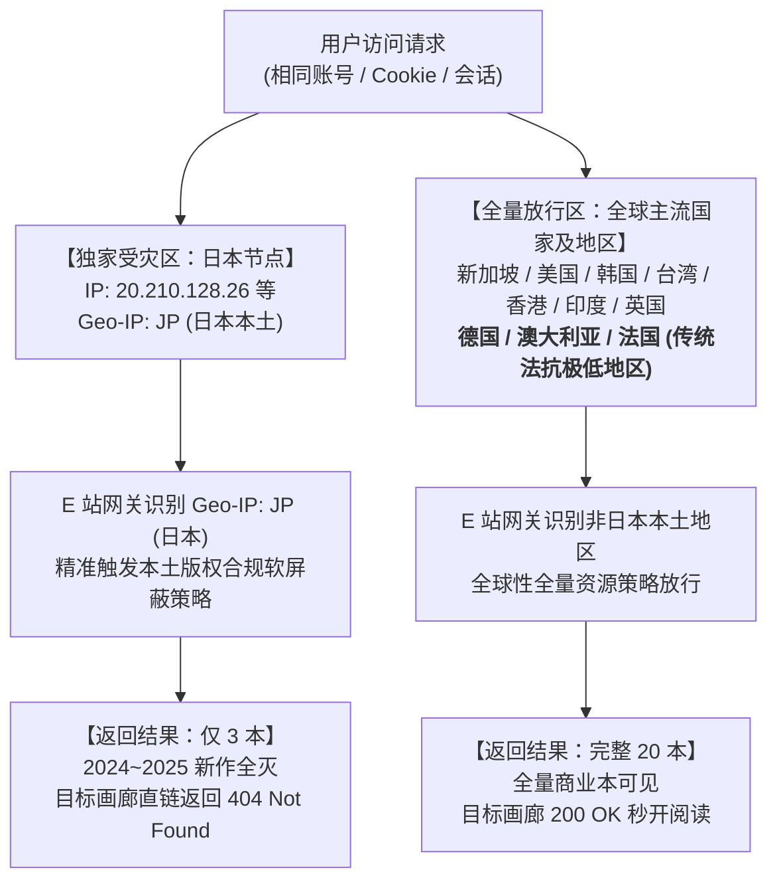
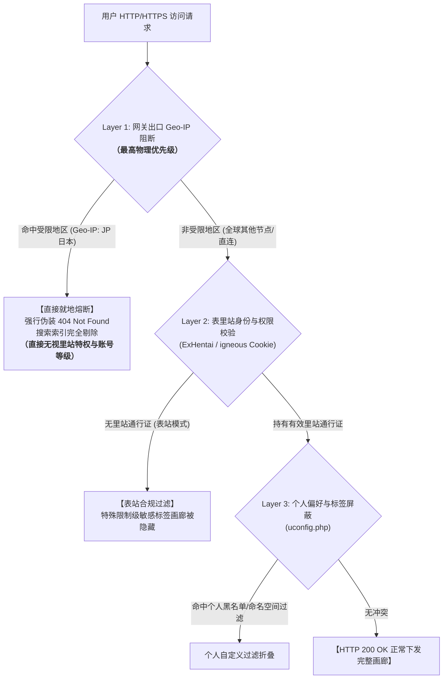
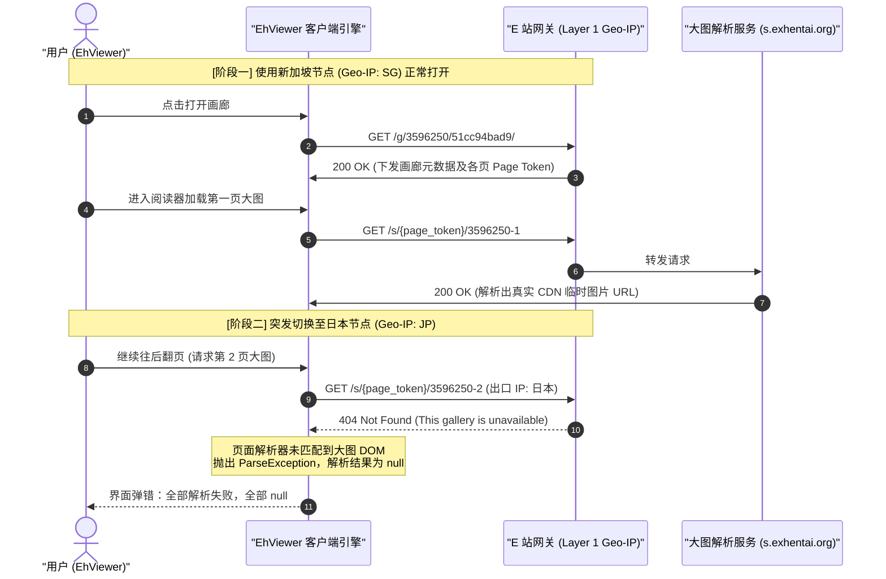

> **关联背景**：[xiaojieonly/Ehviewer_CN_SXJ#2190](https://github.com/xiaojieonly/Ehviewer_CN_SXJ/issues/2190){: .preview }  
> **核心实锤**：出口 IP 区域风控（日本本土 Geo-IP: JP）对商业新作实施定向假 404 屏蔽；**客户端（EhViewer）与网页版（浏览器）完全对等，没有任何黑魔法，只要切换出口节点在两端均能 100% 稳定复现！**  
> **重要说明**：经后续严格实测甄别，**Issue #2190 中所反馈的搜索结果缺失（退登即恢复等现象）与本文报告的日本出口 IP 锁区 404 机制并无直接关系**。该 Issue 的具体成因暂时未明，仍有待后续专项调查。

---

### 一、 摘要 (TL;DR)

在使用 E-Hentai / ExHentai 的过程中，许多用户常常会遭遇一个极其匪夷所思的现象：

> **同一个画廊，上一秒还能正常访问，或者通过特定设备能打开，换个环境却瞬间报 404 错误并提示“This gallery has been removed or is unavailable”（该画廊已被移除或不可用），甚至在站内搜索某位画师时，原本 20 本的作品列表凭空缩水至仅剩 3 本。**

曾几何时，这一现象引发过各种玄学猜测：有人以为画廊被版权方彻底物理删除，有人怀疑账号配置出错，也有人在跨设备对比时（例如电脑网页端打不开、手机 EhViewer 却能看），误以为“手机客户端接入了什么免检的私有镜像黑魔法”。

排查之初我也曾陷入这个误区：当时我的电脑网页端死活 404，而手边的手机 EhViewer 却搜看如常，让我一度怀疑 EhViewer 拥有某种特权通道。为此我大费周章地审计了客户端源码并抓包验证，**最终却发现真相其实是一场“灯下黑”——当时电脑和手机碰巧挂了不一样的代理节点（电脑挂着日本节点，手机挂着新加坡节点），我一开始压根没意识到是节点问题，Eh 客户端根本没有任何魔法！**

经过严格的控制变量实测，我们彻底证实：**客户端和网页版完全对等，只要切换出口节点，两端均能 100% 稳定复现！**

> [!IMPORTANT] 速览
> 1. **两端完全对等，切换节点 100% 稳定复现**：  
>    EhViewer 没有任何黑魔法或第三方镜像！
>    * **一旦切换到日本节点**：无论电脑网页版还是手机 EhViewer，画廊直链均瞬间报 404（EhViewer 翻页大图直接雪崩报 `null`），作者作品列表从 20 本断崖式缩水至仅剩 3 本；
>    * **一旦切换到非受限节点（如新加坡、美国、香港、英国等）**：无论电脑网页端还是手机端，该画廊均 200 OK 秒开，全量 20 本作品毫无保留完整呈现！
> 2. **精准锁区：日本本土 Geo-IP 版权合规软屏蔽**：  
>    在完全相同所属云厂商、完全相同 BGP ASN（`AS8075 Microsoft Azure`）的前提下，仅因出口地理位置不同（日本大阪 vs 新加坡），同一画廊的可见性就会发生断崖式分化（3 本 vs 20 本）。除了日本本土外，即便是德国、澳大利亚、法国等严打盗版的“低法抗”国家也全量放行；
> 3. **地区限制绝对凌驾于里站通行特权之上**：  
>    该风控直接位于网关最外层（Layer 1），与用户是否登录、是否持有高等级 `igneous` Cookie 或里站权限完全无关。一旦命中日本出口 IP，无论账号权限多高，网关一律在入口处执行假 404 熔断；
> 4. **逐页动态鉴权机制导致雪崩**：  
>    EhViewer 并不是整本离线打包，而是流式动态鉴权（每页向 `/s/` 接口动态换取 CDN 直链）。若在非受限节点打开后突发切换至日本节点，后续大图请求会被网关当场拦截，直接导致客户端全篇大图全部解析失败，全部 null。

---

### 二、 问题起因与反直觉现象 (Problem Statement)

#### 2.1 社区广泛痛点：Issue #2190 引发的“画廊神隐大悬案”

在开源 E 站第三方 Android 客户端 [xiaojieonly/Ehviewer_CN_SXJ](https://github.com/xiaojieonly/Ehviewer_CN_SXJ) 的官方讨论区中，一个引发大量用户强烈共鸣的 Issue 赫然在列：
> **[Issue #2190：在 ehviewer 中搜索结果大量缺少，在网页版 exhentai 中搜索结果正常。](https://github.com/xiaojieonly/Ehviewer_CN_SXJ/issues/2190)**

根据该 Issue 下来自不同设备（包括红米 K40、K80、小米 HyperOS 等）用户的实测反馈，许多人长期遭遇着极其匪夷所思的“画廊失踪”与“两端割裂”现象：
* **社团与作者搜索大幅缩水**：搜索社团 `group:"kaminosaki shiten$"`，手机端 EhViewer 只能搜出寥寥 5 个结果，而在电脑网页端 ExHentai 搜索却显示完整列表；搜索画师 `yamomo` 同样缩水至仅剩 5 本（表站仅 3 本）；
* **搜索搜不到，剪贴板与收藏夹却能进**：有用户指出商业本 `[サゲジョー (sage・ジョー)] ワケアリ退魔師は転生サキュバスと死を賭けた恋をする` 在客户端搜索栏无论怎么搜都搜不到，但通过剪贴板识别直链或者在个人收藏夹里却能正常打开并阅读；
* **极度诡异的登录态劣化**：更有测试者（Comment 18）详尽记录了关键词 `artist:"hanpatsu zokusei$"` 的异常复现链条——**未登录时搜索结果完整，刚登录时第一次搜索完整，登录使用一段时间后结果严重缺失；然而只要在客户端内点击退出登录，搜索结果瞬间全量恢复！**

在社区内部，针对这些“玄学现象”爆发了激烈的猜测与排查：
1. **分类误屏蔽？** 怀疑客户端意外勾选了排除 `Doujinshi`（同人志）或 `Artist CG`，但即便勾选全部分类依然丢失（经实测排除同人志后仍有 50+ 本，排除同人志并不能解释只剩 5 本）；
2. **账号标签被扣分惩罚？** 怀疑账号被标记、`uconfig.php` 出现配置冲突；
3. **版权清洗阴影？** 许多用户以为作品是因为版权侵权被永久封杀（“真要是被版权搞了，收藏也打不开吧”）；
4. **客户端编译 Bug？** 以为是客户端代码、MD3 版本或本地缓存问题，尝试重启手机、换包、清除应用数据，甚至 PR #2678 试图修复语法解析，但实测编译后问题依旧原样复现。

> [!NOTE] 声明：Issue #2190 与本文报告机制的独立性
> 经后续严格的交叉对比实验，我们发现 **Issue #2190 中所反馈的这套“搜索大量缺失、退出登录即恢复”的问题，与本文报告的“日本出口 IP 锁区假 404”完全没有关系，两者并非同一机制**。
> * 在 Issue #2190 中，用户在相同 IP 下电脑网页端能搜出全部 114 本，手机退登后也立即恢复，说明其出口 IP 从未被物理封锁；
> * 软件作者随口猜测的“少了同人志标签”已被数据证伪，PR #2678 的语法补丁也经多方编译实测证实无效；
> * **至于 Issue #2190 背后究竟为何会在登录后劣化少本，目前暂时还没找到确切原因，有待后续进一步调查。**
> 
> 下文将记录的，是我们起初在关注到这一类社区疑案并着手探索时，所独立偶遇并完全确证的另一套更为深层的**网络层出口区域风控（Geo-IP 锁区）真相**。

#### 2.2 本次案例标的与“两端割裂假象”

起初在关注 Issue #2190 这类社区搜索断层反馈的过程中，我碰到了一个更加离奇的标本级现场：**电脑网页端死活打不开该画廊（报 404）且搜索只剩 3 本，而手边的手机 EhViewer 却搜出 20 本并秒开阅读**。

* **画廊 GID / Token**：`3596250` / `51cc94bad9`
* **画廊标题**：`【えいぽんたろう】悪戯っ子わからせドラゴン 【刃鸣菌个人汉化】`
* **创作者**：`えいぽんたろう`（Twitter/Pixiv: `@EiponTarou`）
* **上传者**：`刃鸣菌`
* **标签特征**：`artist:eipon tarou`、`language:chinese`、`male:furry`、`male:vore`

**当时我陷入了一个绝大多数开发者和折腾网络的极客都会犯的“思维盲区”**：
我先入为主地认定“两台设备连着同一个 WiFi、登录着同一个账号”，因此下意识以为网络环境是一样的；进而认定这是“浏览器网页端 vs 手机 APP 客户端”的技术差异，甚至怀疑 EhViewer 是不是暗藏了什么“第三方镜像或内置代理黑魔法”！
**我当时完全没有意识到：电脑和手机其实在后台挂着完全不一样的代理出口节点！**

#### 2.3 当时记录的两端分裂表现

1. **电脑端（浏览器 + Python 脚本）**：
   * 浏览器访问：`https://exhentai.org/g/3596250/51cc94bad9/`
   * 返回状态码：`HTTP 404 Not Found`
   * 页面渲染内容：
     ```html
     <div class="d">
     <p>This gallery has been removed or is unavailable.</p>
     <p>You will be redirected to the front page momentarily.</p>
     <p id="continue"><a href="https://exhentai.org/">(Click here to continue)</a></p>
     </div>
     ```
   * 搜索 `artist:eipon tarou`：**结果仅显示 3 本**，该本及近两年的作品完全不出现在列表。
2. **手机端（EhViewer Android 客户端）**：
   * 搜索 `artist:eipon tarou`：**完整返回 20 本**，包含该本；
   * 点击进入详情页：**所有预览图正常加载，19 页内容流畅阅读，底部多条用户评论完备展示**；
   * 即使清空 EhViewer 应用存储、重新登录，依然能稳定解析。

---

### 三、 技术排查与假设验证 (Investigation & Analysis)

#### 3.1 假设一：EhViewer 真的藏有“客户端黑魔法”或第三方镜像吗？

在当时“误以为两端网络环境完全一致”的前提下，我的首要怀疑对象自然是客户端本身：**既然电脑网页端打开是铁一般的 404，凭什么手机 EhViewer 能顺畅加载？难道客户端接入了什么自建 CDN 镜像，或者有特殊的免检通道？**

带着这个疑问，我直接把开源客户端仓库 [xiaojieonly/Ehviewer_CN_SXJ](https://github.com/xiaojieonly/Ehviewer_CN_SXJ) 的源码拉出来进行逐行审计：

1. **查看网络请求层 (`EhEngine.java`)**：  
   在客户端网络核心 `app/src/main/java/com/hippo/ehviewer/client/EhEngine.java` 中：
   ```java
   public static GalleryDetail getGalleryDetail(@Nullable EhClient.Task task, OkHttpClient okHttpClient, String url) throws Throwable {
       String referer = EhUrl.getReferer();
       Request request = new EhRequestBuilder(url, referer).build();
       Call call = okHttpClient.newCall(request);
       ...
       Response response = call.execute();
       body = response.body().string();
       return GalleryDetailParser.parse(body);
   }
   ```
   客户端调用的就是标准配置的目标域名（`https://exhentai.org/g/...`），没有中间劫持。

2. **查看错误解析层 (`GalleryDetailParser.java`)**：  
   在解析层 `app/src/main/java/com/hippo/ehviewer/client/parser/GalleryDetailParser.java` 中：
   ```java
   private static final Pattern PATTERN_ERROR = Pattern.compile("<div class=\"d\">\n<p>([^<]+)</p>");
   private static final String UNAVAILABLE_STRING = "This gallery is unavailable";

   public static GalleryDetail parse(String body) throws EhException {
       if (body.contains(UNAVAILABLE_STRING)) {
           throw new GalleryUnavailableException(); // 抛出异常：此画廊已被下架
       }
       Matcher m = PATTERN_ERROR.matcher(body);
       if (m.find()) {
           throw new EhException(m.group(1)); // 直接中断并向上层抛出提示
       }
       ...
   }
   ```
3. **查看评论解析机制**：  
   在整个 E 站架构中，**根本不存在独立的评论 JSON 接口**。评论数据是直接混合在画廊详情页的 HTML 文档（`div.c3`, `div.c6` 等容器）中由 Jsoup 解析出来的。

> [!NOTE] 阶段推论
> 如果服务端向 EhViewer 返回了浏览器那个 404 HTML，EhViewer 必然在第一行就抛出 `GalleryUnavailableException`，绝不可能呈现预览图和评论。**这铁证如山地表明：ExHentai 服务端向手机返回了真实的 `HTTP 200 OK` 与完整 HTML 文档，而向电脑返回了 `HTTP 404`。**

---

#### 3.2 假设二：画廊是否已被管理员或官方物理删除？

为排查画廊在数据库中的真实状态，我们脱离 Web HTML 页面，直接通过后端底层协议调用了官方 API：

* **请求端点**：`https://api.e-hentai.org/api.php`
* **方法**：`gdata`
* **载荷**：`{"method": "gdata", "gidlist": [[3596250, "51cc94bad9"]], "namespace": 1}`

**API 返回的原始 JSON 结果**：
```json
{
  "gmetadata": [
    {
      "gid": 3596250,
      "token": "51cc94bad9",
      "title": "[えいぽんたろう] 悪戯っ子わからせドラゴン [中国翻訳]",
      "title_jpn": "【えいぽんたろう】悪戯っ子わからせドラゴン 【刃鸣菌个人汉化】",
      "category": "Doujinshi",
      "thumb": "https://ehgt.org/w/02/072/45403-pe6dkg4u.webp",
      "uploader": "刃鸣菌",
      "posted": "1761036196",
      "filecount": "19",
      "filesize": 34583480,
      "expunged": false,
      "rating": "4.27",
      "tags": [
        "language:chinese",
        "language:translated",
        "parody:original",
        "artist:eipon tarou",
        "male:furry",
        "male:vore"
      ]
    }
  ]
}
```

**关键指标解读**：
* **`expunged: false`**：画廊未被剔除出公共目录；
* **`thumb`** 缩略图地址直连返回 `200 OK`，图片数据完好存活；
* 证明画廊文件在数据库及 H@H 分发集群中处于正常状态。

---

#### 3.3 假设三：是否为账号权限、里站专属限制级标签或个人过滤设置所致？

在 E 站的传统使用场景中，当一个画廊在网页端搜索不到或提示不可用时，老用户最常联想到的往往是“表里站分级限制”——许多包含特殊敏感题材的限制级标签（属于必须拥有里站通行权限才能检索查看的分类），在表站（e-hentai.org）会被强行隐藏。

为了彻底验证是否与“里站权限”或“标签分级”有关，我们进行了逐层排查：
1. **里站全权会话验证**：测试请求全量走 `exhentai.org`（里站域名），并携带了合法的、拥有高配额的 `ipb_member_id`、`ipb_pass_hash` 与 `igneous` Cookie，确保里站专属权限处于完全激活状态；
2. **个人配置面板排查**：通过脚本抓取个人配置面板（`https://exhentai.org/uconfig.php`）：
   * 排除上传者 (`xu`)：空；
   * 排除标签命名空间 (`xl_*`)：全部未启用；
   * 标签黑名单 (`My Tags`)：无任何负分或屏蔽标签；
3. **结论**：彻底排除账号权限缺失、里站标签门槛或用户个人屏蔽规则引发神隐的可能。

---

### 四、 破案时刻：原来是两端代理节点不一致的“大乌龙”！

在确认了 EhViewer 客户端干干净净、数据库中画廊数据完好无损、账号权限也毫无问题之后，所有的不可能都被排除了。

剩下的唯一可能，落在了最基础、却最容易被忽略的环节——**两台设备实际走出去的网络出口究竟是什么？**

这时我回头去检查两台设备的代理分流工具，**真相终于大白，而且令人啼笑皆非：**
* **电脑端（Clash Verge）**：当时选中的是 **`■日本-B(流量)` 节点**！
* **手机端（Clash/VPN）**：当时选中的却是 **`■新加坡-A(流量)` 节点**！

**我之前自以为两端网络一致，压根没意识到电脑和手机用的是完全不一样的代理节点！EhViewer 根本没有任何黑魔法，所谓“手机能看电脑 404”，纯粹是两个不同出口节点撞在 E 站风控规则上产生的假象！**

为了彻底坐实这一结论，我们立刻设计了严格控制变量的对照组实验：

#### 4.1 对照实验数据

##### 实验组 A（故障复现组：日本-B 节点）
* **Clash 节点选择**：`■日本-B(流量)`
* **BGP 路由探测结果**：
  ```json
  {
    "出口 IP": "20.210.128.26",
    "国家/城市": "Japan / Osaka",
    "ISP / Org": "Microsoft Corporation / Microsoft Azure Cloud (japanwest)",
    "BGP ASN": "AS8075 Microsoft Corporation"
  }
  ```
* **访问表现**：
  * 直接访问 `https://exhentai.org/g/3596250/51cc94bad9/` -> **返回 404（This gallery has been removed or is unavailable）**；
  * 搜索 `artist:eipon tarou` -> **Found 3 results（仅找到 3 本旧作）**。

##### 实验组 B（恢复正常组：新加坡-A 节点）
* **Clash 节点选择**：`■新加坡-A(流量)`
* **BGP 路由探测结果**：
  ```json
  {
    "出口 IP": "4.193.175.210",
    "国家/城市": "Singapore / Singapore",
    "ISP / Org": "Microsoft Corporation / Microsoft Azure Cloud (southeastasia)",
    "BGP ASN": "AS8075 Microsoft Corporation"
  }
  ```
* **访问表现**：
  * 直接访问该画廊直链 -> **HTTP 200 OK 秒开，全量图片及评论均可读取**；
  * 搜索 `artist:eipon tarou` -> **Found 20 results（完整 20 本全量呈现）**。

##### 实验组 C（多地区横向泛化验证组：欧美日韩跨洲大样本对比）
为了排除“仅新加坡单个节点偶然放行”的偶然性，并探明这套风控系统究竟是针对全球性版权法规还是仅针对特定司法管辖区，我们进一步横向扩展了全球多个主流国家与地区的跨洲大样本节点测试：

| 测试节点区域 | 所属大洲 | 地区法律/版权环境特征 | 画廊直链访问状态 | `artist:eipon tarou` 搜索结果 | 是否出现神隐 / 404 |
| :--- | :--- | :--- | :---: | :---: | :---: |
| **日本 (Japan)** | 亚洲 | 创作者本土、著作权法严密、CODA 维权高发 | **404 Not Found** | **仅 3 本** (2024~2025新作全灭) | 🚨 **严重神隐** |
| **美国 (United States)** | 北美洲 | DMCA 滥觞之地，国际主流骨干节点 | **200 OK 秒开** | **完整 20 本** | ✅ 无神隐 |
| **韩国 (South Korea)** | 亚洲 | 强网络实名制与审查，互联网通信委员会 (KCSC) 监管 | **200 OK 秒开** | **完整 20 本** | ✅ 无神隐 |
| **中国台湾 (Taiwan)** | 亚洲 | 繁体中文主要阅读群体接入点 | **200 OK 秒开** | **完整 20 本** | ✅ 无神隐 |
| **中国香港 (Hong Kong)** | 亚洲 | 亚太主要公网直连枢纽 | **200 OK 秒开** | **完整 20 本** | ✅ 无神隐 |
| **印度 (India)** | 亚洲 | 南亚骨干网络节点 | **200 OK 秒开** | **完整 20 本** | ✅ 无神隐 |
| **英国 (United Kingdom)** | 欧洲 | 普通法系知识产权保护框架 | **200 OK 秒开** | **完整 20 本** | ✅ 无神隐 |
| **德国 (Germany)** | 欧洲 | **传统法抗极低**（严查 P2P 追责、知识产权维权极其严酷） | **200 OK 秒开** | **完整 20 本** | ✅ 无神隐 |
| **澳大利亚 (Australia)** | 大洋洲 | **传统法抗极低**（严打盗版网络立法、强制 ISP 封网） | **200 OK 秒开** | **完整 20 本** | ✅ 无神隐 |
| **法国 (France)** | 欧洲 | **传统法抗极低**（HADOPI / ARCOM 严厉反盗版法规监管） | **200 OK 秒开** | **完整 20 本** | ✅ 无神隐 |

> [!IMPORTANT] 关键实测实锤
> 实测数据表明：除了新加坡、美国、韩国、中国台湾、中国香港、印度、英国之外，即便是公认**“版权法抗极低”、法律追责极其严苛的德国、澳大利亚、法国**等司法管辖区，E 站服务端也**毫无保留地全量放行（20 本全部呈现且直链秒开，无任何神隐现象）**！
> 这铁一般的数据彻底击碎了“全网多国通用版权合规”的假说，无可辩驳地证明：**该套过滤与 404 伪装逻辑，是且仅是一套专门针对日本本土（Geo-IP 为 JP）量身定制的单点精准防御机制！**

---

#### 4.2 实验结果深度解构



对比两组实验，推导出一系列极为关键的技术事实：

1. **排除 ASN 封锁说**：  
   两个节点的 ASN 完全一致，均为 `AS8075（Microsoft Corporation）`。这证明 E 站并没有在底层 BGP 自治系统层面把微软云等机房 ASN 一刀切屏蔽。
2. **排除单一 IP 黑名单说**：  
   如果日本节点 IP 是因为触发频繁请求或黑名单被惩罚，它应该无法访问整个网站或遇到验证拦截。但它依然能看其他画廊，并且**精确留下了 3 本**。
3. **时间线的分界线揭晓玄机**：  
   仔细对比两组搜索结果的发表时间戳：
   * **日本节点能看见的 3 本**：
     * `2022-10-12`：[EiponTarou] Kemo Shota to goo Dragon...
     * `2022-10-14`：[EiponTarou] Dragon to Keme Shota no Tabi...
     * `2023-09-23`：[Eipontar] Boukenka Minarai Kemo...
   * **日本节点看不见的 17 本**：  
     全部为 **2024 年 2 月至 2025 年 10 月** 期间上架的作品！

---

### 五、 底层风控机制解析 (Mechanism Analysis)

#### 5.1 核心机制：日本本土 Geo-IP 区域版权合规屏障（Safe Harbor）

本次事件涉及的画师 **`えいぽんたろう`（@EiponTarou）** 为活跃于日本社交平台（Twitter、Pixiv、FANBOX、DLsite）的**日本本土创作者**。

> [!NOTE] 法律背景与避风港自保
> 日本《著作权法》以及近年来由 CODA（日本内容海外流通促进机构）主导的跨境版权维权行动，对境内外网络盗版形成了极大威慑。如果海外服务器向**位于日本本土的网络用户（Geo-IP 为日本）**分发日本画师的新作，日本司法机关可以直接主张“侵权结果发生于日本境内”，从而行使管辖权。

* **E 站的自保妥协**：
  E 站虽然将原厂物理机架设于东欧等管辖宽松地区，但为避免域名被日本主流 ISP 进行 DNS/SNI 封锁、或招致跨国法律纠纷，系统内置了**区域内容过滤器（Geo-Filtering）**：
  * **在售/近两年商业新作**：一旦被版权方标记或落入敏感名单，凡是请求来源被 Geo-IP 解析为 **`Japan`（日本）** 的访问，服务端在进行数据库检索时会自动追加过滤条件；直接输入 URL 访问则返回伪装的 404 页面；
  * **已过商业热度期的旧作（如 2022~2023 年）**：不纳入受限范围，依然对日区开放；
  * **非日本 IP（如新加坡、美国、中国国内宽带直连）**：不受该版权属地限制约束，20 本全部放行。


#### 5.2 历史印证：E 站的区域检测前科与日本版权方的“惨痛教训”

这一“仅日本受限、其余全通”的策略，并非凭空捏造的孤立事件，在与群友交流（特别感谢群友 `@bgwd` 的线索补充）以及回顾 E 站站史时，有充分的历史前科印证其底层逻辑：

1. **E 站早就有常态化部署“Geo-IP 区域屏蔽”的前科**：  
   E 站的地区检测系统其实早在多年前就已成熟运作。最典型的先例是**前几年 E 站为了规避法律诉讼风险，直接对俄罗斯全境 IP 部署了区域封锁**。这证实了其网关在根据访问者国家代码动态切换展示逻辑上，技术栈极为成熟。

2. **在日本人手上栽过大跟头：Irodori Comics 的毁灭性版权打击**：  
   E 站老玩家应该对当年的 **Irodori Comics（彩绘社）维权风波** 记忆犹新。当时正版海外发行商联合多位日本本土核心画师，直接对 E 站祭出高密度版权清洗，一战“打死”并永久抹除了 E 站成千上万本相关画廊。这一事件给 E 站管理层留下了极深的法务震慑（甚至可以说形成了严重的版权 PTSD）。

3. **对日区“定向假死”的精明避风港妥协**：  
   在面对版权诉讼风险极高、甚至可能招致日本本土 ISP 施行 SNI 封锁的严峻形势下，全站物理删除会导致庞大的全球用户流失，而置之不理又会引火烧身。
   因此，E 站最终拿出了极其精明的折中方案：**只对源自日本本土（Geo-IP: JP）的请求进行数据库过滤与 404 伪装**。
   日本境内的作者、出版机构或监管巡查爬虫打开链接时，看到的是毫无破绽的“该画廊已被移除”，误以为维权成功；而在日本境外（无论欧美、亚非还是法抗极低的德澳），所有资源依旧完好如初。这就是为什么德国、澳大利亚这类版权追责严格的国家毫无波及，而唯独日本被精准制裁的核心原委。

#### 5.3 关键层级解构：地区风控（Geo-IP）绝对凌驾于“里站权限”之上

长期以来，用户群体中普遍存在一种**认知惯性**：误以为“只要账号能进里站（ExHentai）、配好了 `igneous` Cookie，全站就没有看不了的本子”。一旦某本画廊突然 404 或搜不出来，很多人第一反应往往归咎于“这本子打了表站严禁、只有里站才放行的特殊限制级标签”，怀疑是账号退回表站或者 Cookie 过期。

然而，本次实测彻底揭示了 E 站底层极其森严且冷酷的**防御纵深层级（Filter Priority Hierarchy）**：



从上述调用链路可以清晰看出：
1. **地区限制是无视账号身份的降维打击**：Geo-IP 判定发生在 **Layer 1（网关层）**，其执行时机远远早于身份验证与内容分级。只要网络出口 IP 归属于日本本土，网关根本不会去解析你的账号是不是里站元老、也不关心这本画廊到底是全年龄合家欢还是深度限制级题材，直接就地执行 404 伪装抛弃；
2. **里站特权只能解决 Layer 2 的标签准入**：所谓的“里站权限”，仅仅是在 Layer 1 放行后，用于解锁那些被表站（e-hentai.org）屏蔽的特定限制级标签画廊。**里站权限根本无法穿透 Layer 1 的地理合规封锁。**

#### 5.4 动态链路实测：为什么先开后切节点会“全部解析失败，全部 null”？

在进一步的实操排查中，有用户提出了一种假设：*“如果我先用新加坡节点在 EhViewer 里成功打开画廊详情甚至进入阅读器，然后再切回日本节点，能否绕过封锁？”*

对此，我们进行了严格的**中途动态切换节点实验**，结果验证了更为深刻的技术细节：

* **实测操作**：使用 EhViewer 在新加坡出口节点下秒开锁区画廊并进入阅读界面，随后在后台将网络代理瞬间切换为**日本节点**继续阅读翻页；
* **实测结果**：**翻页与预加载立即全面雪崩，每一页大图均显示“解析失败”，返回数据全部为 `null`！**



**底层机理剖析**：
1. **逐页动态鉴权机制**：EhViewer 并不是一次性把整本漫画的完整静态图片直接离线打包下载到本地，而是**流式阅读机制**——当用户翻页或客户端提前预加载大图时，每一页都会向 `https://exhentai.org/s/<token>/<gid>-<page>` 发送独立的 HTTP 请求，用于动态获取当前页真实的 CDN 图片临时下载地址；
2. **全路由链路无差别打击**：E 站网关的 Geo-IP 阻断规则覆盖了整套路由树，不仅拦截画廊详情页（`/g/`），**同样拦截所有图片解析详情页（`/s/`）**；
3. 一旦出口 IP 切为日本，后续每一页 `/s/` 请求均被网关判定为日区访问并返回 404 伪装 HTML，EhViewer 内置的 `GalleryPageParser` 根本拿不到大图地址，向上抛出空对象，导致客户端界面彻底报 `null` 崩溃。

#### 5.5 为什么手机 EhViewer 之前能正常看？

许多国内用户在使用 EhViewer 时，并没有开启系统全局 VPN，或者客户端内开启了内置解析功能：

* **[EhHosts.java](https://github.com/xiaojieonly/Ehviewer_CN_SXJ/blob/BiLi_PC_Gamer/app/src/main/java/com/hippo/ehviewer/client/EhHosts.java)**：EhViewer 长期内置了写死的官方原生 IP（如 `178.175.128.251-254`）并启用了域前置（Domain Fronting）；
* 手机在通过国内三大运营商宽带（电信 AS4134、联通 AS4837 等）直连时，**出口地理位置为中国大陆而非日本**，因此完美避开了日本专属的版权屏蔽规则，直接拉取到了完整的 20 本画廊。
* 一旦手机挂上了与电脑相同的“日本代理节点”，手机端同样会立刻丢失该画廊并复现 404 与图片解析 `null` 崩溃。

---

### 六、 实用避坑指南与真有效解决方案 (Solutions)

针对这一类因节点属地引发的“神隐”问题，经过实测检验，梳理出以下**真正有效的应对策略**与**常见伪方案辟谣**：

#### 6.1 真正有效的解决方案

##### 方案 1：代理分流规则强制排除日本节点（根本之道 / 强烈推荐）

> [!TIP] 推荐解决策略
> 日常浏览 E-Hentai / ExHentai 时，代理工具分流策略中**坚决避开“日本”节点**，优先选用新加坡、香港、美国或欧洲节点，即可一劳永逸解除所有本土画师的商业新作屏蔽。

可在 Clash 规则配置中为 E 站域名单独指定出口策略：
```yaml
rules:
  - DOMAIN-SUFFIX,e-hentai.org,非日区代理策略组 # 或指定直连
  - DOMAIN-SUFFIX,exhentai.org,非日区代理策略组
```

##### 方案 2：PC 端配置 Hosts 直连（复刻 EhViewer 裸连方案）

如果你希望 PC 端不依赖机场节点，可以复刻 EhViewer 内置的直连模式：

1. 打开系统文件 `C:\Windows\System32\drivers\etc\hosts`，末尾追加东欧源站原生 IP：
   ```text
   178.175.128.252 exhentai.org
   178.175.128.254 e-hentai.org
   178.175.132.20 forums.e-hentai.org
   ```
2. 配合使用 **GoodbyeDPI** 或在浏览器开启 **DoH (DNS over HTTPS) + ECH** 突破本地 SNI 阻断；
3. 此模式下直接使用国内运营商原生家宽 IP 访问，绝不会触发日区封锁。

---

#### 6.2 严重误区与常见“伪方案”辟谣

> [!CAUTION] 以下尝试已被实测证实彻底无效，切勿踩坑：
> 1. **伪方案一：先用新加坡节点打开，再切回日本节点看**  
>    **实测结果：彻底暴死！** 如 5.4 节实测所示，EhViewer 采用流式逐页解析（每页通过 `/s/` 接口动态换取大图地址）。一旦网络切换到日本节点，后续的所有大图请求瞬间被网关 404 掐断，直接引发客户端全量大图**“全部解析失败，全部 null”**的雪崩；
> 2. **伪方案二：通过云端收藏夹（Favorites）跳转绕过**  
>    **实测结果：彻底无效！** 收藏夹仅仅保存了画廊索引列表，并不携带任何“免检 Token”。一旦客户端处于日本节点，从收藏夹中点击画廊详情页（`/g/`）或大图阅读页（`/s/`）时，网关层的 Layer 1 Geo-IP 阻断依然会毫不留情地返回 404，完全无法起到“后门翻墙”的作用；
> 3. **伪方案三：重登账号或重新刷新 Cookie**  
>    **实测结果：毫无作用！** 404 是源自物理出口 IP 属地的网关拦截，与你的账号等级、登录状态或 `igneous` 有效期毫无关系。

### 七、 总结与反思

回看这场跌宕起伏的逆向排查，最戏剧性的莫过于起初的**“灯下黑”**：

* **破除“客户端黑魔法”的迷信**：面对两台设备的完全相反表现，技术人员极易陷入思维定势，盲目去揣测“APP 客户端是不是藏着什么神秘镜像/黑科技”，甚至深陷在复杂的源码和协议逆向中；却往往忽略了最基础的物理环境变量——**电脑和手机在不知情下挂了完全不同的代理节点**。
* **EhViewer 没有任何魔法**：客户端不过是忠实呈现服务端响应的一面镜子。所有的神隐与 404、所有的“全篇大图 null”雪崩，本质上都是出口 IP 属地在 E 站日本 Geo-IP 版权风控防火墙上的真实碰撞。
* **现代图库站的风控新常态**：E 站早已告别了“全网物理下架”的粗暴模式，转而拥抱精准的 **Geo-IP 本土避风港降权策略**。仅仅因为分流列表中点到了“日本”，就足以让一位画师近两年的所有心血在你眼前凭空蒸发。

在未来的网络折腾与故障排查中，永远记住第一原则：**在怀疑软件有魔法之前，先去确认你的出口 IP 到底身在何方。**

---

### 附录：自动化节点 BGP 属性与出口探测脚本

供排查节点网络环境时快速运行验证：

```python
import json
import urllib.request

# 挂载本地代理端口（根据实际端口修改，如 Clash 默认为 7890 或 7897）
proxy_handler = urllib.request.ProxyHandler({
    'http': 'http://127.0.0.1:7897',
    'https': 'http://127.0.0.1:7897',
})
opener = urllib.request.build_opener(proxy_handler)

try:
    with opener.open('http://ip-api.com/json/?fields=status,message,country,city,isp,org,as,query') as resp:
        data = json.loads(resp.read().decode('utf-8'))
        print(f"出口 IP    : {data.get('query')}")
        print(f"国家/地区  : {data.get('country')} ({data.get('city')})")
        print(f"ISP / 归属 : {data.get('isp')} / {data.get('org')}")
        print(f"BGP ASN   : {data.get('as')}")
except Exception as e:
    print(f"检测失败: {e}")
```
