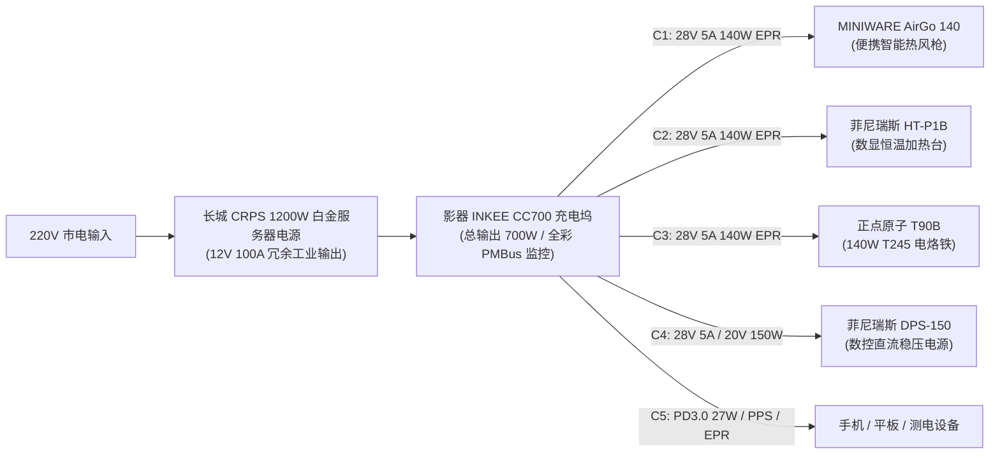
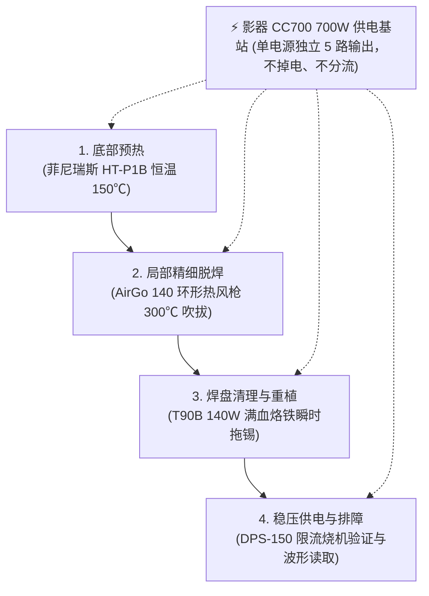

早在今年 2 月底，我就在博客里感叹过自己对桌面工具全套 PD 便携化的极度偏执：

[极客日常：对于设备 PD 供电便携性的极度执念](/posts/8d8839/){: .preview }

当时电烙铁是正点原子 T90B，数控电源用菲尼瑞斯 DPS-150，加热台也是嘉立创 65W PD 项目。整张维修桌上，唯独**热风枪**因为功率门槛和风道体积问题迟迟没有厂商敢下场做 USB-C 供电方案，成了我心头唯一的遗憾。

没想到时隔 8 个月，不仅 **PD 供电热风枪真的量产问世了**，而且伴随着一整套 140W PD 3.1 EPR 生态的成熟，我顺带把加热台和桌面供电基站一并洗牌重构，连同现有的 140W 智能烙铁与数控电源，实现了**整张极客维修桌全套 5 款核心工具 140W PD 3.1 EPR 的终极满血闭环**！

本文带来这场“出血 1000 元”的桌面改造全记录，重点针对群友关心的 **MINIWARE AirGo 140 智能便携热风枪** 进行实测与升温拆焊数据摸底，并详细评测一下硬核神物 **影器 INKEE CC700 CRPS 服务器电源充电坞**，最后盘点整套桌面 PD 3.1 工具家族的协同实战体验。

---

## 🛠️ 一、 硬件换血：全套 5 款 PD 3.1 极客工具家族

### 1.1 MINIWARE AirGo 140：巧妙的空气动力学破局

10 月初，MINIWARE / e-Design 冷不丁把 [MINIWARE AirGo 140](https://e-design.com.cn/ProductDetail/12278771.html) 端了出来。

以前电子圈很多人质疑：“传统热风枪动辄 500W~800W，就算是 240W PD 都不够看，140W 怎么可能吹得动？”
结果 MINIWARE 巧妙地把整个风道设计在笔身最前端——**环形前进风，吃尾流循环加热**。这样热空气不会在长长的枪管里快速衰减，热交换效率暴增，140W 的电热丝就完全够用了！而且由于风道短、阻力小，内部无刷电机可以做得很小，让整支热风枪外壳直径只有 **30mm**、重量仅仅 **115g**。

刚发布时官方定价高达接近 900 元，老实说对自己确实过于自信了；后来群友山子凡通风报信，淘宝裸机（无电源无支架）降到了 415 元。前阵子财力窘迫一直按捺，最近手头宽裕了点，果断以 **405 元** 入手。

### 1.2 菲尼瑞斯 HT-P1B：加热台升至 140W PD3.1

既然热风枪都跨入了 140W PD 3.1 时代，原来的 65W 嘉立创简易加热台就有点不够看了。顺便花了 **193 元** 换成了 **菲尼瑞斯 (FNIRSI) HT-P1B**。

相比普通的 P1A（仅限 100W PD 3.0），**HT-P1B 支持 PD 3.1 (28V 5A 140W)**，DC 供电更可达 150W。铝合金 50×50mm 发热盘升温到 200℃ 仅需 60 秒，自带彩色屏幕与智能回流焊温控曲线，在小板植锡和芯片除胶时极其实用。

### 1.3 正点原子 T90B：兼容 T245 的 140W 满血智能烙铁

我的桌面主力电烙铁是 **正点原子 (ALIENTEK) T90B**。很多朋友只知道它是便携电烙铁，却忽略了它的核心王牌——**它原生支持 PD 3.1 协议诱骗，能直接握手 28V/5A 实现 140W 超大功率输出**！

*   **发热芯兼容**：T90 家族分为 A/B/C 三款，T90B 专门匹配工业级 **JBC T245 发热芯**，热容量远非普通 T65/T210 细笔尖可比；
*   **满血诱骗**：此前受限于 100W PD 3.0 充电头，只能在 20V 档位输出约 96W；而在接入支持 28V 5A EPR 的供电基站后，140W 满血火力瞬间激活，面对多层板接地大铜皮也能做到秒级回温化锡；
*   **极客交互**：机身配备 **0.99 寸全彩 IPS 屏幕**，实时显示工作温度、实时功率、母线电压以及动态温控曲线，配合 CNC 全铝喷砂外壳，手感扎实。

### 1.4 菲尼瑞斯 DPS-150：高机动 150W 迷你数控可调电源

除了烙铁、风枪、加热台这“加热三件套”，桌面电子开发排障必不可少的还有数控电源。我的选择是 **菲尼瑞斯 (FNIRSI) DPS-150**：

*   **输入全兼容**：正面采用 Type-C PD 输入接口，亦支持 DC5525 输入；
*   **数控指标**：输出电压 `0~30V`、输出电流 `0~5A`，最大输出功率达 **150W**，步进调节精度达 0.01V / 0.001A；
*   **轻量化替代**：彻底淘汰了传统笨重庞大的 220V 台式大火牛，只有手机三分之一大小；全彩 IPS 屏幕可实时绘制电压电流波形，自带毫秒级过流短路保护，修板烧机排障极度方便。

### 1.5 供电危机与神级破局：影器 CC700 + 长城 CRPS 1200W

工具集齐了，桌面上却迎来了最致命的瓶颈——**供电瘫痪**。

算算我这套全 PD 化极客桌面工具的极限供电需求：
*   **MINIWARE AirGo 140 便携热风枪**：额定 140W (PD 3.1 28V 5A)
*   **菲尼瑞斯 HT-P1B 加热台**：额定 140W (PD 3.1 28V 5A)
*   **正点原子 T90B 智能电烙铁**：额定 140W (PD 3.1 28V 5A)
*   **菲尼瑞斯 DPS-150 数控电源**：额定 150W (PD 20V/28V 5A)
*   **手机 / 平板 / 测电设备**：27W~100W

总理论峰值需求逼近 **600W~700W**！而我桌上原本的多口桌面充电器总功率才 160W，单口最高仅支持 PD 3.0 20V 100W。别说四台核心设备同时联动，哪怕开加热台的同时开个风枪，充电器就直接过载重置断电了。

市面上普通的大功率 4 口氮化镓充电站（如 300W 档位）动辄要 500~800 元，而且单口功率互相抢占，插拔新设备时还会引起所有端口掉电重启，这在供电中的开发板和烙铁上是灾难性的。

正巧在 YouTube 上看到了充电头网关于 **影器 CC700 (INKEE CC700 Charging Mate)** 的评测：
🔗 [YouTube: INKEE CC700 评测视频](https://youtube.com/watch?v=5dhFacIiStE)

我一整个被震惊了！懂得都懂这是什么概念：
**它居然能直接插拔标准的 CRPS 数据中心服务器电源！**
*   CC700 本身集成 5 路**完全独立**的 DC-DC 降压模块；
*   每个 USB-C 口均支持完整的 **PD 3.1 EPR (最高 28V 5A 140W)**；
*   5 口同时跑满就是 **140W × 5 = 700W 满血总输出**，互不干扰、永不断连断充！

我叠券后以 **287 元** 拿下 CC700 主机，再花了 **120 元** 淘了一台全新长城 (Great Wall) CRPS 1200W 白金级服务器电源（虽然事后感觉如果去二手🐴求购还能更便宜，但 120 元买全新 1200W 工业级电源，冗余拉满，已经极其超值了）。

**407 元搞定 700W 独立 5 口 PD 3.1 供电站！**

新入的四件套算下来：405 (AirGo 140) + 193 (HT-P1B) + 287 (CC700) + 120 (CRPS 1200W) ≈ **1005 元**，加上原本就支持 140W PD3.1 的 T90B 和 DPS-150，整套桌面工具彻底迎来了史诗级升级！

---

## 🌪️ 二、 MINIWARE AirGo 140 热风枪：实测与硬核数据

应群友的要求，热风枪到手第一时间进行了严谨的升温与拆焊测试。不吹不黑，直接看真实仪器测试数据：

### 2.1 升温测试环境与条件
*   **环境室温**：25℃
*   **初始风嘴温度**：50℃（静态预热）
*   **供电线材**：酷态科 6A 线
*   **工作档位**：出厂默认配置下的“通用拆焊模式”（目标设定温度 300℃，4 档风速）

### 2.2 升温实测数据对比

| 供电规格 / 握手档位 | 握手参数 | 系统检测端电压 | 达标用时 (至 300℃) | 升温体验评价 |
| :--- | :--- | :--- | :--- | :--- |
| **标准 PD 3.0 (100W)** | 20V 5A | 19.3V | **21 秒** | 表现尚可，应急可用，略逊于大功率焊台 |
| **满血 PD 3.1 EPR (140W)** | 28V 5A | 27.7V | **12 秒** | **极其迅猛**，出风迅速且温升曲线平滑 |

> [!TIP] 升温数据分析
> 从 50℃ 升至 300℃，在 140W EPR 状态下仅用了 **12 秒**，这对于一支笔杆粗细的纯便携工具而言堪称惊艳！线损方面，虽然在 5A 极限大电流下末端跌落至 27.7V（压降约 0.3V），但依然稳稳释放出超过 135W 的真实有效加热功率。

### 2.3 实战拆焊：老随身碟（Discman）报废板实测

很多人担心 140W 热风枪只能吹吹热缩管。我专门翻出了一块 20 年前随身碟的报废主板进行了元器件拆焊实测：

*   **QFP 多引脚微控制器/DSP 芯片**（如索尼 CXD3009Q、日电 uPC SM5907AF）：配合点圈吹焊手法，约 15~20 秒即刻脱焊夹起，焊盘无剥离；
*   **SOP / SSOP 密脚芯片**：均匀扫风几秒即可整颗取下；
*   **SOT-23 / SOT-89 小三极管与贴片二极管**：轻松秒拆。

如下图实拍所示，整块报废板上的大小芯片均被完整脱焊分离（个别引脚缺失是板子存放 20 年严重氧化腐蚀断裂所致，并非风枪温度不足硬扯损坏）：

### 2.4 热风枪总结与选购建议
*   **优点**：
    1.  **极致小巧**：仅 30mm 直径与 115g 重量，手感宛如一支马克笔，告别笨重粗硬的传统高压风管；
    2.  **移动无敌**：支持任意 100W/140W 充电宝直接驱动，在野外机房、车库排障或高空维修等极端工况下具备无可替代的优势；
    3.  **安全性高**：桌面没有 220V 强电火线，不怕意外烫穿高压电源线引发短路。
*   **不足**：
    受限于 140W 物理上限，风量相比 700W 的传统台式旋涡风枪还是略微偏小；面对大面积大覆铜吸热板或者无铅高温回流板时，需要搭配底部预热台（如 HT-P1B）协同作业。
*   **推荐指数**：★★★★☆（4.5 / 5）  
    如果你有便携需求、桌面空间局促，或者跟我一样对全链路 USB-C PD 供电有极高执念，强烈推荐关注！后续各大电商平台价格如果下探到 400 元以内，性价比会更具统治力。

---

## ⚡ 三、 影器 CC700 深度评测：服务器电源变身 700W 充电基站

视频中大部分基础功能已有介绍，这里着重针对极客玩家分享一些实测细节与协议兼容性表现：

### 3.1 协议握手与 PDO 解析
使用 POWER-Z KM003C 读取 CC700 任意接口的广播报文：
*   **Fixed PDO 档位**：`5V 3A` / `9V 3A` / `12V 3A` / `15V 3A` / `20V 5A`
*   **PPS 档位**：`3.30V-11.00V 3.00A` / `3.30V-21.00V 3.00A`
*   **EPR (PD 3.1) 档位**：`Fixed 28.00V 5.00A (140W)`
*   **AVS 档位**：`15.00V-28.00V 140W`

各通道独立输出互不影响，插拔任意一路均**不会发生其他端口掉电重握手**！

### 3.2 服务器级硬件监控中控与深度遥测

CC700 搭载了一块极具极客风格的彩色液晶屏幕，能实时通过 PMBus/I2C 总线读取 CRPS 服务器电源与 5 路独立降压通道的全部遥测数据：

#### 3.2.1 仪表主界面：整机工况全景
*   **交流电输入监测**：实时显示输入市电电压（如 `226V`）及输入电流（如 `0.30A`）；
*   **直流总线输出**：主板 12V 供电实时电压（`12.23V`）；
*   **功率与负载率**：精准显示当前占用的电源额定功率百分比（如 `0% / 1200W`）；
*   **热管理与风扇转速**：内置温控探头（`28℃`）及服务器风扇转速（`4528 RPM`）。

#### 3.2.2 CRPS 统计子菜单：待机损耗与能量转换
按动控制按键切换到 CRPS 全局统计界面，可以看到市电交流输入到直流总线输出的实时对照：
*   **超低待机空载损耗**：在无负载输出时，交流端输入功率仅为 **`8.0W`**（输出 `0.0W`），对于一台 1200W 的白金级服务器大电源而言，空载待机自耗电控制相当理想；
*   **多维度能量吞吐审计**：详细记录当前上电时长（如连续通电 `5h 21m 5s`），并精确比对「上电累计能耗」（输入 `76Wh` ➔ 输出 `26Wh`）与「历史累计能耗」（输入 `111Wh` ➔ 输出 `31Wh`），电源整流转换效率一目了然。

#### 3.2.3 独立端口遥测：单路硬件库仑计与 128.6W 峰值功率记录
更让我惊喜的是它的单端口监测深度。切换至单个接口（如 C1 端口）详情页，CC700 内置了独立的硬件级库仑计和计时芯片：
*   **峰值功率打卡**：真实捕获并记录了刚刚满血测试 140W 设备时，该通道飙到的 **`峰值功率 128.6W`**；
*   **单次作业用电统计**：完整记录了上次单次持续工作时长 **`26m 6s`**、上次单次放电做工累计 **`24.4Wh`**；在拔掉线缆后明确提示 `已断开`，同时自动汇总进本次上电累计（`29Wh`）与该端口历史累计（`78Wh`）。

无论是排查开发板功耗异常、监测烙铁长时间回焊能耗，还是给大功率设备摸底极限功率，这块屏幕提供的信息量完全不输专业的台式功率分析仪！

### 3.3 ⚠️ 协议槽点：关于纯 PD 协议与三星 PPS 握手异常

在实际多设备测试中，我也发现了该设备几个值得注意的问题：

1.  **协议单一（纯 PD）**：  
    该设备**仅支持标准 USB-PD 协议**，不支持任何厂商私有快充协议（如华为 SCP、蓝绿厂私有协议等），非 PD 设备只能触发基础 5V/9V 充电。
2.  **三星手机无法正确激活 PPS 超级加速充电**：  
    如图所示，在接入三星手机时，握手协议被锁定在 `PD 3.0 27W (Fixed 9V 3.00A)`，而无法激活满血 PPS（25W/45W）：

> [!NOTE] 为什么无法激活三星 PPS？
> 这是不少多口大功率充电器早期的通病：固件逻辑中默认优先广播并握手 **Fixed PDO（固定电压档）**，导致手机检测到高优先级 Fixed 9V 档位后直接锁死，不再向下协商 PPS / AVS。  
> **改进建议**：厂商可以通过后续固件升级，增加“关闭 Fixed 档”或“PPS 优先级提升”的选项，方便用户自由配置。

---

## 📋 四、 2026 极客工作台：全套 5 款核心 PD3.1 设备全景盘点

经历本次“出血 1000 元”大改造后，我之前的硬件清单文章：

[极客劝退指南：电子 DIY 实验室的真实入门硬件成本清单](/posts/84a9f7/){: .preview }

迎来了最具历史意义的汰换更新。整张工作台已经从“四处找头借电”蜕变为由 **影器 CC700 (700W PD 3.1)** 全权统筹的移动式极客工坊。以下是目前桌面 **全部 5 款核心 PD 3.1 / PD 供电设备** 的完整横评与协同全景：

| 核心设备 | 品牌/型号 | 供电规格 / 握手档位 | 入手价格 | 核心亮点与桌面实战定位 |
| :--- | :--- | :--- | :--- | :--- |
| **供电基站 (总枢纽)** | **影器 INKEE CC700 + 长城 CRPS 1200W** | **700W (5 × 140W 独立)** 支持 PD 3.1 EPR (28V 5A) | **407 元** (287+120) | 直插数据中心 CRPS 白金电源，5 口全独立互不断连，全彩 PMBus 遥测监控。 |
| **便携智能热风枪** | **MINIWARE AirGo 140** | **PD 3.1 EPR 28V 5A (140W)** | **405 元** | 前进风尾流循环设计，30mm笔杆粗细，12秒达标 300℃，彻底告别 220V 粗电线。 |
| **数显恒温加热台** | **菲尼瑞斯 FNIRSI HT-P1B** | **PD 3.1 140W (28V 5A)** DC 接口最高 150W | **193 元** | 替代原 65W 嘉立创板，50×50mm 铝合金盘，双模式温控与全自动回流焊曲线。 |
| **智能便携电烙铁** | **正点原子 ALIENTEK T90B** | **PD 3.1 EPR 28V 5A (140W)** 兼容 PD 3.0 (20V 96W) | **165 元** | 兼容 JBC T245 发热芯，28V 满血诱骗秒杀大接地铜箔，0.99" IPS 彩屏与 CNC 机身。 |
| **迷你数控稳压电源** | **菲尼瑞斯 FNIRSI DPS-150** | **Type-C PD / DC (150W)** 0~30V 0~5A 精准数控 | **240 元** | 桌面测试、电压注入烧机排障神器，全彩曲线波形显示，毫秒级短路保护。 |

### 4.1 五剑客协同实战流：极客维修的一气呵成

有了这套 700W PD 3.1 EPR 闭环工作台，拆焊维修的流线体验达到了前所未有的顺畅：

1.  **大板脱焊无压力**：在修多层板或大覆铜主板时，先将板卡置于 **HT-P1B** 进行 150℃ 预热；
2.  **笔式风枪精细夹取**：左手拿镊子，右手如握笔般持握 **AirGo 140**，轻微扫风几秒芯片即可轻松夹起；
3.  **大焊点瞬间补焊**：换上 **T90B**，在 28V 140W 满血 EPR 支持下，即便大面积接地焊盘也能一拖即平；
4.  **上电验证与短路排查**：旋动 **DPS-150** 设定目标工作电压并限制电流，实时观察彩色屏幕上的电流波形，彻底杜绝炸板风险。

### 4.2 极客总结

从年初四处翻找大功率充电头借火，到如今**单台 CRPS 1200W + CC700 榨干 700W 满血 5 路输出**，整张桌面彻底告别了杂乱的 220V 强电排插与笨重火牛。全套 5 件核心工具加起来轻巧便携，全部装进一个工具包即可随身携带。在任何具备 USB-C 的环境下都能瞬间搭建起专业级维修流水线，这大概就是我们对 PD 执念最完美的答卷！
