在上一篇评测文章中，我分享了桌面工具全面升级 **140W PD 3.1 EPR** 满血闭环的折腾体验：

[全套 140W PD 3.1 EPR 桌面工作台达成 —— MINIWARE AirGo140 便携热风枪与影器 CC700 700W 充电坞实测](/posts/pd31gw/){: .preview }

以及此前我对工具全套 PD 便携化的偏执追求与硬件清单：

[极客日常：对于设备 PD 供电便携性的极度执念](/posts/8d8839/){: .preview }  
[极客劝退指南：电子 DIY 实验室的真实入门硬件成本清单](/posts/84a9f7/){: .preview }

当时实测在 28V 5A (140W EPR) 供电下，**MINIWARE AirGo 140** 从 50℃ 极速升温到达标 300℃ 仅用了惊人的 **12 秒**，拆焊 20 年前老主板上的 QFP、SOP 贴片芯片行云流水。

作为全网几乎最早拿到量产机的用户之一，好奇心驱使下，我实在忍不住想探究：**传统工业热风枪动辄 500W~800W 才能胜任的工作，MINIWARE 凭什么用 140W 就能在直径仅 30mm、重量仅 115g 的纤细手柄里做到？**

出于对紧凑结构的好奇与探索精神，我抄起螺丝刀对 AirGo 140 进行了**全网首拆**。在电子显微镜的辅助下，整机的内部机械风道、双层 PCB 堆叠结构以及全部芯片选型被逐一还原。

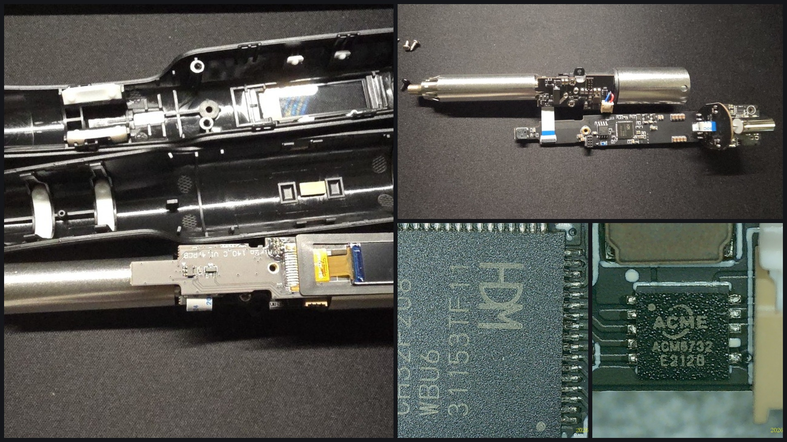

---

## 🪛 一、 机械结构与外壳分解：紧固设计与风道流体力学玄机

### 1.1 极简外壳紧固设计与开壳实操

AirGo 140 整体外壳采用阻燃耐高温工程塑料（ABS/PC 复合材质），表面施以细腻的防滑磨砂纹理。拆解的第一步非常考验对结构的敏锐观察：
* **外壳肉眼可见的仅有 1 颗螺丝**：机身外表极其整洁一体，外部唯一可见的紧固件只有前端固定金属发热套管的 **1 颗黑色螺丝**，规格为 **`H1/16`（1/16 英寸内六角）**，负责前部金属套管与机壳的机械限位与接地屏蔽；
* **金属撬片开壳**：卸下这颗黑色的 H1/16 内六角螺丝后，整个外壳实际上主要依靠紧密的隐形卡扣咬合。此时需要拿出**超薄金属撬片**，沿着机身侧面的结合缝隙小心切入并逐一划开卡扣，上下两半蚌壳式外壳便顺畅分离；
* **内部固定螺丝**：打开外壳后，内部骨架与电路板则是由 **3 颗银色十字自攻螺丝** 紧固在塑料底壳与金属内胆支架上，批头规格为标准的 **`PH1`**。

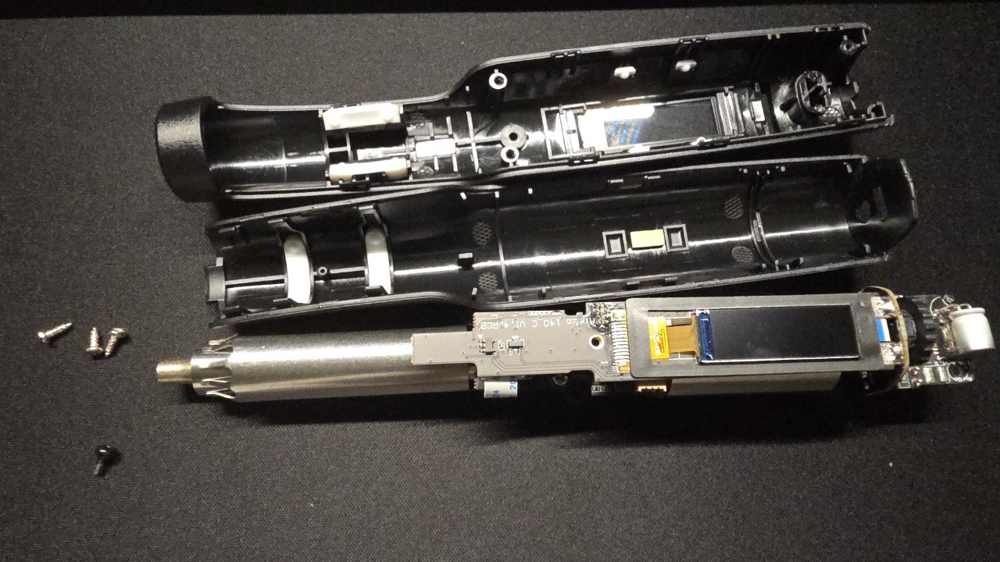

从拆开的上下壳可以看出细节打磨非常到位：
* 内部设计了密集的加强筋与定位滑轨，紧密包裹住前段发热管和后段风机；
* 上壳开窗处内置了防尘透光亚克力，保护内部长条形 OLED 液晶显示屏；
* 侧面按键柱采用了双色注塑的一体式防脱落硅胶导向结构，手感紧致无晃动。

### 1.2 破局关键：环形前进风与“尾流循环”空气动力学

传统 220V 工业热风枪为何需要 500W~1000W 庞大功率？核心短板在于**气道过长、热交换效率低下**：
1. **传统后进风劣势**：大型离心鼓风机安置在手柄末端，常温冷风吹过长达 15~20cm 的金属风筒，热量在途中快速被管壁吸收耗散；为了保证风嘴处吹出 350℃ 的气流，电热丝核心往往必须烧到 600℃ 以上；
2. **气流衰减大**：长风道导致风阻激增，必须采用大功率高压电机强行推风。

**MINIWARE AirGo 140 的革命性设计在于：风道极短化 + 环形前进风尾流循环**：
* 如图所示，在金属发热管的末端后方（枪管结合处），直接开设了一圈**360度环形进风口**；
* 微型无刷涡轮风机紧贴在发热管屁股后方，空气吸入后直接穿过长仅 **35mm** 的高密度发热芯，风阻极小、热交换路径无限缩短；
* 在连续吹焊时，由于风嘴吹出的热气在工件表面反弹，部分被吸入进风口形成“尾流循环加热”，相当于对进风进行了二次余热回收！
* 正是这一空气动力学突破，让 140W 的电热丝达到了传统 400W 级别的升温效率，也让内部可以选用微型超轻的三相无刷风机，将机身直径压制到仅 **30mm**。

---

## 🧩 二、 双层立体 PCB 堆叠：高压发热与低压逻辑的热电隔离

拔下外壳后，AirGo 140 的内部电子架构展现出极高的模块化集成度。为了在狭长圆柱体内兼顾散热、抗干扰和紧凑度，它采用了**上下分层的双主板立体堆叠方案**，两块 PCB 之间通过高密度 FPC 柔性排线进行跨板电气互联：

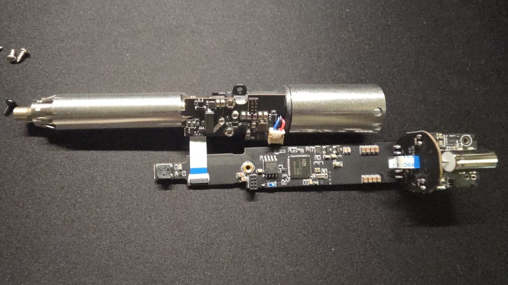

### 2.1 上层板：高压发热功率与动力驱动板（Power & Drive Board）
* **物理位置**：紧密附着在前段不锈钢加热套筒与中段金属无刷风机圆筒上方；
* **核心职责**：
  * **28V 5A 高压回路**：直接通过大面积镀锡加厚铜箔承载来自尾部 Type-C 的 140W 高压直流输入；
  * **发热功率开关**：搭载极低导通内阻的超大功率 MOSFET，以高频 PWM 驱动发热芯；
  * **三相动力输出**：搭载专用的无刷电机驱动芯片，通过 3 针微型接插件（红/蓝/黑三色硅胶线）为高速无刷微型风机供电；
  * **热电分离优势**：发热管与风机引线极短，强电高压被牢牢限制在前端金属护套内，杜绝了大电流纹波对后级控制逻辑的辐射干扰。

### 2.2 下层板：系统逻辑、计算、交互与滤波主板（MCU & UI Board）
* **物理位置**：贯穿整机中后段，正面搭载长条形 OLED 液晶屏和按键触点；
* **核心职责**：
  * **大脑中枢**：承载高性能 32 位 Cortex-M3 主控 MCU 与外部高精度晶振；
  * **图形与配置缓存**：搭载 8MB 大容量 SPI NOR Flash 芯片；
  * **智能姿态感应**：集成高灵敏度 3 轴 IMU 运动传感器，实现离手休眠；
  * **电源转换中枢**：集成高压同步 Buck 降压电路，将 28V EPR 降至 3.3V 逻辑轨；
  * **尾部高压滤波**：在后部布置了 8 颗大容量高耐压 MLCC 滤波电容阵列，平抑大电流开关瞬间对 USB 供电母线的电压尖峰冲击。

### 2.3 跨板互连的绝妙设计：双通道“强弱电物理分流” (白色 FFC 排线 + 2×4 双排 8 脚强电插排)

很多细心的读者在观察上图中的双层 PCB 结构时都会发现：两块主板交接处不仅有一根白色柔性排线，还隐藏着一组小巧的 **2×4 双排 8 脚板对板插排**。

在如此狭小的笔身内安全传输 140W (28V 5A) 的大功率直流电，MINIWARE 在此处做出了教科书级的**强弱电彻底分流**：
1. **通道一（弱电逻辑通路）——白色 FPC/FFC 柔性扁平排线**：
   * 仅用于传输主控 MCU 与上层板之间的低电压、微安/毫安级数字小信号（例如电机调速 PWM、发热使能逻辑、热电偶微弱模拟量与发热芯 1-Wire 认证信号）；
   * 柔韧可折叠，极大降低了机身内走线的装配应力；
2. **通道二（140W 强电动力主干）——2×4 双排 8 脚专用板对板强电插排**：
   * **上层动力板（公头）**：焊有 **2×4（8 Pin）公头排针**，上方丝印清晰蚀刻着 `VBUS` 与 `GND`；
   * **下层主板（母头）**：在紧邻金色纯铜接地螺丝立柱旁，焊有对应的 **2×4（8 Pin）黑色母座插排**；
   * **4 针并联分流机制**：普通 1.27mm / 2.0mm 间距排针单脚通流能力通常为 1.5A 左右。AirGo 140 巧妙利用 **4 针并联承载 28V VBUS 正极、4 针并联承载 GND 动力负极**，使得 5A 持续大电流平摊到每根引脚仅有 $1.25	ext{A}$，接触电阻降至微不足道的毫欧级别，发热损耗几乎为零；
   * **结构机械自锁**：当上下两块 PCB 合盖时，8 针插排精准插入母座，配合正中间的 PH1 金色螺栓加固紧锁，构成了一个超低阻抗、抗摔防震的高压动力传输刚性桥梁！

---

## 🔬 三、 显微级核心芯片全家桶深度剖析

为了彻底摸清其硬件选型与技术脉络，我们使用电子显微镜对两块主板上的全部主要芯片逐一进行了微距实拍与数据表挖掘：

### 3.1 主控大脑：南京沁恒 WCH CH32F208WBU6 (32位 ARM Cortex-M3 + BLE 5.3)

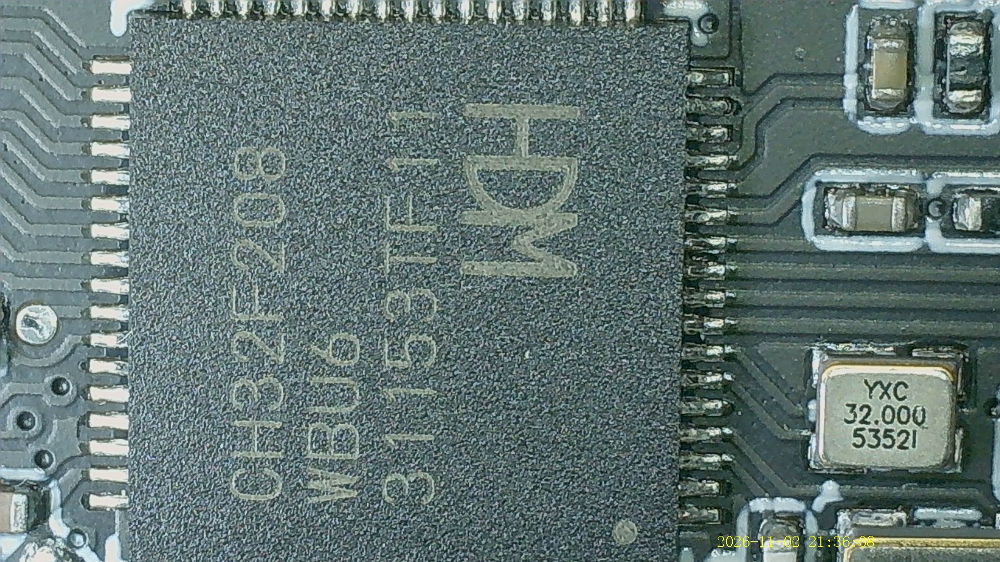

* **芯片丝印**：`WCH CH32F208 WBU6 31153TF11`
* **晶振配套**：右下角紧邻 `YXC 32.000` (32.000 MHz 贴片晶振)
* **封装规格**：QFN-68 极小尺寸封装
* **深度解析**：
  * **内核性能**：采用 32 位 **ARM Cortex-M3** 架构，最高运行频率高达 **144 MHz**，拥有 480 KB Flash 与 64 KB SRAM，算力充沛，可毫秒级运行高精度数字 PID 闭环控温算法；
  * **片上集成 BLE 5.3**：CH32F208 最大的特色是片上原生集成了 **2Mbps 低功耗蓝牙 5.3** 无线收发器。这印证了 AirGo 140 原生具备蓝牙无线连接能力，可配合手机 App / Web 蓝牙实现无线改温、自定义温控曲线与固件升级；
  * **ADC 与外设**：内置 16 通道 12-bit 高速 ADC，负责高敏度采集热电偶毫伏级温度信号及母线电压。

### 3.2 外部存储扩展：华邦 Winbond 25Q64JVSIQ (64M-bit SPI NOR Flash)

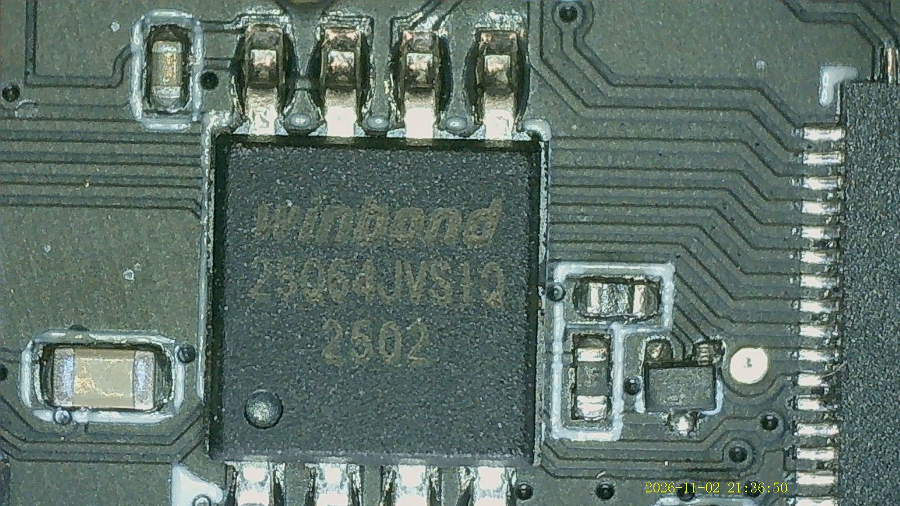

* **芯片丝印**：`winbond 25Q64JVSIQ 2502`
* **封装规格**：SOP-8
* **深度解析**：
  * **容量规格**：容量为 64 Mbit（即 **8 MByte**），支持 Standard/Dual/Quad SPI 模式，时钟频率最高达 133MHz；
  * **核心功用**：由于 AirGo 140 搭载了支持多国语言、多套动效 UI 和多组自定义预设（如 4 档风速、通用拆焊、墨水屏除胶曲线等）的 OLED 屏幕，这颗 8MB Flash 专门用于存放多套矢量字库、图形 UI 帧动画、离线工作日志以及 OTA 双备份固件。

### 3.3 动力总成：至盛半导体 ACME ACM6732 (三相直流无刷电机 BLDC 驱动)

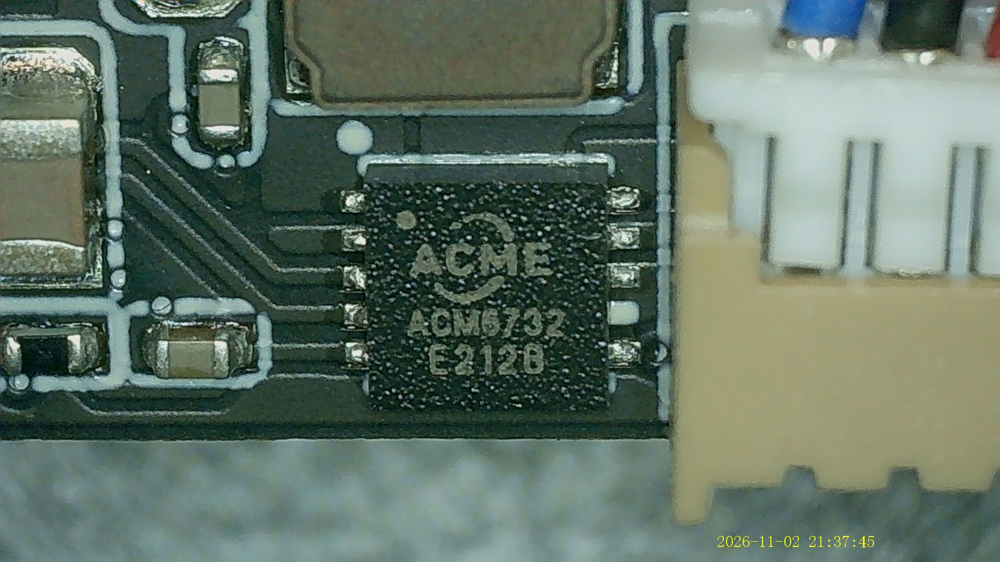

* **芯片丝印**：`ACME ACM6732 E2128`
* **右侧外设**：紧邻驱动微型无刷电机的 3 针插座（出线为红、蓝、黑三相）
* **封装规格**：DFN-10 ($3\text{mm} \times 3\text{mm}$)
* **深度解析**：
  * **厂商背景**：来自苏州至盛半导体（ACME Semi），专注于高性能微型马达驱动；
  * **电气参数**：工作供电范围 $2.7\text{V} \sim 16\text{V}$，支持单路输出峰值相电流达 **$2.4\text{A}$**；
  * **换相算法**：支持**无感方波、无感 180° 正弦波**驱动。对于 AirGo 140 这样拿在手里的超细笔杆设备，正弦波矢量算法能极大抑制电机高频震颤与换相啸叫，确保在 4 档超高转速下依然保持低噪音与平顺手感。

### 3.4 140W 满血加热开关：捷捷微电 JMSL0302AU (30V 145A 1.2mΩ SGT N-MOS)

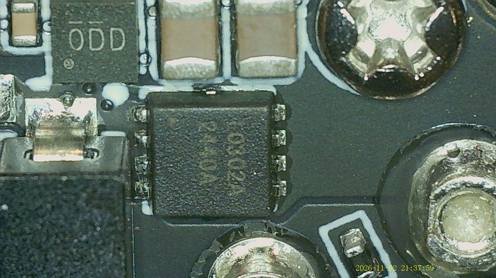

* **芯片丝印**：`L0302A / 2440A`（2024 年第 40 周制造）
* **左上元器件**：丝印 `0DD` 的 5 引脚超微型栅极驱动/电平转换芯片
* **封装规格**：PDFN 3.3×3.3 (PDFN3x3-8L)
* **深度解析**：
  * **极限内阻**：这是整个 140W 加热回路中最惊艳的用料！来自国内功率器件龙头**江苏捷捷微电（JJM）**的屏蔽栅 SGT 工艺 N 沟道功率 MOSFET；
  * **电气指标**：耐压 $V_{DS} = 30\text{V}$，连续漏极电流 $I_D$ 高达 **$145\text{A}$**，而在 $V_{GS}=10\text{V}$ 下的典型导通内阻仅为不可思议的 **$1.2\text{ m}\Omega$**（毫欧）！
  * **发热功耗实算**：在满血 28V 5A (140W) 持续加热时，这颗开关管上的导通发热功耗仅为：
    $$P_{loss} = I^2 \times R_{DS(on)} = 5^2 \times 0.0012\,\Omega = 0.03\,\text{W} = 30\,\text{mW}$$
    **仅仅 30 毫瓦**的微弱损耗！即使长时间满功率运行，芯片温升也微乎其微，这正是 AirGo 140 敢在完全不贴散热片的情况下，将大功率回路塞进 30mm 塑料笔杆的核心黑科技所在。

### 3.5 智能休眠与拿起唤醒：3轴 IMU 运动姿态传感器 (`0403 • RP2`)

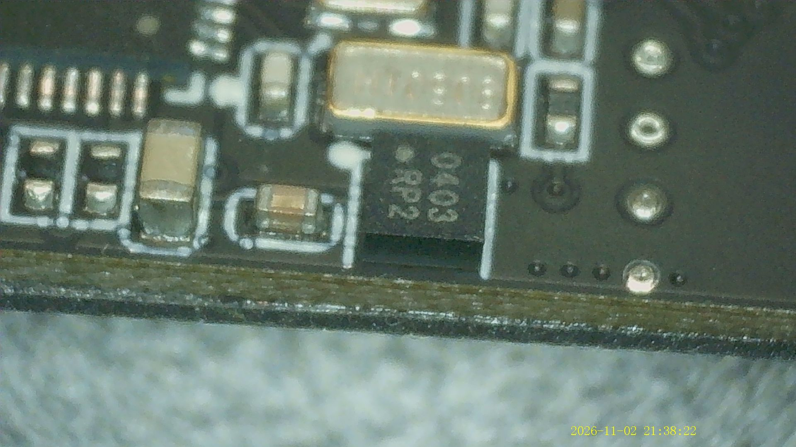

* **芯片丝印**：`0403 • RP2`
* **上方器件**：金色封装高稳石英微型谐振器
* **封装规格**：LGA / DFN 微型引脚封装
* **深度解析**：
  * **核心功能**：MINIWARE 家族经典的拿起唤醒与静置休眠机制。当热风枪被平放在支架或桌面上静止数秒，加速度计检测到无运动后，MCU 立即切断电热丝输出并将风机保持低速吹冷风，直至发热芯降至 50℃ 安全温度后进入睡眠；
  * 一旦操作人员重新拿起手柄，微小位移瞬间触发中断唤醒 MCU，12 秒内再次回到 300℃ 工作状态，既防干烧又极大提升了发热丝使用寿命。

### 3.6 发热芯硬件安全身份与温度校准：中科银河芯 GX2431Q (1-Wire 1024-bit 认证 EEPROM)

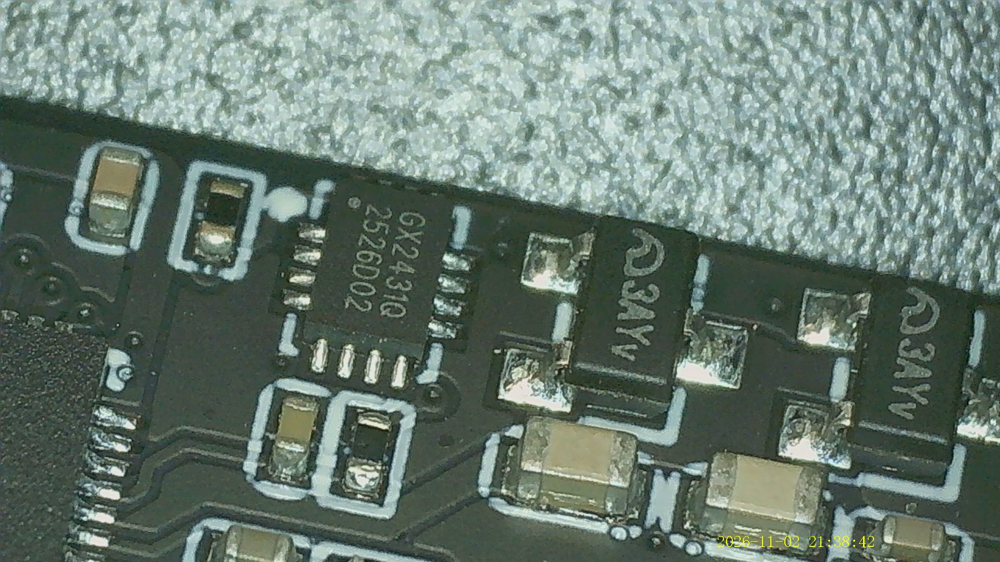

* **芯片丝印**：`GX2431Q 2526D02`
* **右侧器件**：双二极管防静电与稳压钳位单元（丝印 `3AY`）
* **封装规格**：QFN-16
* **深度解析**：
  * **技术血统**：来自中科银河芯（GXCAS），100% 硬件兼容业界经典的 Dallas/Maxim **DS2431** 单总线（1-Wire）安全存储芯片；
  * **功能特性**：内部具有 1024-bit（4 页 × 256-bit）EEPROM，出厂光刻了**全球唯一的 64 位 ROM 序列号**；
  * **为何热风枪里需要它？**
    1. **出厂温差精准校准**：每支发热管的电热丝阻值与热电偶分度均有轻微出厂公差，出厂时厂家将该加热芯的独立校准参数、多段温控曲线直接写入这颗 1-Wire 芯片，MCU 每次开机读取即可免除人工二次标定；
    2. **配件寿命与防伪**：记录发热芯的累计加电时长与热循环次数，实现发热芯寿命预测与原厂配件安全握手认证。

### 3.7 理想二极管防反接与输入保护：美芯微 MX5050T + 芯控源 AGM303AP N-MOS

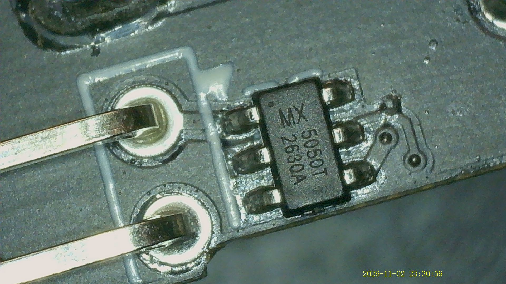

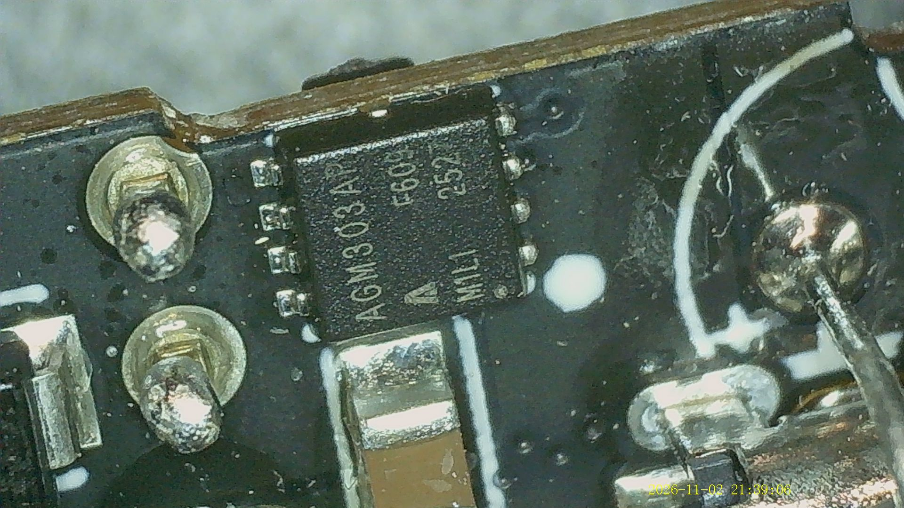

* **芯片组合**：无锡美芯微（Maxinmicro）**MX5050T**（丝印 `5050T`，SOT-23-6L）+ 芯控源（AGMSEMI）**AGM303AP**（30V 90A 2.8mΩ PDFN 3.3×3.3）
* **为什么不用传统二极管？**：
  * 在 140W (28V 5A) 持续大电流下，如果使用传统肖特基二极管做输入防反接与防倒灌保护，即使按 0.4V 极低正向压降计算，发热损耗也高达：
    $$P = I \times V_F = 5\text{A} \times 0.4\text{V} = 2.0\text{W}$$
  * 在空间极度狭小、无风道冷却的笔尾后仓，2W 的持续发热会瞬间烤焦外壳并危及电容。
* **理想二极管架构解析**：
  * **MX5050T 控制器**：支持 5V~40V 宽工作电压（瞬态抗浪涌耐压达 50V），内部集成电荷泵驱动外置高压 N-MOSFET，通过毫伏级闭环侦测源漏电压；
  * **超低导通损耗**：与导通内阻仅 2.8 mΩ 的 AGM303AP 强强联手，在 5A 满血负载下的导通发热损耗被大幅压低至：
    $$P_{loss} = 5^2 \times 0.0028\,\Omega = 0.07\,\text{W} = 70\,\text{mW}$$
  * **微秒级快速关断**：当母线检测到反向电流或拔出瞬间的电压扰动时，MX5050T 能在 0.3 微秒内迅速拉低栅极关断 MOS，杜绝高压倒灌与瞬态火花。

### 3.8 核心快充受电大脑：PD 3.1 EPR 协议控制器 `AD60300` (DFN-10 封装)

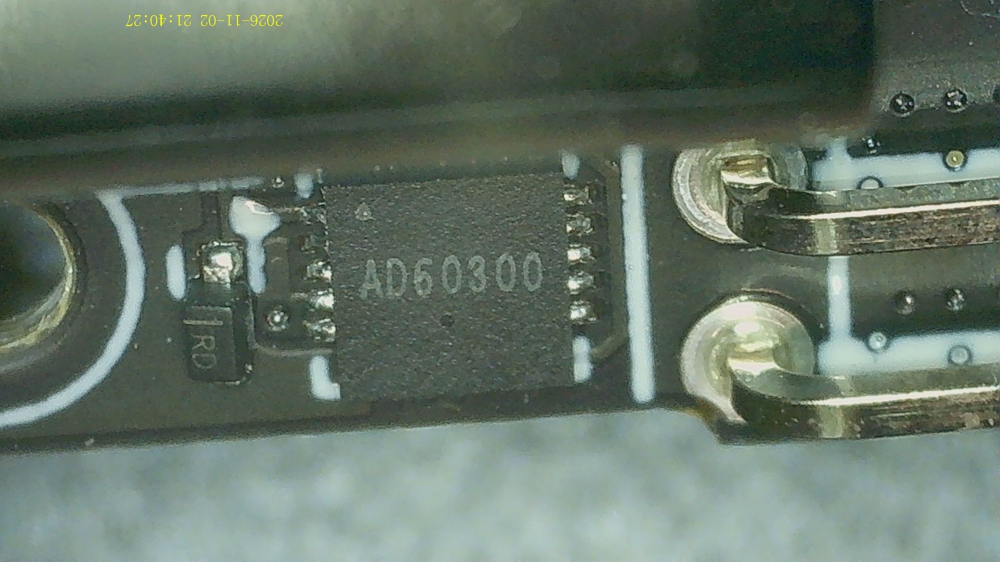

* **芯片丝印**：`AD60300`
* **封装规格**：DFN-10（双排 10 引脚紧凑封装）
* **硬件架构与核心职能**：
  * **140W 高压握手中枢**：AirGo 140 能够在接入支持 PD 3.1 的充电设备时成功激活 28V 5A (140W) EPR 档位，正是依靠坐镇尾部电源板的这颗专用受电控制器；
  * **工业级 DFN-10 规范定义**：在独立硬件级 USB-PD Sink 领域，经典的硬件协商芯片普遍采用标准的 DFN-10 封装，内部完整集成了：
    1. `CC1` / `CC2`：双路配置通道，支持 300kHz BMC 编码协商；
    2. `VBUS_IN`：高耐压母线电压采样，支持 28V~35V 过压保护；
    3. `VDD`：芯片逻辑供电，由旁边 8533U LDO 提供的 3.3V 待机轨供电；
    4. `GND`：纯净接地；
    5. `I2C SDA` / `SCL`：与主控 CH32F208 的数据与状态同步总线；
    6. `INT`：协商成功向 MCU 发送状态中断；
    7. `GATE / EN`：使能后级的 MX5050T + AGM303AP 理想二极管主通路；
    8. `CFG / DISCH`：档位配置与关机母线快速放电引脚；
  * **上电控制时序**：接入 USB-C 充电头后，尾部 8533U LDO 率先启动为该控制器提供 3.3V 逻辑电源，控制器立即通过 CC 引脚请求 28V/5A EPR 档位；协商成功后输出使能信号导通主功率 MOS 管向主板供电，并将握手状态同步给主控 MCU。

### 3.9 风机动力专线降压：高压同步 Buck 转换器 `HOJAS` + 贴片功率电感

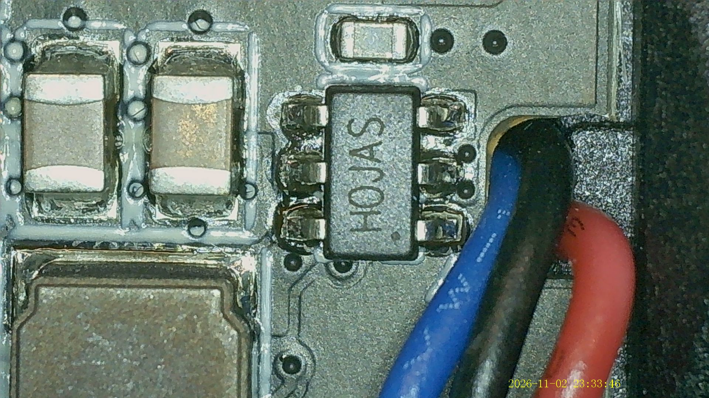

* **芯片丝印**：`HOJAS`
* **配套外设**：紧邻一颗方型贴片屏蔽功率电感与滤波电容
* **封装规格**：SOT-23-6
* **解开风机供电核心谜团**：
  * 很多朋友会疑惑：既然已经有了 28V 母线和 3.3V 逻辑轨，为什么上层动力板上还要多做这一路独立的 DC-DC 降压？
  * 关键原因在于电机驱动芯片的物理耐压上限：前面提到的三相无刷电机驱动芯片 **至盛 ACM6732**，其推荐工作电压为 $2.7\text{V} \sim 16\text{V}$，**绝对耐压只有 16V**！如果直接接到 28V EPR 母线上会瞬间被高压击穿烧毁；
  * 因此，MINIWARE 在上层动力板专门设置了这路降压电路，将 28V 高压母线单独降压为约 12V 动力轨，专门供给 ACM6732 驱动微型三相无刷涡轮风机，既释放了马达的满血转速风压，又确保驱动 IC 始终工作在安全电压区间之内。

### 3.10 磁吸支架感应与秒级入座休眠：圣邦微 SGMICRO 204NS 全极性低功耗霍尔开关

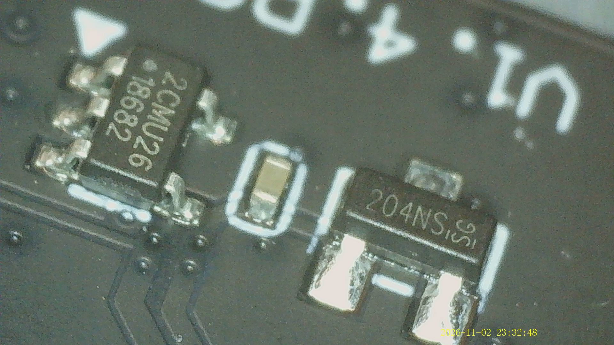

* **芯片丝印**：`SG` (圣邦微标志) `204NS`
* **封装规格**：SOT-23-3
* **与 IMU 构成双重休眠安全闭环**：
  * 使用过 AirGo 140 的朋友会发现：风枪放在桌面上静止几秒会自动休眠，而一旦插回专用的磁吸工作支架，则是**毫秒级瞬间立刻响应吹冷风休眠**；
  * 这颗来自国内模拟龙头**圣邦微电子（SGMICRO）**的低功耗全极性霍尔传感器正是背后的秘密武器！它具备微安甚至纳安级的超低静态功耗，南极或北极磁场靠近皆可触发；
  * 当风枪插入带磁铁的支架底座时，霍尔开关瞬间输出电平跳变给主控 MCU，触发外部中断，风枪零延迟切入降温保护；离开支架后磁场消失立刻恢复加热。与下层板的 3 轴 IMU 运动姿态传感器形成了“磁吸精准识别 + 离手防干烧”的双重安全保险。

### 3.11 双路精密模拟前端：亚德诺 AD8591 轨到轨运放矩阵（测温 + 大电流采样）

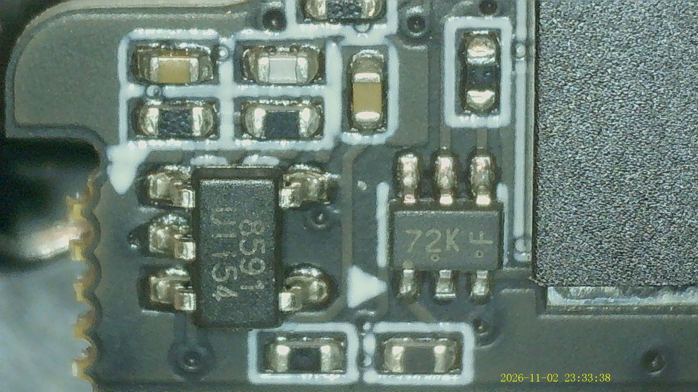

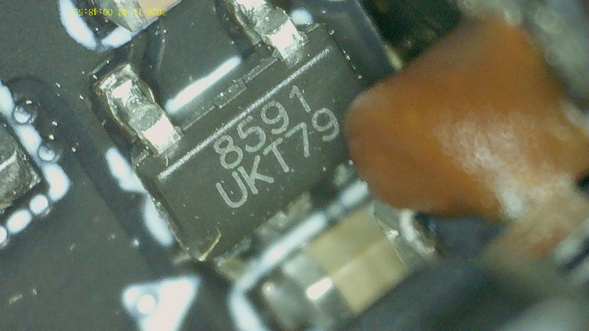

* **芯片丝印**：两颗均为 `8591`（SOT-23-6 封装），第二行批次代码分别为 `U1154` 与 `UKT79`
* **硬件奇观——板载双 8591 运放独立分工**：
  * 来自模拟巨头**亚德诺半导体（Analog Devices）**的高性能单路单电源轨到轨输入/输出运算放大器 **AD8591**；
  * 拥有 3MHz 增益带宽积、极高的共模抑制比和纳安级超低关断漏电流，并具备专门的 Shutdown 引脚；
  * **第一颗（温控 AFE）**：与下方丝印 `72K`（双 2N7002 小型 N-MOS 管）及高精度阻容搭配，负责发热管内部微型热电偶微伏级温差电势的差分放大与低通滤波，确保 MCU 获得 $\pm 1^\circ\text{C}$ 的严苛恒温采样基准；
  * **第二颗（电流采样 AFE）**：周围紧挨着高压大容量 MLCC 滤波电容和粗走线，负责对 140W (5A) 满载发热回路及电机动力母线的**大电流进行毫秒级精密检流（Current Shunt Sense）**，为单片机提供数字实时功耗计算（$P = U \times I$）与毫秒级过流熔断保护。

### 3.12 硬件级防失控联锁：友台半导体 UMW 74AHCT1G08 逻辑与门

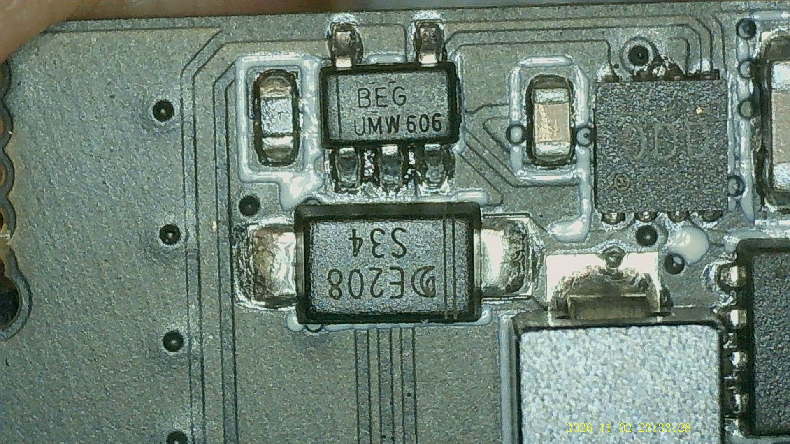

* **芯片丝印**：`BEG`
* **封装规格**：SOT-23-5
* **硬件级最后防线**：
  * 来自友台半导体（UMW）的 **74AHCT1G08** 高速 CMOS 单路双输入正逻辑与门（AND Gate）；
  * 在 140W 高功率发热设备中，最致命的隐患是 MCU 在遭遇异常死锁、固件升级刷新或低压复位瞬间，GPIO 引脚漂移为持续高电平导致电热丝失控常开干烧起火；
  * AirGo 140 在此处引入硬件与门：必须在“主控正常输出加热 PWM”且“硬件安全使能信号（如风机正常运转与温度合规）同时为有效高电平”时，加热 MOS 管 JMSL0302AU 的栅极驱动信号才会被允许导通！这种纯硬件级的硬联锁，彻底杜绝了软件跑飞引发干烧的可能。

### 3.13 辅助精密供电：矽力杰 Silergy 高性能微电源芯片

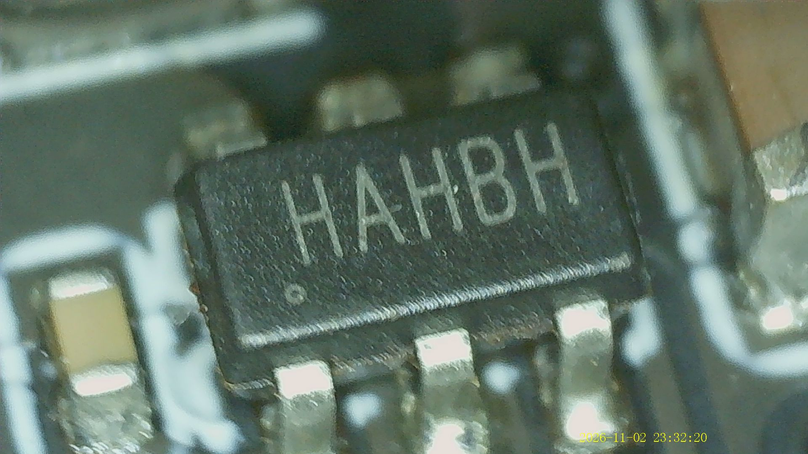

* **芯片丝印**：`HAHBH`
* **核心功用**：为下层敏感模拟电路、基准源与传感器网络提供超低噪声的辅助稳压输出。

### 3.14 尾部圆盘小板的先锋电源：高压超低功耗 LDO `8533U` (35V 输入, SOT-89 封装)

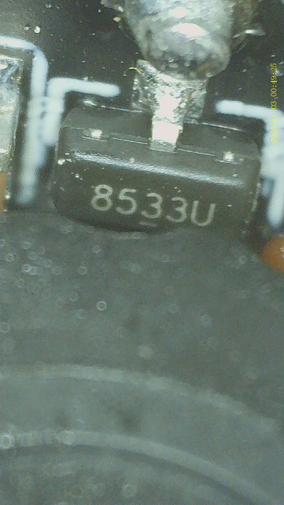

* **芯片丝印**：`8533U`
* **封装规格**：SOT-89（带有宽面散热 Tab）
* **背景特殊细节**：微距视野背景中极其清晰的**同心圆弧形铜箔走线**，直接印证了它正是焊接在机身尾部圆形独立板（`140 PCB`）上的核心元件！
* **深度解析与整机角色**：
  * 典型型号为 **SE8533**（或高压低功耗 3.3V 系列），拥有高达 **35V~40V 的极高输入耐压**，且静态工作电流低至惊人的 **2.6 µA**；
  * **整机的“先锋保命供电”**：当 Type-C 端口插入充电头，母线从 5V 逐步升压到 28V EPR 时，主板上的大功率 Buck 转换器在待机状态可能尚未启动。这颗 8533U 能以极微小的待机功耗，直接从 5V~28V 母线中稳定输出 3.3V 纯净电源，专门供给尾部 Type-C 握手芯片、待机唤醒电路与系统基础逻辑，是整个 140W 系统安全上电的第一道前哨兵。

### 3.15 用户参数断电记忆中枢：AT24C02 I²C 串行 EEPROM (`2CMU26`)

* **芯片丝印**：`2CMU26`（SOT-23-5 封装）
* **丝印解码**：`2C` 代表 24C02 系列（2Kb 容量 / 256 字节），`M` 代表 1.7V~5.5V 宽工作电压，`U` 为环保封装代号，`26` 为生产批次/周期代码；
* **为什么放在霍尔开关旁边？**
  * **入座休眠与即时存盘强联动**：用户使用中频繁调整温度与风速，系统不会每次都写 Flash；而当热风枪插回磁吸支架的瞬间，霍尔开关（`204NS`）受磁触发硬件中断，MCU 在关闭发热管切入吹风休眠前的短短几毫秒内，**会立刻把当前最新的设定温度、风速档位与运行日志写入旁边的这颗 EEPROM 固化保存**；
  * **百万次擦写寿命**：对比大容量 NOR Flash 必须以 4KB 扇区为单位擦除且寿命仅 10 万次，EEPROM 支持按单字节即时读写，擦写寿命高达 **100 万次**，永不磨损；
  * **远离 140W 高频开关的“纯净小信号区”**：霍尔开关和 EEPROM 同属微安级待机弱电设备，共享 3.3V 上拉与滤波网络，并远离前端电机和加热管的强电磁干扰。

---

## 📐 四、 MINIWARE AirGo 140 完整硬件电气架构图

结合两块 PCB 的电路追踪与芯片拆解分析，整个 AirGo 140 的完整硬件控制与能量流动拓扑如下图所示：

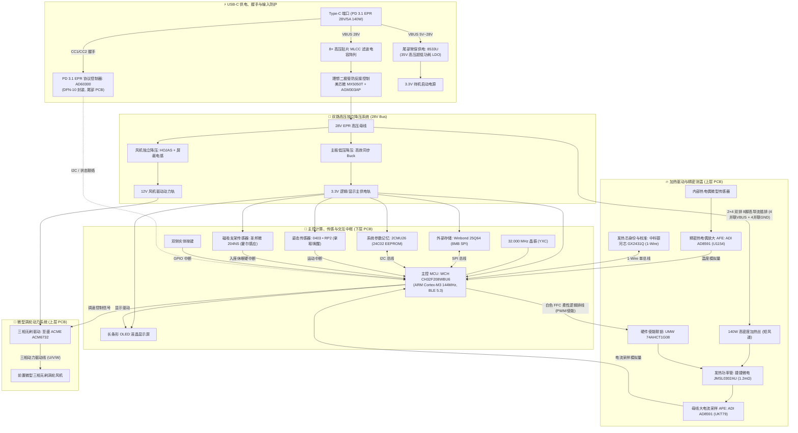

---

## 📋 五、 核心芯片与元器件全景规格清单

以下是本次拆解整理出的 AirGo 140 全套关键半导体器件汇总表，供硬件工程师与电子爱好者参考：

| 电路子系统 | 器件丝印 (Marking) | 完整型号 / 规格 | 制造厂商 | 封装形式 | 核心电气指标与关键参数 | 在机身系统中的核心职责 |
| :--- | :--- | :--- | :--- | :--- | :--- | :--- |
| **主控芯片 (MCU)** | `CH32F208 WBU6` | **CH32F208WBU6** | 南京沁恒 (WCH) | QFN-68 | 32-bit Cortex-M3 @ 144MHz 480KB Flash + 64KB SRAM 集成 BLE 5.3 蓝牙, 12-bit ADC | 整机控制大脑、PID 数字恒温闭环算法、蓝牙上位机通信、UI 渲染 |
| **主控系统晶振** | `YXC 32.000` | **32.000 MHz 贴片晶振** | 扬兴科技 (YXC) | SMD-3225 | 32MHz 基准频率, $\pm 10\text{ppm}$ 高精度 | 为 Cortex-M3 内核及 BLE 蓝牙射频提供稳定基准时钟 |
| **外部闪存 (Flash)** | `25Q64JVSIQ` | **W25Q64JVSIQ** | 华邦电子 (Winbond) | SOP-8 | 64 M-bit (8 MByte) NOR Flash 最高支持 133MHz Quad SPI | 存储多国语言字库、UI 界面帧动画、发热曲线配置及 DFU 备份镜像 |
| **系统配置 EEPROM** | `2CMU26` | **AT24C02** | 业界标准 (Microchip兼容) | SOT-23-5 | 2K-bit (256 字节) I²C EEPROM 100 万次擦写寿命, 字节即时写入 | 位于霍尔开关旁，负责用户个性化参数即时保存、断电记忆与整机出厂校准 |
| **无刷电机驱动** | `ACM6732` | **ACM6732** | 至盛半导体 (ACME) | DFN-10 (3×3) | 供电 2.7V~16V, 峰值相电流 2.4A 支持无感 180° 正弦波静音算法 | 驱动前置微型三相无刷涡轮风机，实现平稳低噪大风量吸风 |
| **风机独立降压** | `HOJAS` | **高压同步 Buck DC-DC** | 高性能电源芯片 | SOT-23-6 | 输入耐压 $\ge 30\text{V}$, 搭配外置贴片电感 | 将 28V EPR 母线降至 12V 动力轨，供给 ACM6732 驱动微型风机 |
| **发热功率开关管** | `L0302A` | **JMSL0302AU** | 捷捷微电 (JJM) | PDFN 3.3×3.3 | 耐压 30V, 最大电流 145A **导通阻抗低至 1.2 mΩ** (SGT 工艺) | 140W 核心加热 PWM 控制管，导通损耗仅 30mW，免散热片的核心保障 |
| **发热芯认证/存储** | `GX2431Q` | **GX2431Q** | 中科银河芯 (GXCAS) | QFN-16 | 1024-bit 1-Wire EEPROM 兼容 DS2431, 唯一 64 位 ROM 序列号 | 储存发热芯出厂温度分度标定参数、工作热循环次数记录与原厂防伪 |
| **精密模拟运放 1** | `8591` (`U1154`) | **AD8591** | 亚德诺 (ADI) | SOT-23-6 | 单路轨到轨输入输出, 3MHz 带宽 搭配 `72K` 双 MOS 管低噪声前端 | 作为热电偶微伏级温差 AFE，信号精密放大滤波后送入 MCU 采样 |
| **精密模拟运放 2** | `8591` (`UKT79`) | **AD8591** | 亚德诺 (ADI) | SOT-23-6 | 单路轨到轨输入输出, 3MHz 带宽 搭配高耐压高容量 MLCC 滤波 | 作为发热母线高动态大电流检流 AFE，为硬件限流与功率计算提供基准 |
| **理想二极管控制** | `5050T` | **MX5050T** | 美芯微 (Maxinmicro) | SOT-23-6L | 宽工作电压 5V~40V, 耐瞬态 50V 驱动外置 N-MOS 替代肖特基 | 驱动 AGM303AP 组成零压降防反接系统，杜绝大电流下的严重管压降发热 |
| **输入保护开关管** | `AGM303AP` | **AGM303AP** | 芯控源 (AGMSEMI) | PDFN 3.3×3.3 | 耐压 30V, 电流 90A 导通阻抗 2.8 mΩ (N-MOS) | 受 MX5050T 驱动充当理想二极管，负责母线过流切断与安全通断 |
| **尾插先锋高压LDO** | `8533U` | **SE8533 系列** | 航顺/思旺微等 | SOT-89 | 输入耐压 35V~40V, 静态功耗 2.6µA 位于尾部圆盘小板 (`140 PCB`) | 直接从 5V~28V 母线降压输出 3.3V 待机电平，为 PD 握手及唤醒电路提供启动电源 |
| **支架休眠霍尔** | `204NS` | **低功耗全极性霍尔开关** | 圣邦微 (SGMICRO) | SOT-23-3 | 纳安级超低静态功耗, 全极性感应 | 识别插入磁吸/金属支架状态，与 IMU 构成进座降温休眠双重保险 |
| **姿态传感器 (IMU)** | `0403 • RP2` | **3 轴数字加速度计** | 紧凑型 MEMS 芯片 | LGA/DFN | 微安级超低功耗运动侦测 | 识别拿取/平放动态，实现离手自动降温、重新拿起 12 秒速热 |
| **硬件使能联锁** | `BEG` | **SN74AHCT1G08** | 友台半导体 (UMW) | SOT-23-5 | 单路双输入正逻辑与门 (AND) | 硬件使能互锁保护，防止 MCU 复位或死机时电热丝常开失控 |
| **逻辑降压转换器** | `AD60300` | **高压同步 Buck 芯片** | 高性能电源管理 IC | DFN-10 | 输入耐压 $\ge 36\text{V}$, 高频同步整流 搭配外挂 `1R0` (1.0µH) 功率电感 | 将 28V EPR 高压降至 3.3V 逻辑电平，为 MCU、Flash 及 OLED 供电 |
| **辅助稳压芯片** | `HAHBH` | **微电源管理 IC** | 矽力杰 (Silergy) | SOT-23-6 | 超低噪声微电源稳压输出 | 为下层高敏传感器与参考基准提供纯净稳压供电 |
| **母线高压滤波阵列**| 贴片电容 | **高耐压贴片 MLCC** | 贴片陶瓷电容 | 1206 / 0805 | 双排并联共 8 颗大容量高压 MLCC | 吸收 140W 高频 PWM 斩波造成的反峰电压与纹波，保护充电头不跳闸 |
| **PD 3.1 协议芯片** | AD60300 | **PD 3.1 EPR Sink 控制器** | 高性能快充控制 IC | DFN-10 (双排10引脚) | 支持 PD 3.1 28V/5A (140W) EPR 协议握手 集成 CC1/CC2 逻辑, I2C 联络主控 | 坐镇尾部 PCB，在插入瞬态与充电桩协商 28V 高压，控制理想二极管导通 |

---

## 💡 六、 拆解总结与硬件评述

拆解完整支 MINIWARE AirGo 140，给我最大的感受是：**这是一款工业美感与工程成熟度极高的便携工具杰作**。

它之所以能彻底打破“传统热风枪无法便携、PD 功率绝对带不动”的固有成见，关键在于它完成了两次跨界创新：
1. **热力学与气动架构的打破常规**：不再照抄传统工业风枪“后置风机 + 贯穿长风筒”的陈旧思路，而是靠**环形前进风 + 尾流循环**大幅缩短风道，让 140W 的热量集中爆发在工作面，实现以小博大；
2. **顶尖国产功率半导体与 SoC 的成熟协作**：
   * **沁恒 CH32F208**：用一颗 Cortex-M3 高主频 MCU 同时搞定高精度温控、UI 显示和 BLE 蓝牙连接；
   * **捷捷微电 JMSL0302AU**：1.2 mΩ 的顶尖 SGT MOSFET，将 140W 满负荷下的开关损耗打落到仅仅 30mW，从源头上抹平了散热空间不足的物理死穴；
   * **至盛半导体 ACM6732**：将三相无刷电机的正弦驱动做进 3×3mm 封装，为 30mm 笔杆提供了强劲而静音的动力；
   * **中科银河芯 GX2431Q**：用 1-Wire 存储器将发热芯的温控标定与安全认证闭环做到了工业级标准。

在 400 元这个价位上，AirGo 140 绝不仅仅是“做了一个能吹热风的笔”，而是为所有热衷便携 DIY 的玩家和电子爱好者，交出了一份从空气动力学到现代电力电子器件的优秀答卷。

---

## 🚀 七、 彩蛋预告：官方支架卖 86 实在绷不住？自制 3D 打印“自重联动自动休眠支架”！

买完 AirGo 140 之后，原本想着顺手配齐原厂配件，结果一搜官方磁吸自动休眠支架的价格——**单卖竟然要 86 元**！

仔细端详官方原厂支架，本质上就是一个带有强磁铁的折弯钣金件。更尴尬的是，官方采用的是**“风枪头部朝下插圈”**的放置方式：在关机吹冷风降温时，发热芯内部数百度的残留热气全往下方喷涌蓄积。如果玩家想用 PETG 或 PLA 等常见 3D 打印耗材复刻一个，低熔点塑料在残温直吹下极易发生软化熔解变形。

86 元实在让人绷不住，既然本次拆解已经把它的硬件底细摸得一清二楚——**我们已经精准定位了主板上那颗圣邦微 SGMICRO 204NS 全极性微功耗霍尔开关的绝对物理坐标**（位于机身正面防滑橡胶颗粒区内部），那么完全可以依托本次拆解的结构数据，自己建模 3D 打印一个更好用、更安全的专属自动休眠支架！

目前这款原创支架已经在 FreeCAD 中完成了全参数化建模与运动学设计，核心亮点抢先剧透：
1. **仰角 65° U 型朝上快取托架**：彻底摒弃官方“枪头朝下”的闷热插圈设计，采用 65° 仰角斜向上支撑。热风枪放入后，余热自然垂直向上对流排空，不仅拿取极顺手，而且即便采用普通 PETG 打印也绝对没有被残温吹熔的风险；
2. **“单底座 + 选配活动摇臂”双模休眠架构**：
   * **模式一：极简模式（屏幕朝下）**：仅需打印一件一体底座，U 型槽底直接嵌入 5mm 强磁片，风枪正面防滑区朝下贴紧即可毫秒级触发霍尔休眠；
   * **模式二：优雅模式（屏幕朝上自重联动）**：为追求视觉与操控体验的玩家量身定制！加装一个微型“L 型活动摇臂”，**无需任何螺丝或铜轴，直接剪一段常见的 0.8mm 焊锡丝穿入耳座充当活动转轴**；风枪放入时依靠 115g 机身自重下压触发板，联动摇臂平稳翻转，将顶端磁铁精准搭在正面防滑区的霍尔感应点上！屏幕全程朝上，降温进度与实时状态一览无余；提起风枪时，外侧微配重翼依靠重力无弹簧自动复位张开，机械联动感拉满。

目前模型正在进行第一轮切片试打与磁场吸附实测调校。待验证测试完毕后，我将单独写一篇详细的开源设计与制作教程，并无偿公开全部 STL / STEP 3D 打印文件与 FreeCAD 参数化工程源码，欢迎各位玩机同好保持关注！

