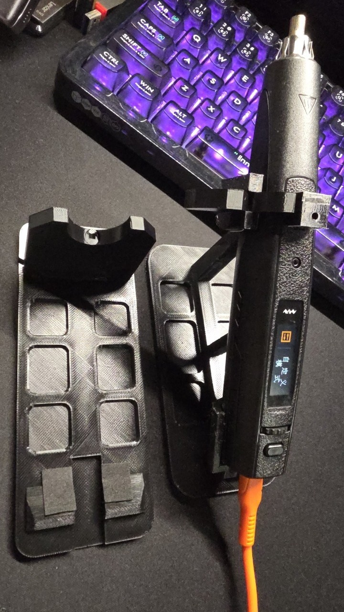
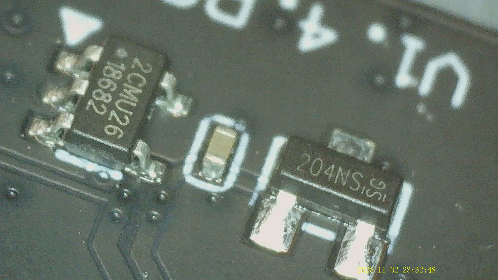
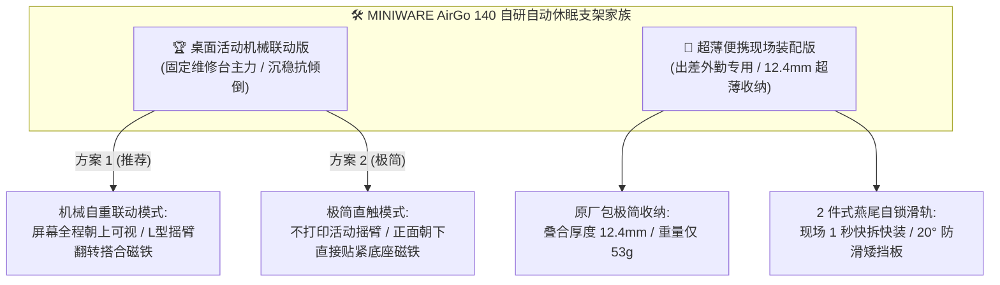
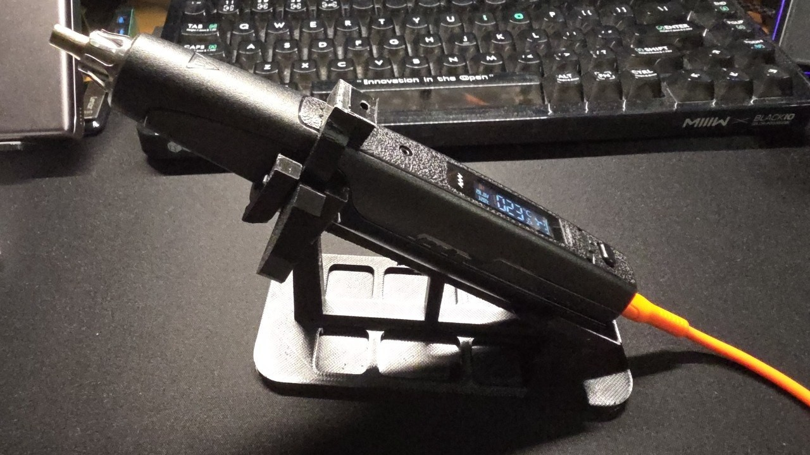
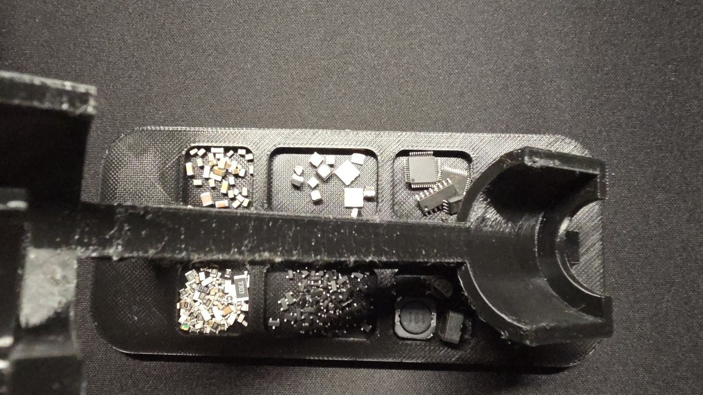
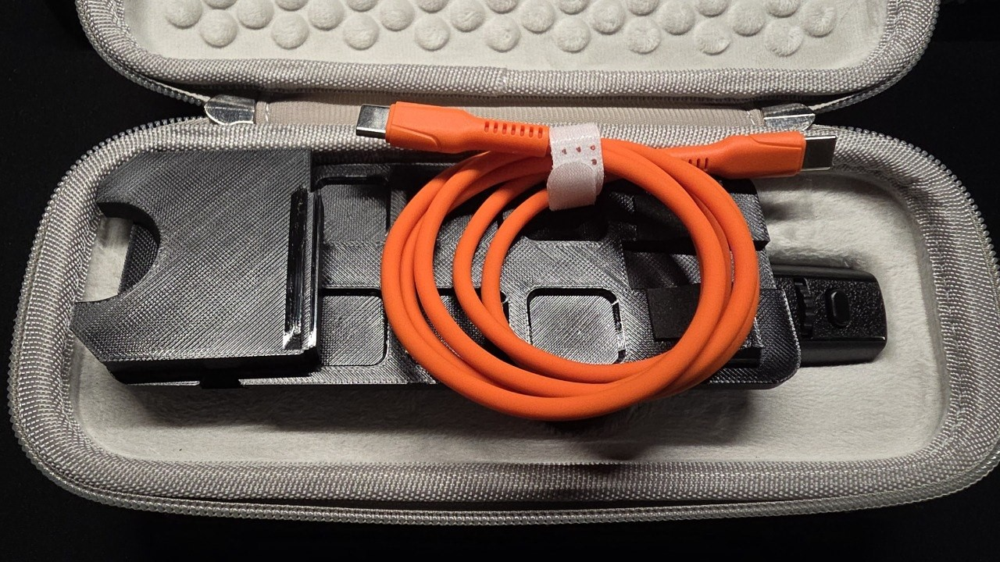
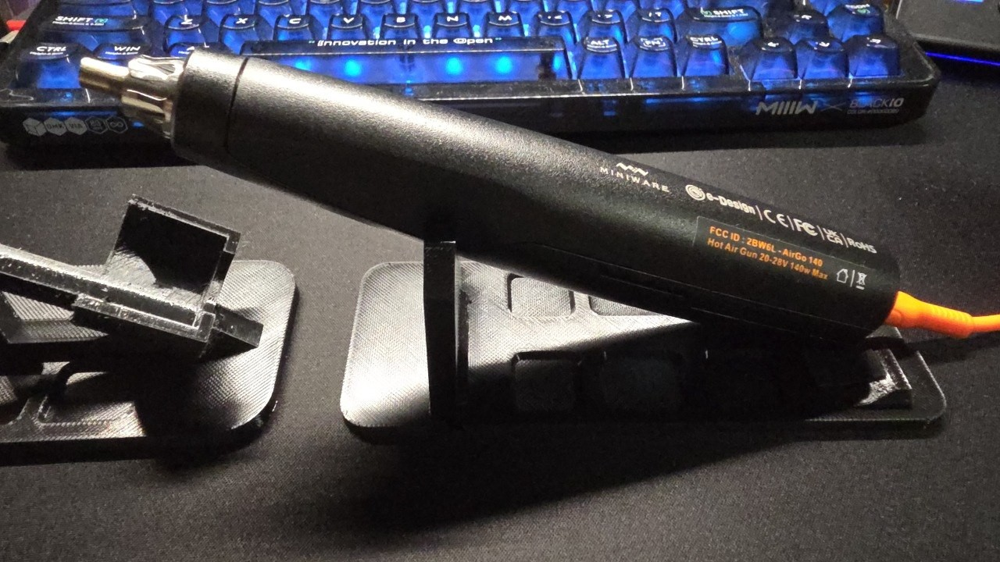

在上一篇深度拆解文章中，我们把 **MINIWARE AirGo 140** 便携热风枪彻底大卸八块，从双层 PCB 强弱电物理分流、1.2mΩ 超低内阻加热开关管，一直剖析到了尾部的 PD 3.1 协议芯片：

[全网首拆！MINIWARE AirGo 140 便携热风枪深度拆解与硬件架构全景分析 —— 140W PD 3.1 掌上拆焊神器的内部秘密](/posts/ag140d/){: .preview }

拆解不仅让我们看清了这支“掌上 140W 吹焊神器”的内部肌肉，更为后续的实用外设改造埋下了一枚极具价值的伏笔。

入手 AirGo 140 之后，原本想着顺手配齐原厂配件，结果一搜官方磁吸自动休眠支架的价格——**单卖竟然要 86 元**！

仔细端详官方支架，本质上就是一个带有磁铁的折弯钣金件。更尴尬的是，它还存在反热力学的结构硬伤。于是，一场基于芯片级精准逆向测绘、用 3D 打印彻底重构热风枪摆放体验的自研计划正式提上日程。

经过数轮实机切片试打与运动学优化，目前这套 **“MINIWARE AirGo 140 朝上双模自动休眠支架”** 已正式落地，并在拓竹 **MakerWorld** 平台无偿开源发布！

---

## 🧐 一、 缘起：官方支架卖 86 实在绷不住？反热力学的结构硬伤

对于热风枪这种停机后发热芯仍有数百摄氏度余温的高功率发热工具而言，支架绝非“可有可无的摆件”，而是保障工作台安全与延长发热丝寿命的核心枢纽。

然而，官方原厂支架的设计却让人难掩失望：
1. **性价比过低，价格虚高**：一块冲压折弯的钣金铁皮加一颗小磁铁，官方单卖售价高达 **86 元**；
2. **反热力学的致命硬伤（枪头朝下大角度插圈）**：
   * 官方采用将风枪头部朝下插进圆环的固定方式；
   * 在使用完毕切断发热、风机全速吹冷风降温时（从 350℃~450℃ 强行吹冷至 50℃ 安全线），**数百度的残留热风全部往下方喷涌蓄积**，热空气受阻后向上对流倒灌！
   * 如果玩家试图使用 PETG 或 PLA 等常见 3D 打印耗材复刻原厂结构，低熔点塑料在热浪直吹下会在几十秒内迅速软化熔融坍塌；
   * 即便使用原厂金属支架，残温被闷在圈内对风枪前段轴流风道与前壳寿命也极不友好，还会将桌面脚垫烤得滚烫。

既然官方方案既贵又存在设计隐患，那么打破常规、自研一款**“枪头朝上自然对流排空、自重机械联动触发休眠”**的专属支架便成了最优解。

---

## 🔬 二、 拆解逆向红利：精准锁定 SGMICRO 204NS 霍尔开关物理坐标

要想在自制支架上完美复刻原厂“放上即停、拿开即开”的磁吸自动休眠功能，核心前提是搞清楚风枪是通过什么原理探测支架的。

在上一篇拆解的 **3.10 节** 与 **3.15 节** 中，我们在下层主板正面有了关键发现：

*   **感应元件**：下层主板靠近 OLED 显示屏与侧键区域，焊有一颗丝印为 `204NS` 的 **圣邦微 (SGMICRO) 全极性超低功耗霍尔开关芯片**；
*   **空间坐标映射**：对照外壳装配定位孔与 PCB 螺柱，我们精准测绘出了这颗芯片在整机机身上的空间坐标——**它正好位于风枪正面外壳凸起的防滑橡胶颗粒区正下方**；
*   **控制时序**：一旦该芯片感应到外部磁场（全极性，无论 S 极还是 N 极贴近均可），即向沁恒 CH32F208 主控发出硬件外部中断，MCU 立即关闭捷捷微电 140W 加热 MOS 管，并将当前温度参数写入旁边的 AT24C02 EEPROM，同时保持风机全速吹风降温，直到温感低于 50℃ 后切断主供电转入低功耗待机。

**知道了霍尔传感器的精确三维空间坐标与感应特性，就等于拿到了支架磁铁位置设计的“标准答案”**。

---

## 📐 三、 架构设计：两套截然不同的使用哲学

为了兼顾“工作室固定维修台”与“移动外勤出差”两种完全不同的工况，本次开源方案没有采用妥协的单一模型，而是推出了两套各司其职的独立分支：

---

## 🏆 四、 核心方案一：桌面活动机械联动版

对于绝大部分在固定工作台上使用的电子工程师与创客而言，桌面版旨在打造极具仪式感与实用性的**“旗舰级桌面伴侣”**。

### 4.1 核心设计亮点

1. **仰角 65° 朝上 + 自然热对流排空**：
   * 彻底摒弃官方“枪头朝下”的闷热插圈设计，采用 65° 仰角斜向上支撑；
   * 热风枪在停机吹风降温时，数百度的残温顺着气流自然垂直向上扩散排空，完全不与支架本体接触，**即便使用耐温仅 70℃ 的普通 PETG 打印，实测长时间降温也绝对毫无软化变形隐患**；
2. **屏幕朝上 + 纯机械自重联动（摇臂活动件可选配）**：
   * **联动模式（推荐）**：专为追求视觉反馈与机械操作感的创客设计。放入风枪时，依靠整机 115g 的自重向下压动摇臂内侧托板，力矩驱动微型“L 型摇臂”平稳向前翻转，将顶端磁铁精准搭在机身正面防滑区的霍尔感应点上；
   * **降温进度直观可视**：**屏幕全程朝上**，实时温度、风速以及从 350℃ 极速跌落至 50℃ 的冷却倒计时一览无余，无需歪头或拿起查看；
   * **重力自然回弹（无弹簧机构）**：提起风枪瞬间，外侧专门经过重心平衡计算的微配重耳在重力分量驱动下向外自锁跌落约 32°，摇臂自动张开待命，无需任何机械扭簧；
   * **极简模式（活动件可不打印）**：如果追求极简或懒得组装连杆，底座前托鞍座底部同样预留了另一个直触磁铁盲孔。只需直接嵌一颗磁铁，风枪**正面朝下放置**也同样能秒级触发自动休眠；
3. **免螺丝极速装配（身边材料即可组装）**：
   * 转轴通孔两侧特别设计了 45° 导向扩口；
   * **无需购买任何特规微型螺丝、铜轴套或轴承**，随手剪一段身边最常见的 **0.8~1.0mm 常用焊锡丝**（或回形针、3D 打印耗材余料），从侧面一插到底，两端轻微压扁即可充当永久免润滑转动销轴；
4. **骨架三角力学桁架 + 6 格 SMD 零件收纳盘**：
   * 底部采用三角桁架结构，大幅偷轻的同时保证低重心稳如磐石；
   * 底座平板区域贴心掏空为 **6 格带圆角过渡的贴片元器件收纳盒**，日常拆焊时顺手存放备用热风喷嘴、镊子、拆板的贴片电容、电阻、晶振或小螺丝，告别桌面细小零件满桌乱滚的噩梦。

---

## 🎒 五、 核心方案二：超薄便携现场装配版

许多玩家购买 AirGo 140 正是看中了它依靠 PD 3.1 实现的极致便携性。然而官方金属支架又重又占地方，根本无法塞进原厂附赠的便携包内。

便携版的目标极其纯粹：**将收纳厚度压缩至物理极限，让支架成为便携包里隐形的标配**。

### 5.1 核心设计亮点

1. **原厂收纳包极度兼容（叠合厚度仅 12.4mm）**：
   * MINIWARE 原厂布艺拉链包的内部有效预留高度仅约 15mm；
   * 便携版将底盘与前托架拆分为两件式薄壁结构，两件交叠收纳时的总厚度严格控制在 **12.4mm**（留足 2.6mm 余量），全套自重仅 53g；
   * 放置在橙色粗编织 140W 快充线下方，拉链合盖平整服帖，毫无鼓包与挤压感；
2. **正面朝下直触自动休眠**：
   * 为将厚度压缩到极致，便携版舍弃了复杂的自重连杆机械；
   * 现场需要自动休眠时，只需将热风枪**正面朝下（屏幕朝下）**放入，机身正面凸起的防滑橡胶区正好贴紧前托鞍座底部的磁铁盲孔，同样实现毫秒级入座感应降温；
3. **2 件式 1 秒插滑燕尾自锁滑轨**：
   * 摒弃螺丝与卡扣，采用两组高刚性燕尾阶梯凸起滑槽；
   * 现场使用时，前托架对准导轨轻轻一推到底即刻形成刚性自锁，完全没有前后框量或侧倾晃动；
4. **20.0° 防滑矮挡板与线槽缺口**：
   * 尾端采用针对 AirGo 140 尾壳倾角 100% 贴合的 20° 机械限位矮挡板，彻底根治斜坡打滑滑脱隐患；
   * 挡板正中央特别开凿了 **14mm 宽口导线槽**，即便插着加粗的高柔性 240W 编织快充线，线缆也能顺畅贴地穿出，绝不顶翘风枪尾部。

---

## 🔩 六、 耗材五金清单 (BOM) 与 3D 打印切片建议

整套方案的制作成本极低，核心耗材总计不足 5 元：

### 6.1 物料清单 (BOM)

| 适用版本 | 所需配件 | 建议规格 | 所需数量 | 装配说明与备选替代 |
| :--- | :--- | :--- | :--- | :--- |
| **桌面版 (机械联动模式)** | **强力钕铁硼圆片磁铁** | 直径 6.0mm × 厚度 1.0~2.5mm | 1 颗 | 压入活动件摇臂头部圆槽，屏幕朝上自重联动 |
| **桌面版 (极简直触模式)** | **强力钕铁硼圆片磁铁** | 直径 6.0mm × 厚度 1.0~2.5mm | 1 颗 | 不印摇臂时，直接压入底座鞍座底部，正面朝下休眠 |
| **桌面版** | **活动铰链转轴销钉** | 直径 0.8~1.0mm 软焊锡丝 / 回形针 | 1 根 (长约 16mm) | 仅联动模式需要，从扩口直接穿入剪平即成转轴 |
| **便携版** | **强力钕铁硼圆片磁铁** | 直径 6.0mm × 厚度 1.0~1.5mm | 1 颗 | 压入前托鞍座底部盲孔，背面有顶针孔方便更换 |
| **通用配件 (选配)** | **圆形硅胶防滑脚垫** | 直径 8~10mm，厚度 1~2mm | 4 粒 | 贴入底座底部预留的沉孔内，抓台稳固度翻倍 |

### 6.2 3D 打印与切片建议

*   **100% 零支撑切片 (No Support)**：
    *   所有 STL 文件均已在 CAD 坐标系中完成最佳贴床角度校正；
    *   无论是桌面版的悬臂轴耳，还是便携版的滑轨燕尾槽，悬空部位均采用了 45° 倒角与自支撑圆弧过渡，**切片时请务必关闭支撑生成**，到手直接撕盘；
*   **耗材选择推荐**：
    *   **首选材质**：**PETG** 或 **ABS / ASA**（具备出色的层间结合力与韧性，滑轨反复插拔耐磨顺滑）；
    *   **PLA / PLA+ 亦可放心使用**：得益于枪口斜向上 65° 自然热对流排空，手柄接触位置在降温全过程中实测温升不足 5℃，PLA 同样能长期稳定服役；
*   **切片工艺参数**：
    *   **层高**：`0.20 mm`
    *   **壁厚圈数 (Wall Loops)**：`4 圈`（确保滑槽、轴耳等受力部位全实心）
    *   **填充率**：`30% 陀螺线 (Gyroid)`（兼顾结构刚性与配重下压手感）。

---

## 🔗 七、 MakerWorld 免费开源下载与结语

硬件折腾的终极魅力，莫过于从电路板上的芯片逆向，一步步延伸到解决真实使用中的痛点。

从深入拆解挖掘出那颗隐藏在橡胶颗粒下方的 `204NS` 霍尔感应点，到全参数化 CAD 建模、力矩自平衡仿真，再到最终用 3D 打印彻底干掉溢价严重的 86 元原厂钣金支架，这场跨越“电子电路”与“机械结构”的 DIY 闭环，不仅让 AirGo 140 的桌面与外勤体验变得彻底完整，也让技术落地充满了创客独有的纯粹乐趣。

所有模型文件均已免费开源上传至拓竹 **MakerWorld**，支持拓竹设备一键切片打印与标准三维文件直接导出：

👉 **模型下载链接**：[MINIWARE敏维AirGo140热风枪朝上自动休眠支架（桌面版+便携版）- MakerWorld](https://makerworld.com.cn/zh/models/3202508-miniwaremin-wei-airgo140re-feng-qiang-zhao-shang-z#profileId-3777595){: .preview }

如果这套模型在日常维修中帮到了你，欢迎在 MakerWorld 上点赞助力，也欢迎在评论区分享你的打印配置与实装返图！
