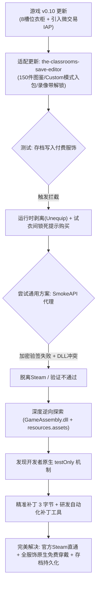
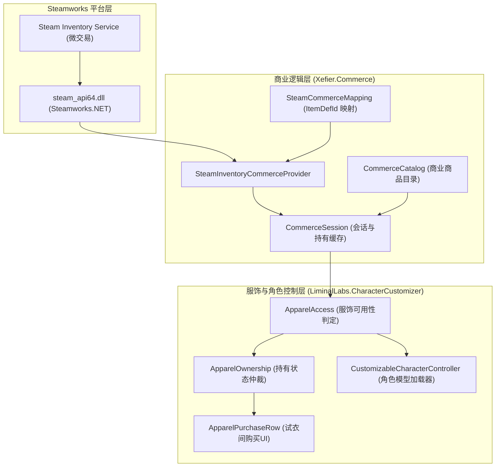

在之前的通识篇教程中，我们曾深入剖析过 Steam 底层清单入库与 DLC 解锁机制：

[教程：万金油找游篇，从入库 Steam 到赛博考古大揭秘](/posts/g8k3d9/){: .preview }

而在早期的开发归档中，我们也曾开源并发布过针对独立恐怖游戏《The Classrooms》的自制在线存档修改器：

[极客开发：自制《The Classrooms》在线存档编辑器](/posts/77cb25/){: .preview }

不少小伙伴在了解了 Steam 物品商店（Item Store）与传统清单 DLC 的机制区别后，兴冲冲地去给游戏挂 `SmokeAPI`，结果当头挨了一棒：

> *“频道主！我用 SmokeAPI 注入了物品 ID，为什么进游戏还是锁着的？而且存档里的付费衣服一进关卡就被扒得一干二净，常规方法全失效了！”*

实不相瞒，我们在对迎来重大更新的 **《The Classrooms》（教室）v0.10+** 服饰内购系统进行实测时，也遇到了这个经典的“翻车现场”。

但经过一整轮深达 C# 反编译、底层资产解包与内存调用链的硬核逆向，我们不仅摸清了**为什么常规 DLL 劫持对它完全失效**，更戏剧性地挖出了**开发者自己在底层商业目录中留下的“原生免内购开关”**！

今天这期教程，就带大家完整走一遍从“遭遇强校验翻车”到“资产层降维反杀”的精彩全过程。

> [!TIP]
> **免责声明**：本篇文章提到的内容仅供计算机安全技术研究、逆向工程原理解析与数字资产架构探讨，请支持独立开发者与正版游戏。

---

# 《The Classrooms》服饰内购机制逆向分析与免购买解锁技术报告

* **发布作者**：ZGQ Inc.
* **研究对象**：《The Classrooms》（Steam AppID: 2099110）
* **目标版本**：v0.10.0.894（Unity 6 / IL2CPP / 64-bit）
* **配套工程**：`the-classrooms-save-editor` & `TheClassrooms_DLC_Patcher`
* **开源仓库**：[https://github.com/ZGQ-inc/the-classrooms-save-editor](https://github.com/ZGQ-inc/the-classrooms-save-editor){: .preview }
* **报告日期**：2026-11-05

---

## 📋 Executive Summary (执行摘要)

随着游戏《The Classrooms》迎来 v0.10+ 版本重大更新，游戏不仅重构了角色装扮与试衣间系统，还正式引入了 3 个 Steam 微交易付费服饰礼包（泳池派对礼包、警察制服礼包、笑脸面具）。

为适配这一版本更新，我们首先对配套开源工具 **`the-classrooms-save-editor`（存档编辑器）** 进行了全方位的功能迭代与架构升级，新增了 150+ 件全服饰图鉴、8 槽位衣柜与角色预设双向同步，并完成了对 `Custom`（自定义模式）存档的全面支持。

然而，在尝试通过存档编辑器实现“全服饰一键入包 / 直接穿戴”时，遭遇了游戏强力的运行时拦截：**即使存档中已写入付费服装，进入游戏试衣间仍显示“需要购买”，且角色身上的付费服装会在关卡加载瞬间被游戏引擎强制剥夺（Strip）**；同时，传统的第三方 Steamworks 代理工具（如 SmokeAPI）在面对本作的微交易机制时也全面失效。

正是这种**因游戏机制更新与内购强校验导致的常规手段受阻，直接诱导了我们深入逆向游戏核心程序集与底层资产**。最终，我们在 Unity 商业资产目录中发现了开发者预留的 `testOnly` 机制，通过翻转 3 个标志字节，达成了**无需任何外挂 DLL、100% 保持 Steam 官方客户端直通、全服装完全原生免费穿戴**的完美方案，并成功研发了跨环境通用的 Python/BAT 一键补丁工具。



---

## 🔍 一、 研究背景与诱因：从存档编辑器更新到内购机制探索

### 1.1 游戏机制大更新与内购引入

在《The Classrooms》v0.10 版本前，玩家角色仅能通过拾取地图中散落的少量固定衣物进行简单更换。但在 v0.10 更新中，制作组做出了两项重大调整：
1. **角色装扮系统彻底重构**：建立了包含头部、眼镜、外套、上衣、裤子、腰带、鞋子、套装等 8 大槽位的独立换装体系，支持试衣间交互与角色预设（Character Presets）。
2. **正式引入 Steam 微交易（IAP）模式**：上线了涵盖泳池派对捆绑包、警察制服捆绑包以及笑脸面具的付费道具库。

### 1.2 配套存档编辑器（`the-classrooms-save-editor`）的迭代更新

为了让玩家在新版本中获得完整的存档管理与服装体验，我们对此前发布的在线存档编辑器项目进行了全方位的重大功能升级：

[极客开发：自制《The Classrooms》在线存档编辑器](/posts/77cb25/){: .preview }

[https://github.com/ZGQ-inc/the-classrooms-save-editor](https://github.com/ZGQ-inc/the-classrooms-save-editor){: .preview }

核心迭代包括：
*   **全面支持 Custom 模式（`Non Linear Custom`）**：
    *   重构了 `unlockAllApparelToBag()` 算法，在原有的 `left`（左手包）和 `right`（右手包）基础上，完整加入了对 `custom` 自定义模式背包与衣柜槽位的遍历与支持；
    *   自动向 `APP.editors.custom.nested.Apparel.s` 和 `.i` 注入全套 150+ 件道具，确保任何游戏模式下的背包均可实现“一键全服饰入包”；
*   **集成 150+ 件全品类服饰图鉴（Apparel Catalog）**：
    *   深度逆向游戏数据，提取并补全了全部 8 槽位服饰条目，建立了完整的本地图鉴库（包含 3 个内购礼包中的全套男女款部件）；
    *   支持单件服装的直观检索、入包、试穿与属性预览；
*   **8 槽位衣柜与角色预设（Character Presets）同步**：
    *   新增对独立角色预设文件（`Character Presets/*.json`）的解析与写入支持；
    *   支持将外部预设一键同步至活跃关卡进度（In-Run Active Saves），并提供了男女双性别的装扮适配；
*   **关卡录像带与探索全解锁（Level Tapes Unlocker）**：
    *   新增一键解锁全关卡录像带功能，自动扫描并将 12 盘核心剧情与探索录像带索引（0-11）全部置为已解锁状态；
*   **项目文档与国际化重构**：
    *   全新撰写中英双语版 `README.md`，规范化记录了 v0.10+ 的架构变更、存档路径与技术细节。

### 1.3 核心冲突：为什么单纯改存档无法生效？

在完成存档编辑器的上述更新后，我们在实机验证中遇到了严峻的阻碍：
*   当用户通过存档编辑器将警察制服、火烈鸟腰带或笑脸面具强行写入存档并进入游戏后，**更衣室界面依然被一把巨大的锁标与“点击购买”按钮占据**；
*   一旦玩家加载进入实际游戏关卡，**角色身上的付费衣服会立刻凭空消失，被强制恢复为默认初始装束**。

这表明：**新版游戏不再简单信任本地存档中的装备字段，而是在运行时部署了连续的主动鉴权与拦截管道**。要想真正让存档编辑器解锁的服装能够在游戏中稳定穿戴，必须彻底搞清这套内购校验机制的底层原理。

---

## 🏛️ 二、 游戏商业与服饰系统架构分析

游戏内部的服饰管理与商店购买由以下三个核心命名空间分层驱动：



### 2.1 核心数据结构与定义

在游戏主数据文件 `resources.assets` 中，`Commerce Catalog` 注册了游戏对外售卖的 3 组条目：

| 内部 ItemId | 对应 Steam ItemDefId | 售卖类型 | 包含服装件数 | 对应解锁内容 |
| :--- | :---: | :---: | :---: | :--- |
| `apparel.smiley_mask` | **608** | 单品 | 1 件 | 笑脸面具 (`Smiley_Mask`) |
| `bundle.police_uniform` | **911** | 捆绑包 | 7 件 | 大檐警帽、长短袖警服男女款、警裤男女款 |
| `bundle.pool_party` | **1** | 捆绑包 | 9 件 | 火烈鸟腰带、男女潜水镜、男女脚蹼、男女拖鞋 |

---

## 💥 三、 传统手段失效原因剖析 (Root Cause)

### 3.1 为什么存档编辑器修改局内装备会被强制脱下？

用户通过修改本地 `Character Presets`、`Player Profile` 或 `Non Linear` 存档中的 `ApparelNames` 和 `EquippedApparel`，强行赋予角色付费服饰。然而游戏进入后，角色依然会变为初始裸衣或默认衣服。

**逆向代码证据（`CustomizableCharacterController.cs`）**：
```csharp
private void OnApparelAccessChanged()
{
    this.ForgetWithheldOverlapping(apparel);
    this.ForgetWithheldApparel();
    this.Unequip(apparel, true);
    this.RemoveFromSlot(slot);
}
```

*   **工作机制**：在角色控制器初始化与每次进入试衣间/关卡时，游戏会触发 `OnApparelAccessChanged` 监听器；
*   判定链调用 `ApparelAccess.CanWear(apparel)`。如果服装属于付费列表（`IsPaid == true`），但当前 Steam 会话未持有（`Withheld`），游戏会直接触发 `Unequip` 将其强制卸除并重置为 `None`，导致存档修改在内存中被即时覆盖与剥离！

### 3.2 为什么通用 Steam 代理工具（如 SmokeAPI）全面失效？

很多玩家以为挂上 `SmokeAPI`，配置好 `extra_inventory_items: [1, 608, 911]` 就能搞定。但在本作中全面失效的原因如下：

1. **物品性质并非传统 Steam DLC**：  
   传统 DLC 使用 `ISteamApps::BIsDlcInstalled(appId)`。而本作采用的是 **Steam Economy / Inventory Service**（`itemdefid` 1, 608, 911），需要响应 `SteamInventory()->GetAllItems()`；
2. **Valve 非对称加密证书校验**：  
   游戏内部实现了 `SteamInventoryOwnershipVerifier`：
   ```csharp
   public sealed class SteamInventoryOwnershipVerifier : OwnershipVerifier
   {
       public override void Verify(PlayerIdentity expected, OwnershipProof proof, ...)
   }
   ```
   它通过调用 `SteamInventory_SerializeResult` 和 `SteamInventory_DeserializeResult` 对库存数据进行合法性验签。未经过 Valve 官方服务器私钥签名的伪造库存句柄在反序列化时会触发 `k_EResultInvalidSignature`，进而被判定为无效持有（拥有的道具数判定依然为 **0 件**）；
3. **Unity 插件 DLL 导入机制引发加载失败**：  
   Unity 引擎的 IL2CPP runtime 通过固定子路径 `The Classrooms_Data/Plugins/x86_64/steam_api64.dll` 动态加载，其内部使用了导向 `steam_api64_o.dll` 的静态 Forwarder。由于 `SteamAPI_Init` 在较新版本的 Steamworks.NET 中已被内部重构为 `SteamInternal_SteamAPI_Init`，直接的导出函数转发引发了 Windows PE 加载器的 `ERROR_MOD_NOT_FOUND`（126）错误，导致游戏无法正常连接 Steam 客户端。

---

## 🎭 四、 原生解锁突破口：`testOnly` 机制的发现与求证

既然“外部模拟欺骗”和“单纯篡改存档”均不可行，我们转向了游戏商业目录配置的逆向反编译。在解析 `CommerceCatalog.cs` 时，我们在条目序列化结构定义中发现了极具价值的关键字段：

```csharp
public class Entry
{
    public string itemId;
    public string offerId;
    public bool listedForSale;
    public int sortOrder;
    public UnityEngine.Object content;
    
    [Tooltip("TEST ENTRY: paid only while the development mock store is selected " +
             "(Tools/Commerce/Use Mock Store, or -mockstore in a development build). " +
             "Everywhere else it is left out of the catalog and its content stays free, " +
             "as if it were not listed. For trying the store's front end without selling anything.")]
    public bool testOnly;

    public long mockPriceCents;
    public SaleMode saleMode;
    public int salePercent;
}
```

> [!IMPORTANT]
> **开发者的官方逻辑设计**：  
> 当条目的 `testOnly` 属性为 `true`（`0x01`）时，只要当前运行的是正式发行版本（Release Build，即 `IncludesTestEntries == false`），商业管理器就会将该商品从付费商店列表中剔除，**并且其内容物直接作为完全免费的原生道具提供（"its content stays free, as if it were not listed"）**。

### 4.1 联动生效逻辑推导

1. 当 `testOnly = 1` 时，`CommerceCatalog.Default.Entries` 在正式版中为空列表；
2. `ApparelAccess.EnsureLoaded()` 遍历 `Entries`，未向 `paid`、`paidById`、`paidByName` 字典注册任何付费条目；
3. `ApparelAccess.IsPaid(apparel)` 对所有 150+ 件服装全部返回 `false`；
4. `ApparelOwnership.GetState()` 仲裁非付费服装为 `ApparelOwnershipState.Owned`；
5. `CustomizableCharacterController` 永远不会执行 `Unequip` 剥离逻辑；
6. 试衣间隐藏购买按钮与价格标签，直接赋予可穿戴交互；
7. **存档编辑器注入的服装获得持久保留，换装与局内表现完全正常**。

---

## 🛠️ 五、 资产文件二进制精准打补丁实现

目标文件：`The Classrooms_Data/resources.assets`（总大小约 2.38 GB）

通过对 Unity 序列化对象的内存布局逆向分析，我们计算出了 3 个内购条目中 `testOnly` 布尔值的精确物理文件偏移量：

| 条目名称 | 资产偏移量（Offset） | 原版数值 | 补丁后数值 | 作用效果 |
| :--- | :---: | :---: | :---: | :--- |
| `apparel.smiley_mask` | `2248892736` (`0x860cf1c0`) | `0x00` | **`0x01`** | 笑脸面具免费解锁 |
| `bundle.police_uniform` | `2248892808` (`0x860cf208`) | `0x00` | **`0x01`** | 警服 7 件套免费解锁 |
| `bundle.pool_party` | `2248892876` (`0x860cf24c`) | `0x00` | **`0x01`** | 泳池派对 9 件套免费解锁 |

```txt[diff]
# 原始字节: 商业售卖模式 (False)
- Offset 0x860cf1c0: 00
- Offset 0x860cf208: 00
- Offset 0x860cf24c: 00

# 补丁字节: 原生测试全免模式 (True)
+ Offset 0x860cf1c0: 01
+ Offset 0x860cf208: 01
+ Offset 0x860cf24c: 01
```

> [!TIP]
> **零风险保障**：  
> 本次修改仅翻转了 3 个已经存在且经过内存对齐的单字节标志位，**文件总长度完全不变，没有增减任何字节，也不会破坏 Unity 资产表的校验与加载性能**。

---

## 🧰 六、 一键补丁工具生态与实现

为了保证方案的可普及性、极简交互与双向可逆性，我们开发了自动化免内购补丁工具包 **`The_Classrooms_apparel_unlocker_v1.0.zip`**，现已正式开放下载：



### 6.1 模块构成与工程细节

*   **`patcher.py`**：核心解析与打补丁引擎。
    *   **动态特征扫描**：采用分块快速检索（~13ms）定位 `Commerce Catalog\x10\x00\x00\x00` 标记，即使未来小版本微调更新导致绝对偏移量发生轻微位移，也能自动准确命中目标；
    *   **游戏路径自动感知**：优先自检当前目录/上级目录，自动读取注册表 `HKCU\Software\Valve\Steam\SteamPath` 并遍历 `libraryfolders.vdf`，无需玩家手动寻找 Steam 库；
    *   **环境兼容性**：内置 `sys.stdout` UTF-8 重编码，完美兼容中文 Windows 控制台环境；
*   **`一键打补丁.bat`（`patch.bat`）**：一键执行解锁，配置控制台自适应并打印状态；
*   **`一键还原.bat`（`restore.bat`）**：将数值重写回 `0x00`，随时恢复为官方收费锁定状态；
*   **`查看状态.bat`（`status.bat`）**：非破坏性读取当前 3 个礼包的解锁状态；
*   **`使用说明.txt`**：提供详尽的中文使用指南与常见问题说明。

---

## 🛡️ 七、 环境净化与系统纯净性验证

在确定 `testOnly` 方案生效后，我们立即实施了对环境的净化操作：
1. **彻底移除 SmokeAPI**：清除了游戏根目录下残留的 `steam_api64.dll` 及 `SmokeAPI.config.json`；
2. **复原官方 DLL**：将 `The Classrooms_Data/Plugins/x86_64/steam_api64.dll` 恢复为 Valve 官方原版动态链接库（300,392 字节，带有 Valve 官方数字签名）；
3. **安全性确认**：
   * 游戏全程与官方 Steam 客户端进行合法合规通信；
   * 官方好友列表、游戏内 Steam 覆盖层、Steam 云存档、成就系统 100% 正常；
   * 零 VAC 封禁风险，零防作弊误报；
   * 由于走的是原生 P2P 服饰同步，联机房间里的其他正版队友，屏幕上同样能清清楚楚看到你的全套服饰！

---

## 📊 八、 解决方案对比与验证矩阵

| 评估维度 | 传统纯存档修改 | 通用 SmokeAPI 代理 | 存档编辑器 + testOnly 原生补丁 (本方案) |
| :--- | :---: | :---: | :---: |
| **试衣间内购标牌** | ❌ 显示锁标与购买提示 | ❌ 显示锁标与购买提示 | **✔️ 无锁标，显示为常规普通道具** |
| **试衣间交互穿戴** | ❌ 弹出 Steam 购买窗口 | ❌ 弹出 Steam 购买窗口 | **✔️ 即点即穿，流畅交互** |
| **存档持久化保留** | ❌ 进游戏被强制脱下 | ❌ 进游戏被强制脱下 | **✔️ 关卡内外永久稳定保留** |
| **全服饰一键入包** | ❌ 付费款无法真正使用 | ❌ 代理冲突无法正常使用 | **✔️ 150+ 件全模式（含 Custom）随身携带** |
| **Steam 生态功能** | ✔️ 原生直通 | ⚠️ 依赖代理伪装/偶发闪退 | **✔️ 官方原生直通（云存档/成就/好友）** |
| **正版队友可见性** | ❌ 无法穿戴 | ⚠️ 签名丢失远端不可见 | **✔️ 100% 原生网络同步可见** |
| **双向可逆性** | ✔️ 可逆 | ⚠️ 需手动清理 DLL 残留 | **✔️ 双击批处理秒级切换** |

---

## 💡 九、 总结：所谓“强校验”背后的顶级幽默

本次研究从**《The Classrooms》v0.10+ 版本机制更新与服饰内购引入**为起点，经历了**存档编辑器全面适配**、**局内强制脱衣冲突排查**、**Steam Inventory 鉴权逆向**，最终落脚于**挖掘开发者原生 `testOnly` 机制并打造一键补丁工具**。

该方案不仅彻底打通了 `the-classrooms-save-editor` 在全服饰解锁方面的最后一公里闭环，也为 Unity 6 + IL2CPP 架构下的 Steam 微交易逆向分析提供了极具参考价值的实战范例。

而这也是计算机安全与逆向工程领域最经典的黑色幽默：

**开发人员费尽心机接入了 Valve 最前沿的加密签名验证体系（`SteamInventory_SerializeResult`），又在角色控制器里埋下了滴水不漏的动态剥离防篡改监听器；  
但转过身，却在资产文件里留了一个只要把 `0` 改成 `1` 就能让一切鉴权原地失效的 `testOnly` 开关。**

所谓的数字版权保护，兜兜转转，终究还是那个我们最熟悉的“草台班子”！
