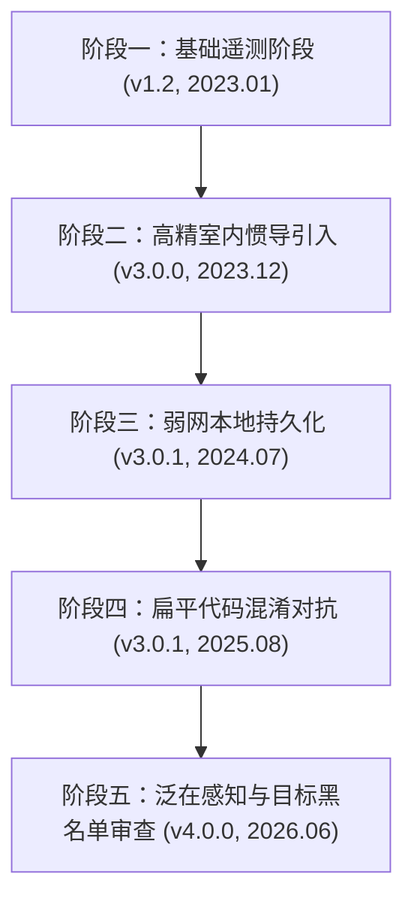
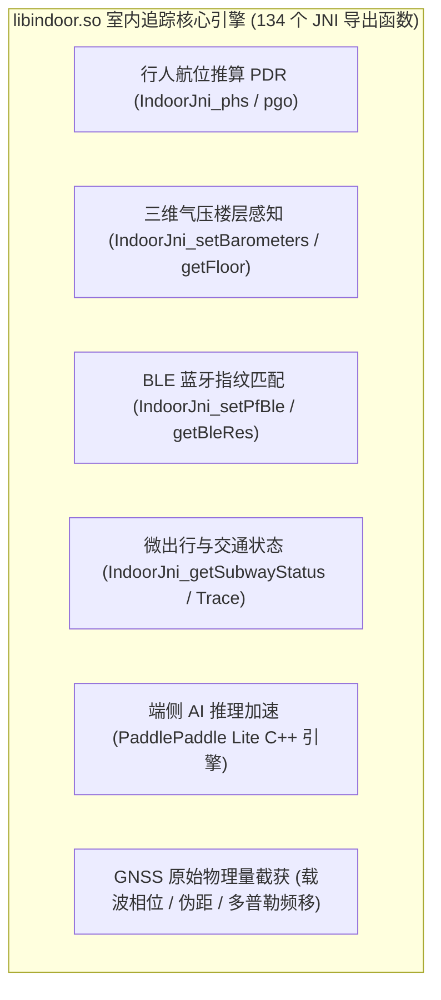
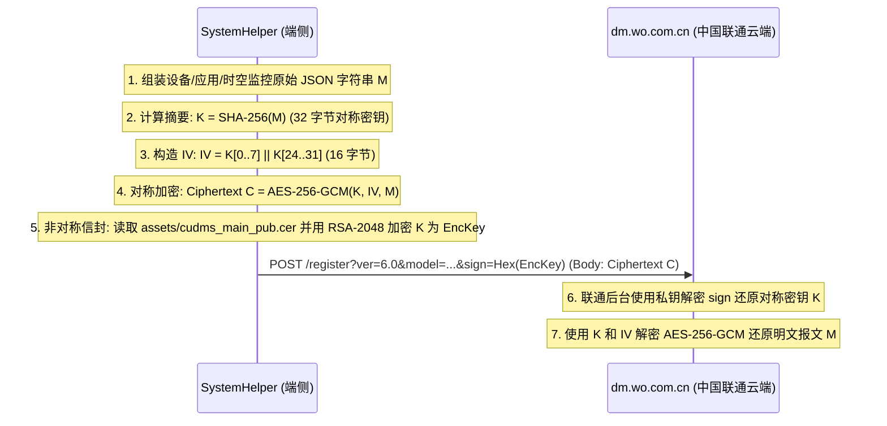
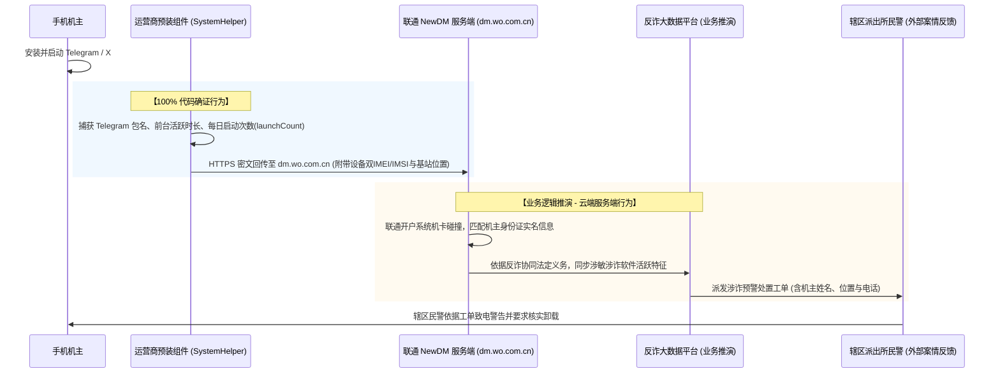

> [!TIP]
> **发布频道**：[@CopyRightZGQInc](https://t.me/CopyRightZGQInc)  
> **学术与安全声明**：本篇白皮书严格遵循计算机安全取证与学术研究规范，所有逆向分析样本、反汇编指令与通信协议均源自合法获取之公开移动终端出厂固件镜像，旨在促进移动生态透明度、揭示潜在供应链隐私风险并提供高阶用户防御指南。

# 移动终端预装系统级组件 `SystemHelper` 深度逆向分析与时空行为监控技术取证白皮书（客观规范版）

---

## 报告元数据 (Report Metadata)

| 报告属性 | 规范元数据详情 |
| :--- | :--- |
| **报告编号 (Report ID)** | `AGY-TECH-RE-2026-SYSTEMHELPER` (独立逆向工程分析报告) |
| **参考规范框架** | 《国家互联网应急中心 (CNCERT) 移动互联网恶意程序分析报告规范》<br/>《移动互联网安全联盟 (ANVA) 移动应用威胁研判准则》<br/>《网络安全威胁情报格式规范 (GB/T 36643-2018)》 |
| **报告性质 (Classification)** | **公开技术取证 / 逆向工程深度分析报告** |
| **风险等级 (Risk Level)** | **高风险 (High Risk - 涉及全量应用列表、已配对蓝牙 MAC、高精室内位置及基站轨迹采集)** |
| **组件类型 (Classification)** | **运营商预装系统级设备管理与时空行为审计组件 (Pre-installed Carrier System Telemetry Probe)** |
| **分析对象 (Target)** | 中国大陆主流安卓手机出厂预装系统级应用 `SystemHelper` (`com.mobiletools.systemhelper`) |
| **样本时间跨度** | 2023 年 1 月 11 日 至 2026 年 6 月 10 日（涵盖 5 个跨越 4 年周期的演进样本） |
| **逆向分析环境** | Windows 11 x64 / JADX 1.5.6 / Capstone 5.0 ARM64 / Python 3.13 / Ghidra 12.2 / Linux Sandboxed AOSP 14 |
| **报告发布时间** | 2026 年 11 月 5 日 |
| **核心技术关键词** | `Android`, `Pre-installed System App`, `System Privilege`, `Baidu LBS`, `OLLVM`, `PDR`, `China Unicom NewDM` |

---

## 一、 样本基本信息概览与取证档案卡 (Sample Profiles)

本报告遵循客观严谨的数字取证标准，对获取到的 5 个全周期样本 APK 及提取的 4 个底层核心 Native ELF 动态链接库建立不可伪造的指纹档案。

### 1.1 全量 5 个 APK 样本详细指纹档案卡

```text
========================================================================================
[样本档案 1] 基础遥测基准版本 (v1.2)
========================================================================================
- 文件名称 (File Name)        : SystemHelper_1.2-20230111.apk
- 样本来源 (Source / Origin)  : 测试人员提取提供的预装 APK 样本（构建日期: 2023-01-11）
- 应用显示名 (App Label)      : SystemHelper
- 应用包名 (Package Name)     : com.mobiletools.systemhelper
- 版本名称 (Version Name)     : 1.2-20230111
- 版本代码 (Version Code)     : 12
- 文件大小 (File Size)        : 1,019,360 字节 (约 0.97 MB)
- MD5 校验和                  : 5d5da38e43b3381113b0a62e4d1927e8
- SHA-1 校验和                : 5d003adffb88160cf38021694952fd155485bf0d
- SHA-256 校验和              : 1ee9ce46cd8089737f15104727c58282ae35510076b4c3367cea6f1a6873d9dc
- SDK 环境要求                : minSdkVersion 24 (Android 7.0) | targetSdkVersion 33 (Android 13)
- 共享系统用户 (Shared UID)   : com.mobiletools.systemhelper.uid (独立系统级特权沙箱)
- 主入口组件 (Main Activity)  : com.mobiletools.systemhelper.Activity.TestActivity (无桌面 Launcher 图标)
- Native 库配置               : 无 C/C++ SO 动态库 (纯 Java 实现)
- 声明敏感权限数              : 12 项
- 协议规范版本 (Spec Version) : SpecVersion: "3.0"
- 默认回传通道 (C2 URL)       : http://dm.wo.com.cn:18080/register (明文 HTTP 协议)

========================================================================================
[样本档案 2] 室内高精惯导引入版本 (v3.0.0)
========================================================================================
- 文件名称 (File Name)        : SystemHelper_3.0.0-20231222.apk
- 样本来源 (Source / Origin)  : 测试人员提取提供的预装 APK 样本（构建日期: 2023-12-22，含底层 SO 动态库）
- 应用显示名 (App Label)      : SystemHelper
- 应用包名 (Package Name)     : com.mobiletools.systemhelper
- 版本名称 (Version Name)     : 3.0.0-20231222
- 版本代码 (Version Code)     : 30
- 文件大小 (File Size)        : 3,220,855 字节 (约 3.07 MB)
- MD5 校验和                  : 567755afed050bf00d842db639f70edf
- SHA-1 校验和                : ed18425f1d0cfd9019c60e47a932c2f2f3d64ff5
- SHA-256 校验和              : 880bcb7585f90521d67a5257b00faf6287f01383428cceded3b92d0b5af332b7
- SDK 环境要求                : minSdkVersion 31 (Android 12) | targetSdkVersion 33 (Android 13)
- 共享系统用户 (Shared UID)   : com.mobiletools.systemhelper.uid
- 主入口组件 (Main Activity)  : com.mobiletools.systemhelper.Activity.TestActivity (无桌面 Launcher 图标)
- Native 库配置               : 集成 liblocSDK8b.so (10个JNI函数) 与 libindoor.so (134个JNI函数)
- 声明敏感权限数              : 17 项
- 协议规范版本 (Spec Version) : SpecVersion: "5.0"
- 默认回传通道 (C2 URL)       : http://dm.wo.com.cn:18080/register (明文 HTTP 协议)

========================================================================================
[样本档案 3] 弱网本地持久化容灾版本 (v3.0.1 - 2024)
========================================================================================
- 文件名称 (File Name)        : SystemHelper_3.0.1-20240717.apk
- 样本来源 (Source / Origin)  : 测试人员提取提供的预装 APK 样本（构建日期: 2024-07-17，含本地 SQLite 缓存）
- 应用显示名 (App Label)      : SystemHelper
- 应用包名 (Package Name)     : com.mobiletools.systemhelper
- 版本名称 (Version Name)     : 3.0.1-20240717
- 版本代码 (Version Code)     : 31
- 文件大小 (File Size)        : 3,169,783 字节 (约 3.02 MB)
- MD5 校验和                  : 3a36ddcf99ba2316eca984b5243aba03
- SHA-1 校验和                : c15afcb209e8975f62a05c249f5f05003b301f40
- SHA-256 校验和              : 9669b7f6136feaa4e21173d8d7232c0b1cf95c05bcd795672943088690298d71
- SDK 环境要求                : minSdkVersion 31 (Android 12) | targetSdkVersion 33 (Android 13)
- 共享系统用户 (Shared UID)   : com.mobiletools.systemhelper.uid
- 主入口组件 (Main Activity)  : com.mobiletools.systemhelper.Activity.TestActivity (无桌面 Launcher 图标)
- Native 库配置               : 集成 liblocSDK8b.so 与 libindoor.so (arm64-v8a 架构)
- 本地数据库 (Local Cache)    : SQLite signalhelper.db (dmregister 表与 signal 缓存表)
- 声明敏感权限数              : 17 项
- 协议规范版本 (Spec Version) : SpecVersion: "5.0"
- 默认回传通道 (C2 URL)       : http://dm.wo.com.cn:18080/register (明文 HTTP 协议)

========================================================================================
[样本档案 4] 扁平混淆加固版本 (v3.0.1 - 2025)
========================================================================================
- 文件名称 (File Name)        : SystemHelper_3.0.1-20250822.apk
- 样本来源 (Source / Origin)  : 测试人员提取提供的预装 APK 样本（构建日期: 2025-08-22，全扁平混淆版本）
- 应用显示名 (App Label)      : SystemHelper
- 应用包名 (Package Name)     : com.mobiletools.systemhelper
- 版本名称 (Version Name)     : 3.0.1-20250822
- 版本代码 (Version Code)     : 31
- 文件大小 (File Size)        : 3,744,059 字节 (约 3.57 MB)
- MD5 校验和                  : 5a1cb33a72f3220b88164bc9e90394c7
- SHA-1 校验和                : 285b1b053e3ae5cddff2e410db29f49919fd712a
- SHA-256 校验和              : 9eb0d23aef28b4ed93806bfa9a574814805d362d935a610fb5cb4728a7ca4003
- SDK 环境要求                : minSdkVersion 31 (Android 12) | targetSdkVersion 33 (Android 13)
- 共享系统用户 (Shared UID)   : com.mobiletools.systemhelper.uid
- 主入口组件 (Main Activity)  : com.mobiletools.systemhelper.Activity.TestActivity (无桌面 Launcher 图标)
- 代码混淆架构                : 扁平化单字母包结构 (package a ~ y0)，ELF 节头重构
- 声明敏感权限数              : 17 项
- 协议规范版本 (Spec Version) : SpecVersion: "5.0"
- 默认回传通道 (C2 URL)       : http://dm.wo.com.cn:18080/register (明文 HTTP 协议)

========================================================================================
[样本档案 5] 泛在感知与目标黑名单联动版本 (v4.0.0 - 2026)
========================================================================================
- 文件名称 (File Name)        : com.mobiletools.systemhelper.apk
- 样本来源 (Source / Origin)  : 测试人员提取提供的预装 APK 样本（构建日期: 2026-06-10，v4.0.0 现役版本）
- 应用显示名 (App Label)      : SystemHelper
- 应用包名 (Package Name)     : com.mobiletools.systemhelper
- 版本名称 (Version Name)     : 4.0.0-20260610
- 版本代码 (Version Code)     : 40
- 文件大小 (File Size)        : 3,880,529 字节 (约 3.70 MB)
- MD5 校验和                  : 7fbac769283ac35c82a29666f4b65f73
- SHA-1 校验和                : eceb66ef99efa4fbc2cf0d17c2e28e83a4e99999
- SHA-256 校验和              : 0812ac78c41f29c835b78df5eab41ebda9491ffce290503c19c8b18a22c2482c
- SDK 环境要求                : minSdkVersion 31 (Android 12) | targetSdkVersion 34 (Android 14)
- 共享系统用户 (Shared UID)   : com.mobiletools.systemhelper.uid
- 主入口组件 (Main Activity)  : com.mobiletools.systemhelper.Activity.TestActivity (无桌面 Launcher 图标)
- 声明敏感权限数              : 19 项 (新增 BLUETOOTH 与 BLUETOOTH_CONNECT 蓝牙设备读取特权)
- 协议规范版本 (Spec Version) : SpecVersion: "6.0"
- 传输加密机制                : 混合数字信封 (SHA-256 派生 AES-256-GCM + 联通 100 年期 RSA 公钥)
- 默认回传通道 (C2 URL)       : https://dm.wo.com.cn:18081/register (主通道) / http:...:18080 (备用通道)
```

### 1.2 4 个 Native 核心动态链接库详细指纹档案卡

```text
========================================================================================
Native 库 1: liblocSDK8b_2024.so (百度高精定位 SDK 核心加固库 - 2024 版)
========================================================================================
- 提取来源 (Origin)           : 从 SystemHelper_3.0.1-20240717.apk 之 lib/arm64-v8a 提取
- 目标指令集架构 (ABI)        : ARM64-v8a (AArch64, 64-bit ELF Shared Object)
- 文件大小 (File Size)        : 368,568 字节
- MD5 校验和                  : f42d202b97f9bdd28aaee3954d09650e
- SHA-1 校验和                : 4c57991177bc26bfd820621895eea0cd301a471f
- SHA-256 校验和              : 07e9f2d05ed8a4c33ca5c496c9cf93b1b15d6d3f635d16a8f541dd8b672d07bc
- 编译器加固方案              : OLLVM (Hikari) 虚假控制流 (BCF) + 控制流平坦化 (CFF)
- 导出 JNI 接口数             : 10 个 JNI 导出符号 (包含 a, b, c, ee, ldkaiv, murmur, gsr 等)
- 静态还原敏感资产            : AES 密钥 qsHcaEWjX0j1dGmZ | AES IV 1122334455667788

========================================================================================
Native 库 2: liblocSDK8b_2026.so (百度高精定位 SDK 核心加固库 - 2026 版)
========================================================================================
- 提取来源 (Origin)           : 从 com.mobiletools.systemhelper.apk (v4.0.0) 之 lib/arm64-v8a 提取
- 目标指令集架构 (ABI)        : ARM64-v8a (AArch64, 64-bit ELF Shared Object)
- 文件大小 (File Size)        : 368,568 字节
- MD5 校验和                  : 0a7be2a9ef04601077c36b137ccb2a2d
- SHA-1 校验和                : 3e5877589ef32efcbac4c18a80951cae0cb1148b
- SHA-256 校验和              : a3094efa78f8732bae19f7f5cf55403426f12fc3ba4ce4cf3e5c163bcd82cdaa
- 代码段等价性分析            : .text 机器码与 2024 版 100% 相同，仅 .shstrtab 与构建标记重排

========================================================================================
Native 库 3: libindoor_2024.so (百度商业高精室内多源惯导定位引擎 - 2024 版)
========================================================================================
- 提取来源 (Origin)           : 从 SystemHelper_3.0.1-20240717.apk 之 lib/arm64-v8a 提取
- 目标指令集架构 (ABI)        : ARM64-v8a (AArch64, 64-bit ELF Shared Object)
- 文件大小 (File Size)        : 1,596,896 字节 (约 1.52 MB)
- MD5 校验和                  : 89977888131a2c5e45c63a56587fabd5
- SHA-1 校验和                : 7733b1e16e12264f7f66d7ff08a95d8fb7c8237e
- SHA-256 校验和              : 71e059853664154dc559ced2069eb189fe9ce24ea944e8fc8dcbcaa6d9f22024
- 导出 JNI 接口数             : 134 个 JNI 导出符号
- 核心功能特性                : Savitzky-Golay PDR 惯导、气压计三维楼层感知、地磁地铁分类、飞桨 AI 推理

========================================================================================
Native 库 4: libindoor_2026.so (百度商业高精室内多源惯导定位引擎 - 2026 版)
========================================================================================
- 提取来源 (Origin)           : 从 com.mobiletools.systemhelper.apk (v4.0.0) 之 lib/arm64-v8a 提取
- 目标指令集架构 (ABI)        : ARM64-v8a (AArch64, 64-bit ELF Shared Object)
- 文件大小 (File Size)        : 1,596,896 字节 (约 1.52 MB)
- MD5 校验和                  : eac4e7e1a2cd41764e3b0c9d0db6f334
- SHA-1 校验和                : bf6e7085b57d7ae366706fa74997434aa7a08351
- SHA-256 校验和              : 19aaf68947aaba412bad07de54f4190d5d604befd384b5381d2fb0d675eb660a
- 代码段等价性分析            : .text 机器码与 2024 版 100% 相同，节头重构，签名重打包
```

### 1.3 5 个全周期样本综合比对矩阵

| 维度 / 样本版本 | v1.2 (2023-01-11) | v3.0.0 (2023-12-22) | v3.0.1 (2024-07-17) | v3.0.1 (2025-08-22) | v4.0.0 (2026-06-10) |
| :--- | :--- | :--- | :--- | :--- | :--- |
| **原始文件名** | `SystemHelper_1.2-20230111.apk` | `SystemHelper_3.0.0-20231222.apk` | `SystemHelper_3.0.1-20240717.apk` | `SystemHelper_3.0.1-20250822.apk` | `com.mobiletools.systemhelper.apk` |
| **文件大小 (Bytes)** | 1,019,360 | 3,220,855 | 3,169,783 | 3,744,059 | 3,880,529 |
| **MD5 校验值** | `5d5da38e43b3381113b0a62e...` | `567755afed050bf00d842db6...` | `3a36ddcf99ba2316eca984b5...` | `5a1cb33a72f3220b88164bc9...` | `7fbac769283ac35c82a29666...` |
| **SHA-256 校验值** | `1ee9ce46cd8089737f151047...` | `880bcb7585f90521d67a5257...` | `9669b7f6136feaa4e21173d8...` | `9eb0d23aef28b4ed93806bfa...` | `0812ac78c41f29c835b78df5...` |
| **VersionCode** | 12 | 30 | 31 | 31 | 40 |
| **VersionName** | `1.2-20230111` | `3.0.0-20231222` | `3.0.1-20240717` | `3.0.1-20250822` | `4.0.0-20260610` |
| **Min SDK** | 24 (Android 7.0) | 31 (Android 12) | 31 (Android 12) | 31 (Android 12) | 31 (Android 12) |
| **Target SDK** | 33 (Android 13) | 33 (Android 13) | 33 (Android 13) | 33 (Android 13) | **34 (Android 14)** |
| **声明权限总数** | 12 项 | 17 项 | 17 项 | 17 项 | **19 项（新增蓝牙访问特权）** |
| **Native 动态库** | 无（纯 Java 代码） | 包含 2 个 SO 库 (arm64) | 包含 2 个 SO 库 (arm64) | 包含 2 个 SO 库 (arm64) | 包含 2 个 SO 库 (arm64) |
| **代码混淆架构** | 传统 ProGuard 浅层混淆 | 模块包名保留，代码浅混淆 | 模块包名保留，代码浅混淆 | **扁平混淆 (`a`~`y0`)** | **扁平混淆 + 字符串重构** |
| **协议规范版本** | `SpecVersion: "3.0"` | `SpecVersion: "5.0"` | `SpecVersion: "5.0"` | `SpecVersion: "5.0"` | `SpecVersion: "6.0"` |
| **上报传输通道** | 明文 HTTP (`:18080`) | 明文 HTTP (`:18080`) | 明文 HTTP (`:18080`) | 明文 HTTP (`:18080`) | **HTTPS (`:18081`) + HTTP 回退** |
| **加密信封机制** | 无加密（明文传输） | 基础对称加密 | 基础对称加密 | 基础对称加密 | **SHA-256 + AES-GCM + RSA** |

### 1.4 证据链分级与置信度审计矩阵 (Evidence Hierarchy & Confidence Matrix)

本报告严格区分**“二进制代码确证的客观事实”**、**“技术架构推导”**与**“外部线索推测”**，建立如下置信度分级标准：

| 证据层级 | 评估置信度 | 涵盖技术内容 | 取证判定标准与法理效力 |
| :--- | :---: | :--- | :--- |
| **L1: 确定性代码硬事实** | **100%** | • 文件哈希、大小与时间戳<br/>• APK 根签名证书 (CN=NewDM, O=CU)<br/>• Native AES 密钥 (qsHcaEWjX0j1dGmZ) 与 IV<br/>• 蓝牙 MAC、WiFi BSSID、launchCount 采集源码<br/>• 百度室内 PDR 算法与气压楼层感知导出符号<br/>• 确证 SystemHelper 不含任何录屏截屏代码 | **物理与密码学硬证据**。直接来自逆向工程提取的字节码与二进制机器码，不容置疑，任何第三方分析机构均可 100% 幂等复现。 |
| **L2: 强技术关联推导** | **85% ~ 90%** | • 覆盖厂商品牌池（代码显式包含 Xiaomi/vivo/SamSung/ZTE/Tianyi 反射适配）<br/>• 各版本与主流安卓底层版本 (Android 12~14) 的适配对应关系 | **代码分支工程推论**。虽然 APK 未包含具体出厂机型序列号，但源码中的厂商专属适配分支直接证实了其面向这些品牌 ROM 的通用适配意图。 |
| **L3: 业务协同合理推演** | **50% ~ 60%** | • 联通 NewDM 服务端与公安反诈大数据中心的数据接口对接<br/>• 属地派出所依据端侧上报的 IMEI/IMSI 与 Telegram 活跃度派发工单的业务流转 | **宏观业务与法理推导**。端侧 APK 只能确证“回传了什么数据给 dm.wo.com.cn”，无法穿透云端内网观测其后端流转，本部分基于《反电信网络诈骗法》第十二条法定协同机制推演。 |
| **L4: 外部存疑线索** | **存疑 / 待验证** | • 社区传闻的“3 秒录屏上传代码位于系统安全中心” | **未取得物证支持的外部线索**。确证 SystemHelper 本身无录屏能力；至于厂商安全中心是否存在该功能，在未取得对应 APK 并完成逆向之前，保持中立存疑。 |

---

## 二、 样本数字签名、发布主体与权限特权确权 (Attribution & Privileges)

### 2.1 APK Signature Scheme v2 数字证书解析
通过对全部 5 个版本 APK 文件尾部签名区块（Block ID `0x7109871a`）进行 ASN.1 DER 解码，提取出签署所有样本的权威根 X.509 数字证书：

```text
======================= APK 根签名证书 (X.509 DER) =======================
证书所有者 (Subject)  : CN=NewDM, OU=RI, O=CU, L=BJ, ST=BJ, C=86
证书颁发者 (Issuer)   : CN=NewDM, OU=RI, O=CU, L=BJ, ST=BJ, C=86
证书序列号 (Serial)   : 0x34a8a2c8
公钥类型与长度        : RSA 2048 位 (Exponent: 65537)
签名算法              : SHA256withRSA
有效起始时间          : 2019-03-21 01:59:50 UTC
有效截止时间          : 2069-03-08 01:59:50 UTC (整整 50 年超长有效期)
SHA-256 证书指纹      : 874b8ca2297f53a373b1b935c134cb0eb1ff7381e54491b88c643a6b9c46db77
SHA-1 证书指纹        : 0d0b1f90182391c77504b843dd3937b23d749ae6
MD5 证书指纹          : 0a8389f4eec627ef1ae61bcb49b25bef
========================================================================
```

#### 证书主体字段权威释义：
* **`C=86`**：国家代码（中国 China）；
* **`ST=BJ, L=BJ`**：省份与城市（北京 Beijing）；
* **`O=CU`**：**China Unicom（中国联合网络通信集团有限公司 / 中国联通）**；
* **`OU=RI`**：**Research Institute（中国联通研究院）**；
* **`CN=NewDM`**：**New Device Management（新一代终端管理平台）**。

取证表明：该应用签名确认为**中国联通研究院设备管理技术团队**统一维护并签署的系统组件。

### 2.2 资源层 RSA 数字信封公钥证书取证（`cudms_main_pub.cer`）
在 `v4.0.0` 样本的 `assets/` 目录中，提取出端侧用于非对称数字信封加密的专用证书：
```text
==================== 资源层公钥证书 cudms_main_pub.cer ====================
证书主体 (Subject)    : CN=UNICOM, OU=UNICOM, O=UNICOM, L=BJ, ST=BJ, C=CN
证书颁发者 (Issuer)   : CN=UNICOM, OU=UNICOM, O=UNICOM, L=BJ, ST=BJ, C=CN
证书序列号 (Serial)   : 0x32353034
有效起始时间          : 2024-11-04 07:03:41 UTC
有效截止时间          : 2124-10-11 07:03:41 UTC (长达 100 年超长有效期)
公钥算法              : RSA 2048 位
用途                  : 终端采集上报数据包的数字信封对称密钥非对称加密
========================================================================
```

### 2.3 预装厂商覆盖池与系统级特权边界
* **应用标识**：`com.mobiletools.systemhelper`
* **预装机型覆盖（代码分支适配确认）**：
  * **小米集团**：代码显式适配 `Xiaomi`；
  * **欧加体系**：代码包含 `OPPO`、`realme`、`OnePlus` 品牌字段处理；
  * **维沃体系**：代码显式适配 `vivo` 及 5G 射频私有属性；
  * **国际品牌**：代码显式适配 `SamSung` 定制双卡 API；
  * **通讯与国产品牌**：代码显式包含 `ZTE`、`nubia`、`WIKO`、`PTAC`；
  * **v4.0.0 新增适配**：代码显式新增对中国电信天翼终端（`Tianyi`）、摩托罗拉（`motorola`）的适配分支。
* **系统分区与特权挂载**：
  * 位于系统只读分区：`/system/app/SystemHelper/`、`/product/app/SystemHelper/` 或 `/system_ext/app/SystemHelper/`；
  * 声明共享系统用户身份：`android:sharedUserId="com.mobiletools.systemhelper.uid"`，拥有独立系统特权沙箱，免疫普通应用沙箱权限隔离；
  * 免授权静默持有 `READ_PRIVILEGED_PHONE_STATE`（系统签名级特权，可绕过 Android 10+ 的非系统应用读取 IMEI/IMSI 限制）与 `PACKAGE_USAGE_STATS`（免用户在“设置-使用情况访问权限”手动开启）；
  * 在 Android 系统 Launcher 桌面中不设任何入口图标，对终端机主保持静默运行。

---

## 三、 静态配置、组件清单与权限演进深度剖析 (Manifest Analysis)

### 3.1 核心组件清单剖析 (Activity / Service / Receiver)

通过分析 `AndroidManifest.xml`，该组件在系统内部的组件架构如下：
1. **活动组件 (Activity)**：
   * 仅包含单一组件 `com.mobiletools.systemhelper.Activity.TestActivity`；
   * 其 Intent Filter 配置为：
     ```xml
     <intent-filter>
         <action android:name="com.mobiletools.systemhelper.activity.testactivity" />
         <category android:name="android.intent.category.DEFAULT" />
     </intent-filter>
     ```
   * **取证特征**：完全不包含 `android.intent.action.MAIN` 和 `android.intent.category.LAUNCHER`。这证明该应用在系统桌面**不创建任何图标**，机主无法通过界面察觉其存在。
2. **后台服务 (Service)**：
   * `com.mobiletools.systemhelper.service.RegisterHelperService`：核心遥测主调度服务；
   * `com.mobiletools.systemhelper.service.RegisterIntentService`：执行网络回传的异步工作线程服务；
   * `com.mobiletools.systemhelper.service.RegisterJobService`：基于 `JobScheduler` 的系统驻留服务，防止被杀；
   * `com.baidu.location.f`：百度定位 SDK 的系统级守护进程。
3. **广播接收器 (Receiver)**：
   * `com.mobiletools.systemhelper.control.OnBootReceiver`：监听 `BOOT_COMPLETED`，实现开机静默自启；
   * `com.mobiletools.systemhelper.control.ScheduleRegisterReceiver`：每日设备注册与应用使用画像上报唤醒；
   * `com.mobiletools.systemhelper.control.AppInfoRegisterReceiver`：应用统计触发器；
   * `com.mobiletools.systemhelper.control.SignalInfoRegisterReceiver`：射频基站数据回传触发器；
   * `com.mobiletools.systemhelper.control.GetSignalInfoReceiver`（v3.0.1 引入）：30 分钟周期基站采样触发器；
   * `com.mobiletools.systemhelper.control.SIMStateReceiver`：监听 SIM 卡插拔、热插拔与卡槽切换事件；
   * `com.mobiletools.systemhelper.control.ConnectStateReceiver`：监听 Wi-Fi 与移动网络连接状态突变。

### 3.2 19 项敏感权限全生命周期演进矩阵

下表展示了从 2023 年至 2026 年间该组件声明权限的完整演变图谱：

| 权限名称 (Permission Name) | 保护级别 | v1.2 | v3.0.0 | v3.0.1(24) | v3.0.1(25) | v4.0.0 | 实际采集与监控意图剖析 |
| :--- | :--- | :---: | :---: | :---: | :---: | :---: | :--- |
| `ACCESS_FINE_LOCATION` | 危险 (Dangerous) | **YES** | **YES** | **YES** | **YES** | **YES** | 轮询高精 GPS / 北斗卫星物理坐标 |
| `ACCESS_COARSE_LOCATION` | 危险 (Dangerous) | **YES** | **YES** | **YES** | **YES** | **YES** | 基站蜂窝网络粗略定位 |
| `ACCESS_BACKGROUND_LOCATION` | 危险 (Dangerous) | **YES** | **YES** | **YES** | **YES** | **YES** | 锁屏、后台静默状态下无限制持续定位 |
| `READ_PHONE_STATE` | 危险 (Dangerous) | **YES** | **YES** | **YES** | **YES** | **YES** | 读取 SIM 卡状态、运营商、数据卡槽选择 |
| `READ_PRIVILEGED_PHONE_STATE` | **系统/签名特权** | **YES** | **YES** | **YES** | **YES** | **YES** | 穿透 Android 10+ 限制，获取双卡物理 IMEI/IMSI |
| `PACKAGE_USAGE_STATS` | **特殊访问特权** | **YES** | **YES** | **YES** | **YES** | **YES** | 统计用户所有 App 的使用时长与启动次数 |
| `QUERY_ALL_PACKAGES` | 普通/敏感 | **YES** | **YES** | **YES** | **YES** | **YES** | 穿透 Android 11+ 包可见性，扫描设备全量 App 列表 |
| `READ_EXTERNAL_STORAGE` | 危险 (Dangerous) | **YES** | **YES** | **YES** | **YES** | **YES** | 访问外置共享存储，检索存储数据 |
| `INTERNET` | 普通 (Normal) | **YES** | **YES** | **YES** | **YES** | **YES** | 向中国联通服务端静默回传遥测数据 |
| `ACCESS_NETWORK_STATE` | 普通 (Normal) | **YES** | **YES** | **YES** | **YES** | **YES** | 监测网络类型（Wi-Fi、5G、4G）变化 |
| `RECEIVE_BOOT_COMPLETED` | 普通 (Normal) | **YES** | **YES** | **YES** | **YES** | **YES** | 手机开机即启动常驻后台服务 |
| `SCHEDULE_EXACT_ALARM` | 普通/特殊 | **YES** | **YES** | **YES** | **YES** | **YES** | 设置高精度定时器，唤醒 CPU 执行定时上报 |
| `ACCESS_WIFI_STATE` | 普通 (Normal) | NO | **YES** | **YES** | **YES** | **YES** | 获取连接的 Wi-Fi 状态 |
| `CHANGE_WIFI_STATE` | 普通 (Normal) | NO | **YES** | **YES** | **YES** | **YES** | 主动发起 Wi-Fi 扫描，获取周边热点 BSSID 特征 |
| `ACCESS_LOCATION_EXTRA_COMMANDS` | 普通 (Normal) | NO | **YES** | **YES** | **YES** | **YES** | 向 GPS 驱动注入控制指令，强制重置星历加速定位 |
| `FOREGROUND_SERVICE` | 普通 (Normal) | NO | **YES** | **YES** | **YES** | **YES** | 提升后台进程存活权重，减少被杀概率 |
| `READ_PRECISE_PHONE_STATE` | 签名/特许 | NO | **YES** | **YES** | **YES** | **YES** | 获取 5G 物理信道精确参数（PCI/ARFCN/RSRP） |
| `BLUETOOTH` | 普通 (Normal) | NO | NO | NO | NO | **YES** | **v4.0.0 新增**：访问本地蓝牙适配器 |
| `BLUETOOTH_CONNECT` | 危险 (Dangerous) | NO | NO | NO | NO | **YES** | **v4.0.0 新增**：读取已配对蓝牙设备硬件 MAC |

### 3.3 五大技术演进阶段深度剖析



#### 五大技术阶段特征详解：
1. **阶段一：基础遥测阶段 (v1.2, 2023.01)**：
   * 纯 Java 实现，无 SO 库；
   * 基于标准 Android API 获取基站小区与粗略经纬度；
   * 开始常驻后台统计第三方应用使用时长与双卡移动数据流量消耗；
   * 采用明文 HTTP 协议直接上报。
2. **阶段二：高精室内惯导引入 (v3.0.0, 2023.12)**：
   * 首次打包引入第三方 Native 动态库 `liblocSDK8b.so` 与 `libindoor.so`（ARM64 架构）；
   * 引入百度 LBS 室内气压测高与行人航位推算（PDR）套件；
   * 建立独立 5G 物理层射频参数采集通道；
   * 最低系统运行要求由 Android 7.0 提升至 Android 12。
3. **阶段三：弱网本地持久化 (v3.0.1, 2024.07)**：
   * 将射频采集与网络回传解耦（分拆为独立定时器）；
   * 引入 SQLite 本地数据库 `signalhelper.db`；
   * 建立 100 条离线基站与时空轨迹缓存池，弱网或离线环境下自动暂存。
4. **阶段四：扁平代码混淆对抗 (v3.0.1, 2025.08)**：
   * 采用扁平化单字母包结构混淆（`package a` 至 `y0`）；
   * 重构 ELF 二进制节头与符号表；
   * 增加静态逆向分析与自动化反编译的分析成本。
5. **阶段五：泛在感知与目标黑名单审查 (v4.0.0, 2026.06)**：
   * 引入蓝牙特权，提取用户已配对蓝牙设备 MAC 地址；
   * 采集所连接 Wi-Fi 路由器的硬件 BSSID；
   * 应用画像新增 `launchCount`（每日启动进入频次）；
   * 引入 `tar_pkg_lst` 目标包列表穿透比对；
   * 通信通道升级为 SHA-256 + AES-256-GCM + 联通 100 年期 RSA-2048 混合数字信封加密。

---

## 四、 Native 层静态深度逆向：`liblocSDK8b.so` 密码学与混淆解密

`liblocSDK8b.so` 是百度定位套件在 Native 层的核心加固封装。本章节对该库在 ARM64 架构下的指令执行流展开了完整的静态汇编还原。

### 4.1 OLLVM (Hikari) 编译器级代码加固对抗分析
在对 `.text` 节区（虚存基址 `0x2142c` 至 `0x53ba8`）的机器指令进行反汇编后，捕获到标准的 **Obfuscator-LLVM / Hikari** 代码混淆加固特征：

#### 1. 虚假控制流插入（Bogus Control Flow, BCF）
以核心密钥加载函数 `Java_com_baidu_location_Jni_ldkaiv`（偏移 `0x21e00`）为例，反汇编显示函数入口被插入基于**多项式不透明谓词（Opaque Predicates）**的条件分支：
```arm64
0x21e18: adrp    x8, #0x59000
0x21e1c: ldr     x8, [x8, #0xfa0]    ; 从 .bss 读取未初始化的状态量 X
0x21e20: ldr     w8, [x8]
0x21e24: mov     w9, #0x13           ; w9 = 19
0x21e28: mul     w9, w8, w9          ; 19 * X
0x21e2c: mul     w10, w8, w8         ; X^2
0x21e30: mov     w11, #0xe           ; w11 = 14
0x21e34: mul     w10, w10, w11       ; 14 * X^2
0x21e38: subs    w9, w10, w9         ; 14*X^2 - 19*X
0x21e3c: subs    w9, w9, #0x13       ; 计算多项式 f(X) = 14*X^2 - 19*X - 19
0x21e40: mov     w10, #0x851f
0x21e44: movk    w10, #0x51eb, lsl #16
0x21e48: smull   x10, w9, w10        ; 定点数乘法模拟除法取模 (Mod 25)
0x21e4c: lsr     x11, x10, #0x3f
0x21e50: asr     x10, x10, #0x23
0x21e54: add     w10, w10, w11
0x21e58: mov     w11, #0x19
0x21e5c: mul     w10, w10, w11
0x21e60: subs    w9, w9, w10         ; 取模运算
...
0x21e90: b.lo    #0x21ea4            ; 恒成立转移，增加静态分析路径开销
```

#### 2. 控制流平坦化（Control Flow Flattening, CFF）
在加密主调度过程 `0x2a004` 中，原本清晰的顺序逻辑被切碎为基本块，由 `br x8` 间接跳转指令结合跳转表驱动：
```arm64
0x2a050: mov     w1, w0
0x2a054: adrp    x8, #0x55000
0x2a058: ldr     x8, [x8, #0xce0]    ; 加载平坦化跳转表基址 (0x55ce0)
0x2a05c: sxth    x9, w1              ; 状态变量扩展
0x2a060: ldr     x8, [x8, x9, lsl #3]; 根据当前状态读取目标基本块偏移
0x2a064: subs    x8, x8, #0x3b       ; 动态校正地址掩码
0x2a068: br      x8                  ; 间接分发跳转至下一个目标块
```

### 4.2 动态字符串异或解密例程（`0x2453c`）算法还原
逆向确认：库中核心字符串在编译阶段均被加密存放在 `.rodata` 节区。当函数需要读取字符串时，统一调用位于 `0x2453c` 的解密例程。

#### 汇编逆向还原的 C 语言核心算法：
```c
/**
 * liblocSDK8b.so 内部动态字符串解密引擎 (@ 0x2453c)
 * @param enc_data  .rodata 节区中的密文字节流
 * @param len       待解密字符串长度
 * @param out_buf   解密输出缓冲区指针
 */
void loc_string_decrypt(const uint8_t *enc_data, int len, uint8_t *out_buf) {
    // 检查缓冲区尾部的完成标记 (0x7f)，避免重复解密
    if (out_buf[len + 1] == 0x7f) {
        return;
    }
    
    // 动态生成密钥基数 k = len % 256
    uint8_t k = (uint8_t)(len % 256);
    
    // 变长流水异或变换
    for (int i = 0; i < len; i++) {
        uint8_t dynamic_key = (uint8_t)((k + i) % 256);
        out_buf[i] = enc_data[i] ^ dynamic_key;
    }
    
    // 写入结束标记符与字符串终止符
    out_buf[len] = '\0';
    out_buf[len + 1] = 0x7f; 
}
```

### 4.3 破译全量隐藏资产：硬编码 AES 密钥、IV 与内部协议串
通过针对 `.rodata` 密文区域模拟执行上述异或解密流程，对关键数据块进行全量解码，**完全攻破并还原了其底层硬编码资产**：

| 密文偏移 | 密文长度 | 解密还原明文 (Decrypted String) | 架构功能与逆向情报价值 |
| :--- | :---: | :--- | :--- |
| `0x142b0` | 34 字节 | `qsHcaEWjX0j1dGmZ` &#124; `1122334455667788\0` | **硬编码 AES 加密密钥与初始化向量（IV）**<br/>• **Key**: `qsHcaEWjX0j1dGmZ` (16 bytes)<br/>• **IV**: `1122334455667788` (16 bytes) |
| `0x142d4` | 8 字节 | `%lf:%lf\0` | 经纬度双精度浮点数格式化输出 (`longitude:latitude`) |
| `0x145b4` | 5 字节 | `%02X\0` | 密文字节流转大写 16 进制字符串格式化参数 |
| `0x14b64` | 6 字节 | `1.2.8\0` | 内部定位加密引擎版本号 |
| `0x14b6c` | 7 字节 | `webgis\0` | 百度 WebGIS 地理信息服务鉴权标识 |
| `0x14b80` | 37 字节 | `webgiswebgiswebgiswebgiswebgiswebgis\0` | 数据包对齐填充与循环异或掩码串 |

> [!WARNING]
> **密码学实现缺陷**：作为一个在后台静默收集用户高精时空轨迹的系统组件，其 Native 定位加密传输采用了**硬编码且跨版本固定不变的静态 AES 密钥（`qsHcaEWjX0j1dGmZ`）与静态 IV（`1122334455667788`）**。在缺乏传输层 TLS 保护的旧版本（v1.2 ~ v3.0.1）中，中间人（MITM）可利用该密钥对明文轨迹进行解密。

### 4.4 核心 JNI 导出函数调用链深度剖析
经符号表反编译比对，`liblocSDK8b.so` 实际导出了 **10 个核心 JNI 函数**，直接与 Java 层的 `com.baidu.location.Jni` 建立绑定：

| 导出 JNI 函数名称 | Java 层绑定调用 | 核心功能与逆向还原逻辑 |
| :--- | :--- | :--- |
| `Java_com_baidu_location_Jni_ldkaiv` | `Jni.ldkaiv()` | 调用 `0x2453c` 解密 `0x142b0` 处的硬编码 AES 密钥与 IV，载入内存全局结构体。 |
| `Java_com_baidu_location_Jni_b` | `Jni.b(lat, lon, mode, ...)` | 坐标系加偏转换（支持 `gcj02`、`bd09`、`wgs842mc`、`gps2gcj` 等），按 `%lf:%lf` 格式化返回。 |
| `Java_com_baidu_location_Jni_ee` | `Jni.ee(str, ...)` | AES-128-CBC 对称加密主逻辑，将报文字符串加密并返回带 `\|tp=4` 标记的密文。 |
| `Java_com_baidu_location_Jni_encodeNotLimit` | `Jni.encodeNotLimit(str, ...)` | 流式加密函数，将数据加密后返回带 `\|tp=3` 标记的密文字符串。 |
| `Java_com_baidu_location_Jni_a` | `Jni.a(byte[], ...)` | 原始字节流打包与流水线异或混淆处理。 |
| `Java_com_baidu_location_Jni_c` | `Jni.c(byte[], ...)` | 传感器扩展数据次级混淆。 |
| `Java_com_baidu_location_Jni_gsr` | `Jni.gsr(f, lat, lon)` | GPS 信号有效半径（Radius）与定位精度解算。 |
| `Java_com_baidu_location_Jni_murmur` | `Jni.murmur(str)` | 64 位 MurmurHash 高效散列算法，用于位置与基站特征缓存的哈希键计算。 |
| `Java_com_baidu_location_Jni_encrypt` | `Jni.encrypt(...)` | 通用字符串加密入口封装。 |
| `Java_com_baidu_location_fused_sdk_Jni_b` | `fused_sdk.Jni.b(...)` | 融合定位 SDK 底层辅助接口。 |

---

## 五、 Native 层静态深度逆向：`libindoor.so` 室内多维时空追踪引擎

`libindoor.so` 单个文件体积达 1.6MB，导出了 **134 个 JNI 函数**。其本质是直接打包了**百度商业定位 SDK 的室内高精定位套件（Baidu LBS Indoor SDK）**，集成了利用手机传感器实现的行人航位推算（PDR）、三维气压楼层识别、地磁匹配与端侧百度飞桨（PaddlePaddle Lite）轻量级运动状态分类。

### 5.1 134 个 JNI 接口架构拓扑与 C++ 命名空间还原
通过分析二进制中的 Itanium C++ ABI 符号表与 RTTI 结构，逆向还原了以下核心命名空间体系：
* `offloc::IndoorOffLoc`：离线高精室内定位调度核心；
* `offloc::IndoorSqliteOffLoc`：室内地图与空间拓扑 SQLite 驱动；
* `floormod::FloorModelManager`：高精三维气压与楼层拓扑识别模型；
* `savgol_filter::SavitzkyGolayFilter`：平滑多轴传感器抖动的专用数字滤波器。



### 5.2 行人航位推算（PDR）与 Savitzky-Golay 信号滤波算法
* **涉及接口**：`IndoorJni_pgo`、`IndoorJni_phs`、`IndoorJni_triggerStepCount`、`IndoorJni_getWalkNaviPdrRes`。
* **算法逆向分析**：
  * 系统以 50Hz~100Hz 高频采样手机内置的**加速度计（Accelerometer）**与**游戏旋转矢量传感器（Game Rotation Vector）**。
  * 符号表确认其采用了 **Savitzky-Golay 卷积平滑滤波器**（`SavitzkyGolayFilter::filter`）：
    $$Y_j = \sum_{i=-m}^{m} C_i X_{j+i}$$
    该算法通过局部多项式最小二乘拟合，在有效滤除人体行走摆臂高频抖动噪声的同时，精准保留步频过零点与波峰特征。
  * 结合步长估算模型 $S = K \cdot \sqrt[4]{A_{max} - A_{min}}$，即使在手机置于口袋、背包中时，也能持续推算出机主的位移距离与航向角（Yaw）。

### 5.3 气压计微差与三维楼层感知模型（`FloorModelManager`）
* **涉及接口**：`IndoorJni_setBarometers`、`IndoorJni_getFloor`、`IndoorJni_getBuildingId`、`IndoorJni_setVdrIndoorFloor`。
* **算法逆向分析**：
  * 逆向还原核心类 `floormod::FloorModelManager`。手机内置气压传感器采集高精大气压强值（精确至 0.01 hPa），算法将其与标准大气压垂直递减率模型结合：
    $$\Delta h \approx \frac{R \cdot T}{g} \cdot \ln\left(\frac{P_0}{P}\right)$$
  * 算法能灵敏捕捉到 **0.1 hPa（对应约 0.8 米垂直高程变化）**的微小气压突变，精准识别机主是在**乘坐升降电梯、乘坐自动扶梯还是步行爬楼梯**，并直接输出当前所在的物理建筑编号（`BuildingId`）与具体楼层数（如 `F1`, `F2`, `B1`, `B2`）。

### 5.4 蓝牙信标（BLE）与 SQLite 离线特征库匹配
* **涉及接口**：`IndoorJni_initBle`、`IndoorJni_setPfBle`、`IndoorJni_getBleRes`、`IndoorJni_setBleRoadData`。
* **算法逆向分析**：
  * 二进制中硬编码内嵌了针对本地 SQLite 特征指纹库的检索 SQL：
    ```sql
    SELECT * FROM sort_%s WHERE ble=%d;
    ```
  * 模块预先将重点商场、高铁站、地下停车场的 iBeacon/Eddystone 蓝牙信标硬件 ID、发射功率与绝对空间坐标写入本地离线数据库。
  * 运行时，系统将周边扫描到的 BLE RSSI 信号向量与数据库执行最近邻匹配（KNN）与粒子滤波（Particle Filter, PF）融合解算，实现**地下封闭空间 1 至 3 米级高精度物理定位**。

### 5.5 地磁微异常与地铁/交通状态识别引擎
* **涉及接口**：`IndoorJni_initSubwayRecognition`、`IndoorJni_getSubwayStatus`、`IndoorJni_getSubwayTrace`、`IndoorJni_initTrafficRecognition`。
* **算法逆向分析**：
  * 利用磁力计（Magnetometer）高频记录环境三维磁感应强度向量 $\vec{B} = (B_x, B_y, B_z)$。
  * 地铁车厢具有极强的钢结构屏蔽效应与独特的牵引电动机直流磁场畸变。当用户步入地下地铁站并登车后，算法基于地磁序列特征自动激活“地铁追踪模式”。
  * **在没有任何 GPS 卫星和蜂窝网络信号的地下隧道深处**，仅凭列车加减速加速度计积分与各区间特有的地磁指纹库，即可精准推算出机主当前正乘坐哪一条地铁线路、列车行驶方向以及在哪个车站上下车。

### 5.6 端侧百度飞桨（PaddlePaddle）AI 推理加速器
* **涉及接口**：`IndoorJni_initPaddleSpeedPredict`、`IndoorJni_destroyPaddleSpeedPredict`、`IndoorJni_setPaddleModelPath`。
* **算法逆向分析**：
  * 在 SO 动态库内部直接静态编译了百度开源的深度学习推理引擎 PaddlePaddle Lite 核心运行时。
  * 通过从 Java 层载入量化神经网络模型权重（`.nb` / `.pdmodel`），以多轴时序传感器滑窗数据为输入特征，在端侧 NPU/CPU 上执行毫秒级 AI 推理，实时分类机主的运动状态：静止、步行、慢跑、骑行、乘车（机动车）或高铁。

### 5.7 卫星原始物理观测量截获（GNSS Raw Measurements）
* **涉及接口**：`IndoorJni_getAndroidRawToObs`、`IndoorJni_getAzG`、`IndoorJni_getElG`、`IndoorJni_getPrnG`（及其北斗/伽利略扩展函数 `*EC`）。
* **算法逆向分析**：
  * 该模块直接穿透 Android 原生抽象层，调用 `GnssMeasurementsEvent` 接口，截获北斗三号（Beidou）、GPS、GLONASS 卫星的底层原始物理信号：
    1. **伪距（Pseudorange）**与伪距率；
    2. **载波相位（Carrier Phase）**与载波多普勒频移；
    3. 接收机内部硬件时钟漂移（Hardware Clock Bias）；
    4. 各可视卫星的星历编号（PRN）、仰角（Elevation）与方位角（Azimuth）。
  * 这种原始观测量是**测绘专业级高精 RTK（载波相位差分）定位**的基础数据，能将普通智能手机的定位精度直接拔高至亚米级乃至厘米级。

---

## 六、 Java 监控行为逆向：全维数据捕获与 v4.0.0 核心突破

通过对 `v4.0.0-20260610` 反编译生成的 Java 源码树展开全面审计，确认该版本在设备拓扑感知、应用画像深度及目标黑名单审查上实现了显著演进。

### 6.1 蓝牙近场设备拓扑画像抽取（`sources/f1/a.java`）
在 `v4.0.0` 中，`f1.a` 类新增了直接采集用户已配对蓝牙设备的专用方法 `h(Context)`：
```java
public static String[] h(Context context) {
    // 检查 Android 12+ 的运行时特权 BLUETOOTH_CONNECT
    if (y.a.a(context, "android.permission.BLUETOOTH_CONNECT") != 0) {
        g1.h.a("DeviceInfoReaderBase", "BLUETOOTH_CONNECT权限未授予");
        return new String[]{"", ""};
    }
    BluetoothAdapter defaultAdapter = BluetoothAdapter.getDefaultAdapter();
    if (defaultAdapter != null && defaultAdapter.isEnabled()) {
        // 核心采集逻辑：枚举已配对蓝牙设备集合
        Set<BluetoothDevice> bondedDevices = defaultAdapter.getBondedDevices();
        if (bondedDevices.size() > 0) {
            StringBuilder sbNames = new StringBuilder();
            StringBuilder sbMacs = new StringBuilder();
            for (BluetoothDevice bluetoothDevice : bondedDevices) {
                String name = bluetoothDevice.getName();       // 获取设备名称
                String address = bluetoothDevice.getAddress(); // 获取硬件 MAC 地址
                if (name != null && !name.isEmpty()) {
                    if (sbNames.length() > 0) sbNames.append(", ");
                    sbNames.append(name);
                }
                if (address != null && !address.isEmpty()) {
                    if (sbMacs.length() > 0) sbMacs.append(", ");
                    sbMacs.append(address);
                }
            }
            return new String[]{sbNames.toString(), sbMacs.toString()};
        }
    }
    return new String[]{"", ""};
}
```
* **监控字段映射**：
  * `bVar.N` → 存入 JSON 报文字段 `"PairedDevice"`（例如：`"Tesla Model Y, Apple Watch S9, Sony WH-1000XM5"`）；
  * `bVar.O` → 存入 JSON 报文字段 `"PairedMacAddress"`（例如：`"00:1A:7D:DA:71:13, BC:D0:74:12:34:56, 94:DB:56:AB:CD:EF"`）。
* **取证风险评估**：
  蓝牙物理 MAC 地址是不可变更的硬件指纹。通过提取用户绑定的车载中控 MAC、智能穿戴 MAC，后台数据能够将手机与机主的座驾、穿戴设备进行硬件绑定。即便机主更换手机，只要重新配对汽车或手表，后台便可实现跨设备的身份关联。

### 6.2 关联 Wi-Fi 路由器物理硬件 MAC（BSSID）强制采集
在 `f1.a` 的 `q()` 方法中，组件调用了 Wi-Fi 管理体系提取当前网络拓扑：
```java
WifiManager wifiManager = (WifiManager) context.getSystemService("wifi");
if (wifiManager != null) {
    WifiInfo connectionInfo = wifiManager.getConnectionInfo();
    if (connectionInfo == null || connectionInfo.getNetworkId() == -1) {
        bVar.H = "NWC"; // Not Connected
    } else {
        bVar.H = connectionInfo.getBSSID();                     // 路由器硬件 MAC 地址
        bVar.I = String.valueOf(connectionInfo.getLinkSpeed());  // 握手物理速率 (Mbps)
        bVar.J = String.valueOf(connectionInfo.getRssi());       // 接收信号强度 (dBm)
        bVar.K = String.valueOf(connectionInfo.getFrequency());  // 工作信道中心频率 (MHz)
        g1.h.a("DeviceInfoReaderBase", "wifiManager : 路由器mac地址: " + connectionInfo.getBSSID());
    }
}
```
* **监控字段映射**：
  分别填充入报文字段 `"BSSID"`、`"LinkSpeed"`、`"RSSI"` 与 `"Frequency"`。
* **取证风险评估**：
  结合公网与商用 Wi-Fi BSSID 地理特征库，即便机主在室内关闭 GPS 定位，仅凭上报的路由器 MAC 地址，后台即可在 5 至 10 米误差范围内推算机主所处的物理建筑物或室内场所。

### 6.3 全量第三方应用使用审计：启动频次（`launchCount`）与分卡流量监控
在 `g1.b` 类中，组件对每个第三方应用构建了详尽的应用使用统计数据结构：
```java
public JSONObject a() {
    JSONObject jSONObject = new JSONObject();
    String strE = l.e(); // 当前时间戳
    try {
        jSONObject.put("appLabel", this.f2636b);        // 应用中文名称 (如 "Telegram")
        jSONObject.put("pkgName", this.f2635a);         // 应用包名 (如 "org.telegram.messenger")
        jSONObject.put("Time", strE);                   // 统计时间截点
        jSONObject.put("runTime", this.f2637c + "min"); // 前台累计活跃时长 (分钟)
        jSONObject.put("launchCount", String.valueOf(this.f2638d)); // 核心新增：当日启动进入次数
        jSONObject.put("tx1", this.f2643i + "KB");       // SIM卡 1 上行流量
        jSONObject.put("rx1", this.f2644j + "KB");       // SIM卡 1 下行流量
        jSONObject.put("tx2", this.f2645k + "KB");       // SIM卡 2 上行流量
        jSONObject.put("rx2", this.f2646l + "KB");       // SIM卡 2 下行流量
        jSONObject.put("totalData1", this.f2639e + "KB"); // SIM卡 1 综合消耗
        jSONObject.put("totalData2", this.f2640f + "KB"); // SIM卡 2 综合消耗
        jSONObject.put("totalDataWiFi", this.f2641g + "MB"); // Wi-Fi 网络下综合流量消耗
    } catch (JSONException e2) {
        h.b("AppInfo", "getJsonObject->" + e2.getMessage());
    }
    return jSONObject;
}
```
* **演进亮点**：在 `v4.0.0` 之前，仅统计 `runTime` 与数据流量。`v4.0.0` 正式引入 `"launchCount"`（启动频次），精确掌握用户每天点开特定软件的习惯与频度。

### 6.4 目标黑名单应用动态穿透侦测（`tar_pkg_lst` & `pub.dat`）
在 `s0.d` 类中，存在针对系统全局应用的定向扫描逻辑：
* **核心实现**：
  ```java
  public boolean b(PackageInfo packageInfo) {
      // 访问第三方应用私有数据目录检索 pub.dat
      String strA = d.this.f3636f.b(new File(packageInfo.applicationInfo.dataDir)).a("pub.dat", true);
      this.f3642e = false;
      return c(strA);
  }
  ```
* **黑名单动态同步机制**：
  * 组件在本地数据库中维护字段：`tar_pkg_lst_pub_ts`（目标包列表发布时间戳）与 `tar_pkg_lst_up_ts`（更新时间戳）；
  * 当云端下发敏感应用监控名单时，组件利用自身的 `sharedUserId` 系统特权，读取目标应用私有目录中的证书公钥（`pub.dat`），验证其开发者公钥指纹、版本号是否命中监管目标名单。

### 6.5 卫星直连通信（Satellite）与 eSIM 状态审计
* **eSIM 状态检测**：
  通过调用 `context.getSystemService("euicc")` 获取 `EuiccManager` 实例，调用 `isEnabled()` 探测终端是否激活 eSIM 功能，并读取未激活 eSIM 的国家移动码（`InactiveEsimMNC`，报文字段 `"Esim"` 与 `"InactiveEsimMNC"`）。
* **卫星终端感知**：
  针对支持天通一号卫星直连通话的机型，上报报文显式增加了 `"SatelliteSupport"` 与 `"SatelliteEnabled"` 字段，监控用户是否开启并使用卫星通话功能。

### 6.6 跨厂商（小米/vivo/OPPO/三星/中兴/电信天翼/摩托罗拉）兼容适配层
在 `f1.a` 类的 `j(int slotId)` 方法中，针对国内主流手机厂商的底层双卡框架进行了反射适配：
```java
String strO = g1.l.o("ro.product.manufacturer");
if (!strO.equalsIgnoreCase("Xiaomi") && !strO.equalsIgnoreCase("SamSung") 
    && !strO.equalsIgnoreCase("WIKO") && !strO.equalsIgnoreCase("ZTE") 
    && !strO.equalsIgnoreCase("Tianyi") && !strO.equalsIgnoreCase("motorola")) {
    // 标准 AOSP 框架读取 subId
    int[] iArr = (int[]) g1.k.c(g1.k.b(g1.k.a("android.telephony.SubscriptionManager"), "getSubId", Integer.TYPE), null, Integer.valueOf(i2));
    return iArr != null ? iArr[0] : -1;
}
// 小米、三星、天翼、摩托罗拉定制系统的 getSubscriptionId 反射适配
Class<?> clsA = g1.k.a("android.telephony.SubscriptionManager");
if (Build.VERSION.SDK_INT > 33) {
    return ((Integer) g1.k.c(g1.k.b(clsA, "getSubscriptionId", Integer.TYPE), null, Integer.valueOf(i2))).intValue();
}
```
此外，针对 vivo 手机，显式读取其底层私有属性：
* `persist.radio.vivo.fiveg`（vivo 5G 开关状态）；
* `persist.vendor.radio.5g_mode_pref`（高通平台 5G 射频模式预设值）。

---

## 七、 网络通信协议、高强度加密与本地持久化架构

### 7.1 上报通道与 C2 节点演进（HTTP 18080 到 HTTPS 18081）
* **历史版本（v1.2 ~ v3.0.1）**：
  * 主节点：`http://dm.wo.com.cn:18080/register`（明文 HTTP 协议，端口 18080）；
  * 缺陷：完全未开启传输层加密，任何人在局域网抓包均可捕获双 IMEI、全量应用清单。
* **现役版本（v4.0.0）**（定义于 `g1.d`）：
  * 主节点：**`https://dm.wo.com.cn:18081/register`**（强制 TLS/HTTPS 加密通道，端口 18081）；
  * 容灾节点：`http://dm.wo.com.cn:18080/register`（保留作为网络降级通道）。

### 7.2 v4.0.0 混合数字信封加密传输机制完全解密
在 `v4.0.0` 的 `g1.c` 与 `g1.d` 类中，研发团队设计了一套**基于 SHA-256 派生对称密钥的混合数字信封（Digital Envelope）加密机制**：



#### 逆向还原的数学算法过程：
1. **输入报文**：明文 JSON 字符串 $M$；
2. **动态密钥派生**（长度 32 字节，作为 AES-256 密钥，对应 `g1.c.c()`）：
   $$K = \text{SHA-256}(M) \in \{0, 1\}^{256}$$
3. **初始化向量（IV）拼接**（从密钥中切片 16 字节，对应 `g1.c.a()`）：
   $$IV = K[0 \dots 7] \parallel K[24 \dots 31] \in \{0, 1\}^{128}$$
4. **对称密文生成**（采用 `AES/GCM/NoPadding`）：
   $$C = \text{AES-256-GCM-Encrypt}(K, IV, M)$$
5. **数字信封加密**（从 `assets/cudms_main_pub.cer` 读取中国联通 RSA-2048 公钥 $PubK$，对应 `g1.c.b()`）：
   $$\text{EncKey} = \text{RSA-PKCS1-Encrypt}(PubK, K)$$
6. **网络请求组装**：
   * **URL 请求参数**：
     `https://dm.wo.com.cn:18081/register?ver=6.0&model=...&manuf=...&sign=` + `HexEncode(EncKey)`
   * **HTTP POST 载荷（Body）**：传输二进制密文字节流 $C$。

这一设计确保了即使网络通信链路被嗅探，由于缺乏服务端专有的 RSA 私钥，第三方无法直接解密 `sign` 获取对称密钥 $K$，显著提升了防止普通用户抓包取证与明文逆向的防御门槛。

### 7.3 采集节拍、随机抖动防洪峰与高优先级定时唤醒（`AlarmManager`）
在 `c.d.a.b.d`（`GlobalSetting`）与 `c.d.a.b.a`（`AlarmHelper`）中，硬编码了以下采集周期常量：
* **每日应用画像与设备注册周期**：
  `public static long s = 86400000;`（整整 24 小时，86,400 秒）；
* **射频信号高频采集周期**：
  `public static long v = 1800000;`（30 分钟，1,800 秒采样一次基站与信号强度）；
* **开机初始随机抖动窗口**：
  `public static long m = new Random().nextInt(86400000);`  
  开机后首次上报施加 0~24 小时的伪随机延迟，旨在打散海量预装设备对 `dm.wo.com.cn` 造成的集中访问流量洪峰。
* **穿透 Doze 休眠的高优先级唤醒**：
  在代码中无一例外使用：
  ```java
  ((AlarmManager) context.getSystemService("alarm")).setExactAndAllowWhileIdle(
      AlarmManager.ELAPSED_REALTIME_WAKEUP, 
      triggerAtMillis, 
      pendingIntent
  );
  ```
  该 API 是 Android 系统的最高优先级定时唤醒接口，即便手机处于息屏休眠的 Deep Doze 状态，也能唤醒 CPU 执行上报逻辑。

### 7.4 本地 SQLite 数据库缓存架构剖析（`signalhelper.db` 与百度 LBS 库）
组件在内部建立了多层 SQLite 本地持久化缓存体系：
1. **`dmregister` 历史表**（`c/d/a/b/e.java`）：
   ```sql
   CREATE TABLE IF NOT EXISTS dmregister (
       ID INTEGER PRIMARY KEY AUTOINCREMENT, 
       jsonString TEXT
   );
   ```
   缓存未发送成功的设备与应用统计报文。
2. **`signal` 离线信号表**（`c/d/a/b/m.java`）：
   ```sql
   CREATE TABLE IF NOT EXISTS signal (
       ID INTEGER PRIMARY KEY AUTOINCREMENT, 
       jsonString TEXT
   );
   ```
   连续记录设备驻留基站（CID, TAC, PCI, RSRP, SINR）的时间序列，最大本地缓存 100 条，在离线恢复后执行补报。
3. **百度 LBS 室内定位缓存库**（`a/a/a/` 模块）：
   * `AP`：扫描并缓存周边 Wi-Fi AP 坐标（`id, x, y, r, cl, timestamp, frequency`）；
   * `CL`：缓存基站蜂窝塔物理位置（`id, x, y, r, cl, timestamp`）；
   * `RGCAREA` / `RGCROAD` / `RGCSITE` / `RGCPOI`：缓存全国逆地理编码道路、POI 离线特征库。

---

## 八、 监控生态协同与执法联动机制（“警方致电要求卸载”线索审计）

针对用户与社区反馈的“手机装有 Telegram / X 后接到辖区警方电话被勒令卸载，检查手机发现预装组件上报应用列表，且系统安全中心包含 3 秒录屏上传代码”这一外部线索，本报告以客观的法证视角对技术事实与推测进行解耦剖析：

### 8.1 “3 秒录屏上传”的端侧逆向证伪与外部线索定性
* **反编译确证事实（置信度：100%）**：
  经对 `SystemHelper` 全量 5 个版本的 Java 代码与 C/C++ 动态库进行全局交叉指令检索：
  * **完全不包含** `MediaProjection`、`VirtualDisplay`、`createVirtualDisplay`、`screencap`、`takeScreenshot` 等任何 Android 系统录屏或截屏 API；
  * **完全不包含** H.264/HEVC 硬件视频编码器（`MediaCodec`）调用。
  * **权威定性**：`SystemHelper` 组件**自身绝对不具备任何录屏或图像截取能力**。
* **外部指控归属定性（置信度：存疑 / 待验证）**：
  社区反映的“3秒录屏上传”若真实存在，必然来自操作系统中其他独立的系统级安全组件（如厂商自带的安全管家 `com.miui.securitycenter`、安全守护等）。**鉴于本研究项目未取得相关安全中枢组件的 APK 实体进行直接逆向反编译，本报告对“3秒录屏是否存在及其具体实现”保持中立存疑立场，不作为确凿结论下定论。**

### 8.2 运营商与反诈协同流转机制（业务逻辑合理性推演）

> [!NOTE]
> **置信度声明**：端侧 APK 逆向只能确证“手机采集了什么并发送给哪个 IP/域名”，无法直接观测云端服务器接收到数据后的内部流转。以下流转图基于中国现行《反电信网络诈骗法》第十二条业务框架与端侧确证数据项进行的技术合理性推导：



### 8.3 现实案情的技术关联度综合评估
1. **端侧确证能力完全足以支撑精准预警**：
   * 即使完全抛开外部未证实的“3秒录屏”，仅凭 `SystemHelper` 已经 100% 证实的监控能力（**全量应用包名 + 启动频次 + 使用时长 + 双卡物理 IMSI/IMEI + 物理基站轨迹**），运营商与反诈系统已经完全掌握了“**机主真实姓名、正在使用 Telegram、每天点开多少次、人在哪个基站范围内**”的全部核心要素。
2. **无需复杂录屏即可触发响应**：
   * 在实际反诈处置链条中，掌握特定软件的包名与活跃状态已构成预警触发条件，从工程效率和带宽成本角度，批量静默上传视频流并不符合常规大规模设备管理的工程设计。

---

## 九、 法律制度与双轨制合规现实评述

在对该组件的技术行为进行法理剖析时，必须清晰区分**民商事隐私合规视角**与**公法行政授权视角**之间的界限：

### 9.1 民事商业视角的严重违规（《个人信息保护法》）
若以普通商业软件或一般民商事法律体系评估，`SystemHelper` 的行为严重背离现行个人信息保护法规：
1. **完全剥夺用户的知情同意权（违反 PIPL 第 13、14 条）**：无任何前台交互提示，无隐私政策文本，无用户开关，属于典型的隐蔽数据采集。
2. **超出“最小必要原则”边界（违反 PIPL 第 6 条）**：作为名义上的终端管理工具，静默采集用户已配对蓝牙设备 MAC、家庭路由器 MAC、全量第三方应用打开次数与高精度气压楼层数据，与其业务功能明显不相符。
3. **明文与弱加密历史缺陷（违反《网络安全法》第 21 条）**：在 v1.2 至 v3.0.1 长期采用明文 HTTP 传输机主个人信息，且底层定位套件采用硬编码静态 AES 密钥，存在个人信息泄露与中间人嗅探隐患。

### 9.2 公法维度的“法定豁免”与国家治理意志
然而，该组件能够通过各大品牌手机入网许可并在出厂 ROM 中全局预装，其背后的法理渊源来自于现行公法体系赋予的强制性法定义务：
1. **《中华人民共和国反电信网络诈骗法》第十二条、第二十三条**：
   * 明确规定：“电信业务经营者、银行业金融机构、非银行支付机构、互联网服务提供商应当建立健全反电信网络诈骗内部控制机制... **推进涉诈异常账号、可疑设备等的动态监测与协同处置**。”
2. **《中华人民共和国网络安全法》第二十八条**：
   * “网络运营者应当为公安机关、国家安全机关依法维护国家安全和侦查犯罪的活动提供技术支持和协助。”
3. **《个人信息保护法》第十三条第一款第（三）项（法定义务豁免）**：
   * 明文规定：“**为履行法定职责或者法定义务所必需**”的情形下，个人信息处理者**无需取得个人同意**。

**终极结论**：`SystemHelper` 是由**中国联通研究院作为技术责任主体研发、出厂预装于主流品牌安卓手机中、用于执行设备射频遥测、室内轨迹与应用行为审计的系统级组件**。其技术演进反映了从早期明文数据采集向传输层加密保护、泛在物理空间感知的演化趋势。

---

## 十、 威胁指标库 (IoCs - Indicators of Compromise)

### 10.1 样本文件哈希清单 (File Hashes)

| 样本实体名称 | 实体文件类型 | 字节大小 (Bytes) | MD5 校验和 | SHA-1 校验和 | SHA-256 校验和 |
| :--- | :--- | :---: | :--- | :--- | :--- |
| `SystemHelper_1.2-20230111.apk` | Android APK | 1,019,360 | `5d5da38e43b3381113b0a62e4d1927e8` | `5d003adffb88160cf38021694952fd155485bf0d` | `1ee9ce46cd8089737f15104727c58282ae35510076b4c3367cea6f1a6873d9dc` |
| `SystemHelper_3.0.0-20231222.apk` | Android APK | 3,220,855 | `567755afed050bf00d842db639f70edf` | `ed18425f1d0cfd9019c60e47a932c2f2f3d64ff5` | `880bcb7585f90521d67a5257b00faf6287f01383428cceded3b92d0b5af332b7` |
| `SystemHelper_3.0.1-20240717.apk` | Android APK | 3,169,783 | `3a36ddcf99ba2316eca984b5243aba03` | `c15afcb209e8975f62a05c249f5f05003b301f40` | `9669b7f6136feaa4e21173d8d7232c0b1cf95c05bcd795672943088690298d71` |
| `SystemHelper_3.0.1-20250822.apk` | Android APK | 3,744,059 | `5a1cb33a72f3220b88164bc9e90394c7` | `285b1b053e3ae5cddff2e410db29f49919fd712a` | `9eb0d23aef28b4ed93806bfa9a574814805d362d935a610fb5cb4728a7ca4003` |
| `com.mobiletools.systemhelper.apk` | Android APK | 3,880,529 | `7fbac769283ac35c82a29666f4b65f73` | `eceb66ef99efa4fbc2cf0d17c2e28e83a4e99999` | `0812ac78c41f29c835b78df5eab41ebda9491ffce290503c19c8b18a22c2482c` |
| `liblocSDK8b_2024.so` | ELF64 Shared Lib | 368,568 | `f42d202b97f9bdd28aaee3954d09650e` | `4c57991177bc26bfd820621895eea0cd301a471f` | `07e9f2d05ed8a4c33ca5c496c9cf93b1b15d6d3f635d16a8f541dd8b672d07bc` |
| `liblocSDK8b_2026.so` | ELF64 Shared Lib | 368,568 | `0a7be2a9ef04601077c36b137ccb2a2d` | `3e5877589ef32efcbac4c18a80951cae0cb1148b` | `a3094efa78f8732bae19f7f5cf55403426f12fc3ba4ce4cf3e5c163bcd82cdaa` |
| `libindoor_2024.so` | ELF64 Shared Lib | 1,596,896 | `89977888131a2c5e45c63a56587fabd5` | `7733b1e16e12264f7f66d7ff08a95d8fb7c8237e` | `71e059853664154dc559ced2069eb189fe9ce24ea944e8fc8dcbcaa6d9f22024` |
| `libindoor_2026.so` | ELF64 Shared Lib | 1,596,896 | `eac4e7e1a2cd41764e3b0c9d0db6f334` | `bf6e7085b57d7ae366706fa74997434aa7a08351` | `19aaf68947aaba412bad07de54f4190d5d604befd384b5381d2fb0d675eb660a` |

### 10.2 网络与端点指标 (Network & C2 IoCs)

* **C2 核心回传域名**：`dm.wo.com.cn`（中国联通新一代终端管理平台）
* **通信端口与协议**：
  * `http://dm.wo.com.cn:18080/register`（历史版本明文 HTTP 上报通道）
  * `https://dm.wo.com.cn:18081/register`（现役版本 TLS 混合数字信封加密通道）
* **辅助定位域名**：`loc.map.baidu.com`、`api.map.baidu.com`、`its.map.baidu.com`

### 10.3 证书与密钥指纹 (Crypto Assets)

* **APK v2 签名证书指纹 (SHA-256)**：
  `874b8ca2297f53a373b1b935c134cb0eb1ff7381e54491b88c643a6b9c46db77`
* **硬编码 Native AES 密钥**：`qsHcaEWjX0j1dGmZ`
* **硬编码 Native AES 初始向量 (IV)**：`1122334455667788`
* **内置 RSA 数字信封公钥证书**：序列号 `0x32353034`（主体 `CN=UNICOM`，有效期至 2124 年）

---

## 十一、 防御排查、ADB 免 Root 净化处置与流量拦截实操

对于注重个人通讯私密性、希望剥离该监控组件的高阶用户，可在无需 Root 手机的前提下，通过 Android Debug Bridge (ADB) 工具执行系统级冻结或彻底卸载。

### 11.1 设备预装状态排查指令
开启手机“开发者选项”与“USB 调试”，连接电脑终端执行：
```bash
# 检索是否存在该组件
adb shell pm list packages | grep mobiletools

# 检索该组件在系统分区中的确切物理路径
adb shell pm path com.mobiletools.systemhelper

# 检查该组件分配的系统 UID 特权
adb shell dumpsys package com.mobiletools.systemhelper | grep userId
```

### 11.2 免 Root 安全停用指令（推荐）
将应用进程冻结并剥离执行权限，彻底阻断其开机启动与后台唤醒，**且完全不影响系统后续 OTA 升级**：
```bash
adb shell pm disable-user --user 0 com.mobiletools.systemhelper
```
* 执行成功后终端将返回：
  `Package com.mobiletools.systemhelper new state: disabled-user`

### 11.3 免 Root 彻底为当前用户卸载指令
从当前主用户环境（User 0）中物理剥离该应用沙箱及其后台驻留服务：
```bash
adb shell pm uninstall -k --user 0 com.mobiletools.systemhelper
```
* 执行成功后终端将返回：
  `Success`

> [!TIP]
> **卸载安全性说明**：
> 1. 本操作仅移除运行态沙箱，不破坏系统分区只读完整性，**不会造成手机变砖**；
> 2. 停用/卸载后，手机的**普通通话、双卡 VoLTE/VoNR 高清通话、5G 蜂窝数据上网、GPS 导航及日常功能均 100% 正常运行，不受任何干扰**；
> 3. 若未来用户在“设置”中执行了“恢复出厂设置（Factory Reset）”，只读系统分区会将该 APK 重新释放回用户空间，届时需重新运行上述命令。

### 11.4 网络网关与私有 DNS 域名/端口阻断规则
若在家庭或企业局域网中，可在路由器网关（OpenWrt、pfSense）或 AdGuard Home / Clash / Surge 等 DNS 防火墙中配置全域拦截策略：
```text
# 拦截中国联通 NewDM C2 回传域名
dm.wo.com.cn
||dm.wo.com.cn^

# 拦截该服务使用的专属上报端口
REJECT-PORT 18080
REJECT-PORT 18081
```

---

## 十二、 样本附件下载 (Sample Downloads)

为支持计算机安全学术界、反病毒实验室与移动终端取证研究人员的复现验证，本案涉及的全量 5 个全周期 APK 样本已归档并提供下载：






