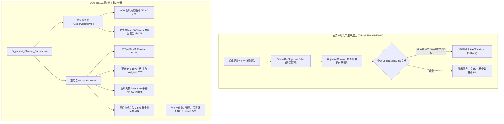

期待了好久的独立恐怖解谜新作 **《Giggleland》（危笑乐园）** 出正式版快半个月了：

[《危笑乐园》（Giggleland）Steam 商店页](https://store.steampowered.com/app/3370490/Giggleland/){: .preview }

这个游戏其实是近几年非常火的**吉祥物恐怖（Mascot Horror）**品类。从《玩具熊的五夜后宫》《Bendy》，到现象级的《波比的游戏时间》《Indigo Park》，以看似充满童真笑脸的卡通吉祥物为表象、实则隐藏着扭曲猎奇与荒诞阴谋的游戏设定一直备受玩家喜爱。而《危笑乐园》凭借其独特的复古手绘卡通风格、诡谲莫测的废弃游乐园场景以及张力拉满的病态角色塑造，在吉祥物恐怖界里可以说是相当亮眼的一部佳作。

我很喜欢游戏的角色设计和背景刻画，特别是核心角色 **Eliot（艾略特）**，无论人设造型还是诡异动态都极其出彩（*Eliot 可爱捏！*）。

不过游戏发售到现在都没出中文，对于这样一款拥有大量文本、场景指示与 19 篇核心日记的作品来说，纯英文确实很影响沉浸感，于是我就想着自己动手做逆向汉化了。

在最初着手时，我本以为这只是一次普通的“提取字典 - 补齐文本 - 封包写回”，但在深入反编译核心代码和解包底层资产后，我们挖出了官方“做了一半却蓄意封存”的确凿铁证；更在后续实机通关测试中，连续排查踩穿了四个光靠改字典根本无法解决的底层暗坑！

今天就借这篇文章，完整公开从**最初逆向挖掘到的官方底细**，到**后续实际实装、排查踩坑、直到现在最终状态（v1.1.4）**的全景历程与配套补丁资源！

> [!TIP]
> **免责声明**：本文所述逆向工程、静态二进制修补与资产分析仅供计算机软件本地化技术研究与交流学习。请支持独立游戏开发者，前往 Steam 平台购买并体验正版《危笑乐园》（Giggleland）。

---

# 一、 第一阶段：最初的逆向发现（官方做了半套，但故意隐藏）

官方**绝非完全没做中文**。我们在拆解底层底层工程时，抓到了官方“正在做但中途封存”的确凿铁证：

### 1. 核心代码铁证：官方故意加了隐藏开关
在游戏的本地化管理核心类 `LocalizationManager` 中，官方直接写死了布尔常量：
```csharp
public const bool OfferedToPlayers = False; // 直译：向玩家开放 = 假
```
在游戏启动引导逻辑中，我们还在引擎输出里抓到了如下调试断言日志：
```text
[LanguageSelect] First-launch flags cleared...
[ButtonEvents] No LanguageSelectScreen in the menu - skipping the first-launch language choice.
```
**原因非常明确**：官方知道自己只翻译了一部分，如果开放给玩家会到处穿帮，因此直接在代码层面把语言选择入口完全剥离，强制默认以英文 `"en"` 启动。

### 2. 翻译时间戳与批次记录（2026 年 10 月）
在官方 `LocalizationData` 的二进制数据结构中，每条文本都带有发送给外包翻译的批次时间戳：
* **第一批 689 条文本**：明确打上了 `2026-10-20` 的日期戳（属于游戏发售前刚合入的精翻第一期成果）；
* **其余 1,182 条文本**：该字段全部为空（代表第二期尚未发包、或者发包后未来得及合入游戏）。

官方甚至连游戏的正式中文名都已经敲定——充满悬疑感的 **《危笑乐园》**！

### 3. 官方走心的底层适配（早就埋好了字体与算法）
* **思源黑体 SDF 资产早就烘焙好了**：官方在 `resources.assets` 预先封包了专属的高清字体资产 `NotoSansSC-Medium SDF`（PathID 18956）；
* **字幕停顿算法专属调优（CJK 算法）**：官方为英文配置的阅读速度是每秒 17 字符，但特别为中文/日文单独做了算法减速：
  ```csharp
  readingCharsPerSecond = 6.0; // 调慢速度，让中文字幕停留更久以便阅读
  ```

### 4. 最初的数据盘点：759 条已翻 vs 1,112 条未翻
在官方原本的 1,871 条本地化数据库中：
* **官方已完成（约 759 条）**：主菜单全局设置（98%）、开场序章与走廊（100%）、泰瑞房屋主线剧情（100%）、前期管道关卡（95%）、核心交互按键提示（100%）；
* **官方未完成（共 1,112 条）**：
  1. 街机像素小游戏《艾略特大冒险》（270 条全英文）；
  2. 泰瑞笔记全文（64 篇长文本仅翻译了“笔记1”等标题，正文全空）；
  3. 制作人员歌曲与画册（Credits/Sing-Along 157 条未翻）；
  4. 后期关卡（RorysRally、新隧道等）世界标语与广播。



---

# 二、 为什么旧补丁失效？动态劫持折戟与静态二进制修补路线

在对剩余文本进行润色、查找资料的时候，我发现之前有人已经做过汉化补丁了。但深入研究后发现，先前的补丁也碰到了硬编码问题，导致不少任务与弹窗依旧是英文；更严重的是，评论区许多玩家提到**游戏更新后补丁就彻底无法使用**。

### 1. 为什么版本更新会导致补丁报废？
对比了更新前后的两个版本后，我发现官方重新编译了核心动态库 `GameAssembly.dll`：
* 本作采用 **Unity 64-bit IL2CPP**；
* IL2CPP 在 AOT（Ahead-Of-Time）静态编译时，会根据全局代码结构重新优化内联函数与虚表。
* 只要官方代码稍微改动一行，**所有的函数入口地址、虚方法表（VMT）以及类结构体偏移量就会全线改变**！依赖固定内存偏移地址的补丁在重新编译的代码面前瞬间暴毙。

### 2. version.dll 动态劫持为什么行不通？
在此之前，我也尝试过走通用的 `version.dll` 动态劫持注入路线，试图在运行时内存中 Hook 语言分发函数。但测试均以失败告终：
* **生命周期冲突**：`version.dll` 劫持加载发生在极早期，此时 Unity 引擎底层的 Mono/IL2CPP Runtime Domain 与资源反序列化流水线均未就绪，极易引发启动死锁或空指针崩溃；
* **IL2CPP 内存保护**：新版 Unity 运行时对代码段施加了严格的只读与执行保护（`PAGE_EXECUTE_READ`），强行修改内存页易触发访问冲突（Access Violation）。

### 3. 最优解：静态二进制修补路线
因此，目前最合理的方案依然是**静态二进制修补（Static Binary In-Place Relocation）**。
通过编写自动化扫描脚本扫描新版本的偏移量与对象表，将动态计算的常量补入 C 语言补丁程序中，使得后期即使游戏频繁更新，也能在几分钟内快速重构出可用补丁，维护成本极低且运行极其稳定。

---

# 三、 补丁实现细节：汇编特征码与资源流式重定位

我们编写的原生 C 补丁程序 `Giggleland_Chinese_Patcher.exe` 体积仅约 1.1MB，内嵌纯净增量本地化包（`loc_data.bin`），在本地实现毫秒级原位流式修改。

### 1. GameAssembly.dll 6 处汇编特征码精准修复
补丁通过扫描特征码，精准解除游戏逻辑中的英文锁死：

```c
DllPatch patches[] = {
    {"Awake.force_en (解除启动英文锁定)",   p1_orig, sizeof(p1_orig), p1_patch, sizeof(p1_patch)},
    {"SetLanguage.force_en (解除切换语言锁死)", p2_orig, sizeof(p2_orig), p2_patch, sizeof(p2_patch)},
    {"Awake.fallback (启动回退设为中文)",     p3_orig, sizeof(p3_orig), p3_patch, sizeof(p3_patch)},
    {"SetLanguage.fallback (切换回退设为中文)", p4_orig, sizeof(p4_orig), p4_patch, sizeof(p4_patch)},
    {"ctor.currentLanguage (默认语言设为中文)", p5_orig, sizeof(p5_orig), p5_patch, sizeof(p5_patch)},
    {"GetDefaults.language (新设置默认中文)",   p6_orig, sizeof(p6_orig), p6_patch, sizeof(p6_patch)},
    {NULL, NULL, 0, NULL, 0}
};
```
* 将 `Awake` 与 `SetLanguage` 中强行将语言设为英文的代码分别填充 27 字节与 7 字节的 `NOP`（`0x90`）；
* 将默认语言及未命中回退指针重定向至中文分支。

### 2. resources.assets 原位无损重定位
新数据包体积从官方最初的 541,852 字节扩增至 1,082,144 字节：
1. **修正文件头大端序总长**：在文件头偏移 `0x1C`（Offset 28..31）处，以 Big-Endian 写入扩展后的总长度；
2. **更新对象表 Entry 19786（PID 19787）**：将对象尺寸修正为新数据包大小；
3. **动态对齐与全局平移**：对后续所有资产条目的 `byte_start` 偏移统一增加差值，并严格维持 **8 字节边界对齐**；
4. **4MB 流式分块读写**：杜绝大内存占用，秒级完成重构并自动生成 `.bak` 备份，随时支持一键卸载还原。

---

# 四、 第二阶段：实战测试中暴露的“四大隐藏深坑”与专项攻坚

当我们将官方原版的 759 条中文激活并补全了未完成的 1,112 条之后，在实际通关实测中，我们进一步发现了**光靠官方原本的本地化框架根本无法解决的四大暗坑**：

### 1. 关卡任务目标全军覆没（硬编码在 14 个场景里）
* **问题**：在游玩过程中发现任务提示依然全为英文。
* **排查原因**：官方在制作 14 个关卡场景（`level0` ~ `level14`）时，关卡程序员根本没有把关卡目标录入本地化表，而是把它们作为硬编码直接写死在 90 处 `ObjectiveControl` 场景脚本里！查表失败后触发 Unity 静默回退，全屏显示原版英文。
* **解决**：我们穿透反编译了全部 14 个场景，把所有硬编码目标及其引号、句号全排列变体全部提炼出来，重构为独立字典注入。

### 2. FMOD 音频事件字幕“灯下黑”（FMOD Timeline Markers）
* **问题**：在艾略特回忆、电视机广播、以及暗黑低语 `SACRIFICE WHAT WILL KILL YOU` 处，屏幕直接回退显示英文大写。
* **排查原因**：游戏的很多台词由 FMOD 音频引擎驱动，字幕取自音频包 `Master.bank` 的时间轴标记（Timeline Marker）。官方音频师把文本放进了音频包，但**从未把这批标记导出到游戏文本表里**！
* **解决**：我们直接逆向扫描了 370MB 的 `Master.bank`，把里面所有时间轴台词、暗黑心魔低语及环境音标记全部捞出并加入本地化库。

### 3. 说话人双重前缀倒装 Bug
* **问题**：游戏内频繁出现 `农夫泰瑞: 泰瑞农夫: ...` 这类怪异的前缀堆叠。
* **排查原因**：官方部分译文里已经翻译了说话人（如“农夫泰瑞：”），但游戏逻辑代码在运行时又自动强行在前头拼了一遍角色名，导致双层重叠。
* **解决**：通过脚本对全量文本进行了前缀标准化清洗，消除了全部 26 处双重前缀冲突。

### 4. 泰瑞日记的“手写 vs 易读（抄录）”双模态断层
* **问题**：在查看日记时，原版手写体正常，但一旦按 `I` 键切换成易读字体，立刻变回英文。
* **排查原因**：官方代码在易读模式下，会在键名外侧自动包裹英文双引号 `""`，查不到原 key 从而导致回退。
* **解决**：建立了双模态多版本映射，无论是带 `<s>` 划线标签的手写体，还是外包引号的易读抄录体，均能 100% 命中中文。

### 5. 全角色统一规范中文译名
* **Ella** → **艾拉**
* **Eliot** → **艾略特**（*人设魅力极高，反差萌拉满！*）
* **Tolie** → **托莉**
* **Simon** → **西蒙**（经典关卡“西蒙说”）
* **Teri / Terry** → **泰瑞**（“泰瑞农夫” / “泰瑞的家”）
* **Rory** → **挠挠**（“挠挠闹翻天”）
* **Debbie** → **黛比**
* **Laura** → **劳拉**
* **Abby** → **艾比**
* **Abel** → **亚伯**
* **Isaac** → **艾萨克**

> [!NOTE]
> **关于 Sprite 贴图素材说明**：**至于 Sprite 素材，个人没有能力汉化**。场景海报、警示牌等属于纹理贴图，若要汉化需进行大量美术重绘且会导致补丁体积膨胀数百兆，因此全部保持了官方原汁原味的手绘英文质感。

---

# 五、 实用附赠：全笔记收集与直通隐藏结局“抉择点”存档

为了方便大家静下心来仔细品味世界观与泰瑞日记的完整故事，并轻松探索多结局分支，我在压缩包中随附了两个制作好的 Windows 注册表存档文件：

### 1. 全笔记全收集存档（`Giggleland_全笔记收集存档.reg`）
Unity 在 Windows 平台将 `PlayerPrefs` 存储于系统注册表中，日记进度的路径为：
`[HKEY_CURRENT_USER\Software\Hooked\Giggleland]`

键名为 `"TerryNotesProgress_h1806427539"`，其内容是一个十六进制 ASCII 序列化的 JSON：
```json
{
  "collected": [0,1,2,3,4,5,6,7,8,9,10,11,12,13,14,15,16,17,18],
  "transcribed": [0,1,2,3,4,5,6,7,8,9,10,11,12,13,14,15,16,17,18],
  "lastRead": 7,
  "version": 2
}
```
直接双击导入该注册表文件，即可在游戏主界面的笔记本中自由查看全部 19 篇笔记的手写与抄录双版本！

### 2. 直达隐藏结局关键抉择点存档（`Giggleland_抉择点存档_选择你的朋友.reg`）
由于游戏通往隐藏结局需要满足苛刻的分支条件，为了避免大家重新从头刷关卡，我特地提取并封装了**直达终局抉择点的专属存档**：
```reg
[HKEY_CURRENT_USER\Software\Hooked\Giggleland]
"ChapterHighWater_h3159641479"=dword:0000000c
"CheckpointLevel_h3727641241"=dword:00000007
"CheckpointIndex_h3733523889"=dword:00000006
```
该存档将检查点精确定位在终局最具决定性的时刻——**“选择你的朋友”（Choose Your Friend）**。在该节点下，玩家可以直接面对分歧抉择，轻松达成并体验我们全新汉化精修的**隐藏结局（Hidden Ending）**！

---

# 六、 游戏的 ARG 解谜与 Demo 移除遗憾

作为一款纯正的吉祥物恐怖（Mascot Horror）游戏，深不见底的背景暗线与 **ARG（Alternate Reality Game，侵入式虚拟现实解谜）** 向来是这类作品最迷人的灵魂所在，而《危笑乐园》在这方面更是设计得极其硬核。

在之前的 Demo 阶段我就体验过了：通过关卡中的暗号与密码可以解密出隐藏的 YouTube 视频，视频里面还藏了更多信息！整个解谜链条极其惊艳。

可惜官方在正式版上线后，**把 Demo 页面的解谜内容给删掉了**，很多后来入坑的玩家无法体验到完整的解密流程，**我真心希望他们能重新上架 Demo**！

想深入了解这套庞大密码学背景的朋友，可以参看官方 Wiki：

[Giggleland ARG Wiki（官方解密维基）](https://giggleland.wiki.gg/wiki/Giggleland_ARG){: .preview }

---

# 七、 社区福利：Telegram 贴纸包、Emoji 与无损源文件

另外，我从游戏解包资源中提取了无损素材，制作了专属的 Telegram 贴纸包和自定义 Emoji 包：

* 📱 **Telegram 贴纸包**：[Giggleland_AssetDump Stickers](https://t.me/addstickers/Giggleland_AssetDump)
* ✨ **Telegram 自定义 Emoji 包**：[Giggleland_AssetDump Emojis](https://t.me/addemoji/Giggleland_AssetDump_Emojis)

在整理素材时，我还发现之前已经有人拿官方的 Trailer 和周边动画视频做过贴纸包了，质量也非常棒：
* 🎨 **预告片动画贴纸包**：[GiggleLand Trailer Stickers](https://t.me/addstickers/GiggleLand)

这里将我们提取的全套透明背景高清贴纸源文件打包共享，方便大家自由创作：



---

# 八、 自动化维护工具链（Source Pipeline）

补丁配套的工程源码位于 `source/` 目录，供大家研究与后续跨版本维护：

| 维护脚本 | 核心功能与自动化机制 |
| :--- | :--- |
| `source/scan_offsets.py` | 自动解析新版 `resources.assets` 物理偏移与对象表，重算 8 字节动态对齐并同步更新 `Giggleland_Patch.c` 中的常量。 |
| `source/extract_game_texts.py` | 集成 AssetRipper，秒级扫描反编译源码与全部 14 个关卡场景，提取所有新增任务目标。 |
| `source/generate_loc_bin.py` | 全集策略合并并生成 8 字节对齐的二进制包 `loc_data.bin`。 |
| `source/build.bat` | 调用 MinGW GCC 毫秒级编译输出单文件绿色补丁。 |

---

# 九、 第三阶段：全流程回归实测与现状全景（v1.1.4 终局状态）

在初步发布汉化补丁后，为了验证补丁在实际多周目游玩中的文本命中率、剧情上下文通顺度以及游戏稳定性，我亲自通关了整部游戏，完整跑完了一次地毯式回归测试（Regression Testing）。

目前，我们已经完成了从“激活官方半成品”到“打造完全无死角汉化补丁”的全部闭环：

### 1. 数据规模与覆盖度全景演进
| 维度 | 最初官方状态 | 中期补齐状态 | 当前最终状态 (v1.1.4) |
| :--- | :--- | :--- | :--- |
| **总词条数** | 1,871 条（仅 759 条中文） | 2,597 条 | **2,808 条**（全覆盖） |
| **语言包体积** | 541,852 字节 | 1,031,728 字节 | **1,082,144 字节** |
| **关卡任务目标** | 0%（全硬编码英文） | 90% | **100% 提取并全汉化** |
| **泰瑞笔记正文** | 仅有标题，正文全空 | 19 篇正文已译 | **双模态全汉化，按 I 键不掉英文** |
| **街机像素小游戏** | 0%（全英文） | 仅旁白 | **按键 HUD、技能、状态、旁白 100% 汉化** |
| **FMOD 语音与低语** | 大量回退英文 | 主线音频已补 | **全屏低语、环境语气声效 100% 补齐** |
| **双重前缀 Bug** | 到处重复堆叠 | 存在偶发 | **已彻底消除为标准单前缀** |

### 2. 隐藏结局与内置街机小游戏深度攻坚
* **隐藏结局（Secret / Hidden Ending）汉化补完**：在实际通关触发隐藏结局时，排查出了由于条件跳转与动态字幕逻辑未命中导致先前遗漏的隐藏结局过场、专属文本与剧情提示，现已全部完成深度精校；
* **街机小游戏《艾略特大冒险》（Eliot's Adventure）全文本汉化**：将内置像素街机小游戏的 270 条按键 HUD、技能说明、状态面板与剧情旁白全部汉化完毕。

至此，主线关卡、任务目标、19 篇泰瑞日记、全部内置小游戏与隐藏结局已实现真正意义上的全流程完整汉化！

---

### 项目正式开源上线 GitHub

为了方便社区玩家参与代码审查、跨版本协同维护以及获取最新更新，本项目现已正式开源并托管至 GitHub：

[ZGQ-inc/Giggleland-zh_CN](https://github.com/ZGQ-inc/Giggleland-zh_CN){: .preview }

仓库完整开源了：
* C 语言原生单文件补丁工程源码（`Giggleland_Patch.c`）；
* 自动化跨版本物理偏移扫描脚本（`scan_offsets.py`）；
* 场景关卡与脚本全集提取器（`extract_game_texts.py`）；
* 本地化二进制资产打包生成器（`generate_loc_bin.py`）；
* 最新的 Release 二进制发行版与构建流水线。

后续官方如果推送小更新，我也将在 GitHub 仓库第一时间更新并发布补丁 Release。

> [!NOTE]
> **核心总结**：  
> 官方当时确实做好了漂亮的底层框架和前期的 759 条中文，但因为工程浩大烂尾、隐藏了开关，并遗留了大量的硬编码和音频漏洞。  
> 现在，我们不仅把官方藏起来的高质量中文完美激活，而且把官方遗漏的关卡目标、日记正文、街机小游戏、FMOD 音频低语全部补充完毕并修复了所有排版 Bug。目前游戏全程已经达到真正意义上的 100% 完全汉化。

---

# 十、 汉化补丁下载与使用指南



> [!NOTE]
> **版本与直链说明**：
> 下载卡片已直连 [GitHub Release 最新直链](https://github.com/ZGQ-inc/Giggleland-zh_CN/releases/latest/download/Giggleland_Chinese_Patcher.zip)，下载解压即可使用最新 v1.1.4 补丁。压缩包内含完整可执行程序、全笔记收集存档以及直通隐藏结局的抉择点存档。之前我也联系了第一个做汉化的作者，目前还没有收到回复。

### 使用方法
1. 从上方下载卡片直接获取 `Giggleland_Chinese_Patcher.zip`（亦可前往 [GitHub Releases](https://github.com/ZGQ-inc/Giggleland-zh_CN/releases) 下载最新版本）；
2. 将压缩包解压得到的 `Giggleland_Chinese_Patcher.exe` 复制到游戏根目录（即包含 `Giggleland.exe` 的文件夹中）；
3. 运行补丁程序：
   * 输入 `1` 并回车：自动备份并一秒完成全文本无损汉化；
   * 输入 `2` 并回车：随时一键彻底卸载，还原官方纯净原版；
   * 支持命令行静默调用：`Giggleland_Chinese_Patcher.exe --install`。
4. **【可选】存档一键导入**：
   * **全笔记收集**：双击运行包内的 `Giggleland_全笔记收集存档.reg` 导入注册表，即可在游戏中阅读全部 19 篇笔记；
   * **直达隐藏结局**：双击运行包内的 `Giggleland_抉择点存档_选择你的朋友.reg` 导入注册表，即可直接载入终局关键分歧点，探索隐藏结局！

---

||Eliot 可爱捏！||
