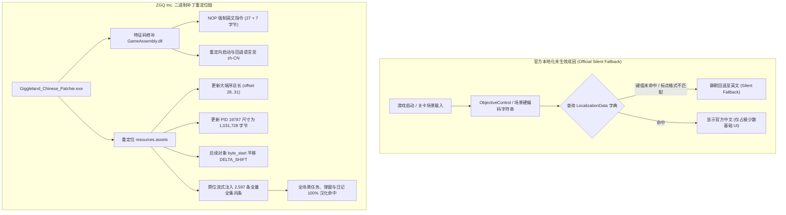

期待了好久的独立恐怖解谜新作 **《Giggleland》（危笑乐园）** 出正式版快半个月了：

[《危笑乐园》（Giggleland）Steam 商店页](https://store.steampowered.com/app/3370490/Giggleland/){: .preview }

这个游戏其实是近几年非常火的**吉祥物恐怖（Mascot Horror）**品类。从《玩具熊的五夜后宫》《Bendy》，到现象级的《波比的游戏时间》《Indigo Park》，以看似充满童真笑脸的卡通吉祥物为表象、实则隐藏着扭曲猎奇与荒诞阴谋的游戏设定一直备受玩家喜爱。而《危笑乐园》凭借其独特的复古手绘卡通风格、诡谲莫测的废弃游乐园场景以及张力拉满的病态角色塑造，在吉祥物恐怖界里可以说是相当亮眼的一部佳作。

我很喜欢游戏的角色设计和背景刻画，特别是核心角色 **Eliot（艾略特）**，无论人设造型还是诡异动态都极其出彩（*Eliot 可爱捏！*）。

不过游戏发售到现在都没出中文，对于这样一款拥有大量文本、场景指示与 19 篇核心日记的作品来说，纯英文确实很影响沉浸感，于是我就想着自己动手做逆向汉化了。

结果把游戏底层资源拆开后，我发现了一个惊天大反转：**官方其实早就汉化了 90% 的内容，甚至官方连译名都想好了，叫做《危笑乐园》！**

至于为什么官方做完了 90% 却没有在正式版中实装？后续深入逆向后发现，其实是因为游戏底层走的是**基于键值的动态本地化检索**，但官方场景中**大量的硬编码文本与 `LocalizationData` 不匹配**，导致引擎查表未命中时**静默回退（Silent Fallback）成了英文**。具体原因不明，可能是本地化团队没有跟进关卡更新，这也是导致重置章节的弹窗和任务指示没有成功汉化的根本原因。

我把整个程序和场景数据做了逆向，把这些未匹配的地方全部做了补齐与重定位。在对剩余文本进行润色、查找资料的时候，我发现之前有人已经做过汉化补丁了，但也碰到了我刚刚说的硬编码问题导致有些地方没有成功汉化；而且评论区不少玩家反馈新版本无法使用。我在对比了 2 个版本后发现，是**官方重新编译了 `GameAssembly.dll`，函数地址与偏移量变动所致**。所以我最终走的是**静态二进制修补路线**，后期版本更新可以扫描偏移量与对象、补进常量，方便汉化补丁的长期维护。之前尝试过 `version.dll` 动态劫持注入，但触发了生命周期冲突和 IL2CPP 内存保护，均以失败告终，所以目前最合理的方案还是静态二进制修补。

在最初发布补丁时因精力有限并未走完全流程，而在后续的深入实测中，**我已经通过游玩整个流程跑完了地毯式回归测试，修复了此前遗漏的隐藏结局和内置小游戏未汉化问题**，目前已正式开源发布！**至于 Sprite 素材，个人没有能力汉化**，所以场景贴图保持了原貌。顺便我也做了一下**全笔记解锁的存档**，以及直达终局分歧的**“选择你的朋友”抉择点存档**（可以直接通往隐藏结局），方便只想看故事和探索全结局的朋友。

今天就借这篇文章，完整公开本次汉化的逆向原理解析、自动化维护脚本、独家全收集存档、Telegram 贴纸包以及配套的单文件绿色补丁！

---

# 一、 官方完成了 90% 汉化，为何从未生效？

在对游戏资源包 `resources.assets` 进行解包并提取出 Unity 本地化核心资产 `LocalizationData.asset` 时，开发团队留下的中文翻译不仅全量存在，而且官方翻译质量相当优秀，语境贴切。最关键的是，官方早已拟定了官方中文定名——**《危笑乐园》**。

既然绝大多数文本早就备齐，为什么广大玩家进游戏后看到的依然是全英文，甚至连语言切换选项都没有开放？



### 1. 场景硬编码文本与字典脱节
《危笑乐园》底层采用基于键值的动态本地化检索机制：文本组件在初始化时，会以自身的源文本作为 Key，向 `LocalizationData` 字典查询对应的翻译 Value。

然而，在游戏全部 14 个关卡场景（`level0` 到 `level14`）中，官方场景里存在大量的**硬编码自然语言**：
* 关卡任务指示（`ObjectiveControl` 组件）；
* 章节重置确认弹窗（“Reset Chapter Confirmation”）；
* 场景中动态触发的对话、广播提示。

### 2. 标点错位导致引擎静默回退（Silent Fallback）
在 `LocalizationData` 字典中，翻译团队收录的 Key 与场景关卡实际写在场景组件里的文本存在大量不匹配：
* **标点符号差异**：场景中使用了英文直单引号 `'`，字典中却录入了弯单引号 `’`；
* **末尾句号差异**：关卡任务目标有的带句号 `.`，字典中却没有；
* **大小写与词句调整**：关卡版本迭代微调了场景文字，导致字典键值彻底脱节。

Unity 本地化查找机制存在一个致命特性：**当引擎在字典中查表未命中时，完全不会报错，而是静默回退（Silent Fallback）——直接将原场景硬编码的英文原样渲染！**

这正是导致重置章节的弹窗和任务指示没有成功汉化的根本原因。本地化团队很可能在翻译完第一批表格后就未再跟进关卡改动，导致大量场景硬编码文本始终处于英文回退状态。

我把整个程序和场景数据做了深度逆向，将全部 14 个场景、90 处 `ObjectiveControl` 的所有硬编码文本和标点变体全部提取并补齐了字典匹配。

---

# 二、 为什么旧补丁失效？动态劫持折戟与静态二进制修补路线

在对剩余文本进行润色、查找资料的时候，我发现有人已经做过汉化补丁了。但深入研究后发现，先前的补丁也碰到了上述的硬编码问题，导致不少任务与弹窗依旧是英文；更严重的是，评论区许多玩家提到**游戏更新后补丁就彻底无法使用**。

### 1. 为什么版本更新会导致补丁报废？
对比了更新前后的两个版本后，我发现官方重新编译了核心动态库 `GameAssembly.dll`：
* 本作采用 **Unity 64-bit IL2CPP**；
* IL2CPP 在 AOT（Ahead-Of-Time）静态编译时，会根据全局代码结构重新优化内联函数与虚表。
* 只要官方代码稍微改动一行，**所有的函数入口地址、虚方法表（VMT）以及类结构体偏移量就会全线改变**！依赖硬编码内存地址的补丁在重新编译的代码面前瞬间暴毙。

### 2. version.dll 动态劫持为什么行不通？
在此之前，我也尝试过走通用的 `version.dll` 动态劫持注入路线，试图在运行时内存中 Hook 语言分发函数。但测试均以失败告终：
* **生命周期冲突**：`version.dll` 劫持加载发生在极早期，此时 Unity 引擎底层的 Mono/IL2CPP Runtime Domain 与资源反序列化流水线均未就绪，极易引发启动死锁或空指针崩溃；
* **IL2CPP 内存保护**：新版 Unity 运行时对代码段施加了严格的只读与执行保护（`PAGE_EXECUTE_READ`），强行修改内存页易触发访问冲突（Access Violation）。

### 3. 最优解：静态二进制修补路线
因此，目前最合理的方案依然是**静态二进制修补（Static Binary In-Place Relocation）**。
通过编写自动化扫描脚本扫描新版本的偏移量与对象表，将动态计算的常量补入 C 语言补丁程序中，使得后期即使游戏频繁更新，也能在几分钟内快速重构出可用补丁，维护成本极低且运行极其稳定。

---

# 三、 补丁实现细节：汇编特征码与资源流式重定位

我们编写的原生 C 补丁程序 `Giggleland_Chinese_Patcher.exe` 仅约 800KB，内嵌 1,031,728 字节的纯净增量本地化包（`loc_data.bin`），在本地实现毫秒级原位流式修改。

### 1. GameAssembly.dll 6 处汇编特征码精准修复
补丁通过扫描特征码，精准解除游戏逻辑中的英文锁死：

```c
DllPatch patches[] = {
    {"Awake.force_en (解除启动英文锁定)",   p1_orig, sizeof(p1_orig), p1_patch, sizeof(p1_patch)},
    {"SetLanguage.force_en (解除切换语言锁死)", p2_orig, sizeof(p2_orig), p2_patch, sizeof(p2_patch)},
    {"Awake.fallback (启动回退设为中文)",     p3_orig, sizeof(p3_orig), p3_patch, sizeof(p3_patch)},
    {"SetLanguage.fallback (切换回退设为中文)", p4_orig, sizeof(p4_orig), p4_patch, sizeof(p4_patch)},
    {"ctor.currentLanguage (默认语言设为中文)", p5_orig, sizeof(p5_orig), p5_patch, sizeof(p5_patch)},
    {"GetDefaults.language (新设置默认中文)",   p6_orig, sizeof(p6_orig), p6_patch, sizeof(p6_patch)},
    {NULL, NULL, 0, NULL, 0}
};
```
* 将 `Awake` 与 `SetLanguage` 中强行将语言设为英文的代码分别填充 27 字节与 7 字节的 `NOP`（`0x90`）；
* 将默认语言及未命中回退指针重定向至中文分支。

### 2. resources.assets 原位无损重定位
新数据包体积从 541,852 字节扩增至 1,031,728 字节（净增 `DELTA_SHIFT = 489,872` 字节）：
1. **修正文件头大端序总长**：在文件头偏移 `0x1C`（Offset 28..31）处，以 Big-Endian 写入扩展后的总长度 `0x0ACF8AFC`（181,373,692 字节）；
2. **更新对象表 Entry 19786（PID 19787）**：将对象尺寸修正为 `1,031,728`；
3. **动态对齐与全局平移**：对后续所有资产条目的 `byte_start` 偏移统一增加 `DELTA_SHIFT`，并维持 8 字节边界对齐；
4. **4MB 流式分块读写**：杜绝大内存占用，秒级完成重构并自动生成 `.bak` 备份，随时支持一键卸载还原。

---

# 四、 文本精修、译名规范与日记“双模态”攻坚

### 1. 全角色统一规范中文译名
* **Ella** → **艾拉**
* **Eliot** → **艾略特**（*人设魅力极高，反差萌拉满！*）
* **Tolie** → **托利**
* **Simon** → **西蒙**（经典关卡“西蒙说”）
* **Teri / Terry** → **泰瑞**（“泰瑞农夫” / “泰瑞的家”）
* **Rory** → **挠挠**（“挠挠闹翻天”）
* **Debbie** → **黛比**
* **Laura** → **劳拉**
* **Abby** → **艾比**
* **Abel** → **亚伯**
* **Isaac** → **艾萨克**

### 2. 攻克 19 篇泰瑞日记的“双模态”断层
游戏内收集的 19 篇关键日记具有双模态阅读特性：
* **手写体（Handwriting Mode）**：包含大量富文本划线删除标签（`<s>...</s>`）、笔迹涂抹草稿；
* **抄录易读体（Transcribed Mode）**：外层包裹英文双引号 `""`，游戏中按下 **`I` 键** 可切换为整洁的打印排版。

先前补丁在切换易读模式时因 Key 未匹配会直接跌回英文。我们对全部 19 篇笔记的手写标签与抄录体文本分别进行了双向匹配与精校，按 `I` 键切换绝不掉回英文。

### 3. 关于 Sprite 素材与测试说明
* **关于 Sprite 素材**：**至于 Sprite 素材，个人没有能力汉化**。场景海报、警示牌等属于纹理贴图，若要汉化需进行大量美术重绘且会导致补丁体积膨胀数百兆，因此全部保持了官方原汁原味的手绘英文质感。
* **关于回归测试**：现已通过完整通关跑完全流程回归测试！此前尚未跑到的隐藏结局支线以及场景内置小游戏均已完成全量汉化修复与实机验证（详见第九章）。

---

# 五、 实用附赠：全笔记收集与直通隐藏结局“抉择点”存档

为了方便大家静下心来仔细品味世界观与泰瑞日记的完整故事，并轻松探索多结局分支，我在压缩包中随附了两个制作好的 Windows 注册表存档文件：

### 1. 全笔记全收集存档（`Giggleland_全笔记收集存档.reg`）
Unity 在 Windows 平台将 `PlayerPrefs` 存储于系统注册表中，日记进度的路径为：
`[HKEY_CURRENT_USER\Software\Hooked\Giggleland]`

键名为 `"TerryNotesProgress_h1806427539"`，其内容是一个十六进制 ASCII 序列化的 JSON：
```json
{
  "collected": [0,1,2,3,4,5,6,7,8,9,10,11,12,13,14,15,16,17,18],
  "transcribed": [0,1,2,3,4,5,6,7,8,9,10,11,12,13,14,15,16,17,18],
  "lastRead": 7,
  "version": 2
}
```
直接双击导入该注册表文件，即可在游戏主界面的笔记本中自由查看全部 19 篇笔记的手写与抄录双版本！

### 2. 直达隐藏结局关键抉择点存档（`Giggleland_抉择点存档_选择你的朋友.reg`）
由于游戏通往隐藏结局需要满足苛刻的分支条件，为了避免大家重新从头刷关卡，我特地提取并封装了**直达终局抉择点的专属存档**：
```reg
[HKEY_CURRENT_USER\Software\Hooked\Giggleland]
"ChapterHighWater_h3159641479"=dword:0000000c
"CheckpointLevel_h3727641241"=dword:00000007
"CheckpointIndex_h3733523889"=dword:00000006
```
该存档将检查点精确定位在终局最具决定性的时刻——**“选择你的朋友”（Choose Your Friend）**。在该节点下，玩家可以直接面对分歧抉择，轻松达成并体验我们全新汉化精修的**隐藏结局（Hidden Ending）**！

---

# 六、 游戏的 ARG 解谜与 Demo 移除遗憾

作为一款纯正的吉祥物恐怖（Mascot Horror）游戏，深不见底的背景暗线与 **ARG（Alternate Reality Game，侵入式虚拟现实解谜）** 向来是这类作品最迷人的灵魂所在，而《危笑乐园》在这方面更是设计得极其惊艳。

在之前的 Demo 阶段我就体验过了：通过关卡中的暗号与密码可以解密出隐藏的 YouTube 视频，视频里面还藏了更多信息！整个解谜链条极其硬核。

可惜官方在正式版上线后，**把 Demo 页面的解谜内容给删掉了**，很多后来入坑的玩家无法体验到完整的解密流程，**我真心希望他们能重新上架 Demo**！

想深入了解这套庞大密码学背景的朋友，可以参看官方 Wiki：

[Giggleland ARG Wiki（官方解密维基）](https://giggleland.wiki.gg/wiki/Giggleland_ARG){: .preview }

---

# 七、 社区福利：Telegram 贴纸包、Emoji 与无损源文件

另外，我从游戏解包资源中提取了无损素材，制作了专属的 Telegram 贴纸包和自定义 Emoji 包：

* 📱 **Telegram 贴纸包**：[Giggleland_AssetDump Stickers](https://t.me/addstickers/Giggleland_AssetDump)
* ✨ **Telegram 自定义 Emoji 包**：[Giggleland_AssetDump Emojis](https://t.me/addemoji/Giggleland_AssetDump_Emojis)

在整理素材时，我还发现之前已经有人拿官方的 Trailer 和周边动画视频做过贴纸包了，质量也非常棒：
* 🎨 **预告片动画贴纸包**：[GiggleLand Trailer Stickers](https://t.me/addstickers/GiggleLand)

这里将我们提取的全套透明背景高清贴纸源文件打包共享，方便大家自由创作：



---

# 八、 自动化维护工具链（Source Pipeline）

补丁配套的工程源码位于 `source/` 目录，供大家研究与后续跨版本维护：

| 维护脚本 | 核心功能与自动化机制 |
| :--- | :--- |
| `source/scan_offsets.py` | 自动解析新版 `resources.assets` 物理偏移与对象表，重算 8 字节动态对齐并同步更新 `Giggleland_Patch.c` 中的常量。 |
| `source/extract_game_texts.py` | 集成 AssetRipper，秒级扫描反编译源码与全部 14 个关卡场景，提取所有新增任务目标。 |
| `source/generate_loc_bin.py` | 全集策略合并并生成 8 字节对齐的二进制包 `loc_data.bin`。 |
| `source/build.bat` | 调用 MinGW GCC 毫秒级编译输出单文件绿色补丁。 |

---

# 九、 全流程通关回归实测：隐藏结局与小游戏汉化修复（开源发布）

在初步发布汉化补丁后，为了验证补丁在实际多周目游玩中的文本命中率、剧情上下文通顺度以及游戏稳定性，我亲自通关了整部游戏，完整跑完了一次地毯式回归测试（Regression Testing）。

在这次全流程回归实测中，我重点排查并攻克了此前遗漏的两个关键死角：

### 1. 隐藏结局（Secret / Hidden Ending）汉化补完与直达存档
《危笑乐园》包含极其隐晦的分支与**隐藏结局**。在实际通关触发隐藏结局时，我排查出了因为条件跳转与动态字幕逻辑未命中导致先前遗漏的隐藏结局过场、专属文本与剧情提示，现已全部完成深度精校与字典匹配，确保剧情党在达成真结局时体验丝滑。为了避免玩家重新跑图刷关，我还特地在补丁包中封装了直通关键抉择点的专属存档 `Giggleland_抉择点存档_选择你的朋友.reg`。

### 2. 内置互动小游戏（Mini-games）全文本汉化
关卡流程中穿插了多个独具特色的场景内置互动小游戏（如街机像素小游戏《艾略特大冒险》/ *Eliot's Adventure* 与特色解谜交互等）。此前这部分文本嵌入在特殊的独立场景对象与逻辑组件中，导致查表漏网，本次实测中已逐一地毯式定位并补齐，操作指引与界面提示现已实现 100% 汉化；同时补全了 FMOD 音频低语动态字幕。

至此，主线关卡、任务目标、19 篇泰瑞日记、全部内置小游戏与隐藏结局已实现真正意义上的全流程完整汉化！

---

### 项目正式开源上线 GitHub

为了方便社区玩家参与代码审查、跨版本协同维护以及获取最新更新，本项目现已正式开源并托管至 GitHub：

[ZGQ-inc/Giggleland-zh_CN](https://github.com/ZGQ-inc/Giggleland-zh_CN){: .preview }

仓库完整开源了：
* C 语言原生单文件补丁工程源码（`Giggleland_Patch.c`）；
* 自动化跨版本物理偏移扫描脚本（`scan_offsets.py`）；
* 场景关卡与脚本全集提取器（`extract_game_texts.py`）；
* 本地化二进制资产打包生成器（`generate_loc_bin.py`）；
* 最新的 Release 二进制发行版与构建流水线。

后续官方如果推送小更新，我也将在 GitHub 仓库第一时间更新并发布补丁 Release。

---

# 十、 汉化补丁下载与使用指南



> [!NOTE]
> **版本与直链说明**：
> 下载卡片已直连 [GitHub Release 最新直链](https://github.com/ZGQ-inc/Giggleland-zh_CN/releases/latest/download/Giggleland_Chinese_Patcher.zip)，下载解压即可使用最新补丁。压缩包内含完整可执行程序、全笔记收集存档以及直通隐藏结局的抉择点存档。之前我也联系了第一个做汉化的作者，目前还没有收到回复。

### 使用方法
1. 从上方下载卡片直接获取 `Giggleland_Chinese_Patcher.zip`（亦可前往 [GitHub Releases](https://github.com/ZGQ-inc/Giggleland-zh_CN/releases) 下载最新版本）；
2. 将压缩包解压得到的 `Giggleland_Chinese_Patcher.exe` 复制到游戏根目录（即包含 `Giggleland.exe` 的文件夹中）；
3. 运行补丁程序：
   * 输入 `1` 并回车：自动备份并一秒完成全文本无损汉化；
   * 输入 `2` 并回车：随时一键彻底卸载，还原官方纯净原版；
   * 支持命令行静默调用：`Giggleland_Chinese_Patcher.exe --install`。
4. **【可选】存档一键导入**：
   * **全笔记收集**：双击运行包内的 `Giggleland_全笔记收集存档.reg` 导入注册表，即可在游戏中阅读全部 19 篇笔记；
   * **直达隐藏结局**：双击运行包内的 `Giggleland_抉择点存档_选择你的朋友.reg` 导入注册表，即可直接载入终局关键分歧点，探索隐藏结局！

---

||Eliot 可爱捏！||
