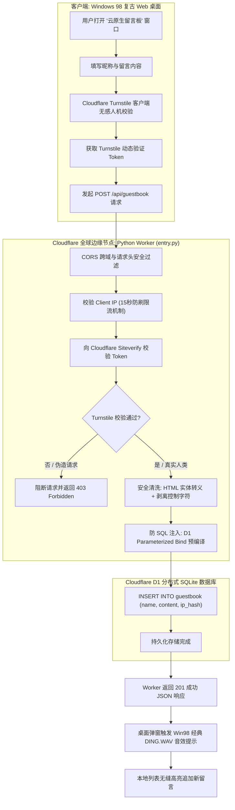

在扁平化设计（Flat Design）与极简卡片风格统治现代 Web 的今天，网页界面的同质化越来越严重。作为一名对 90 年代个人计算机黄金时代与 80 年代复古未来主义（Retro-futurism）怀揣无限敬意的极客开发者，我一直渴望打造一个真正属于自己的“数字精神避难所”。

Windows 98 那带有微妙光影立体斜面的灰色边框、经典 16 色位图图标、咔哒作响的系统提示音，以及 80 年代赛博合成波（Synthwave / Outrun）中永不熄灭的霓虹落日网格与合成器贝斯，是我心中无法磨灭的技术浪漫。

为此，我启动并完成了对 **ZGQ Inc. 个人主页（Homepage）** 的全面重构：**拒绝浮于表面、中看不中用的“静态假皮套”，我们用现代 Web 技术栈和云原生边缘计算，从零构建了一套 1:1 像素级还原、真正拥有操作系统生命力的 Windows 98 Web OS 桌面！**

[🌐 Windows 98 赛博合成波复古桌面（Live Demo 直达）](https://zgqinc.gq/){: .preview }

[📦 个人主页完整源码仓库（GitHub 开源）](https://github.com/ZGQ-inc/homepage){: .preview }


今天这篇长文，就为大家完整复盘这次个人主页重构的架构设计、前端细节打磨、云原生边缘计算实装以及那些藏在系统深处的彩蛋！

> [!TIP]
> **在线体验建议**：推荐在桌面端使用现代 Chromium 或 Firefox 浏览器访问 [zgqinc.gq](https://zgqinc.gq/)。点击任务栏托盘的小喇叭可开启系统原声；移动端及折叠屏手机（如 Galaxy Z Fold）也已专门适配，支持双屏触控交互。

---

# 一、 像素级 Windows 98 桌面环境与窗口管理器设计

市面上许多所谓的“复古 Web 桌面”，往往只是堆叠了几个固定的 HTML `div` 卡片，无法拖拽、不能缩放、层级混乱，一摸就露馅。

为了让用户在浏览器中获得与实体 PC 别无二致的操作体验，我们在经典开源样式库 `98.css` 和 `1j01/98` 经典像素资产库的基础上，耗时数周自研并封装了底层的桌面操作系统管理器 —— **`desktop-os.js`**。

```text
desktop-os.js 核心能力全景：
├── 窗口生命周期调度 (Window Lifecycle)
│   ├── 动态 Z-Index 层级置顶 (Active Window Elevation)
│   ├── 最小化至任务栏 (Minimize to Taskbar)
│   ├── 最大化与视口还原 (Maximize / Restore)
│   └── Escape 快捷键无感安全关闭
├── 原生八方向边缘自由拉伸 (8-Direction Edge Cursor Resizing)
│   ├── 顶部 (n-resize) / 底部 (s-resize)
│   ├── 左侧 (w-resize) / 右侧 (e-resize)
│   └── 四角对角线 (ne/nw/se/sw-resize) 鼠标光标联动
├── 智能桌面排版 (📐 Tidy Windows)
│   └── 桌面多任务智能网格与主副视窗并列算法
└── 折叠屏与移动端响应式布局
    └── Dual-Book 双屏书卷视图与全触控手势防溢出
```

### 1. 窗口的自由缩放与八方向边缘拉伸控制 (Resize)
传统的 Web 窗口大多只能拖拽标题栏移动位置，而真实的 Windows 98 是可以在窗口四周任意边缘拉伸缩放的。我们在每个窗口的边框周围注入了八个不可见的精密触控锚点：
- 鼠标滑过边框四周及四个夹角时，精确触发对应的系统级光标（`n-resize`, `s-resize`, `e-resize`, `w-resize`, `ne-resize`, `nw-resize`, `se-resize`, `sw-resize`）；
- 拖拽缩放时实时计算视口相对坐标（Bounding Client Rect），不仅设定了严格的最小宽度（320px）和最小高度（200px），避免内容塌陷，同时与 WebGL 视觉渲染器及 Webamp 音频上下文无缝联动，保持画面的实时自适应重绘。

### 2. 深度定制的任务栏与开始菜单 (Taskbar & Start Menu)
- **任务栏状态同步**：活动窗口对应的任务栏按钮呈现原版经典的“凹陷点选”视觉样式，非活动窗口或最小化窗口呈现凸起状态；点击任务栏按钮可在“置顶激活”与“最小化”之间无缝切换。
- **系统托盘与秒级时钟**：托盘不仅包含音量控制喇叭、网络状态图标，还配备了秒级刷新的数显时钟，鼠标悬停时会浮出格式化的当前系统日期。
- **一键整洁排版（📐 Tidy Windows）**：桌面上开了一堆窗口觉得乱？点击托盘旁边的“📐 整理窗口”按钮，算法会自动将左侧分配给导航主视窗，右侧将音乐播放器和 3D 视觉器上下并列排布；在移动端则自动按阶梯递进重置，并联动回形针小助手发出趣味提示。

### 3. 折叠屏 Dual-Book 视图与移动端全场景适配
针对现代大屏折叠机（例如我日常主力使用的 **Galaxy Z Fold7**），页面会自动侦测屏幕宽高比与双屏展开态。当检测到展开为接近 1:1 或 4:3 的双屏形态时，桌面自动切入 **Dual-Book 并列双卷书本模式**；在普通手机竖屏下，窗口则自动扩展为自适应屏幕宽度的抽屉卡片，完美兼顾了复古情怀与现代触控便利性。

---

# 二、 灵魂注入：全局 Win98 模态对话框代理系统 (`win98-dialog.js`)

如果在充满 90 年代像素复古氛围的桌面上，点击某个功能却突然弹出一个现代浏览器原生、冰冷惨白的 `window.alert()` 弹窗，那种沉浸感会在一瞬间被彻底撕碎！

为此，我们在项目中编写了独立的模态对话框代理系统 **`win98-dialog.js`**，**在底层深度劫持并代理了原生浏览器提供的 `window.alert()`、`window.confirm()` 和 `window.prompt()` 三大标准 API**。

```javascript
/**
 * Windows 98 Authentic Modal Dialog & MessageBox System
 * Replaces native browser alert(), confirm(), and prompt() with pixel-perfect Win98 dialogs.
 */
class Win98DialogSystem {
  // 原生 API 代理与异步 Promise 封装
  alert(message, title = '系统提示') {
    return this.openDialog({ type: 'alert', message, title, icon: 'info' });
  }

  confirm(message, title = '系统确认') {
    return this.openDialog({ type: 'confirm', message, title, icon: 'question' });
  }

  prompt(message, defaultValue = '', title = '系统输入') {
    return this.openDialog({ type: 'prompt', message, defaultValue, title, icon: 'question' });
  }
}
```

这套对话框系统拥有令人惊叹的像素级还原细节：

### 1. 严格标准的 8×7 像素矢量关闭十字叉
很多前端模拟 Win98 对话框时，为了图省事，往往直接用普通字体的乘号字符 `"×"` 代替右上角的关闭按钮。但在高分屏上，字体的乘号会有抗锯齿边缘和字体变形，非常具有违和感。
我们严格遵循微软官方 Windows 98 SDK 规范，通过纯 CSS 矢量像素绘制了原汁原味的 **8×7 像素实体非对称关闭叉号**，无论屏幕如何缩放，都始终保持最锐利的像素颗粒感！

### 2. 语义化图标与原版声音联动（DNA 颤动！）
对话框会根据调用上下文与语义自动匹配原汁原味的 32×32 主体位图与 16×16 标题栏图标：
- **普通消息 / 系统提示**：匹配蓝色圆形 `info-32x32-8bpp.png`；
- **确认操作 / 用户询问**：匹配黄色问号 `question-32x32-8bpp.png`；
- **告警操作 / 敏感风险**：匹配黄色三角感叹号 `warning-32x32-8bpp.png`；
- **错误拦截 / 致命异常**：匹配红色圆盘白叉 `error-32x32-8bpp.png`。

更重要的是，在弹窗浮出的一瞬间，系统会**联动播放微软原版 `DING.WAV`（提示音）或 `CHORD.WAV`（确认弦音）**！清脆的经典声波从耳机中传出的那一刻，时光仿佛瞬间倒流回了 1998 年那个燥热的蝉鸣午后。

### 3. 全异步 Promise 与键盘快捷流
调用方式完全对齐现代前端标准，所有弹窗均返回标准的 JavaScript `Promise`：
- 支持鼠标按住标题栏在桌面可是可视区域内任意平滑拖动；
- 支持全局键盘监听：按 `Enter` 键触发默认高亮按钮（确认），按 `Escape` 键直接取消并关闭窗口；
- 具备完整的模态遮罩层（Modal Backdrop）与焦点锁定（Focus Trapping），防止键盘 TAB 键穿透逃逸。

---

# 三、 云原生边缘无服务器架构：Cloudflare Python Worker + D1 + Turnstile 留言板

作为一个开放的个人主页，留言板（Guestbook）是连接访客与站长的核心桥梁。但传统的留言板要么依赖庞大臃肿且容易被黑的 PHP/MySQL 动态主机，要么就是接入毫无隐私保障的第三方第三方评论插件。

我们希望这套系统具备三个核心特质：
1. **零成本与高可用**：无需长期租赁和维护任何 VPS 实体服务器；
2. **极速的全球响应**：无论访客身在东京、法兰克福还是硅谷，都能在数十毫秒内就近完成加载；
3. **企业级的安全防御**：彻底免疫灌水机器人（Spam Bot）、SQL 注入与存储型 XSS 攻击。

最终，我们选择了 **Cloudflare 边缘云原生架构**：使用最新支持的 **Python Worker 运行时** 作为 Serverless 后端，配合 Cloudflare 分布式无服务器数据库 **Cloudflare D1 (SQLite)** 以及智能无感人机验证 **Cloudflare Turnstile**！



### 1. 为什么是 Cloudflare Python Worker？
以往大家习惯用 JavaScript/TypeScript 写 Cloudflare Workers，而随着 Cloudflare 官方在 Workers 运行时中原生集成 Pyodide 并正式支持 Python，我们直接采用纯 Python 构建了留言板的整个业务网关 **`worker/src/entry.py`**：

```python
from workers import WorkerEntrypoint, Response
from js import fetch, Object
import json
import html
import re

class Default(WorkerEntrypoint):
    """
    Cloudflare Python Worker for ZGQ Inc. Homepage Guestbook.
    Backed by Cloudflare D1 Database (homepage-db).
    Features Turnstile anti-bot verification, parameterized anti-SQLi queries,
    anti-XSS HTML escaping, and rate limiting.
    """

    async def fetch(self, request):
        method = request.method
        # 标准跨域与安全响应头
        cors_headers = {
            "Access-Control-Allow-Origin": "*",
            "Access-Control-Allow-Methods": "GET, POST, OPTIONS",
            "Access-Control-Allow-Headers": "Content-Type, Authorization, X-Requested-With",
            "Content-Type": "application/json; charset=utf-8",
            "X-Content-Type-Options": "nosniff",
            "X-Frame-Options": "DENY",
            "X-XSS-Protection": "1; mode=block"
        }

        if method == "OPTIONS":
            return Response("", status=204, headers=cors_headers)
        
        # 路由分发与处理逻辑 ...
```

不仅代码表达力极度优雅，而且冷启动延迟被 Cloudflare 优化到了惊人的 **个位数毫秒级**！

### 2. Cloudflare Turnstile 服务端鉴权双重闭环
很多站长使用验证码只在前端做简单的滑块验证，这种“防君子不防小人”的做法用脚本一秒就被绕过了。
在我们的方案中：
- 前端嵌入 Cloudflare Turnstile 智能验证组件；
- 用户点击提交时，客户端拿到由 Cloudflare 签发的临时 Token，随留言数据一同提交到 Worker；
- **Worker 在边缘节点携带私密密钥（Secret Key），向官方验证接口发起反向校验**：

```python
# 向 Cloudflare 官方鉴权端点验证 Turnstile Token
turnstile_verify_url = "https://challenges.cloudflare.com/turnstile/v0/siteverify"
verify_data = json.dumps({
    "secret": str(self.env.TURNSTILE_SECRET_KEY),
    "response": turnstile_token,
    "remoteip": client_ip
})

verify_res = await fetch(turnstile_verify_url, method="POST", headers={"Content-Type": "application/json"}, body=verify_data)
verify_json = await verify_res.json()

if not verify_json.success:
    return Response(json.dumps({"error": "人机安全验证失败，请刷新重试"}), status=403, headers=cors_headers)
```
任何未携带有效 Token 或伪造的外部请求，均会在边缘节点被直接掐断，甚至连数据库的一行记录都不会触碰！

### 3. 多层纵深防御：XSS 清洗、SQL 参数化与 IP 限流
- **彻底消灭 SQL 注入**：全面使用 Cloudflare D1 的预编译参数绑定机制（`db.prepare("INSERT INTO guestbook ... VALUES (?, ?, ?, ?)").bind(...)`），SQL 语句与用户数据在协议层物理隔离，杜绝注入可能。
- **存储型 XSS 防御**：通过 Python 内置的 `html.escape()` 对访客提交的昵称与留言内容进行严格转义，并使用正则强制过滤所有的不可见 Unicode 控制字符。
- **单 IP 15 秒限流防灌水**：针对每个请求的客户端 IP 进行哈希计算，记录其最后一次发言时间戳，未满 15 秒的连续提交将被直接拦截，有效防止恶意轰炸。

### 4. 自动化 CI/CD 交付：GitHub Actions
我们配置了 `.github/workflows/deploy-worker.yml` 工作流。只要向主分支提交代码，GitHub Actions 就会自动安装 Wrangler 并将最新的 Python Worker 与数据库结构同步至 Cloudflare 全球 300+ 边缘机房，真正做到了“代码推送即全球部署”。

---

# 四、 视听盛宴：Webamp 2.9 + Butterchurn (Milkdrop 2) + NewRetroWave 专属电台

在 90 年代末到千禧年代初，每个极客的桌面上都会常驻一个传奇软件 —— **Winamp**。那些带有荧光绿色数字频谱、无数第三方定制皮肤和令人眼花缭乱的可视化插件，定义了一代人对数字音乐的最初记忆。

在全新主页中，我们把这种经典视听体验原汁原味地搬到了浏览器中，打造了音乐与视觉的立体矩阵！

```text
多媒体引擎矩阵：
├── 🎵 本地精选集：Webamp 2.9 (Winamp 经典网页重制)
│   ├── 双通道动态波形 / 柱状频谱分析仪
│   ├── 10 段专业级模拟均衡器 (EQ)
│   └── 精选 10 首顶级合成波黄金曲目 (Carpenter Brut / The Midnight 等)
├── 🌌 3D 律动视觉器：Butterchurn (Milkdrop 2 WebGL 引擎)
│   ├── 纯前端 WebGL 高性能着色器渲染
│   ├── Web Audio API 频域 / 时域实时捕获与矩阵变换
│   └── 内置多套经典分形光影与赛博霓虹视觉预设
└── 📻 在线广播站：NewRetroWave (NRW) 专属流媒体电台
    ├── 官方高质量无损音频直连 (backend.nrwmusic.stream)
    ├── 实时曲库拉取与在线随机切歌
    └── 24 小时全天候霓虹合成波电台广播
```

### 1. 经典 Winamp 2.9 (Webamp)
我们集成了经典的 **Webamp 2.9** 引擎，完整还原了绿色点阵荧光屏、跑马灯曲目滚动、双通道频谱分析仪以及 10 段模拟均衡器（EQ）。
主页预装了 10 首个人珍藏的顶级合成波与暗黑电子金曲：
- **Carpenter Brut** —— 《Turbo Killer》
- **The Midnight & Timecop1983** —— 《River of Darkness》
- **GUNSHIP** —— 《When You Grow up, Your Heart Dies》
- **LeBrock** —— 《Please Don't Cry》、《Takes All Night》
- **PYLOT** —— 《A Race Against Time》
- **Dance With The Dead** —— 《Dead of Night》等

### 2. Butterchurn：Milkdrop 2 的 WebGL 涅槃
玩过 Winamp 的老玩家绝对不会忘记 **Milkdrop** —— 那个随着音乐低音重锤而不断变幻的分形万花筒与流体光栅。
我们通过 **Butterchurn** 将 Milkdrop 2 完整移植至 WebGL 架构。它通过浏览器原生的 `AudioContext` 捕获音频频段的能量衰减与瞬态谐波，通过 GPU 着色器进行实时数学变换，渲染出无比震撼的 3D 赛博空间视觉流！窗口支持任意拉伸缩放，在全屏模式下更是让人沉浸其中无法自拔。

### 3. NewRetroWave (NRW) 专属电台
除了预装的本地音频，如果想要源源不断的合成波新歌怎么办？
我们开发了独立的广播音频引擎 **`radio-engine.js`**，直接与全球最大也是最纯正的合成波厂牌 **NewRetroWave (NRW)** 官方高质量流媒体广播端点（`https://backend.nrwmusic.stream/`）打通。点击桌面的“复古电台”快捷方式，即可 24 小时不间断收听来自全球优秀合成波艺术家的最新电波！

---

# 五、 毫无妥协的硬核资产总览与 RSS 实时互联

许多个人主页在重构时，往往会为了追求所谓“极简”而大幅删减硬件清单和技术栈，最后只剩下一张头像和三行字。

但我认为，**一个极客的个人主页，就应该毫无保留地展现自己的技术全貌、数字化生产力工具与硬核折腾记录！**

因此，我们在主页的“我的电脑”与“导航主视窗”中，**100% 完整平移了我 GitHub Profile 上的全部真实资产**：

| 资产板块 | 规模与内容 | 表现形式与技术细节 |
| :--- | :--- | :--- |
| **🛠️ 语言与开发工具** | **54 组** Devicon 官方矢量图标 + **5 项** 开发环境徽章 | 全量采用原生 SVG 徽章，涵盖 Python、Rust、C++、TypeScript、Docker、K8s 等 |
| **💻 个人数字化终端** | **23 部** 硬件设备全景展示 | 三星 Galaxy Z Fold7、RTX 5070 赛博工作站、壹号本 OneMix、双路 NAS 集群等 |
| **🏠 智能家居物联网** | **25 项** 米家 / Home Assistant 联动设备 | 温湿度传感器、智能门锁、人体存在雷达、Yeelight 智能照明矩阵 |
| **🔧 创客工坊 (Maker)** | **24 项** 硬件制造与焊接仪器 | 经典 Win98 凹凸斑马纹数据表格展示拓竹 3D 打印机、示波器、数控电源、热风焊台 |
| **⚡ 自建云与 Homelab** | **142 款** Homarr Dashboard 原生图标 | 聚合自建个人云盘、私有知识库、Git 服务、媒体库与内网穿透中枢 |

### 现场异步 RSS 博客动态直通
为了打破主页与技术博客之间的信息孤岛，我们在桌面内置了一个独立的“技术博客”查看器。
它并没有采用死板的静态写死数据，而是**在前端通过跨域异步 Fetch，现场实时拉取并解析本博客的 RSS 订阅源（`https://blog.zgqinc.gq/feed.xml`）**！
- 实时解析 XML 文档对象，提取最新的文章标题、发布日期、分类与简介；
- 具备完善的本地离线缓存回退机制（LocalStorage Cache Fallback）：即使网络发生偶发抖动，系统依然能无缝展示上一次缓存的数据，确保桌面永不报错。

---

# 六、 怀旧彩蛋与细节控狂喜：Clippy 助手、CRT 开机与 404 蓝屏

除了核心功能，整套系统最让我感到快乐的，是那些埋藏在各处的小彩蛋与怀旧细节：

### 1. 微软经典回形针助手 Clippy (`clippy-assistant.js`)
还记得当年在 Word 97/2000 里那个动不动眨眼、敲玻璃、还会变成各种形状的搞笑回形针吗？
我们把它请到了 Win98 桌面的右下角！
- 基于原版动画帧序列重构，具备打字、思考、发呆、跳舞、打哈欠等丰富的动作状态；
- 我们大幅扩展了它的“语录库”：不仅会吐槽你的屏幕分辨率、提示你该喝水了，还会在你整理窗口或播放音乐时跳出来互动；双击它还会害羞地缩成一团！

### 2. 4:3 比例 CRT 显像管开机画面
每次初次访问主页时，浏览器会模拟 90 年代老式大屁股 CRT 显示器通电瞬间的光栅扫描：
- 经典的纯黑背景下，浮现出最熟悉的 Windows 98 蓝天白云 Logo；
- 底部是一道彩色流动渐变的启动进度条；
- 当然，为了不打扰经常访问的老朋友，我们在右上角贴心地准备了 **`[跳过 (Esc)]`** 按钮，按键盘 Esc 即可瞬间瞬移进桌面。

### 3. Windows 98 蓝屏死机（BSOD）404 页面
如果访客在网站里输入了一个不存在的 URL 路径，会发生什么？
我们为网站单独定制了原汁原味的 **404 蓝屏死机页面（`404.html`）**：
- 纯正的 `#0000AA` 浓郁蓝底，配上白色的非衬线固定宽度字体；
- 顶部醒目地打着：`A fatal exception 0E has occurred at 0028:C0011E36 in VXD VMM(01) + 00010E36...`；
- 页面提供了原汁原味的说明文字：“* 页面已被移动、删除或暂时无法访问；* 按任意键继续或点击屏幕返回 Windows 98 桌面”。幽默感拉满！

### 4. 回收站历史档案库（`/old/`）
那么，重构之前的旧版主页去哪儿了呢？
我们把它完完整整地打包扔进了桌面上的“回收站”里，归档在 `/old/` 路径下。只要双击桌面上的回收站或相关快捷方式，就能随时穿梭回过去，对比新老两个版本的进化轨迹。

---

# 七、 总结与快速体验指南 (Summary & Quick Start)

这次对个人主页的彻底重构，不仅是一次前端界面与工程架构的技术突破，更是一次关于个人数字身份的深度表达。它将 Windows 98 的像素经典、80 年代合成波的霓虹浪漫，与 Cloudflare 现代边缘计算的高性能结合在了一起。

### 本地快速运行
由于项目整体采用了纯静态前端 + 边缘 Serverless 的架构，如果你也想在本地运行或者二次开发，极为简单：

```bash
# 1. 克隆代码仓库
git clone https://github.com/ZGQ-inc/homepage.git
cd homepage

# 2. 使用任意静态 HTTP 服务器启动（例如 Python）
python -m http.server 8080

# 3. 浏览器访问 http://localhost:8080 即可！
```

### 边缘留言板部署
如果你想拥有自己的 Cloudflare D1 留言板：
1. 在 Cloudflare 控制台创建一个 D1 数据库：`homepage-db`；
2. 执行 `schema.sql` 完成表结构初始化；
3. 在 Cloudflare Turnstile 中申请 Site Key 与 Secret Key；
4. 进入 `worker/` 目录运行 `npx wrangler deploy` 即可一键推向全球边缘节点！

---

欢迎大家前往 [https://zgqinc.gq/](https://zgqinc.gq/) 亲自上手把玩，打开任务栏小喇叭听听经典的开机音效，在 Webamp 里放一首经典的合成波金曲，顺便在桌面的留言板里留下一声复古的“Hello World!”。

希望这个小小的 Web 桌面，能在这个匆忙的时代，为你带来片刻纯粹的快乐。
