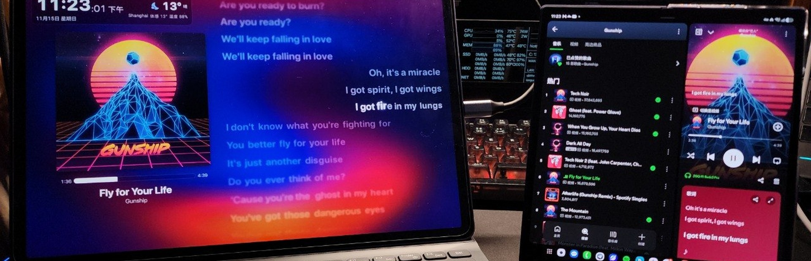
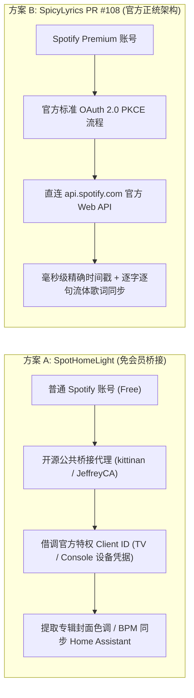
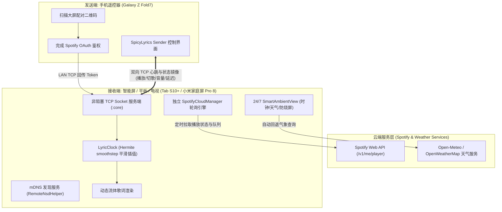
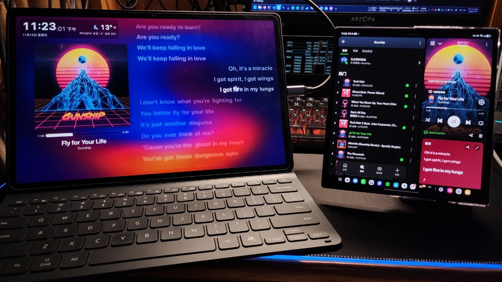
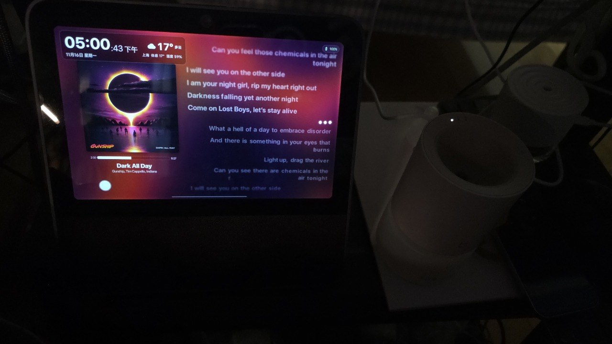

开源社区中，[SpicyLyrics Mobile](https://github.com/spicylyrics/mobile) 凭借其基于 Jetpack Compose 的极致流体渐变渲染、精准的时间戳同步以及强大的第三方歌词源接入能力，成为了 Android 平台上数一数二的歌词神器。

然而，在过去很长一段时间里，围绕 Spotify 展开的第三方音乐生态开发，却经历了一场突如其来的“至暗时刻”——**Spotify 突然修改了开发者权限策略，将原本对普通免费账号开放的播放状态 API（Currently Playing / Playback State）全部加上了强制 Spotify Premium 会员限制**。

这一刀切的改动，直接让我的很多开发想法陷入停滞……直到最近，在亲友的引荐下以 **60 CNY / 年（约合 5 元/月，性价比直接拉满！）** 顺利上车了 Spotify 菲律宾家庭组，被封印的 Premium 权限终于满血复活！

重启引擎后，我针对 SpicyLyrics 进行了为期 2 天的架构扩展与深度重构，最终向上游官方提交了这份**长达 636 KB Diff、改动 54 个核心文件、包含 853 项全通过自动化测试的超大 Pull Request（PR #108）**！

[🚀 查看 GitHub PR #108: feat: add Smart Display mode, LAN remote control, Spotify Web API sync, and bilingual i18n](https://github.com/spicylyrics/mobile/pull/108){: .preview }

[📦 抢先体验版 Release 下载页面（ZGQ-inc/spicy）](https://github.com/ZGQ-inc/spicy/releases/tag/test){: .preview }



今天这篇文章，就从**Spotify API 限制的起因与突围**讲起，对比前作 **SpotHomeLight** 的第三方 Client ID 免会员桥接方案，并全景拆解在 SpicyLyrics 中打造 **24/7 智能家庭屏、局域网协同控制与独立云端播放同步** 的技术实战！

---

# 一、 起因与波折：Spotify API 策略剧变与 60 元家庭车“复活”

在开发音乐联动类应用时，最核心的环节就是**实时捕获用户当前正在听什么歌、播放进度到了第几秒**。

### 1. 致命的 `PREMIUM_REQUIRED`：接口权限一夜收紧
在过去的很长一段时间里，Spotify Web API 的播放器端点：
- `GET /v1/me/player/currently-playing`（获取当前播放曲目与进度）
- `GET /v1/me/player`（获取播放设备、音量与播放状态）

对于所有通过 OAuth 授权的注册用户（即便只是 Spotify Free 免费账号）都是可以正常返回 JSON 数据的。开发者只需要申请一个开发者 Client ID，引导用户完成授权，就能轻松读取播放信息。

然而，随着 Spotify 近年来在变现与商业化上的步步紧缩，官方在无预警的情况下修改了后台策略：**非 Premium 会员在调用上述播放器端点时，API 将直接抛出 HTTP 403 Forbidden，并在 Payload 中明确标注 `PREMIUM_REQUIRED`！**

```json
{
  "error": {
    "status": 403,
    "message": "Player command failed: Premium required",
    "reason": "PREMIUM_REQUIRED"
  }
}
```

这意味着：任何依赖云端 Web API 轮询播放进度的独立看板、桌面小挂件或自动化服务，如果用户没有按月付费购买 Premium 会员，将彻底瘫痪。这一改动在当时让我非常被动，手头一系列关于外置智能看板和跨设备歌词大屏的构想，也因为无法普遍兼顾免费账号而不得不暂时搁置。

### 2. 60 CNY/年的菲律宾家庭组：开发征程满血复活！
要恢复官方 Web API 的深度开发，最直接也最稳妥的途径就是拥有一个稳定的 Premium 订阅。

国内直充或者美区/日区的高昂月费对于业余开发者折腾项目来说性价比实在偏低。幸运的是，最近恰好赶上亲友的 **Spotify 菲律宾区家庭组（Family Plan）** 尚有空余车位，以 **60 CNY / 年（约 5 元/月）** 的超值亲友价成功上车！

不仅彻底告别了切歌广告和插播限制，更关键的是——**账号在 Spotify 开发者后台的 API 调用权限瞬间全量解封！** 无论是纳秒级的播放进度监控，还是读取当前播放队列（Queue），全部一路绿灯。搁置已久的音乐看板开发计划，终于迎来了重启的时刻。

---

# 二、 殊途同归的技术抉择：SpotHomeLight 的免会员方案 vs SpicyLyrics 的官方纯粹性

在这里，许多熟悉我之前项目的朋友可能会好奇：**“你之前的项目不是已经实现了普通免费账号也能同步播放吗？”**

没错！在深入探讨 SpicyLyrics 之前，有必要先复盘一下我的另一个开源项目 —— [SpotHomeLight](https://github.com/ZGQ-inc/SpotHomeLight)。



### 1. SpotHomeLight 的“免凭证桥接模式”原理
在 [SpotHomeLight](https://github.com/ZGQ-inc/SpotHomeLight#-%E7%89%B9%E5%88%AB%E9%B8%A3%E8%B0%A2-credits) 中，核心需求是将正在播放的专辑封面提取主色调，并解析音频特征（Audio Features 中的 Energy 与 BPM），通过 Webhook 实时同步给家庭局域网内的 **Home Assistant**，进而控制客厅的极光灯和水波纹氛围灯。

为了让没有 Premium 的普通用户也能享受智能灯光联动，我引入了 **`mode = bridge`（免凭证桥接模式）**：
* 项目特别集成了社区大佬维护的高可用公共服务：[@kittinan](https://github.com/kittinan) 的 `spotify-github-profile` 与 [@JeffreyCA](https://github.com/JeffreyCA) 的 `spotify-recently-played-readme`；
* 这类服务之所以能突破免费账号限制，其底层奥秘在于**借调了 Spotify 分配给官方认证硬件（例如特定品牌的智能电视、电视盒子或主机端客户端）的特权 Client ID**。在 Spotify 的鉴权体系中，出于某些设备生态的兼容考虑，这部分特定 Client ID 即使面对免费账号，也依然保留了读取 Recently Played 或基础播放状态的接口权限；
* 用户只需在网页端简单完成一次关联并获取 UID，SpotHomeLight 即可通过首选源与热备源自动故障切换，24/7 不间断地为 Home Assistant 输送封面颜色。

### 2. 为什么在 SpicyLyrics 中不采用第三方 Client ID？
既然有这种“奇技淫巧”，为什么不在这次的 SpicyLyrics PR #108 中依样画葫芦呢？

答案在于：**项目的性质与技术底线截然不同。**

1. **上游开源项目的严谨合规性**：  
   `spicylyrics/mobile` 是一个在 GitHub 上拥有广泛全球用户的高质量 Android 原生项目。向这样的上游主仓库提交核心 PR，代码必须经得起官方维护者和社区的严苛审查。借调第三方特权 Client ID 本质上利用了商业平台的策略宽限期，属于随时可能被封杀的灰色地带，如果合入官方代码库，有极大的概率被直接拒绝。
2. **时间戳精度与高频轮询的稳定性**：  
   家庭自动化灯光对延迟的容忍度相对较高（延后 2-3 秒变色完全可以接受）；但**动态流体歌词对时间戳的要求是毫秒级的**！第三方桥接代理存在请求转发链路长、缓存更新慢、切歌容易发生 500 异常等问题，根本无法支撑流畅顺滑的逐字歌词高频同步。
3. **维护者信誉与用户 Token 安全**：  
   SpicyLyrics 的用户群体遍布全球，采用官方标准的 OAuth 2.0 协议和直接向 `api.spotify.com` 发起安全交互，既是对用户 Spotify 账号安全的绝对负责，也是保持开源代码架构纯粹性的必然选择。

因此，我们在本次 PR 中坚守了正统方案：**SpicyLyrics 的这套独立云端同步系统完全基于官方 Web API 构建，目前依旧严格要求 Spotify Premium 会员账号**（当然，如果是在同一台设备本地运行官方 Spotify App，依旧可以通过传统的 Android 系统级播放广播广播无感捕获歌词，此时无需任何 API 介入）。

---

# 三、 超大 PR #108 深度起底：打造全场景数字音乐终端

在厘清了 API 策略与技术边界之后，让我们进入本次实战的重头戏 —— **[PR #108](https://github.com/spicylyrics/mobile/pull/108)**。

在原本的架构中，SpicyLyrics 主要面向“在当前手机上边听边看”的单机随身场景。但在实际生活中，我们手头往往有大量闲置设备：**退役的旧平板、带有触摸屏的智能音箱、或者是客厅里的 Android TV 大屏**。

用户最大的痛点在于：
* 想要把闲置平板或智能音箱打造成 **24/7 常亮的桌面环境音乐看板**，但原版缺乏屏保、防烧屏、时间天气以及开机自启能力；
* 挂在墙上或放在床头的屏幕，如果在另一头播放音乐，走过去触控操作非常繁琐，急需**局域网免配置的手机远程协同控制**；
* 电视或带屏音箱往往硬件性能有限，安装臃肿的官方 Spotify 客户端极易卡顿闪退，急需**无需本地安装客户端的轻量级独立云端直连**；
* 缺乏对国内和全球中文用户的原生多语言（i18n）友好支持。

围绕这些核心痛点，本次 PR 一口气完成了四大维度的系统级重构：



---

## 突破一：24/7 智能家庭屏与环境歌词看板 (`SmartAmbientView`)

为了让闲置设备真正蜕变为专业的“智能音乐家居屏”，我们设计并实现了全套环境待机与展台显示体系：

### 1. 动态环境屏保与双天气服务容灾
在音乐暂停、断开连接或用户闲置时，界面会自动平滑渐变切入 **`SmartAmbientView` 环境看板**：
- **全要素状态呈现**：优雅展示秒级精准数字时钟、当前星期与公历日期、室外温度与天气状况、设备电池电量指示以及当前的播放暂停状态；
- **智能双天气引擎（`OwmWeatherClient`）**：
  首选支持用户填入 OpenWeatherMap 密钥以获取更丰富的气象颗粒度；同时内置了**全球免配置、零 API 门槛的 Open-Meteo 自动容灾降级服务**！即使小白用户什么都不配，系统也能根据定位或城市自动无感抓取室外天气，开箱即用。

### 2. 针对 AMOLED 的防烧屏算法 (`PixelShift`)
智能看板往往需要 24 小时长期通电点亮，对于采用 OLED 材质的屏幕，固定像素极易老化形成烧屏。
我们引入了数学平滑的 **`PixelShift` 防烧屏位移机制**：
- 在后台轻量协程中以极缓的步长周期性改变屏保核心 UI 的 `(dx, dy)` 偏移量；
- 位移幅度与屏幕缩放比例动态自适应计算，人眼几乎难以察觉细微偏移，但足以让发光像素点均匀轮换，杜绝屏幕烙印风险；
- 与此同时，在正式的动态歌词播放态下，顶部时钟与电池组件（`LyricsScreenClockWidget`）保持绝对静止，消除了音乐播放时的画面抖动感。

### 3. Kiosk 展台特权注入
在 `AndroidManifest.xml` 与底层生命周期中深度武装：
- **开机自启动（`BootCompletedReceiver`）**：注册系统广播，设备插电开机后自动直达音乐看板界面；
- **屏幕防休眠（`WAKE_LOCK`）**：播放与待机时全局保持唤醒锁定；
- **穿透锁屏（`showWhenLocked` / `turnScreenOn`）**：断电亮屏或来电挂断后无缝覆盖锁屏重新点亮，无需手动滑屏解锁。

---

## 突破二：多设备局域网远程协同控制架构 (LAN Remote Collaboration)

当智能屏或 Android TV 挂在远处的墙壁上时，躺在沙发上的你不可能每次切歌都跑过去点一下。我们打造了**一套纯局域网、低开销、全双工的多设备协同引擎**！

```text
设备角色架构 (Device Roles):
├── Standalone (默认独立模式): 本地捕获广播，单机自给自足
├── Receiver (接收端/大屏设备): 启动 TCP Socket 服务端，向局域网广播 mDNS，负责极致大屏渲染
└── Sender (发送端/移动手持端): 扫描局域网 mDNS，自动握手，充当轻量级全局遥控器
```

### 1. 零配置 mDNS 局域网自发现与手动容灾
- **Android NSD 自动探测（`RemoteNsdHelper`）**：接收端启动后，自动在内网广播 `_spicyremote._tcp` 服务；手机端进入设置或快速控制栏时，系统在后台异步扫描局域网节点，一键点击即可秒速配对；
- **手动 IP 兜底直连（`RemoteConnectModal`）**：面对部分路由器关闭了组播或开启了 AP 隔离的复杂网络环境，提供简洁的手动 IP 输入口，双保险确保连接永不失联。

### 2. 高性能非阻塞 TCP 通信链路（独立抽取至 `:core`）
为了保证网络吞吐与跨平台复用能力，我们将通信协议与 Socket 实现全部放在了底层的 `:core` 模块中：
- 采用轻量级 JSON 协议序列化数据包，开销微乎其微；
- **4 秒高频心跳保活** + **12 秒无应答超时熔断** + **3 秒后台静默自动重连**，面对弱网或手机息屏切换毫无压力；
- **毫秒级全状态双向镜像**：发送端可实时读取接收端的播放进度条、封面大图、逐字歌词、系统全局音量；支持在手机上微调“歌词延迟偏移（Delay Calibration）”，修改瞬间接收端的大屏歌词立即亚像素级对齐！

### 3. 时间轴时钟引擎升级：Hermite Smoothstep 缓动插值
在局域网同步播放进度时，网络抖动往往会导致时间戳突然跳跃几百毫秒，造成歌词闪烁重绘。
我们在 `LyricClock.kt` 中重写了时间同步算法，引入了 **Hermite smoothstep 平滑步进缓动插值（`smoothSeekTo`）**：当网络端传来新的进度位置时，时钟不再突兀瞬移，而是通过三阶多项式缓动函数平滑过渡到目标时间轴，视觉丝滑无比！

---

## 突破三：独立 Spotify Web API 云端同步与扫码跨屏配对

针对性能孱弱的电视盒子或老旧带屏音箱，强制在后台挂着臃肿的 Spotify 客户端往往会引发系统 OOM（内存溢出）被杀。

我们实现了一套完全脱离本地客户端、**自给自足的独立云端播放轮询器（`SpotifyCloudManager`）**！

### 1. 双模式 OAuth 2.0 授权链路
- **Deep Link 模式**：通过自定义 Scheme `spicyremote://callback` 拦截浏览器授权回调；
- **内嵌 Localhost HTTP Callback 模式**：设备在本地临时启动一个轻量级 HTTP Web 服务器（`http://127.0.0.1:<port>`），支持在设置中自定义 1024–65535 的端口号，完美兼容各类特殊系统环境。

### 2. 屏幕动态二维码跨屏流转
在电视或音箱上用遥控器输密码授权极其痛苦。我们在 `:core` 中集成了纯 Java 实现的轻量级 ZXing 库（`QrCodeGenerator.kt`）：
- 大屏端直接在界面上渲染出授权二维码；
- 手机打开相机一扫，在手机浏览器中完成 Spotify 授权，**手机端的 SpicyLyrics 会自动通过局域网 TCP Socket 将获取到的 Access Token 回传给大屏**，大屏瞬间激活，优雅至极！

### 3. 智能频控与退避机制
- 歌曲播放时，以 5 秒为基准自适应微调轮询间隔；
- 音乐暂停或设备闲置时，自动进入指数退避（Backoff）降频休眠，节约网络与电力；
- 遇到 Spotify 官方 HTTP 429 配额告警时，自动读取 `Retry-After` 头进行熔断避让，绝不造成接口滥用。

---

## 突破四：全局双语国际化与响应式翻译引擎 (`I18n.kt`)

此前 SpicyLyrics 的 UI 文本大量硬编码在各个 Compose 组件内部，非英语用户使用门槛较高。

本次 PR 构建了统一的 **响应式双语国际化框架（`I18n.kt`）**：
- 支持 **简体中文（zh-CN）** 与 **英文（en-US）**；
- 能够跟随 Android 系统的默认语言自适应匹配，并在 App 内的设置页面支持**无需重启、即时热切换**；
- **全量 UI 100% 汉化覆盖**：从庞大的设置页、快速控制抽屉、播放队列、自定义歌词源管理，到毫秒级延迟校准和新手引导页，无一遗漏；
- 针对环境屏，内置了天气气象术语与全球/中国主要城市的中英双向智能转换字典。

---

# 四、 四大真机形态全场景压测验证与实操写真

为了验证这套庞大架构的健壮性，我动用了手头 **4 种截然不同形态的真实硬件设备** 进行全流程实测与联调：

| 硬件形态 | 代表机型与系统规格 | 承担角色 | 实测验证场景与表现 |
| :--- | :--- | :--- | :--- |
| **折叠屏旗舰** | **Samsung Galaxy Z Fold7**<br>(Android 17 / One UI) | **Sender (遥控器)** | 验证手机端展开大屏下的遥控器控制、音量调节、网络扫描与扫码 Token 转发。 |
| **旗舰平板** | **Samsung Galaxy Tab S10+**<br>(Android 16 QPR2) | **Receiver (桌面看板)** | 验证横屏双栏排版、动态流体背景、平滑环境屏保与静态时钟联动。 |
| **智能触屏音箱** | **小米智能家庭屏 Pro 8**<br>(X8F / Android 9 / API 28) | **Receiver (床头/桌面屏)** | 验证老旧系统兼容性、触控灵敏度、低内存占用与 24/7 常亮稳定性。 |
| **智能电视** | **Redmi TV A Pro 43 2025**<br>(MiTV-ASTR0 / 32位 arm-v7a) | **Receiver (大屏)** | 验证 32 位底层兼容性、4K/1080p 大屏缩放与实体遥控器 D-Pad 导航。 |

### 实拍实测一：随身控制与桌面沉浸（Tab S10+ & Fold7 联动）

在桌面工作场景中，Galaxy Tab S10+ 搭配键盘底座作为主力桌面音乐屏，旁边的 Galaxy Z Fold7 则充当多任务控制中枢：



* **左侧 Tab S10+**：运行全新的 `SmartAmbientView`，顶部清晰渲染着当前时间 `11:23:01 下午` 以及上海实时天气 `13℃ 晴`，右侧全屏滚动着英国合成波传奇乐队 **Gunship** 的名曲 —— 《Fly for Your Life》动态歌词；
* **右侧 Z Fold7**：展开内屏双栏分屏，一边浏览 Spotify 歌单与艺人主页，一边通过 SpicyLyrics 发送端实时监控大屏的播放进度，任何切歌与音量调节均在百毫秒内双向同步！

### 实拍实测二：床头/书架 24/7 智能家居看板（小米家庭屏 Pro 8）

在床头或书架角落，闲置的小米智能家庭屏 Pro 8（Android 9 底层）被赋予了全新的生命：



在弱光环境中，屏幕以极其克制且细腻的背光柔和呼吸，时钟 `05:00:43 下午`、天气 `17℃ 多云 上海 体感 17° 湿度 59%` 与电量状态清晰可见。播放 Gunship 的另一首金曲《Dark All Day》时，流体渐变暗色光斑在背景轻柔流淌，桌面氛围感直接拉满！

---

# 五、 抢先体验版发布与下载直链 (Early Preview Release)

在上游官方仓库尚未正式完成 Code Review 与合并 PR 之前，为了方便各位朋友、车载/桌面屏爱好者即刻上手体验 **24/7 环境看板、局域网多设备协同与独立 Spotify 云同步**，我已经预先编译并打包好了完整的 Release 安装包（基于 v0.20.0 底座），发布在个人的 Fork 仓库 Release 中：

[📦 GitHub Release 抢先体验发布页 (ZGQ-inc/spicy)](https://github.com/ZGQ-inc/spicy/releases/tag/test){: .preview }

可以直接点击下方直链下载安装包到设备上体验：





> [!TIP]
> **安装与架构说明**：
> * 推荐绝大多数用户直接下载 **`SpicyLyrics-0.20.0-universal.apk`** 通用版单文件，支持各类 ARM64 / ARMv7 / x86_64 手机、平板、带屏音箱及 Android 智能电视直接安装运行；
> * 通用版 APK SHA-256 校验哈希：`e23ba237444de01b1ce9f3e1d2ec2050dc2af1cf1fdd58914cfcd3d49c1e1fcd`；
> * 如需使用独立 Spotify 云同步功能，请确保你的 Spotify 账号拥有有效订阅（例如家庭组 Premium 车位），手机端作为 Sender 扫描大屏二维码即可秒速完成跨屏鉴权。

---

# 六、 总结与开源展望

回顾整个历程：
从最开始因为 **Spotify 封锁免费账号 Currently Playing API** 导致开发被迫按下暂停键，到后来借着 **60 元/年的菲律宾家庭车** 满血复活重启折腾；
再从 **SpotHomeLight** 探索第三方特权 Client ID 免会员桥接方案，到面对 **SpicyLyrics** 上游代码时坚持遵循官方规范的架构纯粹性抉择；
最终凝结成了这篇包含了 **54 个改动文件、636KB Diff、853 项全绿单测** 的超大 PR #108。

技术折腾的魅力正在于此：**面对规则与限制，不妥协、不放弃，用扎实的工程实践与代码去打破物理边界，把冰冷的旧硬件点亮成充满艺术温度的数字风景。**

目前该 PR 已正式提交至 SpicyLyrics 官方主仓库进行 Code Review。如果你也对打造专属的智能家庭音乐屏感兴趣，欢迎前往相关仓库查阅代码与交流：

* 🚀 **SpicyLyrics PR #108 详情**：[spicylyrics/mobile#108](https://github.com/spicylyrics/mobile/pull/108)
* 💡 **SpotHomeLight 智能灯光同步**：[ZGQ-inc/SpotHomeLight](https://github.com/ZGQ-inc/SpotHomeLight)

愿你的数字生活，永远伴随着最动听的旋律与最灿烂的光影！
