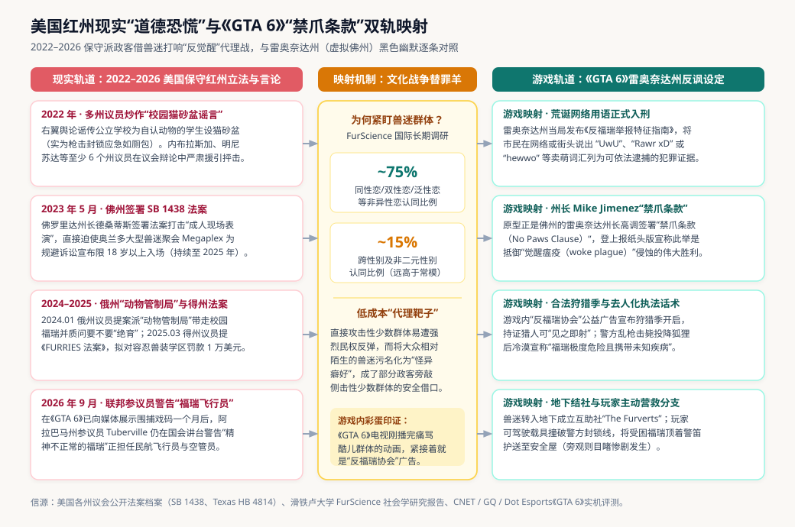
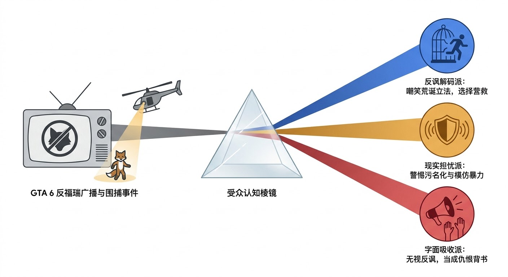
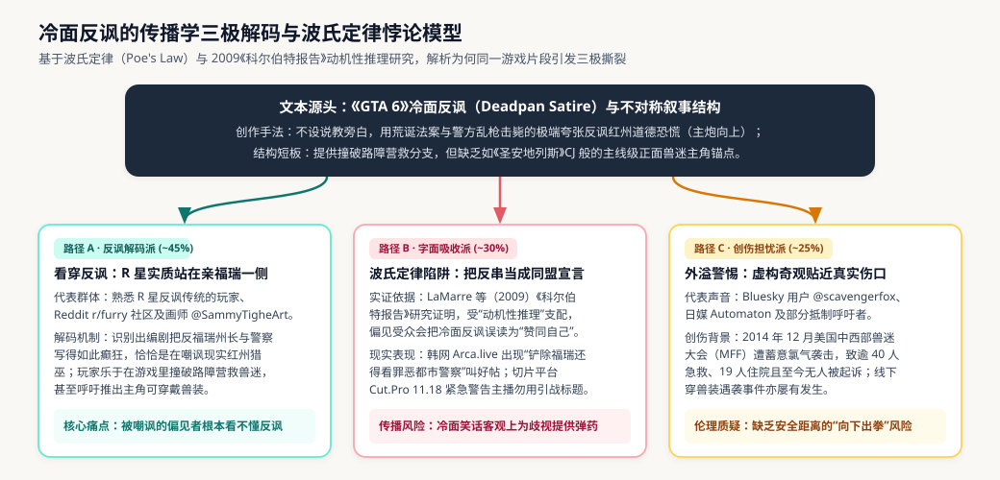

## 一、事件起因与传闻查证：副城“反福瑞围捕”随机事件实录

近期在海外社交平台（Bluesky、Reddit、Twitter/X）及各大游戏媒体圈[^6][^28][^29]，一段关于《GTA 6》（Grand Theft Auto VI）的实机录屏引发了现象级讨论与争议。各大知名主播与资深媒体（包括 Kinda Funny 与 IGN）纷纷跟进披露该开放世界动态事件的深层细节[^30][^31]。

实机视频显示：在 Rockstar 构建的雷奥奈达州（Leonida，原型即美国佛罗里达州）副城（Vice City）街头，做一名“**福瑞（Furry / 兽迷）**”竟然成了被全州立法明确定性的严重违法行为！警方甚至会出动警用直升机与全副武装特警，在深夜街头对穿着毛绒兽装（Fursuit）的市民进行暴力围捕与当街扑杀。

不少玩家在第一眼看到视频时感到极度惊诧与荒谬，甚至以为是恶搞 Mod 或假新闻，发出与本文作者相同的疑惑：“**想不通为什么 R 星会把这种匪夷所思的东西放进游戏里？**”流行文化甚至再次翻出当年调侃兽迷一掷千金订制数千美元顶级兽装的经典梗图“富可敌国的福瑞控”[^3][^4]，来反衬这一幕的巨大荒诞。

我们首先对该段实机录像的源头进行了核实验证：该片段最初由韩国权威游戏媒体 Inven 在试玩报道中作为开放世界随机遭遇（Random Encounter）公开发布[^2]，韩国权威游戏媒体 GameMeca 亦跟进深度科普了兽装与福瑞文化背景[^26]，随后日本等亚洲各大游戏媒体也针对“开放世界极端荒诞”与“内容过于丰富容易忘记主线”展开专题报道[^16]。该片段具有完全确凿的官方实机来源。



---

### 现场原汁原味对峙实录（中英双语字幕还原）

根据 Inven 发布的现场实况录音及英文字幕（WEBVTT，其中因 YouTube 自动字幕规范将部分脏话标记为 `[ __ ]`）[^23][^24]，现场特警、直升机广播、路过平民与被围捕的狐狸兽迷之间的完整对话如下：

> **警用直升机扩音器 / 地面警察**:  
> *"You, the fox down on the ground! Paws in the air! You're under arrest!"*  
> (趴在地上的那只狐狸！把爪子举到空中！你被逮捕了！)
> 
> **被围捕的狐狸兽迷**:  
> *"Screw you pigs! Free the fur!"*  
> (去你们的白皮猪！毛毛无罪 / 释放兽迷！)
> 
> **玩家**:  
> *"What's going on here?"*  
> (这里出什么事了？)
> 
> **地面特警 (厉声推搡)**:  
> *"Stay away from the furry! Do not approach it!"*  
> (离那个福瑞远点！千万不要靠近它！)
> 
> **被围捕的狐狸兽迷**:  
> *"You'll never take me alive! I'll die with my head on!"*  
> (你们休想活着逮住我！我死也要戴着兽头死！)
> 
> **地面特警**:  
> *"Yeah, you out of here! Keep it moving! Let's go, let's go!"*  
> (嘿，前面的快滚出这里！往前走别停下！快走，快走！)
> 
> **玩家**:  
> *"What did the fox do?"*  
> (那只狐狸到底干啥了？)
> 
> **地面特警**:  
> *"Get back before that degenerate kills you or worse!"*  
> (退后！免得那个堕落变态杀了你，甚至干出更恶心的事！)
> 
> **警用扩音喇叭 (冰冷宣读)**:  
> *"Do not move, deviant. Pest control units are en route. Comply or you will be euthanized!"*  
> (不许动，变态分子！有害生物管制队正在赶来。服从命令，否则你将被就地安乐死！)
> 
> **狐狸兽迷 (怒吼)**:  
> *"Suck my ass! [_]! "*  
> (去舔老子屁股吧！[_]！)
> 
> **地面特警**:  
> *"Keep your paws in the air. KEEP YOUR GODDAMN PAWS IN THE AIR!"*  
> (把你的爪子举起来！把你的该死爪子一直举在空中！)
> 
> *"Stay where you are, you rabid little freak!"*  
> (呆在原地别动，你这个狂犬病小怪胎！)
> 
> *"Do not move. Two paws in the air at all times. Pest control are in route. You attempt to retreat to your burrow, we will shoot."*  
> (不许动！两只爪子随时举在空中！有害生物管制队正在路上，你要是敢逃回你的地洞，我们立刻开枪。)
> 
> **狐狸兽迷**:  
> *"[ __ ] you! I'd rather be put down than you put in a cage!"*  
> ([ __ ] 你们！我宁可被安乐死，也绝不去蹲你们的笼子！)
> 
> **狐狸兽迷**:  
> *"Stay strong! Don't beg for your life!"*  
> (挺住！别向他们求饶！)
> 
> **地面特警**:  
> *"Hands in the air! On your knees, you!"*  
> (双手举起来！给我跪下！)
> 
> **狐狸兽迷 (被迫跪地投降)**:  
> *"All right, I'm done. I'm done. You know you guys give pigs a bad name."*  
> (行了，我不动了。算我服了……说真的，叫你们这帮警察‘猪’简直是侮辱了猪。)
> 
> **地面特警**:  
> *"Drop the weapons! Drop them!"*  
> (放下武器！把你手里的武器扔掉！)
> 
> **狐狸兽迷**:  
> *"These? They're paws! They're not detachable!"*  
> (这个？这是毛绒爪套啊！它是连在身上的，拆不下来啊！)
> 
> **地面特警**:  
> *"Fire! Hold fire!"*  
> (开火！停火！)
> 
> **警用直升机全城广播**:  
> *"The immediate furry threat has been neutralized. Officers will be making random home searches for furries in the area. Refusing a furry search will result in arrest. Hey, you know this furry? Assisting or associating with a furry is a crime. Better remember."*  
> (眼前的福瑞威胁已被就地肃清。警方将在本区域对居民住宅展开突击搜查，排查隐藏的福瑞。拒绝搜查者将被直接逮捕。嘿，你认识这个福瑞吗？协助或窝藏福瑞均属重罪！最好牢牢记住。)
> 
> **玩家**:  
> *"The fox was surrendering and you killed them."*  
> (那只狐狸明明都已经跪地投降了，你们居然直接杀了他。)
> 
> **地面特警**:  
> *"Walk away, civilian. Furries are extremely dangerous. Plus, who knows what [ __ ] diseases it was carrying. I'm not touching it."*  
> (走开，平民。福瑞极度危险。而且谁知道它身上带了什么 [ __ ] 传染病，我可不想碰它。)
> 
> **另一名特警**:  
> *"We did the safest thing."*  
> (我们做了最安全的处置。)
> 
> **玩家 (极其讽刺地冷笑)**:  
> *"Murder capital of America. Keep up the good work."*  
> (不愧是全美谋杀之都。接着保持你们的‘优秀执法’吧。)

---

### 关键机制解构：这并非单向过场，而是双分支动态遭遇

Inven 的实机演示不仅揭示了这段震撼对峙，更展示了该随机遭遇的**深层交互玩法**：

1. **旁观冷眼支线**：若玩家（露西亚 Lucia / 杰森 Jason）选择驻足围观，便会完整目击特警因“肉垫爪子无法拆卸卸除”而强行定性为“拒不缴械”，随即当街扫射处决，并在事后听到全城广播与路人的冷嘲热讽；
2. **武装营救支线**：玩家可直接驾驶载具撞开警方防暴警车路障，或者开火击毙特警掩护狐狸兽迷上车撤离！一旦救下福瑞，玩家将立即背负 3 星通缉度，在全城警车追击下护送其逃往隐藏避难所。成功脱险后，不仅能解锁地下结社“The Furverts”的专属安全屋与声望，还能在后续搭乘出租车时触发司机激情宣讲“福瑞应当持枪自卫”的隐藏电台剧情。

这一深层营救机制由海外知名游戏媒体 Dexerto 进行了重点报道与实录证实，揭示出 R 星在冰冷旁观之外，始终为玩家留有一扇践行反抗的交互窗口：

[Dexerto 专访评测：GTA 6 严禁福瑞，但允许你协助他们逃脱警方追捕 (GTA 6 outlaws furries and lets you help them escape the cops)](https://www.dexerto.com/gta/gta-6-outlaws-furries-and-lets-you-help-them-escape-the-cops-3429724/){: .preview }

正是这段戏剧张力拉满的荒诞场景，在玩家社群中投下了一枚震撼弹。接下来，我们将从真实政治背景、黑色幽默肌理、传播学悖论与创作策略四个维度，层层剖析这一事件背后的深意。

# **《GTA 6》“反福瑞”黑色幽默深度解读：传闻查证、现实映射与合理性评估**

## **二、黑色幽默解剖：为什么 R 星要在“虚拟佛州”写反福瑞？**

本文作者疑惑“想不通为什么 R 星会放这种东西进去”。脱离 2022 至 2026 年美国本土、尤其是佛罗里达及其他保守“红州”的政治语境，这一桥段确实显得天马行空；但只要将《GTA 6》虚构的雷奥奈达州（Leonida，原型即佛罗里达州）与近四年的美国现实政治闹剧并置[^10]，就能立刻看懂由 Rockstar 叙事高级副总裁 Rupert Humphries——从当年林赛·罗韩（Lindsay Lohan）肖像侵权案被上诉法院以第一修正案艺术讽刺特权彻底驳回[^7][^8][^37]，到‘佛州小丑’（Florida Joker）指控预告片侵权最终放弃起诉[^38][^39][^40]——（2008 年起任职 R 星的核心老将）领衔的编剧团队究竟在讽刺什么[^42]。  

### **1\. 现实比游戏更魔幻：从“猫砂盆谣言”到佛州法案**

梳理上述现实演进脉络可以发现，《GTA 6》里荒诞至极的“禁爪条款（No Paws Clause）”并非天外飞仙，而是层层脱胎于真实新闻[^9]。2022 年起，一则毫无实据的右翼谣言在北美社交媒体发酵，宣称公立学校为迎合自认是动物的福瑞学生在教室里摆放猫砂盆[^44]。尽管教育部门屡次澄清——现实中极少数美国教室备有猫砂桶，实为应对校园枪击案封锁期间学生无法如厕的极端应急包（内含猫砂、急救包与糖尿病应急糖果）[^46]——内布拉斯加、明尼苏达、田纳西、俄亥俄、艾奥瓦、堪萨斯等至少六个州的保守派议员或官员仍在正式辩论与公开场合援引这一都市传说大加抨击[^45]。  
紧接着，文化战争的战火直接烧到了《GTA 6》的现实原型地佛罗里达州。2023 年 5 月，佛州州长罗恩·德桑蒂斯（Ron DeSantis）签署极具争议的 **SB 1438 法案**（名义上旨在“保护儿童”，以宽泛条文打击所谓“成人现场表演”），导致奥兰多大型兽迷聚会 **Megaplex** 为规避法律诉讼风险被迫宣布仅限 18 岁以上入场，且导致当地最大型兽展 Megaplex 痛心限制未成年人入场，这一年龄限制一直延续至 2025 年[^13][^48][^49]；游戏媒体 Kotaku 当年便以《佛州州长德桑蒂斯现在意外跟福瑞开战了》为题调侃这场闹剧[^50]。此后，类似立法在其他红州愈演愈烈：2024 年 1 月，俄克拉荷马州共和党议员 Justin Humphrey 提交 **HB 3084 法案**[^51][^52]（德州州长阿博特亦力挺针对校园‘非人类行为’的惩治提案[^53]），要求禁止校园福瑞行为并在家长无法到场时呼叫“动物管制局（Animal Control）”带走学生，甚至在视频中质问“要不要给他们打疫苗、做绝育、送进收容所”（舆论哗然不到 24 小时后他改口称“动物管制局”只是反讽）[^12]；2025 年 3 月，得克萨斯州议员 Stan Gerdes 在州长阿博特支持下提出直接以福瑞命名的 **《FURRIES 法案》**（H.B. 4814 / HB 54），拟在公立学校全面禁止动物装扮与行为，将纵容此类行为定性为“虐待儿童”并对学区处以 1 万美元起步罚款（最终未能通过委员会审议）[^11]。极具讽刺意味的是，甚至在 2026 年 9 月——此时《GTA 6》内的福瑞围捕戏码早已定稿并在 8 月向媒体试玩展示[^14]——阿拉巴马州联邦参议员 Tommy Tuberville 仍在国会参议院讲台上煞有介事地发出警告，宣称大量“精神不正常的福瑞”正秘密担任民航飞行员与空管员，危及美国航空安全[^54][^55][^56][^57][^58]；而关于 PC 版本的发售期传闻亦同步引发推测[^41]。现实政治的荒诞程度，甚至在游戏发售前夕还在不断追赶并反超游戏剧本。

### **2\. 为何保守派紧盯福瑞？隐藏在背后的文化战争代理战场**

要看穿《GTA 6》中雷奥奈达州州长 Mike Jimenez 的荒谬演说，还必须理解背后的社会人口结构。在游戏内的《Vice City Horn》头版报道中，州长把“禁爪条款”吹嘘为抵御“觉醒瘟疫（woke plague）”的胜利，指责成人网站算法把“诚实的劳动男性”变成了福瑞，并危言耸听地宣称大城市精英企图借这群穿着卡通兽装的人破坏传统家庭[^9]；而在电视上播放“反福瑞协会”公益广告的前一秒，屏幕里刚演完一段“山姆大叔（Great Uncle Sam）”破窗而入、痛骂酷儿群体（queer folks）在市中心制造骚乱的恶搞动画[^36]。  
Rockstar 刻意将“反福瑞”与“反觉醒 / 反酷儿”政治话术捆绑呈现，精准戳中了美国保守派文化战争的隐秘逻辑：由于现实中的兽迷社群在人口构成上与性少数及多元性别群体高度重合，攻击更容易被污名化为“怪异癖好”的福瑞，便成了部分政客旁敲侧击 LGBTQ+ 群体的低成本替罪羊与代理战场[^11]。国际拟人化研究项目 FurScience（涵盖 5.1 性取向专题调查与历年夏季人口统计实证[^59][^60][^61]）（由滑铁卢大学 Sharon E. Roberts 博士等学者联合主持）的长期实证数据清晰地印证了这一重叠结构[^47]。  

在这套现实与人口结构的双重映照下，《GTA 6》的讽刺闭环便水落石出：现实中的红州政客借“保护家庭”之名对一个边缘亚文化群体大搞道德恐慌，Rockstar 便将这套荒诞逻辑直接推向极致——在雷奥奈达州把说一句 UwU、Rawr xD 或 hewwo 立法列为举报依据，在观光宣传广告里公然宣布“狩猎季开启、持证猎人有权见之即射”，并让警方出动武装直升机在深夜大街上像围剿头号悍匪一样围堵一只只穿着毛绒兽装的狐狸[^9]（其实早在《GTA Online》更新中，R 星就曾低调埋藏过狂欢节动物面具彩蛋[^5]）。  
更重要的是，**开放世界的交互分支进一步亮明了编剧的讽刺底色**。虽然玩家袖手旁观时会目睹狐狸在枪林弹雨中血肉与兽装填充棉齐飞的荒诞结局（GQ 与 Dot Esports 均记录了警方当街击毙的场面）[^9]，但 CNET 评测员 David Lumb 扮演露西亚（Lucia）驾车路过时，果断冲破警方封锁线救下狐狸，与其他兽迷汇合后一路护送他们逃往隐蔽据点——逃亡途中回头看后座，这群怪人还在车里亲昵地彼此蹭脸（nuzzling）[^14]。David Lumb 对此写下一句极具概括力的评语：“当做真实的福瑞自己成了字面意义上的犯罪时，唯一的选择就是违法。”[^15] 叠加出租车司机向杰森（Jason）激情宣讲“福瑞应该持枪自卫”的插曲[^9]，以及被迫转入地下的秘密结社“The Furverts”[^14]，整个桥段在叙事基因里仍是典型的《GTA》式反威权、反猎巫与同情法外边缘人的黑色喜剧。

## **三、“用极端反对嘲讽极端反对”有效吗？黑人类比与传播学悖论**

即便确认 Rockstar 的创作初衷是以荒诞反讽保守派恐慌，仍需从**叙事赋权结构**与**大众传播心理学**两个维度严格检验。

### **1\. 拆解“黑人类比”：机制相通，但叙事权重严重不对等**

将游戏台词中的 fox / furries 替换成 black / blacks，句式确实严丝合缝。这并不令人意外：揭露执法机器用去人化话术合理化过度暴力，本就是 Rockstar 的拿手好戏，比如《GTA V》里洛圣都警车侧面那句反讽“保护与服务”的标语 **“服从与生存（Obey and Survive）”**[^63]，以及《GTA 6》官方预告片中本就包含警察射杀投降/手无寸铁嫌疑人的暗讽画面[^25]。  
然而，本文作者差点忽略了一个至关重要的差异：**群体在游戏叙事中是否拥有主体性与尊严权重**。将《GTA》系列二十余年来四次涉及少数族裔或亚文化群体的经典案例放在一起横向对照，得失瞬间清晰：

| 作品与涉及群体 | 讽刺主靶向 | 该群体的叙事权重与主体性 | 玩家的互动体验 | 现实反响与最终结果 |
| :---- | :---- | :---- | :---- | :---- |
| **《GTA：罪恶都市》（2002）** 海地裔群体 | 1980 年代迈阿密黑帮火拼文化 | **极低**：几乎全员以敌对帮派反派登场，缺少普通市民侧面，甚至出现 *“Kill all the Haitians”* 任务指令[^65][^66][^68][^69] | 被动按主线指示攻击特定族裔帮派成员 | 遭海地裔民权组织抗议、纽约市人权委员会介入及起诉；**Rockstar 正式道歉并在后续版本删改争议台词**[^67] |
| **《GTA：圣安地列斯》（2004）** 美国非裔群体 | 1990 年代系统性种族歧视、警察腐败与帮派悲剧 | **极高（绝对主角）**：玩家全程扮演有血有肉、重情重义的非裔主角 CJ，核心反派则是象征腐败暴力警方的 Tenpenny[^70] | 亲历底层非裔在结构性压迫下的挣扎、成长与反击 | 虽仍有刻板印象争议，但**大量非裔与各族裔玩家高度认同 CJ 的共情魅力与反警察腐败主题**[^71][^72][^73][^80] |
| **《GTA V》（2013）** 墨西哥裔移民与排外民兵 | 美国极右翼排外民兵与虚伪爱国主义 | **中（清晰受害者定位）**：遭骚扰的墨裔农场主明确交代家族已在此居住 200 年，反派排外民兵 Joe 与 Josef 中后者本人竟是俄裔移民[^74] | 崔佛起初糊涂配合抓捕合法公民，认清其虚伪后愤而反杀 Joe 与 Josef，亲手解散该组织[^74][^75][^76] | 广受赞誉的高级反讽样本：先暴露排外荒诞，再由主角彻底清算施害者[^21] |
| **《GTA 6》（2026）** 兽迷（Furry）亚文化群体 | 佛州等红州反“觉醒”道德恐慌、荒诞立法与警察暴力[^9] | **低至中（边缘怪客符号）**：虽被设定为受迫害对象，但也带有“The Furverts”等戏谑标签；尚无主线级兽迷正面人物，主角能否在商场解锁兽装穿戴亦引爆热烈讨论[^14][^77] | **双向分支**：可冷眼围观警方当街击毙狐狸，也可冲破封锁救下福瑞并护送至安全据点[^10] | **剧烈分化**：部分兽迷捧腹叫好并乐于营救，部分兽迷因联想到现实仇恨暴力而抵触，反福瑞网民则按字面欢呼[^1] |



对比可见，非裔玩家钟爱《圣安地列斯》和《GTA V》，从来不是因为游戏“把黑人当笑话嘲讽”，而是因为 Rockstar 把 CJ 和富兰克林（Franklin）塑造成了拥有完整人生弧光的主角，让玩家站在他们的立场对抗系统性压迫，或是像拉玛与富兰克林那样在真实鲜活的社区语境里展开自嘲喜剧[^71]。一旦失去足够的主体赋权，当年《罪恶都市》里哪怕是对黑帮火拼的粗暴描写，也迫使 Rockstar 罕见低头删词道歉[^67]。如今在《GTA 6》里，兽迷群体缺乏主线级情感锚点，主要作为“反衬保守派有多癫狂的荒诞道具”出现在新闻与随机事件里——这就决定了它很难获得与《圣安地列斯》同等级的群体共情红利。

### **2\. 黑色幽默为何会失灵？“波氏定律”与“讽刺悖论”的现实反噬**

更棘手的问题在于，“用极端反对嘲讽极端反对”属于高度依赖受众媒介素养（Media Literacy）的冷面反讽（Deadpan Satire）。传播学与互联网文化研究中的两条经典发现，精准解释了为何同一段游戏录像会在发售瞬间撕裂全球社群。  
首先是 2005 年由网民 Nathan Poe 提出的**波氏定律（Poe's Law）**（其法理与网络起源在维基百科与法典均有详录[^81][^82]）：在缺乏极其醒目的作者立场提示时，对极端主义的夸张戏仿在表层形态上与真实的极端主义几乎无法区分，极易被极端受众误读为志同道合的宣言[^18]。其次是学术界极具影响力的“讽刺的悖论（The Irony of Satire）”：2009 年，Heather L. LaMarre、Kristen D. Landreville 与 Michael A. Beam 在期刊 *The International Journal of Press/Politics* 发表了一项样本量为 332 人的实证论文，测试观众如何理解美国冷面政治讽刺秀《科尔伯特报告》（*The Colbert Report*）[^17][^83]。实验结果令人警醒：自由派与保守派观众认为节目“一样好笑”，但解码路径截然相反——自由派看出了主持人是在反串嘲讽保守派，而保守派在动机性推理（Motivated Reasoning，“只看见自己想看见的东西”）支配下，竟普遍倾向于认为主持人“只是假装在开玩笑，内心其实真的赞同保守派观点并嘲笑自由派”，导致讽刺非但未能消解偏见，反而沦为了强化既有立场的极化工具[^17]。  
 

《GTA 6》发售首日的海内外舆情，几乎成了 2009 年那场传播学实验的现实复刻。**反讽解码派**（如 Reddit r/furry、r/furrymemes 的诸多成员以及画师 @SammyTigheArt）立刻读懂了 Rockstar 的意图，认为这是在狠狠嘲讽保守派针对兽迷的无厘头恐慌，甚至笑言《GTA 6》实质上站在亲福瑞一侧，许多人还兴致勃勃地打听能不能给主角买一套兽装穿上[^10]。

然而，正如画师 @SammyTigheArt 在社交平台上的精辟吐槽——“这显然是在讽刺痛恨福瑞的保守派，可惜被嘲讽的那群人根本看不懂自己在被嘲讽”[^10]：



**字面吸收派**迅速跳进了波氏定律的陷阱：韩国论坛 Arca.live 上出现了“罪恶都市的正义依然活着”“铲除福瑞还得看罪恶都市警察”的叫好帖[^22]；争议主播 Adin Ross 顺应游戏里反福瑞法案的直播切片在 Reddit 引发群嘲，被网友戏称为一场大型“媒介素养测试”[^84]：



Bluesky 上更有网民直接宣称自己“支持 Rockstar 把福瑞封杀出游戏”[^79]。  
与此同时，**现实担忧派**的抵触绝非简单的“玻璃心”或“不懂幽默”，而是与沉重的现实创伤紧密相连。Bluesky 用户 @scavengerfox 在转发 Inven 视频后愤怒表示，自己见过太多穿兽装在公共场合遇袭的视频，更从未忘记 **MFF 氯气袭击事件**——现实中确实有人想致兽迷于死地，而 Rockstar 却拿来开玩笑[^1]：



其所指正是 **2014 年 12 月 7 日美国伊利诺伊州“中西部兽迷大会（Midwest FurFest）”蓄意毒气案**：当时有人在酒店九楼楼梯间制造浓度超过 60 ppm 的氯气泄漏，导致逾 40 人接受急救、**19 人住院治疗**，FBI 调查多年直至诉讼时效在 2019 年届满，截至 2026 年仍无任何人被起诉[^20]，知名调查播客《Fur & Loathing》曾详尽披露该案取证脉络[^85]。日本媒体 Automaton[^19] 与 Reddit 讨论版 r/furryteens[^88] 同样担忧，《GTA》作为全球最具破圈力的文化巨兽，其台词和梗极易向线下外溢，在现实敌意尚存的语境下把“合法见之即射”做成喜剧奇观，可能为现实霸凌甚至暴力提供模仿话术[^14]。连直播切片工具平台 Cut.Pro 在 11 月 18 日发布的运营建议中，都专门提醒主播切勿用嘲讽真实兽迷群体的标题传播该片段，以免点燃仇恨并招致平台举报[^86]：

[Cut.Pro 创作者指南：GTA 6 福瑞逃亡随机事件实机解析与主播直播推流合规指引 (GTA 6: Outlaws Furries and Police Escape Random Event)](https://cut.pro/en/blog/gta-6-furries-police-escape-random-event-2026){: .preview }

## **四、终极评估：R 星“站中间串两边”到底合不合理？**

这实际上抛出了一个极有价值的媒介批评议题：在当代高度撕裂的政治与文化战场中，Rockstar 标志性的“站中间串两边（各打五十大板 / Equal-Opportunity Offender）”策略，究竟合不合理？

### **1\. 先纠偏一个观察：在福瑞议题上，R 星并未真正 50/50 站中间**

纵观《GTA 6》全貌，Rockstar 在整体世界观上的确延续了左右通杀的习惯——加拿大广播公司（CBC News）的评测就举例称，游戏里既有抱怨跨性别女性参加体育赛事、扬言“让体育再次伟大”的右翼脱口秀主播，也有一边试图放生圈养动物一边大谈“能量水晶”的左翼环保怪客[^87]。但具体聚焦到“反福瑞”这一条事件线，**Rockstar 的嘲讽天平其实明显倾斜，并非绝对中立的各打五十大板**：针对反福瑞一方，剧本给出的是**定性批判**，把州长写成沉溺阴谋论的政客、把反福瑞协会写成荒诞猎巫组织、把警方写成滥用重火力围猎无害奇装异服者的暴力机器[^9]；而针对福瑞一方，则只是借用了“UwU / Rawr xD”“死也要戴着头死”“获救后车厢互蹭脸”以及带有戏谑双关色彩的组织名“The Furverts”等常见亚文化槽点[^9]，既避免游戏沦为生硬的说教，又在玩法层面留出了**冲破警方封锁线营救福瑞**的正向爽感出口[^14]。与其说这是“站中间串两边”，不如说是“主炮向上猛轰威权与保守派恐慌（Punching Up）”之余，顺手保留了《GTA》一贯“世间皆荒诞、无人完全体面”的脏乱美学[^21]。

### **2\. 这一策略的内在合理性：商业现实、创作周期与交互优势**

即便放眼整部《GTA 6》所秉持的“无差别讽刺”方法论，站在 2026 年的行业坐标下，Rockstar 的选择也有其难以替代的现实逻辑。首先是**超长研发周期带来的“去时效化”压力**。早在 2018 年，时任 R 星联合创始人兼首席编剧 Dan Houser 便在《GQ》专访中坦言，极左与极右同样狂热愤怒，现实已然“超越讽刺（beyond satire）”，谢天谢地不用在特朗普任期内发售新作，因为写太具体的政治段子“两分钟就会过时”[^89][^90]；而核心编剧副总裁 Michael Unsworth 亦于近年离职[^91][^92]。在 Dan Houser（2020 年 3 月）、Lazlow Jones（2020 年 8 月）与 Michael Unsworth（2023 年）相继离职后[^91]，接棒领衔的 Rob Nelson 与 Rupert Humphries 必须为超过 10 亿美元的巨额投入寻找经得起十年考验的表达方式[^27]。Rob Nelson 在 2026 年 8 月接受 IGN 采访时直言团队在选题上必须“非常谨慎（be careful）”，避免陷入迅速过气的具体政争或短期热梗[^93]；编剧 Michael Wiafe 也强调，嘲讽“贪婪与傲慢（greed and hubris）”才是跨越立场的普遍公约数[^43]。  
其次是**平衡“品牌灵魂”与“去向下出拳”的高难度走钢丝**。2022 年彭博社记者 Jason Schreier 曾披露 Rockstar 决定在《GTA 6》中减少对弱势群体“向下出拳（punching down）”的笑话（并删除了《GTA V》部分恐跨内容），一度引发核心玩家担忧系列会因过度迎合政治正确而失去尖锐锋芒[^94]。发售当日 Metacritic 99 分（基于首批 145 家 PS5 媒体评测、斩获包括 IGN、VICE、G2A 与卫报在内的逾百个满分）的高口碑表明[^78][^94][^96][^97][^98][^99]，Rockstar 找到了一种极具商业韧性的折中方案：在主线中通过杰森与露西亚的亡命爱情首次引入深沉的**共情机制（empathy）**[^27]，在开放世界的外围媒体与随机事件里则死守百无禁忌的荒诞幽默[^95]。正如不少海外玩家指出的，《黑道圣徒》重启版失利的一大教训正是试图讨好原本应该被嘲讽的对象[^84]；对于受众横跨全球各政治光谱的《GTA》而言，保持混沌平等的冒犯姿态几乎是维系沙盒生命力的必选项。更重要的是，电子游戏拥有影视与脱口秀不具备的**交互赋权**：《GTA 6》没有靠说教字幕告诉玩家“歧视福瑞不对”，而是把警车路障和无助的狐狸直接摆在车头前，让玩家自己决定是冷漠驶过还是撞开封锁把人救走[^10]，把道德判断权完整交还给操控手柄的人。玩家既可以在海滩骑着摩托艇遛狗装修公寓享受闲暇[^62]，也可以在漫游中感受 R 星为身患绝症老玩家 Chris Edwards 设立纪念彩蛋的人文厚度[^32][^33][^34][^35]；亦能在警方暴力执法中直面体制的黑白是非[^64]。

### **3\. 这一策略的真正软肋：“向下出拳”的附带伤害与“全面虚无主义”**

承认 Rockstar 策略的合理性，并不意味着它没有硬伤。从媒体伦理与文化批评视角审视，“站中间串两边”存在三重无法忽视的副作用。第一重是“向上出拳”演变为“附带伤害”的风险。美国著名政治专栏作家 Molly Ivins 早在 1991 年接受《人物》（*People*）采访时便立下经典的讽刺尺度：“讽刺传统上是弱者对抗强者的武器。文化理论界的经典原则‘向上出拳（Punching Up）’强调：当讽刺的枪口对准无权者时，它不仅残酷，而且粗俗[^100][^101]；而当 R 星将反讽机制推向极致，也极易在 Losercity 等泛网络模因社区沦为‘世态炎凉’的荒谬消费[^104]。 哪怕 Rockstar 的初衷是炮轰政客与暴力警务，但将现实中高度边缘化且曾遭遇真实仇恨袭击的群体置入“当街被乱枪打爆毛绒填充物”的喜剧奇观中央，本身就容易让本该指向强权的子弹，把现实中的弱势社群变成陪葬的笑料[^1]。  
第二重软肋是容易滑向“全面虚无主义（blanket nihilism）”。在一片满分赞歌中，CBC News 尖锐地指出，当游戏里每一个政治光谱的群体都被同等嘲弄成自私鬼、骗子或白痴，所有笑点的终极落脚点都坍缩成“天哪，那家伙真蠢”时，讽刺便会令人疲惫并丧失真正的批判锐度[^87]。评论界常把这种犬儒倾向概括为“南方公园综合征（South Park Syndrome）”：用“两边都很蠢、一切不过是玩笑”的超然姿态抹平现实中极不对等的伤害权重，把对严肃压迫的关切贬低为“太较真”，无形中为现实偏见披上了一层“只是开玩笑”的保护罩[^102]。  
第三重困境则是**现实与虚构的安全距离正在塌缩**。黑色幽默能够令人发笑，前提是观众与惨剧之间隔着一层安全的心理距离。当现实中的美国州议员和联邦参议员真的在议会大厅提议“把福瑞送进动物收容所绝育”或“警惕福瑞飞行员”时[^12]，游戏里的“持证猎杀福瑞”就不再像过去《GTA IV》里恶搞外星人或火星殖民的《共和党太空游骑兵》那样遥远[^103]。对局外玩家而言，这是一场酣畅淋漓的荒诞狂欢；但对正置身美国红州、刚经历兽展被迫限龄或线下辱骂的年轻兽迷而言，这记玩笑正贴着现实伤口呼啸而过[^1]。

---

[^1]: Post by @scavengerfox.bsky.social — Bluesky, [https://bsky.app/profile/scavengerfox.bsky.social/post/3n2mnxm4jjk26](https://bsky.app/profile/scavengerfox.bsky.social/post/3n2mnxm4jjk26)

[^2]: [바이스 시티에서 퍼리는 불법입니다 (GTA6, 랜덤 인카운터 스포일러) - Inven YouTube](https://youtube.com/watch?v=E3CKl7WgJt0)

[^3]: Suspiciously Wealthy Furry (수상할 정도로 돈이 많은 퍼리), [https://knowyourmeme.com/memes/suspiciously-wealthy-furry-%EC%88%98%EC%83%81%ED%95%A0-%EC%A0%95%EB%8F%84%EB%A1%9C-%EB%8F%88%EC%9D%B4-%EB%A7%8E%EC%9D%80-%ED%8D%BC%EB%A6%AC/photos](https://knowyourmeme.com/memes/suspiciously-wealthy-furry-%EC%88%98%EC%83%81%ED%95%A0-%EC%A0%95%EB%8F%84%EB%A1%9C-%EB%8F%88%EC%9D%B4-%EB%A7%8E%EC%9D%80-%ED%8D%BC%EB%A6%AC/photos)

[^4]: [Suspiciously Wealthy Furry Meme Photo - Know Your Meme](https://knowyourmeme.com/photos/1999790-suspiciously-wealthy-furry-%EC%88%98%EC%83%81%ED%95%A0-%EC%A0%95%EB%8F%84%EB%A1%9C-%EB%8F%88%EC%9D%B4-%EB%A7%8E%EC%9D%80-%ED%8D%BC%EB%A6%AC)

[^5]: Rockstar Was Apparently Hiding A Furry In GTA Online ... - Gameranx, [https://gameranx.com/updates/id/562353/article/rockstar-was-apparently-hiding-a-furry-in-gta-online-for-four-years-only-to-reveal-them-now/](https://gameranx.com/updates/id/562353/article/rockstar-was-apparently-hiding-a-furry-in-gta-online-for-four-years-only-to-reveal-them-now/)

[^6]: When does GTA 6 release? Release date and PC version - FlowUP, [https://www.flowup.shop/en_GB/blog/jeux-9/will-gta-6-come-out-earlier-than-expected-214](https://www.flowup.shop/en_GB/blog/jeux-9/will-gta-6-come-out-earlier-than-expected-214)

[^7]: Lohan v. Take-Two Interactive Software, Inc. :: 2018 :: New York, [https://law.justia.com/cases/new-york/court-of-appeals/2018/24.html](https://law.justia.com/cases/new-york/court-of-appeals/2018/24.html)

[^8]: Lindsay Lohan “Takes-Two” Appellate Losses, [https://www.sgrlaw.com/newsroom/publications/lindsay-lohan-takes-two-appellate-losses](https://www.sgrlaw.com/newsroom/publications/lindsay-lohan-takes-two-appellate-losses)

[^9]: ‘Rawr’: GTA 6 goes viral for Leonida’s anti-furry propaganda, [https://dotesports.com/gta/news/gta-6-furry-furries-ads-arrest-psa](https://dotesports.com/gta/news/gta-6-furry-furries-ads-arrest-psa)

[^10]: [GTA 6 Furries Illegal In Leonida - Shane The Gamer](https://www.shanethegamer.com/news/gta-6-furries-illegal-leonida/)

[^11]: FURRIES Act - Wikipedia, [https://en.wikipedia.org/wiki/FURRIES_Act](https://en.wikipedia.org/wiki/FURRIES_Act)

[^12]: OK HB3084 - WikiFur, the furry encyclopedia, [https://en.wikifur.com/wiki/OK_HB3084](https://en.wikifur.com/wiki/OK_HB3084)

[^13]: Florida furries convention forced to add age restriction by DeSantis, [https://www.orlandoweekly.com/news/florida-furries-convention-forced-to-add-age-restriction-by-desantis-drag-law-34304068/](https://www.orlandoweekly.com/news/florida-furries-convention-forced-to-add-age-restriction-by-desantis-drag-law-34304068/)

[^14]: GTA 6 outlaws furries and lets you help them escape the cops, [https://www.dexerto.com/gta/gta-6-outlaws-furries-and-lets-you-help-them-escape-the-cops-3429724/](https://www.dexerto.com/gta/gta-6-outlaws-furries-and-lets-you-help-them-escape-the-cops-3429724/)

[^15]: GTA 6 Review: The Megayacht of Gaming Has Something for Nearly, [https://www.cnet.com/tech/gaming/gta-6-review/](https://www.cnet.com/tech/gaming/gta-6-review/)

[^16]: 《GTA6》日媒评测：游戏内容过于丰富，甚至容易忘记主线, [https://m.3dmgame.com/news/202611/3960659.html](https://m.3dmgame.com/news/202611/3960659.html)

[^17]: The Irony of Satire: Political Ideology and the Motivation to See What, [https://www.researchgate.net/publication/237580607_The_Irony_of_Satire_Political_Ideology_and_the_Motivation_to_See_What_You_Want_to_See_in_The_Colbert_Report](https://www.researchgate.net/publication/237580607_The_Irony_of_Satire_Political_Ideology_and_the_Motivation_to_See_What_You_Want_to_See_in_The_Colbert_Report)

[^18]: Poe's Law - TV Tropes, [https://tvtropes.org/pmwiki/pmwiki.php/Main/PoesLaw](https://tvtropes.org/pmwiki/pmwiki.php/Main/PoesLaw)

[^19]: [https://automaton-media.com/articles/newsjp/20261119-480000/](https://automaton-media.com/articles/newsjp/20261119-480000/)

[^20]: 2014 Midwest FurFest gas attack - Wikipedia, [https://en.wikipedia.org/wiki/2014_Midwest_FurFest_gas_attack](https://en.wikipedia.org/wiki/2014_Midwest_FurFest_gas_attack)

[^21]: It's official now : r/furrymemes - Reddit, [https://www.reddit.com/r/furrymemes/comments/1xzufjy/its_official_now/](https://www.reddit.com/r/furrymemes/comments/1xzufjy/its_official_now/)

[^22]: 스포)밑에 쓴 그타 퍼리 인카운터 인벤에 있네 ㅋㅋㅋ - 가이진 채널, [https://arca.live/b/gaijin/189600721?p=1](https://arca.live/b/gaijin/189600721?p=1)

[^23]: Why Do YouTube Captions Censor Swear Words? \[ __ \] Fix - CapsAI, [https://capsai.co/blogs/why-youtube-captions-censor-swear-words](https://capsai.co/blogs/why-youtube-captions-censor-swear-words)

[^24]: YouTube censoring swear words in automatic captions is ableist, [https://www.reddit.com/r/10thDentist/comments/1xd103y/youtube_censoring_swear_words_in_automatic/](https://www.reddit.com/r/10thDentist/comments/1xd103y/youtube_censoring_swear_words_in_automatic/)

[^25]: Do you think we'll get another controversial mission in GTA 6 like the, [https://www.reddit.com/r/GTA6unmoderated/comments/1w4ugsz/do_you_think_well_get_another_controversial/](https://www.reddit.com/r/GTA6unmoderated/comments/1w4ugsz/do_you_think_well_get_another_controversial/)

[^26]: "수상하지 않아요" 퍼리와 퍼슈터에 대한 이야기 - 게임메카, [https://www\.gamemeca.com/view.php?gid=1743178](https://www.gamemeca.com/view.php?gid=1743178)

[^27]: [https://www.theguardian.com/games/ng-interactive/2026/nov/15/grand-theft-auto-vi-inside-rockstar-games](https://www.theguardian.com/games/ng-interactive/2026/nov/15/grand-theft-auto-vi-inside-rockstar-games)

[^28]: GTA 6 Launch Live Blog: Rockstar's Epic Unlocks Across the ... - IGN, [https://www\.ign.com/articles/gta-6-launch-live-blog](https://www.ign.com/articles/gta-6-launch-live-blog)

[^29]: 'Most extraordinary virtual world': critics hail Grand Theft Auto VI as, [https://www.theguardian.com/games/2026/nov/19/grand-theft-auto-vi-critics-response-masterpiece](https://www.theguardian.com/games/2026/nov/19/grand-theft-auto-vi-critics-response-masterpiece)

[^30]: Kinda Funny's GTA 6 Preview Reveals Dozens of New Gameplay, [https://www\.gtavice.net/news/kinda-funnys-gta-6-preview-reveals-dozens-of-new-gameplay-details](https://www.gtavice.net/news/kinda-funnys-gta-6-preview-reveals-dozens-of-new-gameplay-details)

[^31]: Kinda Funny Says GTA 6 Includes a Furry-Related Random Event, [https://vgtimes.com/gaming-news/165878-kinda-funny-says-gta-6-includes-a-furry-related-random-event.html](https://vgtimes.com/gaming-news/165878-kinda-funny-says-gta-6-includes-a-furry-related-random-event.html)

[^32]: Does anyone know who it was Chris Edwards? : r/GTA - Reddit, [https://www.reddit.com/r/GTA/comments/1gc9z5r/does_anyone_know_who_it_was_chris_edwards/](https://www.reddit.com/r/GTA/comments/1gc9z5r/does_anyone_know_who_it_was_chris_edwards/)

[^33]: GTA Players Search For Secret Jetpack, Find Touching Memorial, [https://kotaku.com/gta-players-search-for-secret-jetpack-find-touching-me-1697070157](https://kotaku.com/gta-players-search-for-secret-jetpack-find-touching-me-1697070157)

[^34]: Rockstar Games May Let Terminally Ill Fan Play GTA 6 Early, [https://rockstarintel.com/rockstar-games-may-let-terminally-ill-fan-play-gta-6-early/](https://rockstarintel.com/rockstar-games-may-let-terminally-ill-fan-play-gta-6-early/)

[^35]: Rockstar responds to plea for a terminally ill 'huge GTA fan' to get his, [https://www\.pcgamer.com/games/grand-theft-auto/rockstar-responds-to-plea-for-a-terminally-ill-huge-gta-fan-to-get-his-hands-on-the-game-early/](https://www.pcgamer.com/games/grand-theft-auto/rockstar-responds-to-plea-for-a-terminally-ill-huge-gta-fan-to-get-his-hands-on-the-game-early/)

[^36]: GTA 6 Eager Beaver and furry PSA leave TimTheTatman cackling, [https://esports.gg/news/grand-theft-auto-6/gta-6-eager-beaver-and-furry-psa-leave-timthetatman-cackling/](https://esports.gg/news/grand-theft-auto-6/gta-6-eager-beaver-and-furry-psa-leave-timthetatman-cackling/)

[^37]: Champion v Take Two Interactive Software, Inc. (2019 NY Slip Op, [https://www\.nycourts.gov/reporter//3dseries/2019/2019_29136.htm](https://www.nycourts.gov/reporter//3dseries/2019/2019_29136.htm)

[^38]: 'Florida's Joker' alleges Grand Theft Auto 6 used his likeness, [https://www.theguardian.com/us-news/2023/dec/11/florida-joker-gta-6](https://www.theguardian.com/us-news/2023/dec/11/florida-joker-gta-6)

[^39]: 'Florida Joker' Says He's Not Suing Rockstar Over GTA 6 ... - IGN, [https://www\.ign.com/articles/florida-joker-says-hes-not-suing-rockstar-over-gta-6-anymore-but-does-want-to-be-paid-to-voice-the-character](https://www.ign.com/articles/florida-joker-says-hes-not-suing-rockstar-over-gta-6-anymore-but-does-want-to-be-paid-to-voice-the-character)

[^40]: Florida Joker vs GTA 6 Resmi Berakhir, Lawrence Sullivan Tidak, [https://kincir.com/game/console-game/florida-joker-vs-gta-6-resmi-berakhir/](https://kincir.com/game/console-game/florida-joker-vs-gta-6-resmi-berakhir/)

[^41]: GTA 6 PC Release Date: What's Confirmed (November 2026), [https://www\.tinyfish.ai/blog/gta-6-pc-release-date](https://www.tinyfish.ai/blog/gta-6-pc-release-date)

[^42]: How years of research built Grand Theft Auto VI's ... - The Guardian, [https://www.theguardian.com/games/2026/nov/11/a-world-of-its-own-inside-the-making-of-the-most-detailed-grand-theft-auto-yet](https://www.theguardian.com/games/2026/nov/11/a-world-of-its-own-inside-the-making-of-the-most-detailed-grand-theft-auto-yet)

[^43]: Who Made GTA 6? The Dev Team Behind Rockstar's Biggest Game, [https://www\.gta6hype.com/blog/who-made-gta6-dev-team/](https://www.gta6hype.com/blog/who-made-gta6-dev-team/)

[^44]: Legislator seeks ban on 'furries' in schools - Houston Chronicle, [https://eedition.houstonchronicle.com/infinity/article_popover_share.aspx?guid=3602e16b-bd67-4e5d-90de-5cea6cbc355c\&share=true](https://eedition.houstonchronicle.com/infinity/article_popover_share.aspx?guid=3602e16b-bd67-4e5d-90de-5cea6cbc355c&share=true)

[^45]: Litter boxes in schools hoax - Wikipedia, [https://en.wikipedia.org/wiki/Litter_boxes_in_schools_hoax](https://en.wikipedia.org/wiki/Litter_boxes_in_schools_hoax)

[^46]: Oklahoma bill would require 'furries' be picked up from school by, [https://www.reddit.com/r/nottheonion/comments/1994kip/oklahoma_bill_would_require_furries_be_picked_up/](https://www.reddit.com/r/nottheonion/comments/1994kip/oklahoma_bill_would_require_furries_be_picked_up/)

[^47]: Oklahoma GOP bill targets non-existent furries in schools, [https://www.advocate.com/politics/furries-bill-oklahoma-republicans](https://www.advocate.com/politics/furries-bill-oklahoma-republicans)

[^48]: Important Dates and Updates - Megaplex: Florida Sun. Furry Fun., [https://megaplexcon.org/news/88](https://megaplexcon.org/news/88)

[^49]: Florida furries saddened after DeSantis law bans children from 18, [https://www\.denvergazette.com/2023/05/30/florida-furries-saddened-after-desantis-law-bans-children-from-18-plus-convention-7f3080a1-6bb1-509b-9285-0e02b2f86721/](https://www.denvergazette.com/2023/05/30/florida-furries-saddened-after-desantis-law-bans-children-from-18-plus-convention-7f3080a1-6bb1-509b-9285-0e02b2f86721/)

[^50]: Florida Gov. Ron DeSantis Is Now Accidentally Fighting Furries, [https://kotaku.com/florida-gov-ron-desantis-furries-president-megaplex-1850480706](https://kotaku.com/florida-gov-ron-desantis-furries-president-megaplex-1850480706)

[^51]: Animal control to pick up 'furries' from schools? Oklahoma's bizarre, [https://www\.hindustantimes.com/world-news/us-news/animal-control-to-pick-up-furries-from-schools-oklahomas-bizarre-new-proposed-bill-101705578329868.html](https://www.hindustantimes.com/world-news/us-news/animal-control-to-pick-up-furries-from-schools-oklahomas-bizarre-new-proposed-bill-101705578329868.html)

[^52]: Students Dressed as Furries Could be Collected by Animal Control if, [https://ca.rollingstone.com/fr/culture/students-dressed-as-furries-could-be-collected-by-animal-control-if-new-oklahoma-bill-passes/](https://ca.rollingstone.com/fr/culture/students-dressed-as-furries-could-be-collected-by-animal-control-if-new-oklahoma-bill-passes/)

[^53]: Gov. Greg Abbott backs bill banning 'non-human' behavior in schools, [https://www\.tpr.org/government-politics/2025-03-14/gov-greg-abbott-backs-bill-banning-non-human-behavior-in-schools](https://www.tpr.org/government-politics/2025-03-14/gov-greg-abbott-backs-bill-banning-non-human-behavior-in-schools)

[^54]: Tommy Tuberville Claims 'Many' Pilots, Flight Attendants Are Furries, [https://www\.youtube.com/shorts/4Be3KSZup-8](https://www.youtube.com/shorts/4Be3KSZup-8)

[^55]: U.S. Senator Warns Your Airline Pilot May Secretly Dress Up As An, [https://liveandletsfly.com/senator-airline-pilot-furry-animal-costume/](https://liveandletsfly.com/senator-airline-pilot-furry-animal-costume/)

[^56]: Senator says “furry” pilots are taking over airlines because of trans, [https://www.reddit.com/r/politics/comments/1wo9gw5/senator_says_furry_pilots_are_taking_over/](https://www.reddit.com/r/politics/comments/1wo9gw5/senator_says_furry_pilots_are_taking_over/)

[^57]: What is going on with Sen. Tuberville and “furries are a flight risk”?, [https://www.reddit.com/r/OutOfTheLoop/comments/1wpxclo/what_is_going_on_with_sen_tuberville_and_furries/](https://www.reddit.com/r/OutOfTheLoop/comments/1wpxclo/what_is_going_on_with_sen_tuberville_and_furries/)

[^58]: Sen. Tommy Tuberville's Worried Too Many Furries Are Flying Planes, [https://www\.jezebel.com/sen-tommy-tubervilles-worried-too-many-furries-are-flying-planes](https://www.jezebel.com/sen-tommy-tubervilles-worried-too-many-furries-are-flying-planes)

[^59]: 5.1 Orientation - Furscience, [https://furscience.com/research-findings/sex-relationships-pornography/5-1-orientation/](https://furscience.com/research-findings/sex-relationships-pornography/5-1-orientation/)

[^60]: Researcher says furries, people who dress like animals, offer ... - CBC, [https://www.cbc.ca/news/canada/kitchener-waterloo/furry-furries-research-sharon-roberts-just-like-you-1.3885048](https://www.cbc.ca/news/canada/kitchener-waterloo/furry-furries-research-sharon-roberts-just-like-you-1.3885048)

[^61]: Summer 2020 Survey - Furscience, [https://furscience.com/research-findings/appendix-1-previous-research/summer-2020/](https://furscience.com/research-findings/appendix-1-previous-research/summer-2020/)

[^62]: GTA 6 players are ignoring crime to jet-ski with dogs and redecorate, [https://www\.windowscentral.com/gaming/gta-6-players-are-ignoring-crime-to-jet-ski-with-dogs-and-redecorate-their-bedrooms-the-funniest-clips-so-far](https://www.windowscentral.com/gaming/gta-6-players-are-ignoring-crime-to-jet-ski-with-dogs-and-redecorate-their-bedrooms-the-funniest-clips-so-far)

[^63]: Jason Schreier: Rockstar Games Cleaned Up Its Frat-Boy Culture, [https://www.reddit.com/r/Games/comments/w9e8cg/jason_schreier_rockstar_games_cleaned_up_its/](https://www.reddit.com/r/Games/comments/w9e8cg/jason_schreier_rockstar_games_cleaned_up_its/)

[^64]: No charges against Kenosha police officer Rusten Sheskey in Jacob, [https://www.reddit.com/r/milwaukee/comments/kr85me/prosecutor_no_charges_against_kenosha_police/](https://www.reddit.com/r/milwaukee/comments/kr85me/prosecutor_no_charges_against_kenosha_police/)

[^65]: Every time GTA series has been accused of racism - Sportskeeda, [https://www\.sportskeeda.com/gta/every-time-gta-series-accused-racism](https://www.sportskeeda.com/gta/every-time-gta-series-accused-racism)

[^66]: Why Grand Theft Auto game sparked protests, lawsuit from ... - WLRN, [https://www\.wlrn.org/light/arts-culture/2026-09-24/grand-theft-auto-miami-haitians-florida-lawsuit](https://www.wlrn.org/light/arts-culture/2026-09-24/grand-theft-auto-miami-haitians-florida-lawsuit)

[^67]: Rockstar Responds To 'Human Rights Violations' Accusation - IGN, [https://www\.ign.com/articles/2003/12/09/rockstar-responds-to-human-rights-violations-accusation](https://www.ign.com/articles/2003/12/09/rockstar-responds-to-human-rights-violations-accusation)

[^68]: Grand Theft Auto game incites lawsuit - Pinsent Masons, [https://www\.pinsentmasons.com/out-law/news/grand-theft-auto-game-incites-lawsuit](https://www.pinsentmasons.com/out-law/news/grand-theft-auto-game-incites-lawsuit)

[^69]: Take-Two self-censoring Vice City - GameSpot, [https://www\.gamespot.com/articles/take-two-self-censoring-vice-city/1100-6085346/](https://www.gamespot.com/articles/take-two-self-censoring-vice-city/1100-6085346/)

[^70]: The Meaning of Race and Violence in Grand Theft Auto: San Andreas, [https://www.researchgate.net/publication/251779536_The_Meaning_of_Race_and_Violence_in_Grand_Theft_Auto_San_Andreas](https://www.researchgate.net/publication/251779536_The_Meaning_of_Race_and_Violence_in_Grand_Theft_Auto_San_Andreas)

[^71]: Grand Theft Auto: San Andreas as Satirical Discourse - Helda, [https://helda.helsinki.fi/bitstreams/e75a512d-aa30-41a5-996b-603a327ff021/download](https://helda.helsinki.fi/bitstreams/e75a512d-aa30-41a5-996b-603a327ff021/download)

[^72]: How did gamers react to a black protagonist when San Andreas, [https://www.reddit.com/r/videogames/comments/1cvnih1/how_did_gamers_react_to_a_black_protagonist_when/](https://www.reddit.com/r/videogames/comments/1cvnih1/how_did_gamers_react_to_a_black_protagonist_when/)

[^73]: How GTA San Andreas Taught You Empathy : r/SocialistGaming, [https://www.reddit.com/r/SocialistGaming/comments/1siz7wz/how_gta_san_andreas_taught_you_empathy/](https://www.reddit.com/r/SocialistGaming/comments/1siz7wz/how_gta_san_andreas_taught_you_empathy/)

[^74]: Civil Border Patrol - Villains Wiki - Fandom, [https://villains.fandom.com/wiki/Civil_Border_Patrol](https://villains.fandom.com/wiki/Civil_Border_Patrol)

[^75]: YMMV / Grand Theft Auto V - TV Tropes, [https://tvtropes.org/pmwiki/pmwiki.php/YMMV/GrandTheftAutoV](https://tvtropes.org/pmwiki/pmwiki.php/YMMV/GrandTheftAutoV)

[^76]: GTA v - Minute Man Blues - Trevor Mission - YouTube, [https://www\.youtube.com/watch?v=hcZCH20D4xQ](https://www.youtube.com/watch?v=hcZCH20D4xQ)

[^77]: With all the anti-furry stuff in the game we better be able to unlock, [https://www.reddit.com/r/GTA/comments/1y00c53/with_all_the_antifurry_stuff_in_the_game_we/](https://www.reddit.com/r/GTA/comments/1y00c53/with_all_the_antifurry_stuff_in_the_game_we/)

[^78]: GTA 6 메타크리틱 99 ㄷㄷ - 명조 채널 - 아카라이브, [https://arca.live/b/wutheringwaves/189556909?p=1](https://arca.live/b/wutheringwaves/189556909?p=1)

[^79]: Post by @toonhive.bsky.social — Bluesky, [https://bsky.app/profile/toonhive.bsky.social/post/3n2meorhnfs22](https://bsky.app/profile/toonhive.bsky.social/post/3n2meorhnfs22)

[^80]: How realistic is Franklin and Lamar's dialogue? : r/GrandTheftAutoV, [https://www.reddit.com/r/GrandTheftAutoV/comments/39lcgl/how_realistic_is_franklin_and_lamars_dialogue/](https://www.reddit.com/r/GrandTheftAutoV/comments/39lcgl/how_realistic_is_franklin_and_lamars_dialogue/)

[^81]: Poe's law - Wikipedia, [https://en.wikipedia.org/wiki/Poe%27s_law](https://en.wikipedia.org/wiki/Poe%27s_law)

[^82]: Poe's Law: Meaning, Examples & Origin \| The Law Tome - Conyso, [https://conyso.com/lawtome/laws/poes-law/](https://conyso.com/lawtome/laws/poes-law/)

[^83]: The Irony of Satire, [https://e1.nmcdn.io/assets/pushkin/wp-content/uploads/imported-files/The_Irony_of_Satire.pdf](https://e1.nmcdn.io/assets/pushkin/wp-content/uploads/imported-files/The_Irony_of_Satire.pdf)

[^84]: Adin Ross agrees to comply with the anti-Furry law in GTA 6 - Reddit, [https://www.reddit.com/r/LivestreamFail/comments/1xzxhzg/adin_ross_agrees_to_comply_with_the_antifurry_law/](https://www.reddit.com/r/LivestreamFail/comments/1xzxhzg/adin_ross_agrees_to_comply_with_the_antifurry_law/)

[^85]: Fur & Loathing \| Brazen FM, [https://brazen.fm/podcasts/fur-loathing/](https://brazen.fm/podcasts/fur-loathing/)

[^86]: GTA 6 lets you help furries escape the police - Cut.Pro, [https://cut.pro/en/blog/gta-6-furries-police-escape-random-event-2026](https://cut.pro/en/blog/gta-6-furries-police-escape-random-event-2026)

[^87]: Grand Theft Auto VI is a spectacular, cynical and sometimes shallow, [https://www.cbc.ca/news/entertainment/grand-theft-auto-vi-review-9.7425005](https://www.cbc.ca/news/entertainment/grand-theft-auto-vi-review-9.7425005)

[^88]: Thought on furrys in gta 6 : r/furryteens - Reddit, [https://www.reddit.com/r/furryteens/comments/1xzna6l/thought_on_furrys_in_gta_6/](https://www.reddit.com/r/furryteens/comments/1xzna6l/thought_on_furrys_in_gta_6/)

[^89]: Rockstar co-founder's 6-year-old claim that he was "thankful" not to, [https://www\.gamesradar.com/games/grand-theft-auto/rockstar-co-founders-6-year-old-claim-that-he-was-thankful-not-to-be-launching-gta-6-during-a-trump-presidency-has-aged-like-milk/](https://www.gamesradar.com/games/grand-theft-auto/rockstar-co-founders-6-year-old-claim-that-he-was-thankful-not-to-be-launching-gta-6-during-a-trump-presidency-has-aged-like-milk/)

[^90]: Rockstar boss 'thankful' not to be releasing GTA 6 during Trump's, [https://www\.pcgamer.com/rockstar-boss-thankful-not-to-be-releasing-gta-6-during-trumps-presidency/](https://www.pcgamer.com/rockstar-boss-thankful-not-to-be-releasing-gta-6-during-trumps-presidency/)

[^91]: Dan Houser - Wikipedia, [https://en.wikipedia.org/wiki/Dan_Houser](https://en.wikipedia.org/wiki/Dan_Houser)

[^92]: Vice President of writing leaves Rockstar Games after 16 years, [https://www\.neogaf.com/threads/vice-president-of-writing-leaves-rockstar-games-after-16-years.1660323/](https://www.neogaf.com/threads/vice-president-of-writing-leaves-rockstar-games-after-16-years.1660323/)

[^93]: GTA 6 Satire: Rockstar Says It Has to 'Be Careful' - IGN, [https://www\.ign.com/articles/gta-6-satire-humor-rockstar-comments](https://www.ign.com/articles/gta-6-satire-humor-rockstar-comments)

[^94]: Bloomberg: Grand Theft Auto VI to include playable female protagonist, [https://www\.gematsu.com/2022/07/bloomberg-grand-theft-auto-vi-to-include-playable-female-protagonist-rockstar-games-cleans-up-work-environment](https://www.gematsu.com/2022/07/bloomberg-grand-theft-auto-vi-to-include-playable-female-protagonist-rockstar-games-cleans-up-work-environment)

[^95]: [https://libertycity.net/news/gta-6/10269-the-humor-is-intact-jason-schreier.html](https://libertycity.net/news/gta-6/10269-the-humor-is-intact-jason-schreier.html)

[^96]: GTA 6 Review Roundup - Grand Theft Auto VI Is Now The ... - VICE, [https://www\.vice.com/en/article/gta-6-review-roundup/](https://www.vice.com/en/article/gta-6-review-roundup/)

[^97]: GTA VI reviews are in: 99 on Metacritic and what critics agree on - G2A, [https://www\.g2a.com/news/gta-6-news/gta-vi-reviews-are-in-99-on-metacritic-and-what-critics-agree-on/](https://www.g2a.com/news/gta-6-news/gta-vi-reviews-are-in-99-on-metacritic-and-what-critics-agree-on/)

[^98]: Grand Theft Auto VI review – gaming's most depraved world is now, [https://www.theguardian.com/games/2026/nov/18/grand-theft-auto-vi-gta-6-review-playstation-rockstar](https://www.theguardian.com/games/2026/nov/18/grand-theft-auto-vi-gta-6-review-playstation-rockstar)

[^99]: GTA 6 Debuts as the Joint-Highest-Rated Game of All Time, and It, [https://colombiaone.com/2026/11/18/gta-6-debuts-as-the-joint-highest-rated-game-of-all-time-and-it-may-be-the-last-of-its-kind/](https://colombiaone.com/2026/11/18/gta-6-debuts-as-the-joint-highest-rated-game-of-all-time-and-it-may-be-the-last-of-its-kind/)

[^100]: Always punch up - Ben Werdmuller, [https://werd.io/always-punch-up/](https://werd.io/always-punch-up/)

[^101]: Punching up - Geek Feminism Wiki - Fandom, [https://geekfeminism.fandom.com/wiki/Punching_up](https://geekfeminism.fandom.com/wiki/Punching_up)

[^102]: “South Park Syndrome”: How a Generation Misunderstood Satire, [https://medium.com/@kerrybuker9/south-park-syndrome-ec5cabf9315e](https://medium.com/@kerrybuker9/south-park-syndrome-ec5cabf9315e)

[^103]: GTA Radio - TV Tropes, [https://tvtropes.org/pmwiki/pmwiki.php/Radio/GTARadio](https://tvtropes.org/pmwiki/pmwiki.php/Radio/GTARadio)

[^104]: Society comic sans : r/Losercity - Reddit, [https://www.reddit.com/r/Losercity/comments/1xzuv99/society_comic_sans/](https://www.reddit.com/r/Losercity/comments/1xzuv99/society_comic_sans/)
